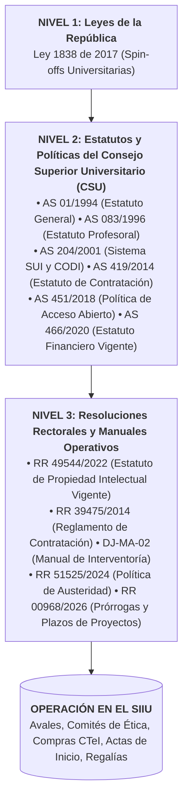
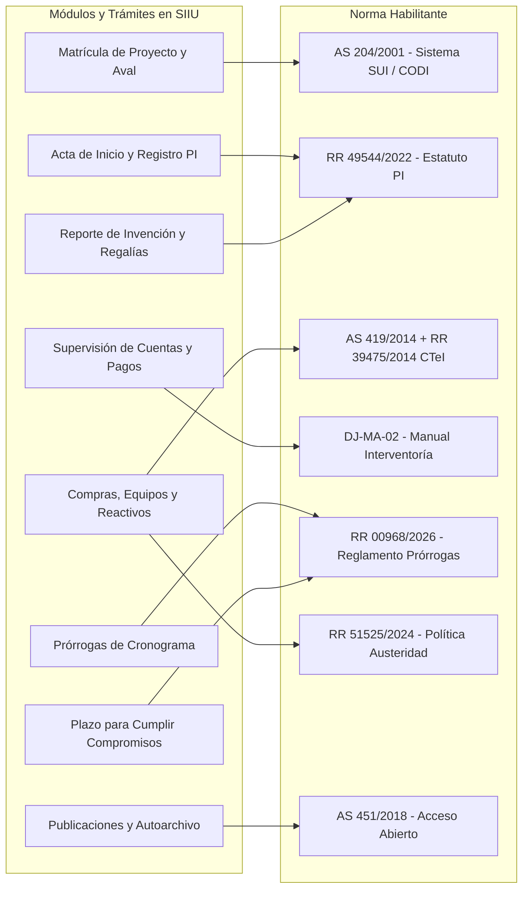

# MOC: Marco Normativo e Institucional de la Investigación

| Metadato | Detalle Institucional |
| :--- | :--- |
| **Código MOC** | `MOC-05-LEGALIDAD` |
| **Entidad Regulada** | Vicerrectoría de Investigación — Universidad de Antioquia |
| **Alcance** | Régimen Jurídico, Estatutario y Reglamentario del Ecosistema de Investigación |
| **Documentos Consolidados** | **21 Disposiciones Normativas Fundamentales** (Leyes, Estatutos CSU, Resoluciones Rectorales) |
| **Herramienta Integrada** | **Sistema de Información para la Investigación Universitaria (SIIU)** |

---

## 1. Arquitectura de Jerarquía Jurídica Institucional

Toda actuación técnica, presupuestal, administrativa o contractual adelantada en el **SIIU** por investigadores, evaluadores, centros o vicerrectorías se fundamenta en la siguiente jerarquía piramidal:

---

## 2. Catálogo Maestro de las 21 Normas Reguladoras

A continuación se relacionan los 21 actos normativos compilados, con acceso directo a sus **Fichas Didácticas Wiki** y a sus **Transcripciones Fidedignas Íntegras** en el Archivo Maestro:

| # | Norma Oficial | Materia / Descripción Operativa | Estado Jurídico | Ficha Wiki Didáctica | Archivo Fidedigno |
| :-: | :--- | :--- | :---: | :--- | :--- |
| **1** | **Ley 1838 de 2017** | Fomento a empresas de base tecnológica (Spin-offs) en IES públicas | **Vigente** | [Ficha Wiki](../05_MARCO_NORMATIVO/Ley_1838_2017_Spinoffs.md) | [LEG-LEY-1838-2017](../archivo_maestro/legalidad/LEG-LEY-1838-2017.md) |
| **2** | **Acuerdo Superior 01 de 1994** | Estatuto General de la UdeA (Misión, gobierno, autonomía, estructura) | **Vigente** | [Ficha Wiki](../05_MARCO_NORMATIVO/AS_01_1994_Estatuto_General.md) | [LEG-AS-01-1994](../archivo_maestro/legalidad/LEG-AS-01-1994.md) |
| **3** | **Acuerdo Superior 083 de 1996** | Estatuto Profesoral (Dedicación a I+D, derechos, estímulos, deberes) | **Vigente** | [Ficha Wiki](../05_MARCO_NORMATIVO/AS_083_1996_Estatuto_Profesoral.md) | [LEG-AS-083-1996](../archivo_maestro/legalidad/LEG-AS-083-1996.md) |
| **4** | **Acuerdo Superior 086 de 1996** | Participación remunerada de docentes de cátedra en proyectos I+D | **Vigente** | [Ficha Wiki](../05_MARCO_NORMATIVO/AS_086_1996_Profesores_Catedra_Proyectos.md) | [LEG-AS-086-1996](../archivo_maestro/legalidad/LEG-AS-086-1996.md) |
| **5** | **Acuerdo Superior 121 de 1997** | Estatuto Presupuestal antecedente (Estructura histórica del gasto) | *Histórico* | [Ficha Wiki](../05_MARCO_NORMATIVO/AS_121_1997_Estatuto_Presupuestal.md) | [LEG-AS-121-1997](../archivo_maestro/legalidad/LEG-AS-121-1997.md) |
| **6** | **Acuerdo Superior 124 de 1997** | Estatuto Básico de Extensión (Consultorías científicas y servicios) | **Vigente** | [Ficha Wiki](../05_MARCO_NORMATIVO/AS_124_1997_Estatuto_Extension.md) | [LEG-AS-124-1997](../archivo_maestro/legalidad/LEG-AS-124-1997.md) |
| **7** | **Acuerdo Superior 204 de 2001** | Sistema Universitario de Investigación (SUI) y funciones del CODI | **Vigente** | [Ficha Wiki](../05_MARCO_NORMATIVO/AS_204_2001_Sistema_Universitario_Investigacion.md) | [LEG-AS-204-2001](../archivo_maestro/legalidad/LEG-AS-204-2001.md) |
| **8** | **Acuerdo Superior 253 de 2003** | Estatuto del Profesor de Cátedra y Ocasional (Vinculación a proyectos) | **Vigente** | [Ficha Wiki](../05_MARCO_NORMATIVO/AS_253_2003_Docentes_Catedra_Ocasionales.md) | [LEG-AS-253-2003](../archivo_maestro/legalidad/LEG-AS-253-2003.md) |
| **9** | **Acuerdo Superior 284 de 2004** | Programa de Gestión Tecnológica y Transferencia de Resultados | **Vigente** | [Ficha Wiki](../05_MARCO_NORMATIVO/AS_284_2004_Gestion_Tecnologica.md) | [LEG-AS-284-2004](../archivo_maestro/legalidad/LEG-AS-284-2004.md) |
| **10** | **Acuerdo Superior 350 de 2007** | Estatuto Financiero anterior (Derogado por AS 466 de 2020) | *Histórico* | [Ficha Wiki](../05_MARCO_NORMATIVO/AS_350_2007_Estatuto_Financiero.md) | [LEG-AS-350-2007](../archivo_maestro/legalidad/LEG-AS-350-2007.md) |
| **11** | **Acuerdo Superior 418 de 2014** | Política Integral de Prácticas Académicas (Pasantías en I+D) | **Vigente** | [Ficha Wiki](../05_MARCO_NORMATIVO/AS_418_2014_Politica_Practicas.md) | [LEG-AS-418-2014](../archivo_maestro/legalidad/LEG-AS-418-2014.md) |
| **12** | **Acuerdo Superior 419 de 2014** | Estatuto General de Contratación (Régimen de derecho privado en CTeI) | **Vigente** | [Ficha Wiki](../05_MARCO_NORMATIVO/AS_419_2014_Estatuto_Contratacion.md) | [LEG-AS-419-2014](../archivo_maestro/legalidad/LEG-AS-419-2014.md) |
| **13** | **Acuerdo Superior 451 de 2018** | Política de Acceso Abierto a la Producción Académica e Investigativa | **Vigente** | [Ficha Wiki](../05_MARCO_NORMATIVO/AS_451_2018_Politica_Acceso_Abierto.md) | [LEG-AS-451-2018](../archivo_maestro/legalidad/LEG-AS-451-2018.md) |
| **14** | **Acuerdo Superior 466 de 2020** | **Estatuto Financiero Vigente** (Centros de costo, rubros y tesorería) | **Vigente** | [Ficha Wiki](../05_MARCO_NORMATIVO/AS_466_2020_Estatuto_Financiero_Vigente.md) | [LEG-AS-466-2020](../archivo_maestro/legalidad/LEG-AS-466-2020.md) |
| **15** | **Manual DJ-MA-02** | Manual de Interventoría de Bienes, Servicios y Obras | **Vigente** | [Ficha Wiki](../05_MARCO_NORMATIVO/DJ_MA_02_Manual_Interventoria.md) | [LEG-DJ-MA-02](../archivo_maestro/legalidad/LEG-DJ-MA-02.md) |
| **16** | **Resolución Rectoral 21231 de 2005** | Estatuto de PI anterior (Derogado por RR 49544 de 2022) | *Derogado* | [Ficha Wiki](../05_MARCO_NORMATIVO/RR_21231_2005_Estatuto_Propiedad_Intelectual.md) | [LEG-RR-21231-2005](../archivo_maestro/legalidad/LEG-RR-21231-2005.md) |
| **17** | **Resolución Rectoral 39475 de 2014** | Reglamento del Estatuto Contractual (Contratación directa CTeI Art. 44) | **Vigente** | [Ficha Wiki](../05_MARCO_NORMATIVO/RR_39475_2014_Reglamento_Contratacion.md) | [LEG-RR-39475-2014](../archivo_maestro/legalidad/LEG-RR-39475-2014.md) |
| **18** | **Resolución Rectoral 39477 de 2014** | Referente Ético Institucional (Bioética, honestidad científica, valores) | **Vigente** | [Ficha Wiki](../05_MARCO_NORMATIVO/RR_39477_2014_Referente_Etico.md) | [LEG-RR-39477-2014](../archivo_maestro/legalidad/LEG-RR-39477-2014.md) |
| **19** | **Resolución Rectoral 49544 de 2022** | **Estatuto de Propiedad Intelectual Vigente** (Acta SIIU, 33% regalías) | **Vigente** | [Ficha Wiki](../05_MARCO_NORMATIVO/RR_49544_2022_Nuevo_Estatuto_PI.md) | [LEG-RR-49544-2022](../archivo_maestro/legalidad/LEG-RR-49544-2022.md) |
| **20** | **Resolución Rectoral 51525 de 2024** | Política de Austeridad y Gasto (Viajes, compras, software e insumos) | **Vigente** | [Ficha Wiki](../05_MARCO_NORMATIVO/RR_51525_2024_Ajustes_SIIU.md) | [LEG-RR-51525-2024](../archivo_maestro/legalidad/LEG-RR-51525-2024.md) |
| **21** | **Resolución Rectoral 00968 de 2026** | **Reglamento de Prórrogas y Plazos** en Proyectos de Investigación | **Vigente** | [Ficha Wiki](../05_MARCO_NORMATIVO/RR_00968_2026_Modernizacion.md) | [LEG-RR-00968-2026](../archivo_maestro/legalidad/LEG-RR-00968-2026.md) |

---

## 3. Matriz Temática de Concordancia Normativa $\leftrightarrow$ Trámites en el SIIU

A continuación se detalla qué norma habilita, regula o restringe cada paso del ciclo operativo de un proyecto de investigación en el SIIU:

### Tabla de Concordancias Específicas:

| Trámite / Acción en el SIIU | Norma Aplicable | Artículo(s) Clave | Regla Operativa Institucional |
| :--- | :--- | :--- | :--- |
| **Inscripción y Aval de Propuesta** | [AS 204 de 2001](../05_MARCO_NORMATIVO/AS_204_2001_Sistema_Universitario_Investigacion.md) | Arts. 10 y 12 | Requiere aval técnico del Centro y aprobación del Consejo de Facultad para horas en plan de trabajo. |
| **Acta de Registro de PI** | [RR 49544 de 2022](../05_MARCO_NORMATIVO/RR_49544_2022_Nuevo_Estatuto_PI.md) | Art. 64 | El registro del proyecto en el SIIU cumple formalmente los 15 requisitos del Acta de PI y TRL. |
| **Compra de Reactivos e Insumos** | [RR 39475 de 2014](../05_MARCO_NORMATIVO/RR_39475_2014_Reglamento_Contratacion.md) y [RR 51525 de 2024](../05_MARCO_NORMATIVO/RR_51525_2024_Ajustes_SIIU.md) | Art. 44 (RR 39475) y Art. 14 (RR 51525) | Contratación directa bajo régimen de CTeI sin pliegos ordinarios. Solicitud justificada según ensayos. |
| **Adquisición de Software Científico** | [RR 51525 de 2024](../05_MARCO_NORMATIVO/RR_51525_2024_Ajustes_SIIU.md) | Art. 15 Parágrafo | Proyectos de I+D con recursos externos no requieren visto bueno de Informática; solo notificación. |
| **Interventoría y Pago de Contratos** | [Manual DJ-MA-02](../05_MARCO_NORMATIVO/DJ_MA_02_Manual_Interventoria.md) | Numerales 4, 5 y 6 | Verificación previa obligatoria de aportes PILA (Salud, Pensión, ARL) antes de aprobar informe y factura. |
| **Solicitud de Prórroga de Ejecución** | [RR 00968 de 2026](../05_MARCO_NORMATIVO/RR_00968_2026_Modernizacion.md) | Arts. 4, 6 y 7 | Radicar en SIIU mínimo 2 meses antes del vencimiento. Máximo 50% del plazo original (excepcional 100%). |
| **Plazo para Artículos o Patentes** | [RR 00968 de 2026](../05_MARCO_NORMATIVO/RR_00968_2026_Modernizacion.md) | Art. 12 | Hasta 1 año (máximo 2 años). No reabre presupuesto. Para compromisos pendientes por evaluación de terceros. |
| **Protección de Patente y Spin-off** | [RR 49544 de 2022](../05_MARCO_NORMATIVO/RR_49544_2022_Nuevo_Estatuto_PI.md) y [Ley 1838 de 2017](../05_MARCO_NORMATIVO/Ley_1838_2017_Spinoffs.md) | Art. 98 y 113 (RR 49544) | Concepto vinculante del Comité de PI. Distribución del 33% de regalías brutas para investigadores. |
| **Depósito de Artículos y Tesis** | [AS 451 de 2018](../05_MARCO_NORMATIVO/AS_451_2018_Politica_Acceso_Abierto.md) | Arts. 5, 6 y 7 | Autoarchivo obligatorio en el Repositorio Institucional UdeA en acceso abierto, respetando embargos editoriales. |

---

## 4. Navegación Transversal de la Wiki

- :material-home: **Volver al Portal Principal:** [HOME](HOME.md)
- :material-account-group: **MOC por Perfiles y Roles:** [MOC_Por_Roles](MOC_Por_Roles.md)
- :material-refresh: **MOC Ciclo de Vida del Proyecto:** [MOC_Ciclo_de_Vida_Proyectos](MOC_Ciclo_de_Vida_Proyectos.md)
- :material-clipboard-list: **MOC de Trámites y Modificaciones:** [MOC_Tramites_y_Solicitudes](MOC_Tramites_y_Solicitudes.md)
- :material-chart-bar: **MOC de Certificaciones y Reportes:** [MOC_Reportes_y_Constancias](MOC_Reportes_y_Constancias.md)
- :material-book-open: **Glosario Oficial del SIIU:** [Glosario_Terminos_SIIU](../04_GLOSARIO_Y_CONCEPTOS/Glosario_Terminos_SIIU.md)
