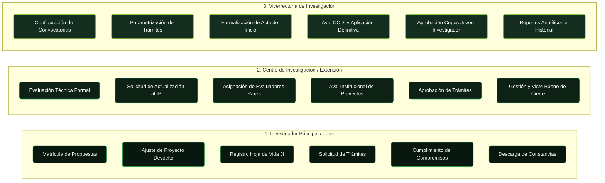

# Mapa de Contenido (MOC): Navegación por Roles

En el **Sistema SIIU**, las acciones y permisos están segmentados según la responsabilidad administrativa y académica del usuario. Utiliza este mapa para localizar los procedimientos y guías pertinentes a tu perfil:

---

## 1. Investigador Principal / Tutor
*Responsable de formular proyectos, ejecutar presupuesto, coordinar talento y rendir cuentas académicas.*

| Operación | Guía / Instructivo Base | Procedimiento Sintetizado |
| :--- | :---: | :--- |
| **Inscripción en Convocatoria Interna** | [VI-GU-24](../../archivo_maestro/VI-GU-24.md) | [Matricula Proyectos](../02_PROCESOS_CLAVE/Matricula_Proyectos.md#convocatoria-interna) |
| **Matrícula de Primer Proyecto** | [VI-GU-17](../../archivo_maestro/VI-GU-17.md) | [Matricula Proyectos](../02_PROCESOS_CLAVE/Matricula_Proyectos.md#primer-proyecto) |
| **Matrícula de Proyecto Inscrito (Financiación Externa)** | [VI-GU-18](../../archivo_maestro/VI-GU-18.md) | [Matricula Proyectos](../02_PROCESOS_CLAVE/Matricula_Proyectos.md#proyectos-inscritos) |
| **Uso del Editor de Texto (CKEditor)** | [VI-GU-25](../../archivo_maestro/VI-GU-25.md) | [Matricula Proyectos](../02_PROCESOS_CLAVE/Matricula_Proyectos.md#editor-ckeditor) |
| **Actualizar Proyecto Devuelto por el Centro** | [VI-IN-05](../../archivo_maestro/VI-IN-05.md) | [Evaluacion y Aval](../02_PROCESOS_CLAVE/Evaluacion_y_Aval.md#subsanacion-y-ajustes-de-proyectos-devueltos) |
| **Diligenciar Información Complementaria (ODS / Sabios / G8)** | [VI-GU-16](../../archivo_maestro/VI-GU-16.md) | [Matricula Proyectos](../02_PROCESOS_CLAVE/Matricula_Proyectos.md#informacion-complementaria) |
| **Matrícula de Cupo Joven Investigador** | [VI-GU-10](../../archivo_maestro/VI-GU-10.md) | [Programa Joven Investigador](../02_PROCESOS_CLAVE/Programa_Joven_Investigador.md#matricula-de-cupos) |
| **Registro de Estudiante / Hoja de Vida JI** | [VI-IN-06](../../archivo_maestro/VI-IN-06.md) | [Programa Joven Investigador](../02_PROCESOS_CLAVE/Programa_Joven_Investigador.md#hoja-de-vida-estudiante) |
| **Prórroga de Cupo Joven Investigador** | [VI-GU-11](../../archivo_maestro/VI-GU-11.md) | [Programa Joven Investigador](../02_PROCESOS_CLAVE/Programa_Joven_Investigador.md#prorroga-de-cupos) |
| **Solicitud de Prórroga del Proyecto (Inicio o Ejecución)** | [VI-GU-23](../../archivo_maestro/VI-GU-23.md) | [Modificaciones y Tramites](../02_PROCESOS_CLAVE/Modificaciones_y_Tramites.md#prorroga-de-proyecto) |
| **Solicitud de Modificación Presupuestal / Cambio de Rubro** | [VI-GU-20](../../archivo_maestro/VI-GU-20.md) | [Modificaciones y Tramites](../02_PROCESOS_CLAVE/Modificaciones_y_Tramites.md#cambio-de-rubro) |
| **Solicitud de Cambio o Inclusión de Participantes** | [VI-GU-19](../../archivo_maestro/VI-GU-19.md) | [Modificaciones y Tramites](../02_PROCESOS_CLAVE/Modificaciones_y_Tramites.md#cambio-de-participante) |
| **Solicitud de Plazo para Entrega de Compromisos** | [VI-GU-22](../../archivo_maestro/VI-GU-22.md) | [Gestion Compromisos](../02_PROCESOS_CLAVE/Gestion_Compromisos.md#solicitud-de-plazo) |
| **Entrega y Subida de Compromisos Académicos** | [VI-GU-09](../../archivo_maestro/VI-GU-09.md) | [Gestion Compromisos](../02_PROCESOS_CLAVE/Gestion_Compromisos.md#entrega-de-compromisos) |
| **Generar Constancia Personal de Participación** | [VI-IN-07](../../archivo_maestro/VI-IN-07.md) | [Reportes y Certificaciones](../02_PROCESOS_CLAVE/Reportes_y_Certificaciones.md#constancias-de-participacion) |
| **Generar Constancia como Evaluador** | [VI-IN-08](../../archivo_maestro/VI-IN-08.md) | [Reportes y Certificaciones](../02_PROCESOS_CLAVE/Reportes_y_Certificaciones.md#constancias-evaluador) |
| **Consulta Histórica Personal de Proyectos** | [VI-IN-11](../../archivo_maestro/VI-IN-11.md) | [Reportes y Certificaciones](../02_PROCESOS_CLAVE/Reportes_y_Certificaciones.md#reporte-por-persona) |

Consulta la **[Guía Detallada del Investigador](../01_ROLES/Rol_Investigador.md)** y la **[Ficha Rápida](../03_GUIAS_RAPIDAS_CHEAT_SHEETS/CheatSheet_Investigador.md)**.

---

## 2. Centro de Investigación / Extensión
*Unidad académico-administrativa de Facultad, Escuela o Instituto que valida la viabilidad técnica, avala y supervisa los proyectos.*

| Operación | Guía / Instructivo Base | Procedimiento Sintetizado |
| :--- | :---: | :--- |
| **Evaluación Técnica Formal y Aval del Proyecto** | [VI-GU-08](../../archivo_maestro/VI-GU-08.md) | [Evaluacion y Aval](../02_PROCESOS_CLAVE/Evaluacion_y_Aval.md#evaluacion-tecnica-de-centro) |
| **Solicitar Actualización / Devolución de Proyecto al IP** | [VI-IN-12](../../archivo_maestro/VI-IN-12.md) | [Evaluacion y Aval](../02_PROCESOS_CLAVE/Evaluacion_y_Aval.md#devolucion-para-ajustes) |
| **Asignación de Evaluadores Pares Internos / Externos** | [VI-GU-06](../../archivo_maestro/VI-GU-06.md) | [Evaluacion y Aval](../02_PROCESOS_CLAVE/Evaluacion_y_Aval.md#asignacion-evaluadores) |
| **Aprobación de Solicitudes y Trámites Administrativos** | [VI-GU-12](../../archivo_maestro/VI-GU-12.md) | [Modificaciones y Tramites](../02_PROCESOS_CLAVE/Modificaciones_y_Tramites.md#aprobacion-en-centro) |
| **Revisión y Aprobación de Compromisos Entregados** | [VI-GU-09](../../archivo_maestro/VI-GU-09.md) | [Gestion Compromisos](../02_PROCESOS_CLAVE/Gestion_Compromisos.md#revision-en-centro) |
| **Cierre Formal del Proyecto (Técnico y Administrativo)** | [VI-GU-04](../../archivo_maestro/VI-GU-04.md) | [Cierre y Liquidacion](../02_PROCESOS_CLAVE/Cierre_y_Liquidacion.md#cierre-en-centro) |
| **Generar Constancias de Proyectos por Grupo de Investigación**| [VI-IN-01](../../archivo_maestro/VI-IN-01.md) | [Reportes y Certificaciones](../02_PROCESOS_CLAVE/Reportes_y_Certificaciones.md#constancias-por-grupo) |
| **Consulta de Reporte Historial de Proyectos** | [VI-IN-02](../../archivo_maestro/VI-IN-02.md) / [VI-IN-10](../../archivo_maestro/VI-IN-10.md) | [Reportes y Certificaciones](../02_PROCESOS_CLAVE/Reportes_y_Certificaciones.md#reporte-historial) |
| **Reporte de Información Básica de Proyectos** | [VI-IN-09](../../archivo_maestro/VI-IN-09.md) | [Reportes y Certificaciones](../02_PROCESOS_CLAVE/Reportes_y_Certificaciones.md#informacion-basica) |

Consulta la **[Guía Detallada del Centro](../01_ROLES/Rol_Centro_Investigacion.md)** y la **[Ficha Rápida](../03_GUIAS_RAPIDAS_CHEAT_SHEETS/CheatSheet_Centro.md)**.

---

## 3. Vicerrectoría de Investigación / Administrador Central
*Instancia central de gobierno institucional que parametriza el sistema, define convocatorias, avala ante CODI y ejecuta liquidaciones.*

| Operación | Guía / Instructivo Base | Procedimiento Sintetizado |
| :--- | :---: | :--- |
| **Configuración de Convocatorias del SIIU** | [VI-GU-07](../../archivo_maestro/VI-GU-07.md) | [Evaluacion y Aval](../02_PROCESOS_CLAVE/Evaluacion_y_Aval.md#configuracion-convocatorias) |
| **Configuración de Trámites y Flujos Administrativos** | [VI-GU-14](../../archivo_maestro/VI-GU-14.md) | [Modificaciones y Tramites](../02_PROCESOS_CLAVE/Modificaciones_y_Tramites.md#configuracion-flujos) |
| **Cambio de Responsable de Proyecto** | [VI-GU-01](../../archivo_maestro/VI-GU-01.md) | [Modificaciones y Tramites](../02_PROCESOS_CLAVE/Modificaciones_y_Tramites.md#cambio-de-responsable) |
| **Inicio Formal de Proyectos en el SIIU** | [VI-GU-15](../../archivo_maestro/VI-GU-15.md) | [Inicio Formal](../02_PROCESOS_CLAVE/Inicio_Formal.md#inicio-en-vicerrectoria) |
| **Avalar y Aplicar Solicitudes Administrativas (Instancias / CODI)** | [VI-GU-13](../../archivo_maestro/VI-GU-13.md) | [Modificaciones y Tramites](../02_PROCESOS_CLAVE/Modificaciones_y_Tramites.md#aplicacion-en-vicerrectoria) |
| **Cierre y Liquidación Institucional del Proyecto** | [VI-GU-04](../../archivo_maestro/VI-GU-04.md) | [Cierre y Liquidacion](../02_PROCESOS_CLAVE/Cierre_y_Liquidacion.md#liquidacion-en-vicerrectoria) |
| **Generación de Reportes Consolidados del Sistema** | [VI-IN-09](../../archivo_maestro/VI-IN-09.md) / [VI-IN-10](../../archivo_maestro/VI-IN-10.md) | [Reportes y Certificaciones](../02_PROCESOS_CLAVE/Reportes_y_Certificaciones.md#reportes-analiticos) |

Consulta la **[Guía Detallada de la Vicerrectoría](../01_ROLES/Rol_Vicerrectoria.md)**.
