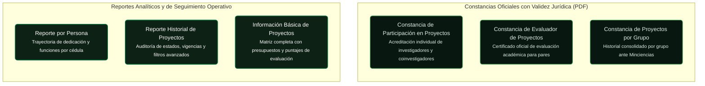

# Mapa de Contenido (MOC): Reportes, Consultas y Constancias

El **Sistema SIIU** ofrece dos grandes tipos de salidas documentales:
1. **Constancias Oficiales en PDF:** Documentos con validez institucional para acreditar participación de personas, de grupos o labores de evaluación de pares.
2. **Reportes Analíticos y de Gestión (Excel / HTML / PDF):** Consultas gerenciales para el seguimiento de la ejecución académica y financiera por convocatoria, centro o facultad.

---

## 1. Constancias Oficiales (Descarga en PDF)

Estas constancias se generan directamente desde el menú principal del sistema y cuentan con el encabezado y pie oficial de la Vicerrectoría de Investigación.

| Tipo de Constancia | ¿Quién la genera? | Parámetros Requeridos | Instructivo Oficial | Procedimiento |
| :--- | :--- | :--- | :---: | :--- |
| **Constancia de Participación en Proyectos** | Investigador / Centro | Cédula del participante, rango de fechas (opcional para histórico completo), tipo de proyecto. | [VI-IN-07](../archivo_maestro/VI-IN-07.md) | [Reportes y Certificaciones](../02_PROCESOS_CLAVE/Reportes_y_Certificaciones.md#constancias-de-participacion) |
| **Constancia de Evaluador de Proyectos** | Investigador / Centro | Cédula del evaluador, tratamiento de cortesía (Profesor, Dr., etc.), rango de fechas de evaluación. | [VI-IN-08](../archivo_maestro/VI-IN-08.md) | [Reportes y Certificaciones](../02_PROCESOS_CLAVE/Reportes_y_Certificaciones.md#constancias-evaluador) |
| **Constancias de Proyectos por Grupo** | Centro / Vicerrectoría | Selección de Unidad Académica, Centro de Investigación, Grupo de Investigación y estado del proyecto. | [VI-IN-01](../archivo_maestro/VI-IN-01.md) | [Reportes y Certificaciones](../02_PROCESOS_CLAVE/Reportes_y_Certificaciones.md#constancias-por-grupo) |

---

## 2. Reportes Analíticos y de Seguimiento

Herramientas para auditar la cartera de proyectos, verificar estados, vigencias y puntajes de evaluación.

| Nombre del Reporte | ¿Quién tiene acceso? | Qué información entrega | Exportación | Instructivo Oficial | Procedimiento |
| :--- | :--- | :--- | :---: | :---: | :--- |
| **Reporte por Persona** | Investigador *(solo sus proyectos)*, Centro y Vicerrectoría *(todos)* | Código SIIU, nombre de proyecto, grupo, institución, rol, dedicación semanal, función, fechas de vinculación/retiro y ficha técnica HTML del proyecto. | PDF / HTML | [VI-IN-11](../archivo_maestro/VI-IN-11.md) | [Reportes y Certificaciones](../02_PROCESOS_CLAVE/Reportes_y_Certificaciones.md#reporte-por-persona) |
| **Reporte Historial de Proyectos** | Investigador, Centro y Vicerrectoría | Filtros por código, palabras clave, estado, año/mes de finalización, convocatoria o proceso de selección. | Pantalla / Excel | [VI-IN-02](../archivo_maestro/VI-IN-02.md) / [VI-IN-10](../archivo_maestro/VI-IN-10.md) | [Reportes y Certificaciones](../02_PROCESOS_CLAVE/Reportes_y_Certificaciones.md#reporte-historial) |
| **Información Básica de Proyectos** | Centro y Vicerrectoría | Matriz completa de datos: año, modalidad/línea temática, centro, estado, IP, vinculación docente, unidad académica, grupo, montos solicitados/totales y puntajes de evaluadores 1, 2, 3 y promedio. | Excel / PDF / HTML | [VI-IN-09](../archivo_maestro/VI-IN-09.md) | [Reportes y Certificaciones](../02_PROCESOS_CLAVE/Reportes_y_Certificaciones.md#informacion-basica) |

---

!!! tip "RECOMENDACIÓN DE RENDIMIENTO EN REPORTES"
    Al consultar en el SIIU, **evite seleccionar la opción "TODOS"** en todos los filtros de búsqueda simultáneamente. Esto genera consultas muy pesadas a la base de datos y puede ocasionar lentitud o bloqueo de sesión. Delimite siempre por año, centro o estado.
