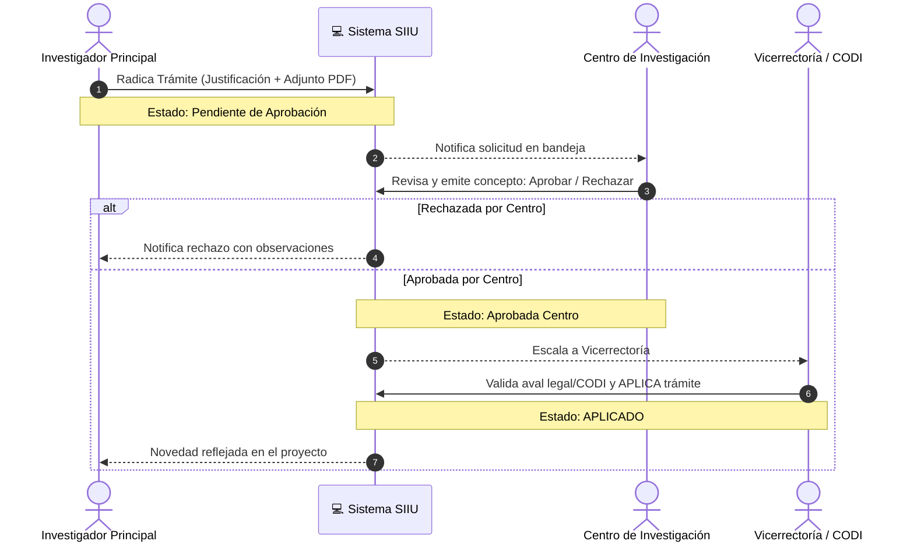

# Mapa de Contenido (MOC): Trámites y Modificaciones Administrativas

Durante la vida de un proyecto en el SIIU surgen eventualidades que exigen modificaciones contractuales, operativas o presupuestales. El sistema gestiona estas solicitudes mediante flujos parametrizables de aprobación entre el **Investigador Principal**, el **Centro de Investigación** y la **Vicerrectoría**.

---

## Matriz Comparativa: Solicitud vs Novedad

Una de las distinciones operativas más críticas en el SIIU es la fuente de financiación:

| Criterio | Solicitud Administrativa | Novedad Administrativa |
| :--- | :--- | :--- |
| **Tipo de Proyecto** | Proyectos de Convocatoria Interna (recursos UdeA, CODI, BUP, etc.). | Proyectos Inscritos con Financiación Externa (Minciencias, Regalías, Cooperación Internacional). |
| **Flujo de Decisión** | El Centro aprueba y la Vicerrectoría (o CODI) avala y aplica de fondo. | El Investigador o Centro anexa la carta/acta del financiador externo que autoriza el cambio; la UdeA valida y aplica el registro. |
| **Menú en SIIU** | `Trámites administrativos >> Nueva solicitud o Novedad >> Solicitud` | `Trámites administrativos >> Nueva solicitud o Novedad >> Novedad` |

---

## Catálogo de Trámites Disponibles

### 1. Prórrogas de Tiempo del Proyecto
- **Prórroga de Inicio:** Se solicita cuando el proyecto está en estado **Aprobado** pero no se han podido suscribir contratos o pólizas dentro del término reglamentario.
- **Prórroga de Ejecución:** Se solicita cuando el proyecto está en estado **En ejecución** para extender el plazo de finalización y entrega de productos.
- 📘 Guía oficial: [VI-GU-23](../archivo_maestro/VI-GU-23.md) | Síntesis: [Modificaciones y Tramites](../02_PROCESOS_CLAVE/Modificaciones_y_Tramites.md#prorroga-de-proyecto)

### 2. 💰 Cambio de Rubro / Modificación Presupuestal
- Permite traslados entre rubros aprobados o la creación de subrubros dentro de rubros habilitados.
- **Condición Estricta:** El proyecto debe estar **En ejecución**. No es posible trasladar saldo desde un rubro padre cuyo saldo disponible sea \$0.
- 📘 Guía oficial: [VI-GU-20](../archivo_maestro/VI-GU-20.md) | Síntesis: [Modificaciones y Tramites](../02_PROCESOS_CLAVE/Modificaciones_y_Tramites.md#cambio-de-rubro)

### 3. Cambio o Inclusión de Participantes
- Modificación del equipo humano (investigadores principales, coinvestigadores, asesores, personal técnico).
- Requiere justificación, indicación de dedicación horaria semanal y soportes académicos.
- 📘 Guía oficial: [VI-GU-19](../archivo_maestro/VI-GU-19.md) | Síntesis: [Modificaciones y Tramites](../02_PROCESOS_CLAVE/Modificaciones_y_Tramites.md#cambio-de-participante)

### 4. Cambio del Responsable del Proyecto
- Relevo institucional del Investigador Principal ante la Universidad por razones de fuerza mayor, comisión académica, renuncia o retiro.
- 📘 Guía oficial: [VI-GU-01](../archivo_maestro/VI-GU-01.md) | Síntesis: [Modificaciones y Tramites](../02_PROCESOS_CLAVE/Modificaciones_y_Tramites.md#cambio-de-responsable)

### 5. Solicitud de Plazo en Entrega de Compromisos
- Aplica para prórrogas específicas asociadas a un compromiso académico particular (informe de avance, informe final, artículo sometido) sin necesariamente extender el tiempo contractual general.
- 📘 Guía oficial: [VI-GU-22](../archivo_maestro/VI-GU-22.md) | Síntesis: [Gestion Compromisos](../02_PROCESOS_CLAVE/Gestion_Compromisos.md#solicitud-de-plazo)

---

## Flujos de Gestión Administrativa en el Sistema

| Rol | Acción | Guía de Referencia | Procedimiento |
| :--- | :--- | :---: | :--- |
| **Centro** | Aprobar solicitudes radicadas por los investigadores | [VI-GU-12](../archivo_maestro/VI-GU-12.md) | [Modificaciones y Tramites](../02_PROCESOS_CLAVE/Modificaciones_y_Tramites.md#aprobacion-en-centro) |
| **Vicerrectoría** | Avalar ante instancias institucionales y APLICAR en el sistema | [VI-GU-13](../archivo_maestro/VI-GU-13.md) | [Modificaciones y Tramites](../02_PROCESOS_CLAVE/Modificaciones_y_Tramites.md#aplicacion-en-vicerrectoria) |
| **Vicerrectoría** | Configurar y parametrizar los tipos de trámites y sus rutas de aprobación | [VI-GU-14](../archivo_maestro/VI-GU-14.md) | [Modificaciones y Tramites](../02_PROCESOS_CLAVE/Modificaciones_y_Tramites.md#configuracion-flujos) |

Consulta la sección integral: **[Modificaciones y Tramites](../02_PROCESOS_CLAVE/Modificaciones_y_Tramites.md)**.
