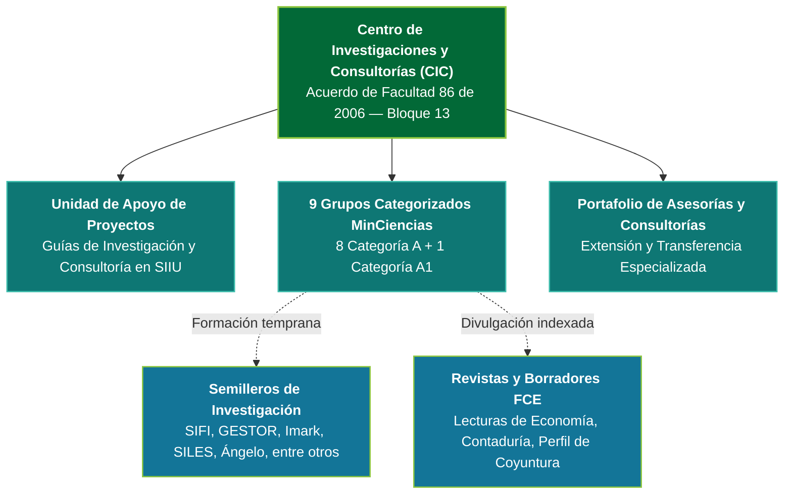

---
search:
  boost: 2.0
---

# Caso Aplicado de Unidad Académica: Centro de Investigaciones y Consultorías (CIC – FCE)

Para ilustrar cómo opera en la práctica un Centro de Investigación dentro del ecosistema **SIIU** y bajo el marco del **Acuerdo Superior 204 de 2001**, se presenta el modelo operativo del **Centro de Investigaciones y Consultorías (CIC)** de la **Facultad de Ciencias Económicas (FCE)** de la Universidad de Antioquia.

---

## 1. Arquitectura y Evolución del Centro (CIC)

El **CIC** fue creado a finales de 2006 mediante el **Acuerdo de Facultad 86 de 2006**, integrando académica y administrativamente tres dependencias históricas de la Facultad:
1. **Centro de Investigaciones Económicas (CIE)** (fundado en 1962).
2. **Consultorio Contable** (agosto de 1983).
3. **Centro de Investigaciones y Consultorías Administrativas (CICA)** (1983).

### Unidad de Apoyo de Proyectos y Articulación con el SIIU
A través de su **Unidad de Proyectos**, el CIC acompaña a los profesores de la Facultad en la formulación, ejecución y cierre de propuestas en el SIIU, disponiendo de dos protocolos diferenciados según la naturaleza misional de la iniciativa:
- [:material-file-pdf-box: Guía de Investigación CIC](https://www.udea.edu.co/wps/wcm/connect/udea/e9ee9d70-5409-4611-94a7-4691d1c9a99e/guia-investigacion.pdf?MOD=AJPERES&CVID=lQufRjO) — Para propuestas de investigación científica, convocatorias CODI y proyectos sin financiación.
- [:material-file-pdf-box: Guía de Consultoría CIC](https://www.udea.edu.co/wps/wcm/connect/udea/56c32b22-108c-46d6-8020-69cd0012fd3b/guia-consultoria.pdf?MOD=AJPERES&CVID=lQufJnZ) — Para contratos de asesoría, extensión especializada y transferencia tecnológica o empresarial.

---

## 2. Matriz de Grupos de Investigación y Semilleros Articulados

El CIC coordina administrativamente **nueve (9) grupos de investigación activos**, todos categorizados en los niveles **A** y **A1** de MinCiencias, cada uno con semilleros asociados que nutren el programa de **Jóvenes Investigadores**:

| Sigla | Nombre Oficial del Grupo | Departamento Adscrito | Categoría MinCiencias | Fundación | Coordinador(a) | Semilleros Asociados |
| :--- | :--- | :--- | :---: | :---: | :--- | :--- |
| **GES** | Grupo Economía de la Salud | Economía | **A1** | 1997 | Jairo Humberto Restrepo Zea | Semillero de Economía de la Salud |
| **MACROECONOMIA** | Grupo de Macroeconomía Aplicada | Economía | **A** | 1984 | Wilman Arturo Gómez Muñoz | Semilleros Ángelo, Economía Clásica y Computacional |
| **GER** | Grupo de Estudios Regionales | Economía | **A** | 1995 | Liliana Gallego Duque | Semillero de Estudios Regionales |
| **MICROECONOMIA** | Grupo de Microeconomía Aplicada | Economía | **A** | 1999 | Carlos Andrés Vasco Correa | Semillero de Microeconomía Aplicada |
| **GESTOR** | Grupo de Investigación en Gestión Organizacional | Ciencias Administrativas | **A** | 2001 | José Enrique Arias Pérez | Semillero GESTOR |
| **COMPHOR** | Comportamiento Humano Organizacional | Ciencias Administrativas | **A** | 2002 | Héctor L. Bermúdez Restrepo | Semillero Gestión de lo Propio |
| **GICCO** | Grupo de Investigaciones y Consultorías Contables | Ciencias Contables | **A** | 2004 | Hernán Carlos Bustamante García | Semilleros Financiero, SILES e Innovación FCE |
| **IMARK** | Grupo de Investigación en Marketing | Ciencias Administrativas | **A** | 2008 | Beatriz Londoño Giraldo | Semillero Imark |
| **GIFI** | Grupo de Investigación en Finanzas | Ciencias Administrativas | **A** | 2013 | Claudia Inés Sepúlveda Rivillas | Semillero SIFI (Finanzas) |

---

## 3. Ecosistema Editorial y Cumplimiento de Compromisos

Para facilitar el cumplimiento de los compromisos académicos registrados en el **SIIU** (productos de nuevo conocimiento, documentos de trabajo y apropiación social), la Facultad articula sus proyectos con medios editoriales propios:

- **Revistas Científicas Indexadas:**
  - [*Lecturas de Economía*](https://revistas.udea.edu.co/index.php/lecturasdeeconomia)
  - [*Contaduría Universidad de Antioquia*](https://revistas.udea.edu.co/index.php/cont)
  - [*Perfil de Coyuntura Económica*](https://revistas.udea.edu.co/index.php/coyuntura)
- **Documentos de Trabajo (*Working Papers*):** Serie [*Borradores del Departamento de Economía*](https://www.udea.edu.co/wps/portal/udea/web/inicio/unidades-academicas/ciencias-economicas/investigacion/publicaciones), que permite socializar avances de proyectos de investigación en curso antes de su sometimiento a revistas internacionales.

---

## 4. Canales de Atención y Puntos de Contacto (Referencia CIC)

- **Dirección del Centro (Investigación):** Ciudad Universitaria, Bloque 13, Piso 1, Oficinas 108 y 328A (`jcic.fce@udea.edu.co`).
- **Coordinación de Asesorías y Consultorías:** Edificio de Extensión Universitaria, Calle 70 No. 52-72, Piso 4, Oficina 408 (`ciceconomicas@udea.edu.co` — Tel: `(+57-604) 219 5840` / `219 5842`).

---

## 5. Enlaces Relacionados en la Wiki

- **[Rol del Centro de Investigación / Extensión](Rol_Centro_Investigacion.md):** Competencias operativas generales en el SIIU.
- **[Ecosistema de Comités y Gobernanza](Ecosistema_Comites_Gobernanza.md):** Cómo interactúa el Comité Técnico del Centro con el Consejo de Facultad y el CODI.
- **[Gestión de Compromisos en SIIU](../02_PROCESOS_CLAVE/Gestion_Compromisos.md):** Registro de productos bibliográficos y entregas finales.
