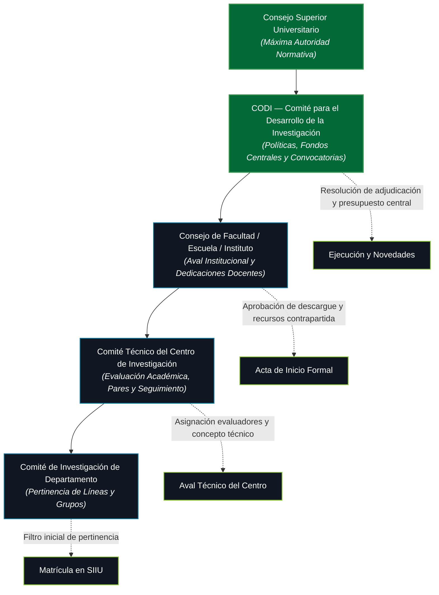

# Ecosistema de Comités y Gobernanza de la Investigación

El desarrollo de las actividades de investigación y extensión en la Universidad de Antioquia no opera de manera aislada dentro del sistema informático; el **SIIU** es el reflejo digital de un entramado de decisiones colegiadas y normativas amparadas en el **Acuerdo Superior 204 de 2001** (Sistema Universitario de Investigación) y el **Estatuto General (Acuerdo Superior 01 de 1994)**.

Cada estado, aval, novedad o liquidación dentro del SIIU responde a competencias delegadas en distintos órganos de gobierno y cuerpos colegiados.

---

## 1. Instancias Colegiadas y su Función en el SIIU

### A. Comités de Investigación por Departamento
- **Nivel:** Unidad académica básica (Departamentos académicos).
- **Integrantes clave:** Jefe de Departamento y Coordinadores de los Grupos de Investigación adscritos.
- **Competencias operativas:**
  1. Revisar la pertinencia de las propuestas postuladas en relación con las líneas activas de los grupos.
  2. Verificar la disponibilidad y capacidad real de dedicación horaria de los profesores proponentes.
  3. Emitir el primer visto bueno que permite al proponente solicitar el aval del Centro de Investigación.

### B. Comité Técnico del Centro de Investigación y Consultorías (CIC)
- **Nivel:** Unidad Académica Mayor (Facultad, Escuela o Instituto) — Regulado por el **Acuerdo Superior 204 de 2001**.
- **Integrantes:**
  - Decano o su delegado (Presidente).
  - Jefe o Director del Centro de Investigación (Secretario).
  - Coordinador de Grupos de Investigación.
  - Coordinadores de Programas de Posgrado (Maestría y Doctorado).
  - Representante de los investigadores con proyectos activos.
  - Representante de Extensión.
- **Acciones directas en el SIIU:**
  - **Revisión Técnico-Formal:** Validación de requisitos de convocatoria, formatos, pólizas y contrapartidas.
  - **Asignación de Evaluadores Pares:** Selección de pares internos o externos calificados para emitir juicio valorativo.
  - **Consolidación de Conceptos:** Emisión del concepto favorable que habilita al Consejo de Facultad a expedir el aval institucional.
  - **Seguimiento a Compromisos y Novedades:** Conceptuar sobre solicitudes de prórrogas de tiempo, cambios de rubro presupuestal o sustitución de coinvestigadores.

### C. Consejo de Facultad
- **Nivel:** Máxima autoridad directiva de la unidad académica.
- **Integrantes:** Decano, Vicedecano, Jefes de Departamento, Director de Centro, Representante Profesoral y Representante Estudiantil.
- **Impacto directo en el flujo SIIU:**
  - **Aprobación de Dedicaciones:** Autoriza formalmente las horas semanales de dedicación lectiva y de investigación de los docentes vinculados al proyecto (Art. 21, AS 083/1996).
  - **Expedición de Avales:** Emite la resolución o acta de aval institucional requerida para la radicación ante convocatorias externas (Minciencias, SGR, agencias internacionales).
  - **Ordenación del Gasto Delegada:** En cabeza del Decano para la suscripción de contratos, órdenes de servicio y convenios derivados del proyecto (Art. 47, AS 121/1997).

### D. CODI (Comité para el Desarrollo de la Investigación)
- **Nivel:** Central — Presidido por la Vicerrectoría de Investigación.
- **Competencias:**
  - Establecer los términos de referencia de las convocatorias internas (programáticas, menor cuantía, apoyo a grupos y fondos de sostenibilidad).
  - Asignar el presupuesto central y dirimir discrepancias en las evaluaciones.
  - Aprobar prórrogas extraordinarias o liquidaciones unilaterales que superen las atribuciones de los Centros.

---

## 2. Comités de Soporte Especializado y Requisitos Previos

En proyectos con componentes de riesgo ético, social o ambiental, el **SIIU** exige adjuntar certificaciones previas emitidas por comités especializados antes de autorizar el desembolso presupuestal:

| Comité Especializado | Objeto de Evaluación | Requisito en SIIU |
| :--- | :--- | :--- |
| **Comité de Ética de la Investigación (Humanos)** | Ensayos clínicos, encuestas biomédicas, tratamiento de datos sensibles, interacción con comunidades vulnerables. | Consentimientos informados y aval ético formal cargado en pestaña *Documentos Soporte*. |
| **Comité Institucional para el Cuidado y Uso de Animales (CICUA)** | Experimentación con modelos animales, bioterios y fauna silvestre. | Certificado de cumplimiento de protocolos de bienestar animal. |
| **Comité de Bioética y Bioseguridad** | Manipulación de microorganismos patógenos, material genético recombinante y agentes biológicos. | Plan de manejo de residuos y bioseguridad en laboratorio avalado. |
| **Comité de Propiedad Intelectual** | Resultados susceptibles de patente, secreto industrial, software o licenciamiento tecnológico (RR 49544/2022). | Acuerdo de titularidad compartida y cesión de derechos de autor patrimoniales. |

---

## 3. Matriz de Trazabilidad: Estado del SIIU vs. Instancia Responsable

| Estado en el SIIU | Instancia Responsable | Documento o Acto Asociado |
| :--- | :--- | :--- |
| **En Formulación** | Investigador Principal / Grupo | Propuesta técnica en borrador |
| **Enviado Centro** | Gestor del Centro / Auxiliar Técnico | Lista de chequeo habilitante |
| **Pendiente Actualización** | Investigador Principal | Subsanación de observaciones |
| **Avalado Centro** | Comité Técnico del Centro / Consejo | Acta de Comité Técnico |
| **En Evaluación Pares** | Evaluadores Pares (Internos / Externos) | Formulario de calificación |
| **Aprobado** | CODI / Ente Financiador Externo | Resolución de adjudicación |
| **Inicio Formal** | Centro de Investigación y Decanatura | Acta de Inicio, Pólizas y Centro de Costos |
| **En Ejecución (Novedad)** | Comité Técnico / Vicerrectoría | Solicitud de Prórroga o Traslado |
| **Finalizado** | Comité Técnico del Centro | Informes y Acta de Cumplimiento |
| **Liquidado** | Decano / Vicerrectoría de Investigación | Acta de Liquidación y Paz y Salvo Presupuestal |

---

## 4. Enlaces de Interés y Rutas Operativas Relacionadas

- Consulta el **[Rol del Investigador Principal](Rol_Investigador.md)** para conocer las rutas de radicación.
- Consulta el **[Rol del Centro de Investigación](Rol_Centro_Investigacion.md)** para el trámite de revisiones y avales.
- Consulta el **[Acuerdo Superior 204 de 2001](../05_MARCO_NORMATIVO/AS_204_2001_Sistema_Universitario_Investigacion.md)** para la estructura jurídica completa del SUI.
