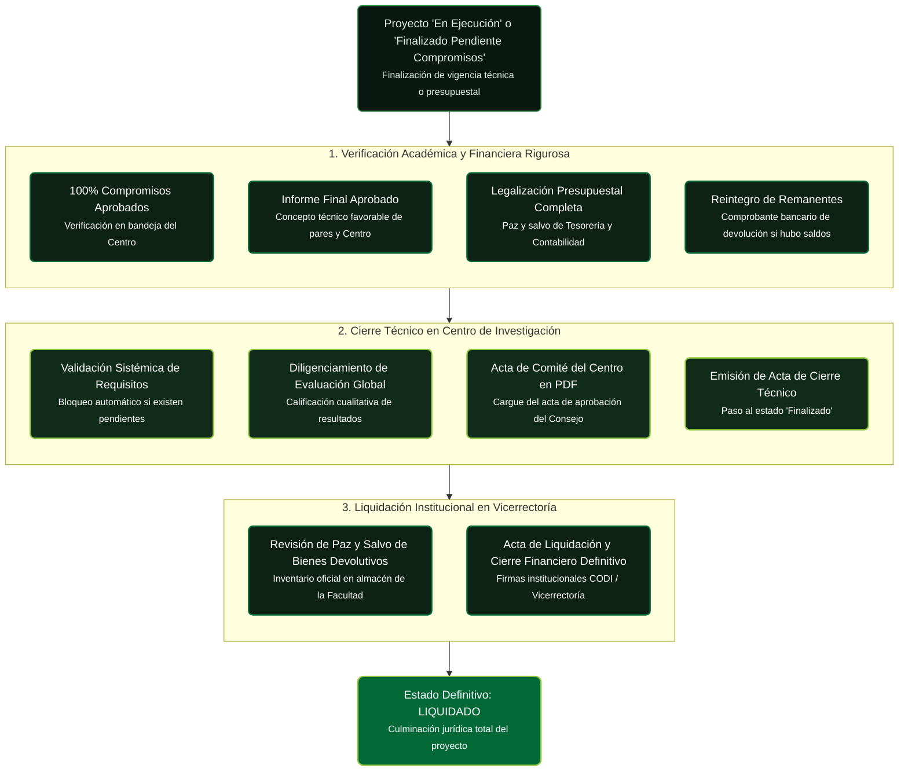

# Proceso Clave: Cierre y Liquidación de Proyectos

!!! tip "En simple: ¿cómo cierro mi proyecto?"
    Cerrar = **demostrar que entregaste todo y gastaste bien**. Necesitas: 1) **100% compromisos aprobados**, 2) informe final aprobado, 3) presupuesto legalizado sin saldos (o con reintegro). Luego el Centro hace el acta de cierre y la Vicerrectoría liquida. Sin paz y salvo no hay liquidación.

El proceso de **Cierre y Liquidación** es la culminación jurídica, presupuestal y académica del proyecto en la Universidad de Antioquia. Garantiza que todos los recursos asignados fueron debidamente legalizados y que los productos prometidos fueron recibidos a satisfacción.

---

## 1. Requisitos Previos al Cierre

Para que el SIIU permita iniciar el trámite de cierre, se deben cumplir cuatro condiciones estrictas:

1. **Cumplimiento de Compromisos al 100%:** Todos los compromisos registrados en el proyecto deben encontrarse en estado **Aprobado** por el Centro de Investigación (ninguno puede estar en estado *Pendiente*, *Enviado* o *Atrasado*).
2. **Aprobación del Informe Final:** Debe constar el concepto favorable del Centro respecto al informe técnico definitivo.
3. **Paz y Salvo Presupuestal:**
   - Para proyectos financiados con recursos UdeA: Ejecución y legalización completa de anticipos, cuentas de cobro y facturas ante el Departamento de Presupuesto.
   - Si existieron saldos no ejecutados, debe constar el comprobante de reintegro a los fondos centrales de la Universidad.
4. **Paz y Salvo de Bienes Devolutivos:** Los equipos o instrumentos adquiridos deben encontrarse inventariados en el almacén de la unidad académica correspondiente.

---

## 2. Procedimiento de Cierre en Centro (Rol Centro de Investigación)

- **Ruta SIIU:** `Trámites administrativos >> Seguimiento proyectos >> Seleccionar proyecto >> Botón: Cierre de proyecto`
- **Pasos:**
  1. El sistema valida automáticamente el estado de los compromisos. Si existen pendientes, emitirá un mensaje de bloqueo indicando cuáles compromisos faltan.
  2. Si todos los compromisos están aprobados, el sistema habilita el formulario de **Cierre de Proyecto**.
  3. Registrar la evaluación general del proyecto (calificación de pertinencia y cumplimiento de objetivos).
  4. Adjuntar en formato **PDF** el Acta de Reunión del Comité Técnico del Centro donde se aprueba el cierre del proyecto.
  5. Presionar **CONFIRMAR CIERRE**. El proyecto adquiere el estado **Finalizado** o **Evaluado finalización**.
- 📘 Guía oficial: [VI-GU-04](../archivo_maestro/VI-GU-04.md)

---

## 3. Liquidación en Vicerrectoría (Rol Vicerrectoría de Investigación)

- **Ruta SIIU:** `Trámites administrativos >> Seguimiento proyectos >> Liquidación institucional`
- **Pasos:**
  1. La Vicerrectoría audita el expediente digital completo.
  2. Se verifica la correspondencia entre la ejecución presupuestal reportada en el sistema contable y lo registrado en el SIIU.
  3. Se genera digitalmente el **Acta de Liquidación Definitiva**, firmada por el Vicerrector de Investigación (o su delegado) y el Investigador Principal.
  4. Al confirmar la liquidación, el proyecto pasa al estado definitivo **LIQUIDADO**.

---

## Diferencia entre Estados de Terminación

| Estado en SIIU | Significado Operativo |
| :--- | :--- |
| **Finalizado pendiente de compromisos** | El tiempo contractual de ejecución venció, pero el investigador adeuda uno o más informes o productos. No se puede liquidar hasta subsanar. |
| **Finalizado** | El proyecto terminó su plazo y cumplió todos sus compromisos académicos, pero está en trámite la legalización presupuestal o el acta formal. |
| **Evaluado finalización** | El Centro ya completó la rúbrica de evaluación de resultados finales. |
| **Liquidado** | El proyecto cuenta con acta formal de liquidación y se legalizó el 100% de los recursos económicos. Cierre jurídico definitivo. |

---

## 🔗 Próximo Paso en el Flujo
Para expedir certificados de finalización o paz y salvos institucionales:
Consulta **[Reportes y Certificaciones](../02_PROCESOS_CLAVE/Reportes_y_Certificaciones.md)**.
