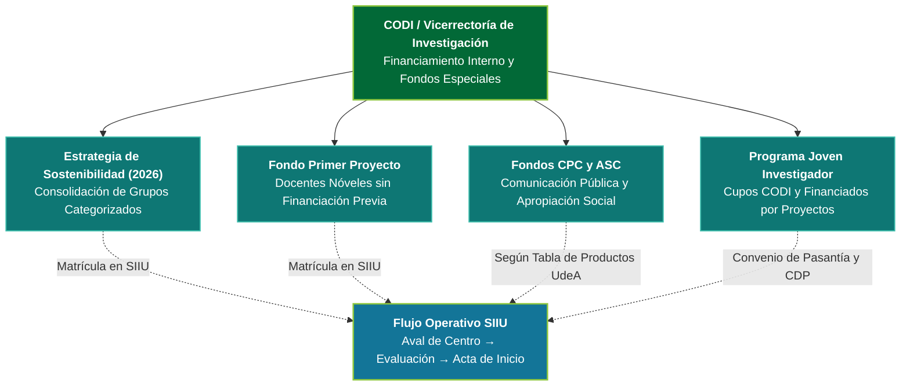

---
search:
  boost: 2.5
---

# Convocatorias, Fondos CODI y Circulares de Investigación

El financiamiento interno de la investigación en la Universidad de Antioquia es administrado por el **Comité para el Desarrollo de la Investigación (CODI)** y ejecutado operativamente a través del **SIIU** bajo la coordinación de la **Vicerrectoría de Investigación (VRI)**. Esta guía integra las líneas de financiación interna vigentes, las condiciones de los fondos especiales y las circulares informativas clave emitidas entre 2021 y 2026.

---

## 1. Convocatorias Internas y Fondos Especiales CODI

### A. Estrategia para la Sostenibilidad y Consolidación de Grupos (2026)
La Universidad de Antioquia y el CODI convocan a los grupos de investigación institucionales a presentar propuestas dentro de la **Convocatoria Estrategia para la sostenibilidad y consolidación de los grupos de investigación 2026**.

- **Propósito:** Fortalecer la capacidad científica, la estabilidad operativa y el incremento de la producción académica de alto nivel en los grupos reconocidos de la Universidad.
- **Operación en SIIU:** Las propuestas se radican en el módulo de convocatorias del SIIU, adjuntando el aval del Centro de Investigación correspondiente y los compromisos de producción científica asociados a la vigencia.

### B. Fondo de Apoyo al Primer Proyecto
Mecanismo diseñado para impulsar la trayectoria investigativa de profesores vinculados que formulan su primer proyecto ante el Sistema Universitario de Investigación (SUI).

- **Normativa operativa:** Regulado originalmente mediante la [Circular N°1 del 3 de marzo de 2021](https://www.udea.edu.co/wps/wcm/connect/udea/a110d1cf-be4f-4adc-8007-ee5cd72819f4/Circular+1+de+2021+-+Fondo+Primer+Proyecto.pdf?MOD=AJPERES&CVID=nwsEvwY) y actualizado respecto a su estado de ejecución en la [Circular informativa 01 de 2025](https://www.udea.edu.co/wps/wcm/connect/udea/71323081-1d07-4e42-95b7-5083ec5e3e91/Circular012025_estado-ejecucion-fondo-apoyo-PPInvestigacion.pdf?MOD=AJPERES&CVID=pnnOY0k).

### C. Fondos de Comunicación Pública de la Ciencia (CPC) y Apropiación Social del Conocimiento (ASC)
El CODI dispone de fondos especiales orientados a fomentar la socialización, publicación de resultados, realización de eventos científicos y transferencia hacia públicos no especializados.

- **Tipología financiable:** Los productos susceptibles de apoyo deben corresponder estrictamente a la tipología definida en la **Tabla de Aceptación de Productos vigente de la Universidad de Antioquia** como productos de **Apropiación Social del Conocimiento (ASC)** y **Comunicación Pública de la Ciencia (CPC)**.

!!! warning "Eliminación de Apoyos de Traducción, Estilo y APC (Circular 02 de 2023)"
    Mediante la [Circular Informativa 02 de 2023](https://www.udea.edu.co/wps/wcm/connect/udea/aa758391-23ff-4f6e-b812-33f7f74e3bc5/Circular_2_Eliminaci%C3%B3n_Fondos_+Apoyo_Investigaci%C3%B3n_09JUN23.pdf?MOD=AJPERES&CVID=oySx8Fj), la Vicerrectoría de Investigación informó la **eliminación** del Fondo de apoyo para la revisión de estilo, edición o traducción, así como de la modalidad de pago de *Article Processing Charges* (APC) dentro del Fondo de Democratización. Verifica siempre las fuentes alternativas de tu proyecto o Centro antes de comprometer pagos editoriales.

---

## 2. Compendio de Circulares Normativas y Operativas (VRI)

Las siguientes circulares oficiales emitidas por la Vicerrectoría de Investigación establecen reglas vigentes de obligatorio cumplimiento para investigadores, tutores y gestores de Centros de Investigación en el SIIU:

### Vigencias 2024 – 2026

| Circular | Objeto / Directriz Operativa | Enlace Oficial |
| :--- | :--- | :--- |
| **Circular 00001 de 2026** | Cronograma oficial de vinculación y reportes de pago de **Jóvenes Investigadores 2026**. | [:material-file-pdf-box: Descargar PDF](https://www.udea.edu.co/wps/wcm/connect/udea/3c9af606-ebae-4aa9-bd4f-b1f052c56bee/Circular+01+del+2026_CronogramaJI.pdf?MOD=AJPERES&CVID=pL.E-QC) |
| **Circular Informativa 01 de 2025** | Estado de la ejecución del **Fondo de apoyo al primer proyecto de investigación**. | [:material-file-pdf-box: Descargar PDF](https://www.udea.edu.co/wps/wcm/connect/udea/71323081-1d07-4e42-95b7-5083ec5e3e91/Circular012025_estado-ejecucion-fondo-apoyo-PPInvestigacion.pdf?MOD=AJPERES&CVID=pnnOY0k) |
| **Circular Informativa 02 de 2025** | Extensión de la vigencia del listado de **revistas extranjeras homologadas de Publindex**. | [:material-file-pdf-box: Descargar PDF](https://www.udea.edu.co/wps/wcm/connect/udea/b4d785f0-c796-4939-b653-4a31a60104a0/Circular+0225_listado-revistas-homologadas-publindex.pdf?MOD=AJPERES&CVID=pnnLUdV) |
| **Circular Informativa 01 de 2024** | Procedimiento para la **inscripción de proyectos sin financiación** en el sistema de investigación (SIIU). | [:material-file-pdf-box: Descargar PDF](https://www.udea.edu.co/wps/wcm/connect/udea/80a130a3-ab6a-47d2-b74d-c43ccc777b3e/Circular+2-Inscripci%C3%B3n+de+Proyectos+Feb23.pdf?MOD=AJPERES&CVID=oTDiX9Q) |
| **Circular Informativa 02 de 2024** | Procedimiento general para la **inscripción de proyectos** en el sistema de investigación. | [:material-file-pdf-box: Descargar PDF](https://www.udea.edu.co/wps/wcm/connect/udea/a4598c93-4389-4051-b619-b7a0e39def85/Circular+2-Marzo6_Inscripci%C3%B3n+de+Proyectos+VRI.pdf?MOD=AJPERES&CVID=oUlAIez) |

### Vigencias 2021 – 2023 (Lineamientos de Gestión, JI y Seguridad)

| Circular | Objeto / Directriz Operativa | Enlace Oficial |
| :--- | :--- | :--- |
| **Circular Informativa 02 de 2023** | Eliminación del Fondo de apoyo para revisión de estilo/traducción y modalidad de pago de APC. | [:material-file-pdf-box: Descargar PDF](https://www.udea.edu.co/wps/wcm/connect/udea/aa758391-23ff-4f6e-b812-33f7f74e3bc5/Circular_2_Eliminaci%C3%B3n_Fondos_+Apoyo_Investigaci%C3%B3n_09JUN23.pdf?MOD=AJPERES&CVID=oySx8Fj) |
| **Circular ARL (Vacaciones Colectivas)** | Recomendaciones para actividades académicas e investigativas y cobertura **ARL en período de vacaciones colectivas**. | [:material-file-pdf-box: Descargar PDF](https://www.udea.edu.co/wps/wcm/connect/udea/fd62135c-cccc-4fa0-8306-bc6d0f906012/Circular_ARL_2023.pdf?MOD=AJPERES&CVID=oxYPsAy) |
| **Circular N°7 de 2022** | Formas de vincular estudiantes en formación de pregrado en proyectos de convocatorias internas CODI. | [:material-file-pdf-box: Descargar PDF](https://www.udea.edu.co/wps/wcm/connect/udea/ba096ed6-3c2d-4140-8f06-a129d3b734c2/Circular+Informativa+07+de+2023.pdf?MOD=AJPERES&CVID=ov7XRVy) |
| **Circular N°1 de 2022** | Modificación a requisitos de Jóvenes Investigadores (Resolución Académica 3588). | [:material-file-word-box: Descargar Word](https://www.udea.edu.co/wps/wcm/connect/udea/1e959b66-f7bf-45af-8d61-01fdceb74138/Circular%2B1%2B2022+garant%C3%ADas%2BJI+RA+3588.docx?MOD=AJPERES&CVID=n.CDyQS) |
| **Circular N°4 de 2021** | Trámite de convenios de pasantía de **Jóvenes Investigadores financiados con recursos de proyectos**. | [:material-file-pdf-box: Descargar PDF](https://www.udea.edu.co/wps/wcm/connect/udea/b473b926-2579-4845-8a5a-8ca97646495e/Circular+4+tra%CC%81mite+ji+por+proyecto+vf.pdf?MOD=AJPERES&CVID=nLAEZBO) |
| **Circular N°5 de 2021** | Directrices de **Gestión Documental** para Centros de Investigación. | [:material-file-pdf-box: Descargar PDF](https://www.udea.edu.co/wps/wcm/connect/udea/37119481-0ce8-4cdc-90c7-9212fffc8a65/Circular_No_5_VRI_2021.pdf?MOD=AJPERES&CVID=nP4BKip) |
| **Circular N°6 de 2021** | Gestión financiera de proyectos de investigación con recursos manejados en **cuentas bancarias exclusivas**. | [:material-file-pdf-box: Descargar PDF](https://www.udea.edu.co/wps/wcm/connect/udea/a069ee65-3679-4915-bd95-c9cc16b43714/Circular_No_6_VRI_2021.pdf?MOD=AJPERES&CVID=nP4BQhl) |

!!! tip "Consulta el repositorio completo de Circulares"
    Para revisar circulares históricas (2012–2020) o información actualizada de convocatorias abiertas, visita la sección de [Circulares de la Vicerrectoría de Investigación](https://www.udea.edu.co/wps/portal/udea/web/inicio/investigacion/gestion-investigacion/Contenido/asContenidosMenu/circulares) o comunícate al conmutador `(+57-604) 219 5190` (Bloque 16 / SIU).

---

## 3. Enlaces Relacionados en la Wiki

- **[Matrícula de Proyectos en SIIU](Matricula_Proyectos.md):** Paso a paso para inscribir propuestas con y sin financiación.
- **[Programa Joven Investigador](Programa_Joven_Investigador.md):** Registro de cupos, vinculación y prórrogas en el SIIU.
- **[Catálogo Maestro de Formatos Oficiales](../03_GUIAS_RAPIDAS_CHEAT_SHEETS/Catalogo_Formatos_Oficiales.md):** Descarga directa de minutas, listas de chequeo y plantillas de seguimiento.
