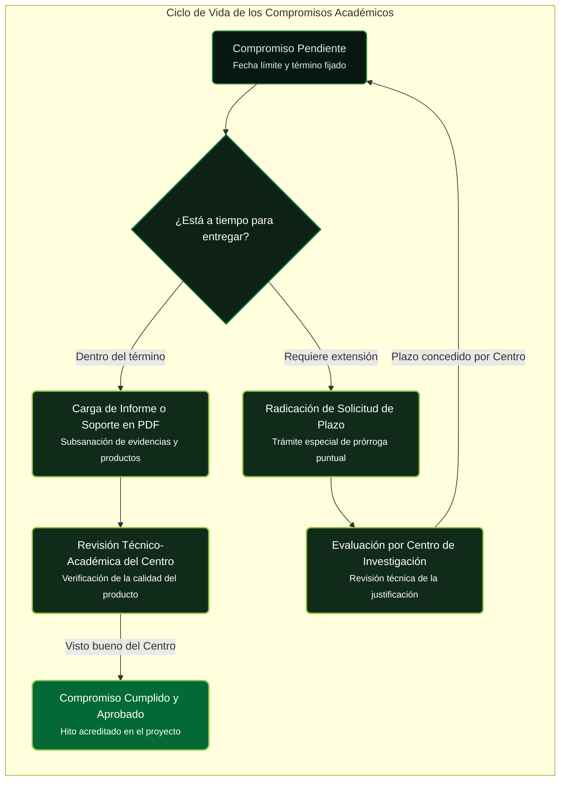

# Proceso Clave: Gestión de Compromisos Académicos

!!! tip "En simple: ¿qué son los compromisos?"
    Son **lo que prometiste entregar** (informes, artículos, tesis, patentes). Cada uno tiene fecha y estado: **Pendiente → En revisión → Aprobado**. Subes el PDF, presionas **Confirmar entrega** y el Centro lo aprueba o lo devuelve. Si solo necesitas más días para UN entregable, pide **plazo en compromisos** (no prórroga de todo el proyecto).

Los **Compromisos** representan las obligaciones científicas, tecnológicas y de formación pactadas por el Investigador Principal en la formulación de la propuesta (informes de avance, informe final, artículos, ponencias, tesis dirigidas, patentes o prototipos).

---

## 1. Tipos de Compromisos en el SIIU

1. **Informes de Avance (Parciales):** Reportes periódicos de ejecución técnica y presupuestal exigidos en convocatorias o contratos de larga duración (anuales o semestrales).
2. **Informe Final:** Documento técnico exhaustivo que compila los resultados, conclusiones, publicaciones y balance presupuestal definitivo.
3. **Productos Científicos y Tecnológicos:** Artículos publicados o aceptados en revistas indexadas (Scopus / WoS), libros de investigación, registros de software ante la DNDA, solicitudes de patente ante la SIC o actas de sustentación de trabajos de grado de pregrado y posgrado.

---

## 2. Entrega y Carga de Compromisos (Rol Investigador)

- **Ruta SIIU:** `Trámites administrativos >> Seguimiento mis proyectos >> Seleccionar proyecto >> Botón: Compromisos`
- **Pasos Operativos:**
  1. El sistema despliega la lista de todos los compromisos del proyecto con sus fechas límite de entrega y su estado actual (*Pendiente*, *En revisión*, *Aprobado*, *Atrasado*).
  2. Ubique el compromiso a entregar y presione el botón **Acciones (...) >> Entregar compromiso**.
  3. Diligencie el resumen del avance o descripción del producto.
  4. Adjunte el soporte documental en formato **PDF** (ej. artículo en PDF, certificado de aceptación editorial, acta de sustentación, informe final firmado).
  5. Presione **CONFIRMAR ENTREGA**. El compromiso pasa a estado **Enviado para revisión** del Centro de Investigación.
- 📘 Guía oficial: [VI-GU-09](../archivo_maestro/VI-GU-09.md)

---

## 3. Solicitud de Plazo en la Entrega de Compromisos

Cuando por razones metodológicas o demoras editoriales no es posible entregar un compromiso específico en la fecha estipulada, pero **NO se requiere prorrogar el tiempo general del proyecto**, se utiliza este trámite específico:

- **Ruta SIIU:** `Trámites administrativos >> Nueva solicitud o Novedad >> Solicitud >> Tipo: Solicitud de plazo en compromisos`
- **Operación:**
  1. Seleccionar el proyecto respectivo.
  2. Seleccionar el compromiso puntual sobre el cual se solicita la ampliación.
  3. Ingresar la nueva fecha propuesta de entrega.
  4. Justificar detalladamente los motivos del retraso y adjuntar el soporte en PDF.
  5. Radicar para revisión del Centro de Investigación y posterior aval de la Vicerrectoría.
- 📘 Guía oficial: [VI-GU-22](../archivo_maestro/VI-GU-22.md)

---

## 4. Revisión y Aprobación en Centro (Rol Centro de Investigación)

- **Ruta SIIU:** `Trámites administrativos >> Seguimiento proyectos >> Seleccionar proyecto >> Botón: Compromisos`
- **Operación:**
  1. Revisar los compromisos en estado **Enviado para revisión**.
  2. Descargar y auditar el archivo PDF de soporte.
  3. Seleccionar la acción:
     - **Aprobar Compromiso:** Marca el hito como cumplido al 100%.
     - **Rechazar / Devolver:** Si el documento no cumple con los estándares de rigor técnico o no corresponde a lo comprometido. Se registra la observación para que el investigador vuelva a cargar la versión corregida.
- 📘 Guía oficial: [VI-GU-09](../archivo_maestro/VI-GU-09.md)

---

## 🔗 Próximo Paso en el Flujo
Una vez aprobados el 100% de los compromisos e informes, el proyecto queda habilitado para el cierre definitivo:
Consulta **[Cierre y Liquidacion](../02_PROCESOS_CLAVE/Cierre_y_Liquidacion.md)**.
