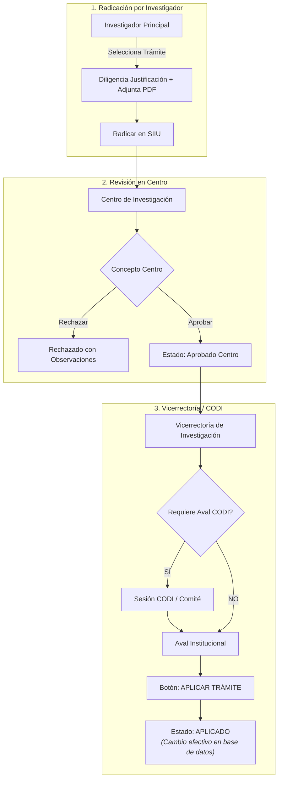

# Proceso Clave: Modificaciones y Trámites Administrativos

Durante la ejecución de un proyecto es habitual requerir ajustes de calendario, variaciones presupuestales o cambios en la composición del equipo de trabajo. El SIIU canaliza estas modificaciones mediante **Trámites Administrativos** auditables.

---

## 1. Tipos Principales de Trámites

### Prórroga de Proyecto
Permite extender el horizonte temporal del proyecto.
- **Prórroga de Inicio:** Se tramita con el proyecto en estado **Aprobado**. Evita que el proyecto sea cancelado por demoras en contratos, pólizas o comités de ética.
- **Prórroga de Ejecución:** Se tramita con el proyecto en estado **En ejecución**. Extiende la fecha oficial de finalización para culminar actividades experimentales o redactar informes finales.
- **Campos requeridos:** Número de meses solicitados, nueva fecha estimada de terminación, justificación técnica y cronograma reprogramado en PDF.
- 📘 Guía oficial: [VI-GU-23](../archivo_maestro/VI-GU-23.md)

### Cambio de Rubro / Modificación Presupuestal
Permite trasladar saldos entre los rubros aprobados o abrir nuevos subrubros para responder a necesidades reales de compra o contratación.
- **Condiciones obligatorias:**
  1. El proyecto debe estar en estado **En ejecución**.
  2. El rubro origen ("rubro padre") **debe tener saldo disponible mayor a \$0**. No es posible trasladar recursos desde rubros con saldo agotado.
  3. No se pueden superar los topes porcentuales fijados en la convocatoria para rubros restrictivos (ej. gastos de viaje, papelería).
- **Campos requeridos:** Rubro origen, rubro destino, valor a trasladar, justificación y matriz presupuestal comparativa en PDF.
- 📘 Guía oficial: [VI-GU-20](../archivo_maestro/VI-GU-20.md)

### Cambio o Inclusión de Participantes
Modifica la nómina del proyecto:
- Salida de un coinvestigador (por retiro voluntario, finalización de contrato o graduación).
- Ingreso de nuevos docentes, investigadores colaboradores o estudiantes.
- Ajuste de dedicación horaria semanal de los participantes existentes.
- **Campos requeridos:** Datos de identificación, tipo de vinculación, rol dentro del proyecto, horas semanales y carta de aceptación / renuncia en PDF.
- 📘 Guía oficial: [VI-GU-19](../archivo_maestro/VI-GU-19.md)

### Cambio de Responsable del Proyecto
Procedimiento especial y de alta relevancia institucional cuando el Investigador Principal original no puede continuar al frente de la dirección científica del proyecto (por licencia, renuncia, incapacidad médica prolongada, año sabático o fuerza mayor).
- **Condición:** El nuevo responsable propuesto debe pertenecer al mismo grupo de investigación o unidad académica y cumplir con los requisitos de idoneidad y vinculación de la convocatoria.
- 📘 Guía oficial: [VI-GU-01](../archivo_maestro/VI-GU-01.md)

---

## 2. Aprobación en Centro (Rol Centro de Investigación)

- **Ruta SIIU:** `Trámites administrativos >> Flujo de procesos administrativos y novedades >> Consulta`
- **Operación:**
  1. Filtrar las solicitudes en estado **Pendiente de Aprobación**.
  2. Desplegar el menú de acciones (`...`) del trámite respectivo.
  3. Revisar la justificación y descargar el archivo PDF adjunto.
  4. Seleccionar la decisión: **Aprobar** o **Rechazar**.
  5. Si se rechaza, es obligatorio registrar el motivo técnico del rechazo.
  6. Si se aprueba, la solicitud pasa a estado **Aprobada Centro** y se enruta automáticamente hacia la Vicerrectoría.
- 📘 Guía oficial: [VI-GU-12](../archivo_maestro/VI-GU-12.md)

---

## 3. Aplicación en Vicerrectoría (Rol Vicerrectoría)

- **Ruta SIIU:** `Trámites administrativos >> Flujo de procesos administrativos y novedades >> Consulta >> Instancia: Vicerrectoría`
- **Operación:**
  1. Revisar las solicitudes avaladas por los Centros.
  2. Si el trámite requiere decisión de CODI (prórrogas superiores a 6 meses, adiciones presupuestales mayores, relevo de IP), registrar el número de acta y fecha de la sesión del comité.
  3. Emitir el **Aval de Vicerrectoría**.
  4. Presionar el botón **`APLICAR`**: Este paso es **decisivo e irreversible**. Al hacer clic en Aplicar, el motor de base de datos del SIIU recalcula los saldos de los rubros, actualiza la fecha de fin en el cronograma o sustituye la cédula del responsable.
- 📘 Guía oficial: [VI-GU-13](../archivo_maestro/VI-GU-13.md)

---

## 4. Configuración de Flujos de Trámites (Rol Administrador Central)

Permite a la Vicerrectoría definir qué instancias deben intervenir para cada tipo de trámite (ejemplo: determinar si un cambio de rubro menor requiere solo Centro o si debe escalar a CODI):
- **Ruta SIIU:** `Configuración >> Flujo de trámites >> Configuración trámites`
- 📘 Guía oficial: [VI-GU-14](../archivo_maestro/VI-GU-14.md)

---

## 🔗 Próximo Paso en el Flujo
Para coordinar el cumplimiento de compromisos y plazos de entrega:
Consulta **[Gestion Compromisos](../02_PROCESOS_CLAVE/Gestion_Compromisos.md)**.
