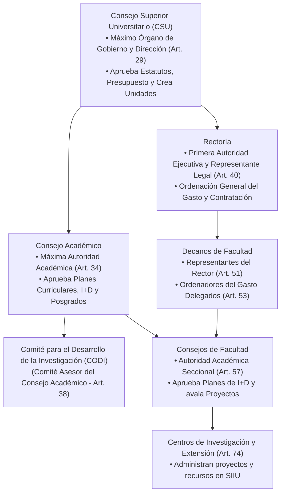
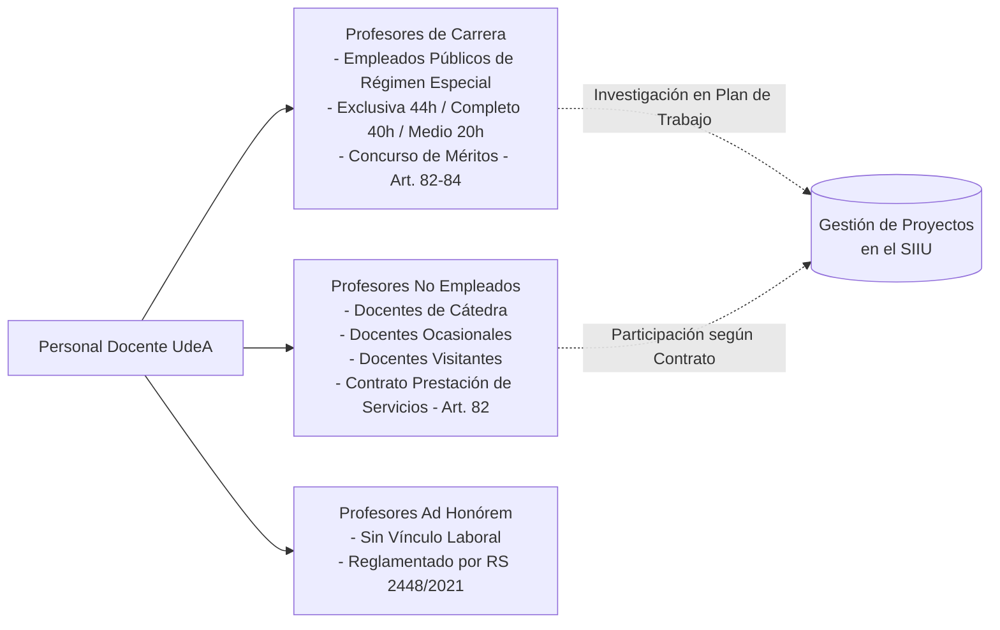

# Acuerdo Superior 01 de 1994 — Estatuto General de la Universidad de Antioquia

| Metadato | Detalle Institucional |
| :--- | :--- |
| **Jerarquía** | **Constitución Institucional / Norma Cúspide de la Universidad** |
| **Fecha de Expedición** | 5 de marzo de 1994 (Vigente desde 14 de marzo de 1994) |
| **Versión Actualizada** | Compilación oficial de Secretaría General con concordancias a 30 de junio de 2026 |
| **Órgano Emisor** | Consejo Superior Universitario (CSU) |
| **Documento Fidedigno** | [LEG-AS-01-1994](../archivo_maestro/legalidad/LEG-AS-01-1994.md) |
| **Estatus Legal** | **Vigente** (Deroga el Acuerdo Superior 13 de 1980) |

---

## 1. Naturaleza Jurídica y Principios Rectores

El **Estatuto General (Acuerdo Superior 01 de 1994)** define a la Universidad de Antioquia como un **Ente Universitario Autónomo con régimen especial**, personería jurídica, gobierno propio, rentas y patrimonio independientes (Artículo 1º).

### Principios Fundamentales para el Ecosistema de Investigación:
1. **Investigación y Docencia como Ejes Misionales (Art. 14):** La investigación es la fuente primaria del conocimiento, sustento del currículo y motor de soluciones científicas y tecnológicas para Antioquia y Colombia.
2. **Autonomía Universitaria (Art. 7):** Facultad de autoorganización académica, reglamentación propia, fijación de planes de estudio y régimen contractual de derecho privado con sujeción presupuestal.
3. **Interdisciplinariedad (Art. 13):** Promoción de la cooperación transversal entre saberes e institutos para el abordaje de problemas complejos.
4. **Descentralización y Desconcentración (Art. 23):** Operación delegada en Facultades, Institutos, Escuelas y Centros de Investigación.

---

## 2. Mapa de Gobernanza y Órganos de Dirección

---

## 3. Estructura Académica Operativa para la Investigación

El Estatuto General categoriza las unidades académicas donde se gesta y ejecuta la investigación universitaria:

| Tipo de Unidad | Definición Estatutaria (Arts. 70-77) | Rol en el SIIU y en la Investigación |
| :--- | :--- | :--- |
| **Facultad** | Unidad académica básica fundamental dirigida por el Decano y el Consejo de Facultad. | Unidad de adscripción de los grupos de investigación y aval institucional de propuestas. |
| **Instituto** | Unidad de primer orden enfocada en el desarrollo de disciplinas mediante investigación de punta y programas de maestría/doctorado. | Gestiona proyectos de investigación pura y aplicada con alto componente doctoral. |
| **Escuela** | Unidad de primer orden orientada al desarrollo de profesiones e investigación aplicada. | Ejecuta proyectos orientados al ejercicio profesional y transferencia. |
| **Centro de Investigación** | Unidad técnica de la Facultad encargada de administrar la investigación cuando el volumen de proyectos lo justifique. | **Centro Gestor Primario en el SIIU**: revisa requisitos éticos, formula presupuestos y gestiona convocatorias. |
| **Corporación Académica** | Entidad interdisciplinaria creada por el CSU por fuera de facultades (e.g., Biogénesis, Ambiental). | Conduce macroproyectos interfacultades y alianzas científicas internacionales. |

---

## 4. Régimen del Personal Docente e Investigador (Título V)

El Estatuto clasifica con precisión las formas de vinculación profesoral que interactúan con el Sistema de Información para la Investigación Universitaria (SIIU):

### Reglas Clave para Investigadores:
- **Plan de Trabajo Académico:** Las horas dedicadas a proyectos de investigación aprobados por el CODI o financiados externamente deben formalizarse en el Plan de Trabajo semestral aprobado por el Consejo de Facultad.
- **Incentivos y Estímulos (Art. 86):** Los incentivos económicos o regalías recibidos por proyectos de investigación o consultorías científicas **no constituyen factor salarial**.
- **Premio a la Investigación:** Máximo galardón científico otorgado periódicamente para exaltar las contribuciones sobresalientes de docentes y estudiantes (Anexo 3).

---

## 5. Articulación con el Marco Normativo Institucional

El Estatuto General es la matriz de habilitación de todas las normas reglamentarias del ecosistema:
- **Estatuto Profesoral:** [Acuerdo Superior 083 de 1996](AS_083_1996_Estatuto_Profesoral.md)
- **Sistema Universitario de Investigación (SUI):** [Acuerdo Superior 204 de 2001](AS_204_2001_Sistema_Universitario_Investigacion.md)
- **Estatuto de Contratación:** [Acuerdo Superior 419 de 2014](AS_419_2014_Estatuto_Contratacion.md) y [RR 39475 de 2014](RR_39475_2014_Reglamento_Contratacion.md)
- **Estatuto Financiero Vigente:** [Acuerdo Superior 466 de 2020](AS_466_2020_Estatuto_Financiero_Vigente.md)
- **Propiedad Intelectual:** [Resolución Rectoral 21231 de 2005](RR_21231_2005_Estatuto_Propiedad_Intelectual.md) y [RR 49544 de 2022](RR_49544_2022_Nuevo_Estatuto_PI.md)

---

## 6. Navegación y Enlaces

- **Transcripción Fidedigna:** [LEG-AS-01-1994](../archivo_maestro/legalidad/LEG-AS-01-1994.md)
- **Mapa de Contenido:** [MOC_Marco_Normativo](../00_INICIO_Y_MOCS/MOC_Marco_Normativo.md)
- **Estructura de Roles:** [Rol del Investigador Principal](../01_ROLES/Rol_Investigador.md) | [Rol del Centro de Investigación](../01_ROLES/Rol_Centro_Investigacion.md) | [Rol de la Vicerrectoría](../01_ROLES/Rol_Vicerrectoria.md)
