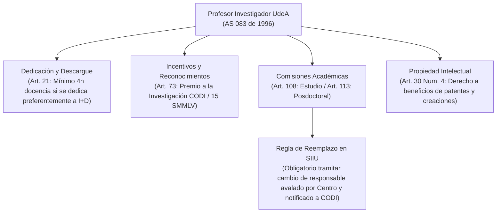

# Acuerdo Superior 083 de 1996 — Estatuto Profesoral

> **Tipo de Norma:** Estatuto Profesoral de la Universidad de Antioquia  
> **Número:** Acuerdo Superior 083 (22 de julio de 1996, actualizado a junio de 2026)  
> **Órgano Emisor:** Consejo Superior Universitario — Universidad de Antioquia  
> **Documento Fuente Fidedigno:** [LEG-AS-083-1996.md](../../archivo_maestro/legalidad/LEG-AS-083-1996.md)

---

## 1. Importancia Crucial para los Investigadores en el SIIU

El Estatuto Profesoral es el marco laboral y académico que define los deberes, derechos, ascensos, descargues horarios, distinciones y comisiones de los docentes universitarios vinculados a la investigación:

---

## 2. Articulación Directa con Guías y Procesos del SIIU

| Asunto Estatutario | Disposición en AS 083/1996 | Vínculo Directo en el SIIU y la Wiki |
|---|---|---|
| **Sustitución de Responsable de Proyecto** | **Art. 108 (inciso final):** El docente que tome comisión debe acreditar el cumplimiento o sustituir la jefatura del proyecto ante el Comité Técnico del Centro y CODI. | [Guía VI-GU-01 (Cambio de Responsable)](../../archivo_maestro/VI-GU-01.md) y [Modificaciones Administrativas](../02_PROCESOS_CLAVE/Modificaciones_y_Tramites.md) |
| **Dedicación Preferente a la Investigación** | **Art. 21:** Descargue de docencia lectiva (mínimo 4 horas lectivas semanales). | [Rol del Investigador](../01_ROLES/Rol_Investigador.md) |
| **Premio a la Investigación Universitaria** | **Art. 73:** Evaluación CODI con jurados externos en 3 áreas del saber sobre proyectos registrados en el SIIU. | [Rol de la Vicerrectoría](../01_ROLES/Rol_Vicerrectoria.md) |
| **Propiedad Intelectual Docente** | **Art. 30 num. 4:** Derecho a disponer y beneficiarse de patentes y producción académica. | [Acuerdo Superior 086 de 1996](AS_086_1996_Profesores_Catedra_Proyectos.md) |
| **Filiación Institucional Obligatoria** | **Art. 31 num. 13:** Obligación de acreditarse formalmente como profesor UdeA en toda publicación científica. | [Gestión de Compromisos](../02_PROCESOS_CLAVE/Gestion_Compromisos.md) |
