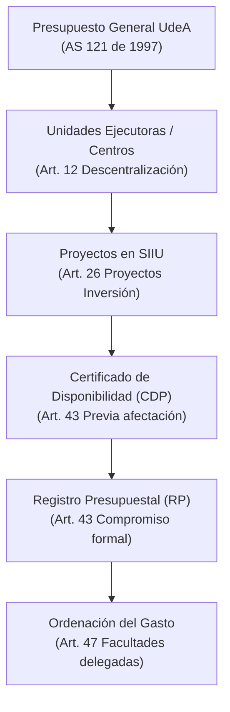

# Acuerdo Superior 121 de 1997 — Estatuto Presupuestal de la Universidad

> **Tipo de Norma:** Estatuto Presupuestal Universitario  
> **Número:** Acuerdo Superior 121 (07 de julio de 1997, vigencia 1998, compilado a 2019)  
> **Órgano Emisor:** Consejo Superior Universitario — Universidad de Antioquia  
> **Documento Fuente Fidedigno:** [LEG-AS-121-1997.md](../archivo_maestro/legalidad/LEG-AS-121-1997.md)

---

## 1. Importancia para la Gestión de Proyectos en el SIIU

El Estatuto Presupuestal establece los principios rectores bajo los cuales opera la ejecución de los recursos financieros en proyectos de investigación interna (CODI/BUP) y externa (Minciencias, Regalías, Cooperación Internacional).

---

## 2. Articulación Directa con Procesos del SIIU

| Artículo / Principio | Impacto en el SIIU | Enlace en Wiki |
|---|---|---|
| **Art. 10 y 14 (Anualidad y Especialización)** | Las apropiaciones de proyectos con recursos institucionales deben programarse y ejecutarse conforme a vigencias y rubros específicos. | [Cheat Sheet Investigador](../03_GUIAS_RAPIDAS_CHEAT_SHEETS/CheatSheet_Investigador.md) |
| **Art. 22 (Cooperación Internacional)** | Fondos de asistencia internacional no reembolsable se incorporan como recursos de capital en proyectos inscritos. | [Matrícula de Proyectos](../02_PROCESOS_CLAVE/Matricula_Proyectos.md) |
| **Art. 42 (Proyectos Cofinanciados)** | Obliga a que toda contrapartida universitaria o externa esté debidamente garantizada antes del inicio. | [Inicio Formal](../02_PROCESOS_CLAVE/Inicio_Formal.md) |
| **Art. 43 (CDP y RP)** | Requisito indispensable para contratar personal, adquirir equipos o ejecutar traslados presupuestales en SIIU. | [Modificaciones y Trámites](../02_PROCESOS_CLAVE/Modificaciones_y_Tramites.md) |
| **Art. 47 (Ordenación del Gasto)** | Define la potestad delegada a Decanos y Directores para firmar contratos y autorizar desembolsos de proyectos. | [Rol Centro Investigación](../01_ROLES/Rol_Centro_Investigacion.md) |
