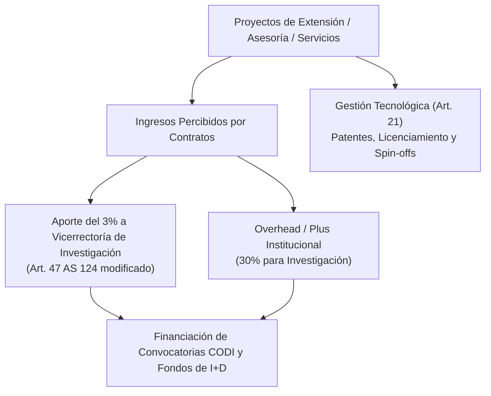

# Acuerdo Superior 124 de 1997 — Estatuto Básico de Extensión

> **Tipo de Norma:** Estatuto Básico de Extensión  
> **Número:** Acuerdo Superior 124 (29 de septiembre de 1997, actualizado con reformas a junio de 2026)  
> **Órgano Emisor:** Consejo Superior Universitario — Universidad de Antioquia  
> **Documento Fuente Fidedigno:** [LEG-AS-124-1997.md](../archivo_maestro/legalidad/LEG-AS-124-1997.md)

---

## 1. Conexión Estratégica entre Investigación y Extensión

El Estatuto de Extensión regula la interacción directa de la Universidad con la sociedad civil, las empresas y el Estado. Su vínculo con la investigación es determinante en la **gestión tecnológica, consultoría especializada, prestación de servicios de laboratorio y transferencias de recursos**:

---

## 2. Aspectos Clave para la Operación del SIIU

| Componente | Disposición Legal | Impacto Operativo en Proyectos |
|---|---|---|
| **Gestión Tecnológica (Art. 21)** | Define invención, innovación, adecuación, transferencia y comercialización de tecnología. | Marco que orienta los compromisos de nuevo conocimiento y productos tecnológicos en el SIIU. |
| **Distribución de Ingresos y Overheads (Art. 47)** | 3% directo del ingreso bruto o 30% del overhead pactado se transfiere a la Vicerrectoría de Investigación. | Alimenta las bolsas presupuestales de las convocatorias internas en el SIIU. |
| **Consultoría e Interventoría (Art. 19)** | Clasifica asesorías, consultorías, asistencia técnica, interventorías y veedurías. | Define la tipología jurídica de proyectos inscritos con entidades externas. |
| **Centros de Extensión (Art. 36-37)** | Establece las atribuciones de los Centros de Extensión en articulación con los Centros de Investigación. | Evaluación de pertinencia social e impacto territorial. |
