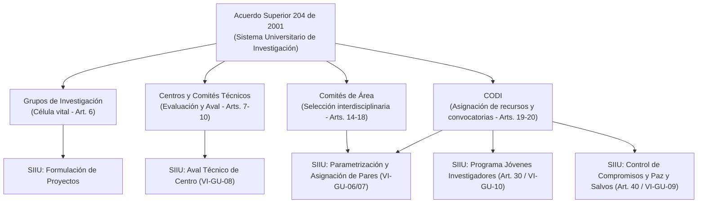

# Acuerdo Superior 204 de 2001 — Sistema Universitario de Investigación (SUI)

> **Tipo de Norma:** Estatuto del Sistema Universitario de Investigación (SUI)  
> **Número:** Acuerdo Superior 204 (06 de noviembre de 2001, con modificaciones de AS 317/2006, AS 386/2011, AS 477/2022)  
> **Órgano Emisor:** Consejo Superior Universitario — Universidad de Antioquia  
> **Documento Fuente Fidedigno:** [LEG-AS-204-2001.md](../../archivo_maestro/legalidad/LEG-AS-204-2001.md)

---

## 1. La Columna Vertebral del Ecosistema de Investigación y del SIIU

El Acuerdo Superior 204 de 2001 es la norma estatutaria suprema que define **cómo se concibe, organiza, financia y evalúa la investigación en la Universidad de Antioquia**. Cada módulo operativo del SIIU y cada instructivo técnico derivan su validez funcional de este acuerdo:

---

## 2. Articulación Directa con Procesos y Guías del SIIU

| Estipulación del AS 204/2001 | Aplicación Práctica en el Sistema SIIU | Guía / Instructivo de Respaldo |
|---|---|---|
| **Art. 6: Grupos de Investigación** | Solo grupos avalados por Vicerrectoría pueden postular proyectos en convocatorias internas y avalar jóvenes investigadores. | [Instructivo VI-IN-01 (Constancias por Grupos)](../../archivo_maestro/VI-IN-01.md) |
| **Art. 10: Comité Técnico de Centro** | Realiza la evaluación técnica formal, solicita ajustes al IP, aprueba prórrogas y avala trámites. | [Guía VI-GU-08 (Evaluación Técnica y Aval)](../../archivo_maestro/VI-GU-08.md) y [Instructivo VI-IN-05](../../archivo_maestro/VI-IN-05.md) |
| **Art. 20 y 23: Convocatorias CODI** | Parametrización de términos de referencia, montos, requisitos de financiación en SIIU. | [Guía VI-GU-07 (Configuración de Convocatorias)](../../archivo_maestro/VI-GU-07.md) |
| **Art. 30: Jóvenes Investigadores** | Cuotas de estudiantes de pregrado asignadas a grupos con agenda activa y estímulo económico mensual. | [Guía VI-GU-10 (Matrícula Cupos JI)](../../archivo_maestro/VI-GU-10.md) e [Instructivo VI-IN-06](../../archivo_maestro/VI-IN-06.md) |
| **Art. 33: Pares Evaluadores** | Asignación confidencial de evaluadores externos independientes e imparciales para garantizar rigor. | [Guía VI-GU-06 (Asignación Evaluadores)](../../archivo_maestro/VI-GU-06.md) e [Instructivo VI-IN-08](../../archivo_maestro/VI-IN-08.md) |
| **Art. 40: Regla de Paz y Salvo para Concursar** | No se puede radicar nuevo proyecto si el grupo o IP tiene compromisos vencidos o pendientes en proyectos previos. | [Guía VI-GU-09 (Gestión Compromisos)](../../archivo_maestro/VI-GU-09.md) y [Reglas de Oro del SIIU](../03_GUIAS_RAPIDAS_CHEAT_SHEETS/Reglas_Oro_SIIU.md) |
