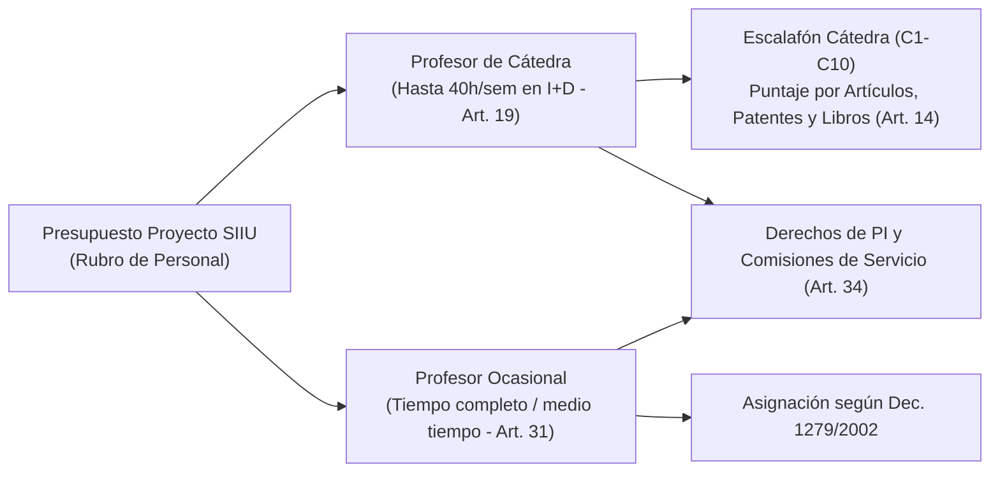

# Acuerdo Superior 253 de 2003 — Estatuto del Profesor de Cátedra y Ocasional

> **Tipo de Norma:** Estatuto del Profesor de Cátedra y Ocasional  
> **Número:** Acuerdo Superior 253 (18 de febrero de 2003, compilado y actualizado a junio de 2026)  
> **Órgano Emisor:** Consejo Superior Universitario — Universidad de Antioquia  
> **Documento Fuente Fidedigno:** [LEG-AS-253-2003.md](../../archivo_maestro/legalidad/LEG-AS-253-2003.md)

---

## 1. Importancia Práctica en la Contratación de Equipos de Proyecto en el SIIU

En el SIIU, una proporción muy significativa del personal de investigación corresponde a **profesores ocasionales y docentes de cátedra** contratados específicamente con recursos de proyectos (CODI, Minciencias, Regalías o convenios interinstitucionales).

---

## 2. Puntos Clave para la Formulación Presupuestal y Trámites Administrativos

| Parámetro Normativo | Regla del AS 253/2003 | Impacto en el SIIU |
|---|---|---|
| **Dedicación en Investigación (Art. 19.2.1)** | Docentes de cátedra externos o jubilados pueden contratarse **hasta por 40 horas semanales** dedicadas exclusivamente a proyectos de investigación. | Permite formular dedicaciones altas en proyectos financiados con recursos externos o de Vicerrectoría. |
| **Puntaje por Productos de I+D (Art. 14)** | Artículos A1 (10 u), patentes/software (6 u), libros int. (12 u) elevan la categoría del docente (C1 a C10) e incrementan su tarifa horaria. | Estimula el reporte de compromisos y productos tecnológicos en el SIIU. |
| **Incremento Especial de Tarifa (Art. 16)** | Se puede autorizar un incremento hasta del **200%** en la hora cátedra por méritos y conveniencia del proyecto (autorizado por Vicerrectoría de Investigación). | Exige adjuntar la resolución de incremento en los trámites de contratación del proyecto. |
| **Comisiones de Servicio (Art. 34.f)** | Profesores de cátedra hasta 8 días; profesores ocasionales hasta 30 días (y hasta 60 días para pasantías de posgrado/convenio). | Habilita salidas de campo y estancias en proyectos sin suspender el contrato. |
| **Contratación de Jubilados (Art. 3)** | Jubilados pueden ser vinculados como investigadores principales o co-investigadores mediante cátedra. | [Guía VI-GU-19 (Cambio de Participante)](../../archivo_maestro/VI-GU-19.md) |
