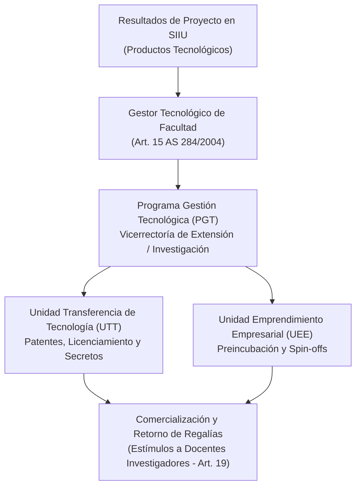

# Acuerdo Superior 284 de 2004 — Programa de Gestión Tecnológica y Transferencia

> **Tipo de Norma:** Acuerdo del Consejo Superior Universitario  
> **Número:** 284 (14 de diciembre de 2004)  
> **Órgano Emisor:** Consejo Superior Universitario — Universidad de Antioquia  
> **Documento Fuente Fidedigno:** [LEG-AS-284-2004](../archivo_maestro/legalidad/LEG-AS-284-2004.md)

---

## 1. Conexión Estratégica con el SIIU

El Acuerdo Superior 284 de 2004 estructura el marco operativo para que las invenciones y resultados de proyectos inscritos en el SIIU trasciendan los laboratorios hacia el sector productivo mediante **patentes, licenciamiento, desarrollo de software, spin-offs y contratos de I+D+i**:

---

## 2. Aspectos Normativos y Operativos Clave

| Disposición | Contenido Normativo | Aplicación en el SIIU |
|---|---|---|
| **Estructura Dual (Art. 4)** | Creación de la Unidad de Transferencia (UTT) y Unidad de Emprendimiento (UEE). | Canales institucionales para registrar y valorar productos tecnológicos generados en proyectos del SIIU. |
| **Gestores Tecnológicos (Art. 15)** | Figura de enlace en cada facultad entre los grupos de investigación y el PGT. | Articulación con los Centros de Investigación al evaluar componentes de innovación. |
| **Proyectos con Empresas (Art. 18)** | Regula formulación técnico-económica, negociación contractual y entrega de informes finales a empresas aliadas. | Aplica para la tipología de proyectos inscritos con financiación de contraparte privada. |
| **Estímulos a Docentes (Art. 19)** | Faculta la reglamentación de incentivos económicos a investigadores derivados de la explotación comercial de su tecnología. | Articulado con la Ley 1838 de 2017 y el Estatuto de Propiedad Intelectual. |
