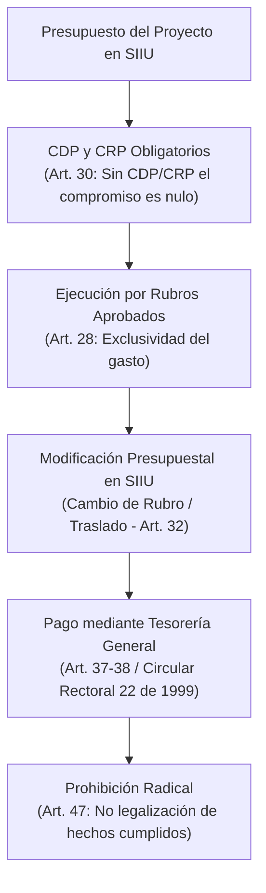

# Acuerdo Superior 350 de 2007 — Estatuto Financiero de la Universidad

> **Tipo de Norma:** Estatuto Financiero Universitario  
> **Número:** Acuerdo Superior 350 (27 de noviembre de 2007, vigencia 2008, actualizado a 2019)  
> **Órgano Emisor:** Consejo Superior Universitario — Universidad de Antioquia  
> **Documento Fuente Fidedigno:** [LEG-AS-350-2007.md](../../archivo_maestro/legalidad/LEG-AS-350-2007.md)

---

## 1. El Rigor Financiero en la Gestión de Proyectos del SIIU

El Estatuto Financiero gobierna la administración de fondos, la ordenación del gasto, los pagos a proveedores/contratistas y la contabilidad de los proyectos de investigación:

---

## 2. Puntos Clave que Todo Investigador y Centro Debe Saber

| Regla Financiera | Artículo del AS 350/2007 | Consecuencia Práctica en el SIIU |
|---|---|---|
| **Prohibición de Hechos Cumplidos** | **Art. 47** | Ningún investigador puede solicitar bienes, servicios o contratar personal antes de contar con la aprobación y registro del trámite en SIIU. Los gastos no autorizados no se reembolsan y comprometen la responsabilidad personal. |
| **Certificados Presupuestales (CDP y CRP)** | **Art. 30** | Toda orden de servicio, compra o pago de estímulos a Jóvenes Investigadores requiere reserva previa y refrendación de la Sección de Presupuesto. |
| **Cambios de Rubro / Traslados** | **Art. 32** | Los traslados presupuestales en SIIU solo proceden si la partida origen tiene saldo real libre de afectación. |
| **Centralidad de Tesorería** | **Art. 37** | No existen cuentas bancarias descentralizadas de proyectos; todo el recaudo y desembolso es gestionado por la Tesorería General. |
| **Cajas Menores y Avances** | **Art. 48** | Los gastos operativos menores de campo se gestionan por fondos fijos reembolsables de acuerdo con la normatividad de cajas menores. |
