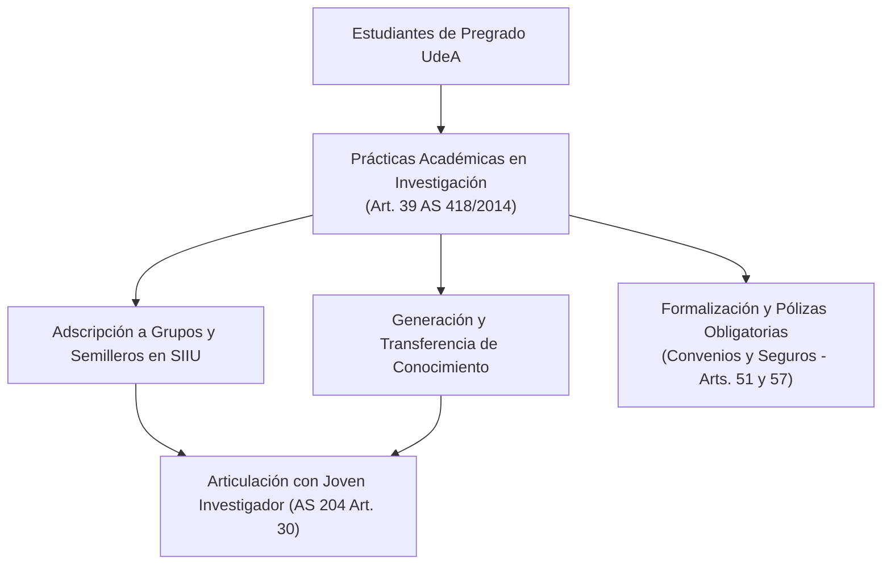

# Acuerdo Superior 418 de 2014 — Política Integral de Prácticas Académicas

> **Tipo de Norma:** Acuerdo del Consejo Superior Universitario  
> **Número:** 418 (29 de abril de 2014)  
> **Órgano Emisor:** Consejo Superior Universitario — Universidad de Antioquia  
> **Documento Fuente Fidedigno:** [LEG-AS-418-2014.md](../archivo_maestro/legalidad/LEG-AS-418-2014.md)

---

## 1. Integración de la Práctica Académica con la Investigación Formativa

El Acuerdo Superior 418 de 2014 supera la visión tradicional de que las prácticas estudiantiles son exclusivas de la docencia o extensión asistencial. Establece que la práctica es un espacio estructurante y transversal donde convergen la **Docencia, la Extensión y la Investigación**:

---

## 2. Puntos Clave para Grupos y Proyectos en el SIIU

| Componente | Artículo AS 418/2014 | Impacto en el SIIU |
|---|---|---|
| **Prácticas en I+D+i** | **Art. 39** | La Vicerrectoría de Investigación promueve y avala prácticas con componentes de generación y transferencia de conocimiento en proyectos del SIIU. |
| **Formalización Jurídica** | **Art. 51** | Toda vinculación de estudiantes en escenarios de práctica externos requiere convenio marco/específico, acta de inicio o contrato formal. |
| **Pólizas y Cobertura de Riesgos** | **Art. 57** | Obligatoriedad institucional de pólizas de accidentes estudiantiles y responsabilidad civil extracontractual para salidas de campo y laboratorios. |
| **Dedicación Docente a Tutorías** | **Art. 42-43** | El acompañamiento docente a estudiantes en proyectos formativos se reconoce expresamente en el plan de trabajo profesoral. |
