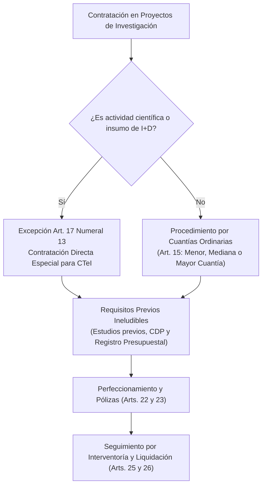

# Acuerdo Superior 419 de 2014 — Estatuto General de Contratación

> **Tipo de Norma:** Estatuto General de Contratación Universitaria  
> **Número:** Acuerdo Superior 419 (29 de abril de 2014, compilado y actualizado a junio de 2026)  
> **Órgano Emisor:** Consejo Superior Universitario — Universidad de Antioquia  
> **Documento Fuente Fidedigno:** [LEG-AS-419-2014.md](../archivo_maestro/legalidad/LEG-AS-419-2014.md)

---

## 1. El Régimen Contractual Privado y la Ciencia y Tecnología

El Estatuto General de Contratación consagra la aplicación del régimen de **derecho privado** para la contratación de la Universidad de Antioquia, otorgando una flexibilidad operativa crucial para el desarrollo de proyectos de investigación y convenios interinstitucionales:

---

## 2. Puntos Críticos para Investigadores y Centros de Investigación

| Asunto Contractual | Disposición en AS 419/2014 | Impacto Práctico en el SIIU |
|---|---|---|
| **Régimen Especial de CTeI (Art. 17 num. 13)** | Se exceptúan de las convocatorias y cotizaciones ordinarias los contratos para el desarrollo de actividades científicas y tecnológicas, proyectos de investigación, innovación y adquisición de insumos especializados de laboratorio. | Facilita la adquisición ágil de reactivos, insumos de alta pureza y servicios especializados en el marco del presupuesto del proyecto. |
| **Convenios Internacionales (Art. 7 num. 2)** | El Rector tiene la competencia exclusiva para suscribir contratos y convenios internacionales que aporten recursos para proyectos. | En la [Matrícula de Proyectos Inscritos](../02_PROCESOS_CLAVE/Matricula_Proyectos.md), los convenios con agencias extranjeras deben contar con la firma rectoral. |
| **Límite de Adición Presupuestal (Art. 21)** | Los contratos solo pueden adicionarse en valor hasta en un **50% del monto inicial**. | Todo contrato o prestación de servicios de investigación debe formularse con previsión adecuada para evitar superar el tope legal. |
| **Pólizas y Garantías (Art. 23)** | Se exige constitución de garantías de cumplimiento, salarios y calidad de bienes de acuerdo con el riesgo. | En el [Inicio Formal de Proyectos](../02_PROCESOS_CLAVE/Inicio_Formal.md), el cargue de pólizas aprobadas es condición previa al acta de inicio. |
| **Liquidación Oportuna (Art. 26)** | Todo contrato o convenio debe liquidarse de común acuerdo a más tardar dentro de los **seis (6) meses** siguientes a su finalización. | Condición ineludible para el [Cierre y Liquidación de Proyectos](../02_PROCESOS_CLAVE/Cierre_y_Liquidacion.md) en SIIU. |
