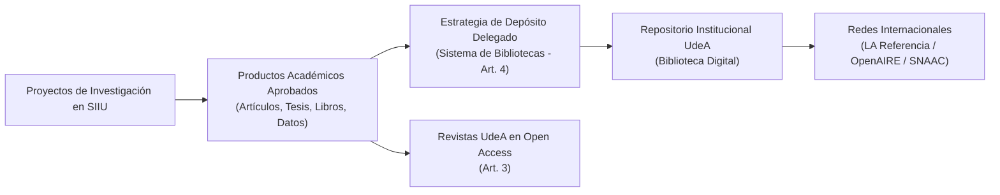

# Acuerdo Superior 451 de 2018 — Política Institucional de Acceso Abierto

> **Tipo de Norma:** Política Institucional del Consejo Superior Universitario  
> **Número:** Acuerdo Superior 451 (24 de abril de 2018)  
> **Adhesión:** Declaración de Berlín sobre Acceso Abierto  
> **Órgano Emisor:** Consejo Superior Universitario — Universidad de Antioquia  
> **Documento Fuente Fidedigno:** [LEG-AS-451-2018.md](../../archivo_maestro/legalidad/LEG-AS-451-2018.md)

---

## 1. El Compromiso con la Ciencia Abierta y la Democratización del Saber

El Acuerdo Superior 451 de 2018 consagra la adhesión de la Universidad de Antioquia al movimiento mundial de **Acceso Abierto (Open Access)**, ordenando que toda la producción científica resultante de proyectos de investigación financiados con recursos públicos e institucionales sea depositada y visibilizada libremente:

---

## 2. Aplicación Directa en la Gestión de Compromisos del SIIU

| Aspecto de la Política | Mandato del AS 451/2018 | Procedimiento Operativo en el SIIU |
|---|---|---|
| **Depósito Delegado (Art. 4)** | El Sistema de Bibliotecas archiva directamente en el Repositorio Institucional la producción de autores con filiación UdeA. | En la [Gestión de Compromisos](../../wiki/02_PROCESOS_CLAVE/Gestion_Compromisos.md), el registro de artículos y libros en SIIU facilita la articulación automática con el Repositorio. |
| **Interoperabilidad de Sistemas (Art. 6.b)** | Mandato para que el sistema de información de proyectos (SIIU) intercambie metadatos con el Repositorio Institucional. | Permite validar compromisos académicos sin duplicar cargas documentales para los investigadores. |
| **Filiación Institucional Obligatoria** | Los productos deben registrar explícitamente a la *Universidad de Antioquia* como entidad de adscripción de los autores. | Requisito indispensable para la aprobación técnica de informes finales y paz y salvos en SIIU. |
| **Tesis y Trabajos de Grado (Art. 4 Par. 2)** | Los trabajos de investigación de maestría y doctorado vinculados a proyectos deben depositarse en acceso abierto. | Verificado en el [Cierre y Liquidación de Proyectos](../../wiki/02_PROCESOS_CLAVE/Cierre_y_Liquidacion.md). |
