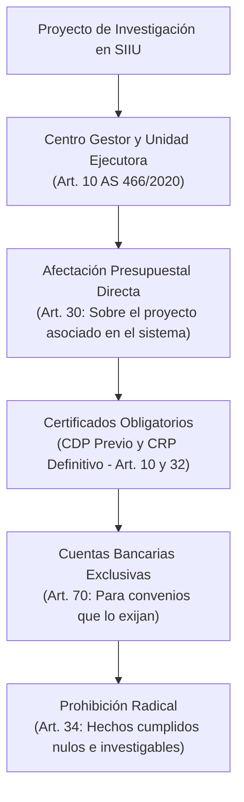

# Acuerdo Superior 466 de 2020 — Estatuto Financiero Vigente de la Universidad

> **Tipo de Norma:** Estatuto Financiero Universitario Vigente  
> **Número:** Acuerdo Superior 466 (28 de julio de 2020, actualizado a junio de 2026)  
> **Órgano Emisor:** Consejo Superior Universitario — Universidad de Antioquia  
> **Estado:** Vigente (Sustituyó y derogó expresamente al AS 350 de 2007 y al AS 121 de 1997)  
> **Documento Fuente Fidedigno:** [LEG-AS-466-2020.md](../../archivo_maestro/legalidad/LEG-AS-466-2020.md)

---

## 1. El Marco Financiero Vigente y su Impacto en el SIIU

El Acuerdo Superior 466 de 2020 es la norma que rige hoy todas las operaciones presupuestales, contables y financieras de los proyectos en la Universidad de Antioquia. Introduce la convergencia con las **Normas Internacionales de Contabilidad del Sector Público (NICSP)** y define el ciclo financiero aplicable a los investigadores:

---

## 2. Puntos Críticos para la Gestión de Proyectos en el SIIU

| Componente del AS 466/2020 | Regla Vigente | Trámite en SIIU |
|---|---|---|
| **Hechos Cumplidos (Art. 34)** | Prohibición absoluta de legalizar o pagar obligaciones que no reúnan los requisitos o se configuren como hechos cumplidos sin orden judicial previa. | Nunca adquirir insumos ni ordenar labores antes de que el contrato u orden de compra cuente con CRP en el sistema. |
| **Cuentas Bancarias de Convenios (Art. 70)** | Cuando un contrato o financiador externo exija el manejo exclusivo de fondos, la División de Gestión Financiera abre una cuenta con destinación específica atada al Centro Gestor. | Se reporta en el [Inicio Formal de Proyectos](../../wiki/02_PROCESOS_CLAVE/Inicio_Formal.md) para recepción de desembolsos. |
| **Devolución de IVA en Proyectos (Art. 21)** | Los ordenadores del gasto de proyectos con recursos Minciencias pueden tramitar bimestralmente la devolución del IVA ante la Vicerrectoría Administrativa. | Representa recursos adicionales recuperados para la ejecución de las investigaciones. |
| **Reservas Presupuestales y Cuentas por Pagar (Art. 38-40)** | Las apropiaciones expiran a 31 de diciembre; solo los compromisos perfeccionados con CRP pasan como reservas presupuestales o cuentas por pagar a la siguiente vigencia. | Justifica la necesidad de tramitar prórrogas y adiciones con suficiente anticipación en SIIU. |
| **Activos Intangibles (Art. 57)** | El software, algoritmos y patentes desarrollados en proyectos se reconocen formalmente en los estados financieros de la Universidad. | Articulado con la política de propiedad intelectual y los compromisos tecnológicos. |
