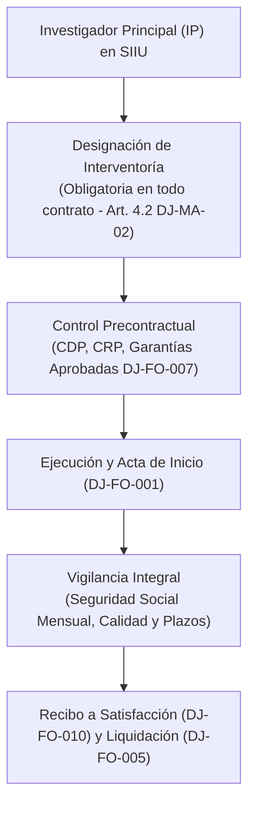

# Manual de Interventoría de Bienes, Servicios y Obras (DJ-MA-02)

> **Código:** DJ-MA-02 (Versión 01 / 19 de mayo de 2020)  
> **Emisor:** Dirección Jurídica — Universidad de Antioquia  
> **Marco Legal:** Acuerdo Superior 419 de 2014, Resolución Rectoral 39475 de 2014, Ley 1474 de 2011  
> **Documento Fuente Fidedigno:** [LEG-DJ-MA-02](../archivo_maestro/legalidad/LEG-DJ-MA-02.md)

---

## 1. El Rol del Investigador Principal como Interventor Técnico en el SIIU

En la inmensa mayoría de proyectos financiados por convocatorias internas (CODI) o fuentes externas, el **Investigador Principal (IP)** actúa contractualmente como **interventor o supervisor** de las órdenes de compra de reactivos, adquisición de equipos científicos y contratos de prestación de servicios para el personal auxiliar y técnico:

---

## 2. Obligaciones Ineludibles y Responsabilidades del Investigador

| Deber del Interventor | Mandato en DJ-MA-02 | Riesgo / Sanción por Incumplimiento |
|---|---|---|
| **Verificación de Seguridad Social (4.4.3.g-h)** | Exigir mensualmente la planilla de pago a EPS, Pensión y ARL antes de firmar cualquier cuenta de cobro o autorización de pago. | Responsabilidad disciplinaria y fiscal solidaria si se paga sin aportes al sistema de seguridad social. |
| **Prohibición de Iniciar sin Legalización (7.1.a)** | Prohibido iniciar labores antes de contar con la firma del contrato, pólizas aprobadas y Certificado de Registro Presupuestal (CRP). | Incurre en causal de hecho cumplido (Art. 34 AS 466/2020), con responsabilidad patrimonial personal. |
| **Oportunidad en Prórrogas (5.3)** | Toda prórroga de plazo contractual debe solicitarse y formalizarse **antes del vencimiento del contrato original**. | Los contratos vencidos no admiten prórroga; cualquier intento de adición posterior adolece de nulidad absoluta. |
| **Tope de Adición del 50% (5.1)** | El valor inicial del contrato solo puede incrementarse hasta en un **50%**. | Obliga a planear adiciones presupuestales dentro de los márgenes de ley. |
| **Régimen de 5 Responsabilidades (Cap. 6)** | El interventor responde en 5 esferas: **Disciplinaria, Penal, Civil, Patrimonial y Fiscal (ante Contraloría General de Antioquia)**. | Llamamiento en garantía y acción de repetición si la Universidad resulta condenada. |

---

## 3. Formatos Normalizados Clave para el Investigador

- **DJ-FO-001:** Acta de Inicio de Ejecución.
- **DJ-FO-003:** Acta de Seguimiento Mensual para contratos continuos.
- **DJ-FO-007:** Acta de Aprobación de Pólizas Contractuales.
- **DJ-FO-010:** Recibo a Satisfacción de Bienes y Servicios (requisito previo para desembolso por Tesorería).
- **DJ-FO-005:** Acta de Liquidación Final del Contrato.
