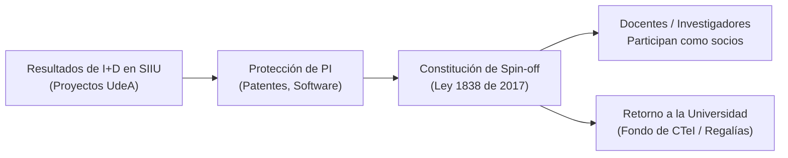

# Ley 1838 de 2017 — Creación y Fomento de Spin-offs Universitarias

> **Tipo de Norma:** Ley de la República de Colombia  
> **Número:** 1838 de 2017 (06 de Julio de 2017)  
> **Publicación:** Diario Oficial No. 50286  
> **Alcance:** Nacional para Instituciones de Educación Superior (IES)  
> **Documento Fuente Fidedigno:** [LEG-LEY-1838-2017](../archivo_maestro/legalidad/LEG-LEY-1838-2017.md)

---

## 1. Propósito y Relevancia Institucional

La Ley 1838 de 2017 (conocida como la *Ley Spin-off*) eliminó las barreras legales históricas que impedían a los docentes e investigadores de universidades públicas participar como socios, creadores y beneficiarios económicos en empresas de base tecnológica (EBT) nacidas a partir de resultados de proyectos de I+D+i.

En el marco de la Universidad de Antioquia, esta ley es el pilar legal superior que habilita las políticas institucionales de innovación, licenciamiento y transferencia tecnológica reguladas en los Acuerdos Superiores 418 y 419 de 2014.

---

## 2. Puntos Clave de la Ley

| Artículo | Concepto Regulado | Aplicación Práctica en la UdeA |
|---|---|---|
| **Art. 1** | Definición de Spin-off | Empresa basada en conocimientos y PI generados en laboratorios e instalaciones de la universidad. |
| **Art. 2** | Habilitación de Servidores Públicos | Docentes e investigadores pueden asociarse a cualquier título o fundar EBTs sin incurrir en incompatibilidad legal. |
| **Art. 3** | Beneficios Económicos | Los ingresos que reciba el docente provienen de la empresa; **no constituyen factor salarial** ni violan la prohibición de doble asignación del tesoro público. |
| **Art. 4** | Retorno y Fondos de CTeI | Las utilidades o regalías retornan a la Universidad para reinvertir en los fondos de investigación (FODI / CODI). |
| **Art. 5** | Coordinación Administrativa | Las IES deben contar con una dependencia gestora (Unidad de Innovación / Transferencia Tecnológica). |

---

## 3. Articulación con el SIIU y el Ciclo de Proyectos

1. **Gestión de Compromisos Académicos y Tecnológicos ([Gestión de Compromisos](../02_PROCESOS_CLAVE/Gestion_Compromisos.md)):**
   - Cuando un proyecto en SIIU reporta productos tecnológicos (prototipos, patentes, software registrado), estos pueden postularse ante la Vicerrectoría de Extensión / Innovación para ruta de transferencia.
2. **Propiedad Intelectual ([Acuerdo Superior 086 de 1996](AS_086_1996.md)):**
   - La titularidad institucional de las patentes y derechos patrimoniales se articula con la opción de licenciamiento hacia la Spin-off creada por el equipo investigador.
3. **Rol del Investigador ([Rol Investigador](../01_ROLES/Rol_Investigador.md)):**
   - Permite al docente universitario transitar de la investigación pura al emprendimiento de base científica con total blindaje jurídico.
