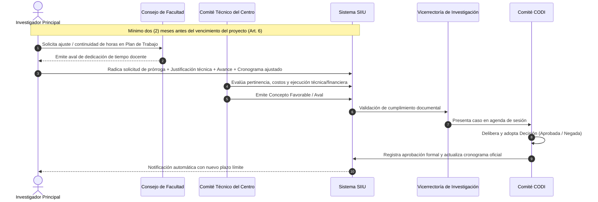

# Resolución Rectoral 00968 de 2026 — Trámite de Prórrogas y Plazos en Proyectos SIIU

| Metadato | Detalle Institucional |
| :--- | :--- |
| **Norma Superior Habilitante** | [Acuerdo Superior 204 de 2001 (SUI)](AS_204_2001_Sistema_Universitario_Investigacion.md) — Art. 44 y [AS 01 de 1994](AS_01_1994_Estatuto_General.md) |
| **Fecha de Expedición** | 30 de septiembre de 2026 |
| **Órgano Emisor** | Rectoría — Universidad de Antioquia (aprobado tras sesión CODI 00012/2026) |
| **Instancia Aprobatoria** | Comité para el Desarrollo de la Investigación (CODI) y Centros de Investigación |
| **Plataforma Tecnológica** | **Sistema Integrado de Información Universitaria — SIIU** |
| **Documento Fidedigno** | [LEG-RR-00968-2026](../archivo_maestro/legalidad/LEG-RR-00968-2026.md) |
| **Estado Jurídico** | **VIGENTE** |

---

## 1. Contexto y Objetivos del Nuevo Reglamento

La **Resolución Rectoral 00968 de 2026** establece por primera vez un marco normativo uniforme, riguroso y transparente para gestionar:
1. La **ampliación del tiempo de ejecución técnica y financiera** de proyectos de investigación financiados por el CODI o la Universidad.
2. La concesión de un **plazo adicional exclusivo para la acreditación de productos que dependen de terceros** (como artículos científicos en evaluación por revistas indexadas, exámenes de patentes en la SIC o dictámenes editoriales).
3. La eliminación de asimetrías y discrecionalidades entre dependencias académicas, garantizando la **corresponsabilidad institucional** en el manejo de recursos públicos.

---

## 2. Diferenciación Crítica: Prórroga de Ejecución vs. Plazo de Compromisos

```mermaid
flowchart TD
    FinProyecto[Vencimiento del Cronograma del Proyecto] --> TipoSolicitud{¿Qué Necesita el Proyecto?}
    
    TipoSolicitud -- "Continuar Actividades Técnicas,\nExperimentos o Gastos" --> Prorroga[Prórroga de Plazo para Ejecución\n- Art. 2 literal b y Art. 7\n- Máximo 50% del tiempo inicial (Excepcional 100%)\n- Requiere aval del Centro + Consejo Facultad + CODI\n- Mantiene ejecución presupuestal y horas de dedicación]
    
    TipoSolicitud -- "Solo Acreditar Publicación,\nPatente o Dictamen de Terceros" --> PlazoAdicional[Plazo para Cumplimiento de Compromisos\n- Art. 2 literal c y Art. 12\n- Hasta por 1 Año (Máximo absoluto 2 Años)\n- NO reabre ejecución presupuestal\n- NO otorga nuevas horas en plan de trabajo\n- Estado SIIU: 'Con plazo adicional autorizado']
```

| Criterio Comparativo | Prórroga de Plazo de Ejecución (Art. 2b) | Plazo Adicional de Compromisos (Art. 2c, 12) |
| :--- | :--- | :--- |
| **Finalidad** | Culminar experimentos, pruebas de campo, compras o análisis técnicos. | Acreditar productos terminados cuya publicación/registro depende de un tercero. |
| **Ejecución Presupuestal** | Se mantiene abierta para ejecutar saldos comprometidos. | **Cerrada definitivamente**. No permite ningún gasto nuevo ni reasignación de rubros. |
| **Plan de Trabajo Docente** | Requiere aval de horas adicionales aprobado por Consejo de Facultad. | **No asigna horas en el plan de trabajo**. |
| **Límite Temporal** | Suma máxima: **hasta 50%** del plazo inicial (excepcional hasta 100%). | **Hasta 1 año** renovable por el CODI hasta un máximo de **2 años**. |
| **Estado en el SIIU** | "En Ejecución (Con Prórroga)" | "Con plazo adicional autorizado para cumplimiento de compromisos" (No atrasado). |

---

## 3. Flujograma del Trámite en el SIIU (Artículos 4, 5, 6 y 9)



---

## 4. Causales y Exigencias de Oportunidad (Artículos 3 y 6)

1. **Circunstancias Sobrevinientes:** La prórroga es de carácter extraordinario y solo procede ante contingencias científicas, logísticas imprevistas o fuerza mayor debidamente documentadas.
2. **Prohibición Expresa:** En ningún caso se otorgará para subsanar negligencias, omisiones de gestión o falta de planeación del equipo investigador.
3. **Plazo de Presentación:** Debe radicarse ante el Comité Técnico del Centro con **mínimo dos (2) meses de antelación** a la fecha de finalización. 
4. **Vencimiento sin Aprobación (Art. 13):** Si el plazo fenece sin que el IP haya radicado la solicitud y sin acreditar los compromisos, el SIIU calificará automáticamente el proyecto como **"INCUMPLIDO"**, notificando a la Oficina de Control Interno y activando el régimen de responsabilidades fiscales y disciplinarias.

---

## 5. Checklist Operativo para el Investigador Principal

Antes de someter una prórroga o plazo en el SIIU:
- [ ] ¿Faltan más de 60 días calendario para la fecha de terminación del proyecto?
- [ ] ¿Cuenta con el aval formal del Consejo de Facultad para la asignación de horas en el Plan de Trabajo?
- [ ] ¿El informe de avance detalla con precisión los objetivos cumplidos, el saldo presupuestal y las tareas pendientes?
- [ ] En caso de solicitar plazo de compromisos (Art. 12), ¿se adjuntó la carta de recepción de la revista científica o el radicado de la patente ante la SIC?
- [ ] ¿El tiempo acumulado de prórrogas respeta el tope del 50% del plazo original?

---

## 6. Enlaces y Navegación Cruzada

- **Documento Fidedigno:** [LEG-RR-00968-2026](../archivo_maestro/legalidad/LEG-RR-00968-2026.md)
- **Sistema Universitario de Investigación:** [Acuerdo Superior 204 de 2001](AS_204_2001_Sistema_Universitario_Investigacion.md)
- **Estatuto General:** [Acuerdo Superior 01 de 1994](AS_01_1994_Estatuto_General.md)
- **Estatuto Profesoral:** [Acuerdo Superior 083 de 1996](AS_083_1996_Estatuto_Profesoral.md)
- **Estatuto de Propiedad Intelectual Vigente:** [Resolución Rectoral 49544 de 2022](RR_49544_2022_Nuevo_Estatuto_PI.md)
- **MOC Central de Legalidad:** [MOC_Marco_Normativo](../00_INICIO_Y_MOCS/MOC_Marco_Normativo.md)
