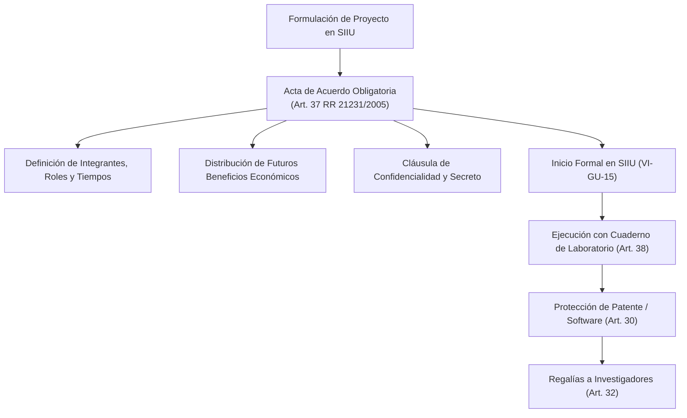

# Resolución Rectoral 21231 de 2005 — Estatuto de Propiedad Intelectual

> **Tipo de Norma:** Resolución Rectoral  
> **Número:** 21231 (05 de agosto de 2005)  
> **Emisor:** Rectoría — Universidad de Antioquia (por delegación del Consejo Superior Universitario AS 073/1996)  
> **Documento Fuente Fidedigno:** [LEG-RR-21231-2005](../archivo_maestro/legalidad/LEG-RR-21231-2005.md)

---

## 1. El Blindaje de los Resultados Científicos en el SIIU

La Resolución Rectoral 21231 de 2005 sentó las bases operativas de la propiedad intelectual en la Universidad de Antioquia, regulando desde la **titularidad institucional de patentes** hasta el instrumento más importante en el arranque de cualquier investigación: el **Acta de Acuerdo de Proyecto**:

---

## 2. Puntos Críticos para Investigadores y Centros

| Aspecto Regulado | Disposición Legal | Impacto Operativo en el SIIU |
|---|---|---|
| **Acta de Acuerdo Previa (Art. 37)** | Es obligatoria para todo proyecto antes de su ejecución. Debe incluir roles, quiénes NO son titulares de PI, reparto de beneficios y confidencialidad. | En la [Guía VI-GU-15 (Inicio Formal)](../archivo_maestro/VI-GU-15.md), el cargue del acta de acuerdo firmada es requisito indispensable. |
| **Titularidad Institucional (Arts. 23-24)** | Las patentes y derechos patrimoniales sobre creaciones de docentes en cumplimiento de sus funciones pertenecen a la Universidad. | Los contratos de proyectos cofinanciados en SIIU deben estipular con claridad las reglas de titularidad compartida. |
| **Participación en Regalías (Art. 32)** | Los inventores y autores tienen derecho a participar en los beneficios económicos netos que reciba la Universidad por licenciamiento. | Habilita incentivos económicos directos al equipo de investigación. |
| **Cuaderno de Laboratorio (Art. 38)** | Toda investigación experimental debe llevar un cuaderno foliado y cronológico que no puede ser retirado del laboratorio. | Garantiza la trazabilidad y la fecha cierta para la solicitud de patentes nacionales e internacionales. |
| **Prohibición de Divulgación Previa (Art. 34.2)** | No se pueden publicar artículos, ponencias ni tesis mientras se tramite la solicitud de patente o registro (máx. 1 año). | Evita la pérdida de novedad de las invenciones generadas en proyectos de SIIU. |
