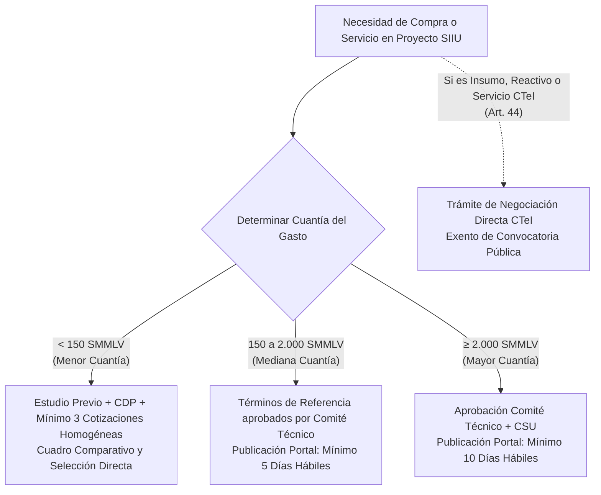

# Resolución Rectoral 39475 de 2014 — Reglamento del Estatuto General de Contratación

| Metadato | Detalle Institucional |
| :--- | :--- |
| **Norma Reglamentada** | [Acuerdo Superior 419 de 2014](AS_419_2014_Estatuto_Contratacion.md) |
| **Fecha de Expedición** | 14 de noviembre de 2014 |
| **Órgano Emisor** | Rectoría — Universidad de Antioquia |
| **Régimen Legal** | Derecho Privado (Art. 93 Ley 30/1992, Ley 647/2001) con Excepciones de CTeI |
| **Documento Fidedigno** | [LEG-RR-39475-2014](../archivo_maestro/legalidad/LEG-RR-39475-2014.md) |
| **Estado Jurídico** | **Vigente** (Deroga RR 16263/2002, 17887/2003, 13843/2000, 17115/2003, 21176/2005) |

---

## 1. Propósito y Alcance Operativo

La **Resolución Rectoral 39475 de 2014** es la norma procedimental maestra que instrumentaliza las adquisiciones, órdenes de servicio, convenios y compras públicas en la Universidad de Antioquia. 

Para los investigadores, directores de centro y coordinadores de proyectos en el **Sistema de Información para la Investigación Universitaria (SIIU)**, esta resolución establece:
1. Los **requisitos obligatorios de los Estudios Previos de Necesidad y Conveniencia** (20 ítems obligatorios antes de comprometer cualquier rubro).
2. El **procedimiento preferencial de contratación directa para Ciencia, Tecnología e Innovación (CTeI)** (Artículo 44).
3. Las reglas para **compras directas a proveedores extranjeros** (software, insumos de laboratorio, reactivos) sin las restricciones ordinarias de pliegos.
4. El régimen de pólizas, garantías contractuales y responsabilidades de interventoría (articuladas con el manual [DJ-MA-02](DJ_MA_02_Manual_Interventoria.md)).

---

## 2. Matriz Operativa de Cuantías y Tiempos de Selección



| Modalidad | Rango de Cuantía (SMMLV) | Instancia de Aprobación | Tiempo Publicación Portal | Requisitos Documentales |
| :--- | :--- | :--- | :--- | :--- |
| **Caja Menor** | < 1 SMMLV | Ordenador del Gasto Dependencia | No requiere | Solicitud justificada, factura legal |
| **Menor Cuantía** | Hasta 150 SMMLV | Decano / Director de Instituto (Delegado) | No requiere | Estudio previo (20 ítems), CDP, 3 cotizaciones, cuadro comparativo |
| **Mediana Cuantía** | 150 a 2.000 SMMLV | Comité Técnico de Contratación | Mínimo 5 días hábiles | Términos de referencia, RUP, evaluación objetiva, garantías |
| **Mayor Cuantía** | $\ge$ 2.000 SMMLV | Rector / Comité Técnico / Consejo Superior | Mínimo 10 días hábiles | Pliegos aprobados por CSU, adendas con 3 días de antelación, RUP |
| **Negociación Directa CTeI (Art. 44)** | Cualquier cuantía según rubro asignado | Ordenador del Gasto según delegación | No requiere convocatoria | Justificación de pertinencia científica, estudio previo, CDP, cotización |

---

## 3. Régimen Especial de Contratación en CTeI (Artículo 44)

Conforme a las facultades excepcionales del **Decreto Ley 393 de 1991, Decreto Ley 591 de 1991 y Ley 1286 de 2009**, la Universidad exonera de convocatoria pública las contrataciones amparadas en las **19 actividades del conocimiento**:

```mermaid
graph LR
    subgraph Adquisiciones CTeI Exoneradas
        A[Reactivos y Químicos Especializados]
        B[Equipos Científicos de Laboratorio]
        C[Suscripciones Bases de Datos Científicas]
        D[Servicios Técnicos Foráneos Especializados]
        E[Honorarios Investigadores y Conferencistas Extranjeros]
        F[Patentes, Licenciamiento y Transferencia]
        G[Publicaciones Científicas Indexadas]
    end
    
    Adquisiciones CTeI Exoneradas --> ProcesoDirecto[Contratación Directa CTeI\n- Sin Pliegos Ordinarios\n- Con Oferta Directa\n- Con Aceptación Electrónica]
```

### Compras a Proveedores Extranjeros (Artículos 47 y 48)
1. **Perfeccionamiento Ágil:** Se perfecciona formalmente con la **aceptación de la cotización vía correo electrónico** institucional o la expedición de la Orden de Compra/Factura Proforma.
2. **Exención de Garantías Locales:** Se autoriza el pago anticipado bancario internacional o mediante carta de crédito sin exigir pólizas de aseguradoras colombianas cuando el proveedor no tenga sucursal en el país.
3. **Nacionalización y Aduanas:** Tramitada centralmente por la Dirección de Gestión Logística con cargo al proyecto en el SIIU.

---

## 4. Matriz de Garantías y Pólizas Contractuales (Artículos 49-50)

Cuando el contrato o la orden de servicio supera los 50 SMMLV o involucra anticipos/riesgos operacionales, se exigen las siguientes garantías:

| Amparo / Cobertura | Porcentaje Mínimo Exigible | Vigencia Requerida |
| :--- | :--- | :--- |
| **Seriedad de la Oferta** | 10% del presupuesto estimado | Plazo de selección + 30 días calendario |
| **Cumplimiento del Contrato** | 15% del valor total del contrato | Plazo de ejecución + 4 meses adicionales |
| **Buen Manejo del Anticipo** | 100% del monto desembolsado | Hasta la amortización total del anticipo |
| **Pago de Salarios y Prestaciones** | 7% del valor total del contrato | Plazo contractual + 3 años adicionales |
| **Calidad de Equipos Científicos** | 50% del valor de los bienes suministrados | Mínimo 1 año a partir del Acta de Recibo a Satisfacción |
| **Calidad del Servicio Prestado** | 15% del valor de la orden | Plazo de ejecución + 4 meses adicionales |
| **Responsabilidad Civil Extracontractual** | 15% del valor total | Plazo contractual completo (UdeA asegurada) |

---

## 5. Puntos de Contacto con el SIIU y el Investigador Principal

1. **Elaboración del Estudio Previo en SIIU:**
   - Todo rubro a comprometer debe vincular el Estudio Previo diligenciado con los 20 requisitos del Artículo 7, incluyendo la matriz de riesgos operacionales y ambientales.
2. **Interventoría y Supervisión:**
   - El Investigador Principal o el Coordinador suele ser designado como **Interventor o Supervisor**. Debe cumplir rigurosamente el procedimiento del Manual [DJ-MA-02](DJ_MA_02_Manual_Interventoria.md).
3. **Verificación de Aportes Parafiscales:**
   - Es causal de rechazo de pago tramitar cuentas en SIIU sin adjuntar la planilla PILA mensual certificada del contratista (Salud, Pensión y ARL).
4. **Límite de Modificaciones Contractuales:**
   - Las prórrogas en tiempo no tienen límite porcentual pero requieren justificación técnica en el Comité del Centro; las **adiciones en dinero no pueden superar el 50% del valor inicial** del contrato (Artículo 59).

---

## 6. Enlaces y Navegación Cruzada

- **Norma Superior:** [Acuerdo Superior 419 de 2014 — Estatuto de Contratación](AS_419_2014_Estatuto_Contratacion.md)
- **Manual Operativo Vinculado:** [DJ-MA-02 — Manual de Interventoría](DJ_MA_02_Manual_Interventoria.md)
- **Norma Financiera:** [Acuerdo Superior 466 de 2020 — Estatuto Financiero Vigente](AS_466_2020_Estatuto_Financiero_Vigente.md)
- **Procedimientos SIIU:** [Gestión de Compras e Insumos en Proyectos](../02_PROCESOS_CLAVE/Gestion_Compras_SIIU.md)
- **Mapa Normativo Central:** [MOC_Marco_Normativo](../00_INICIO_Y_MOCS/MOC_Marco_Normativo.md)
