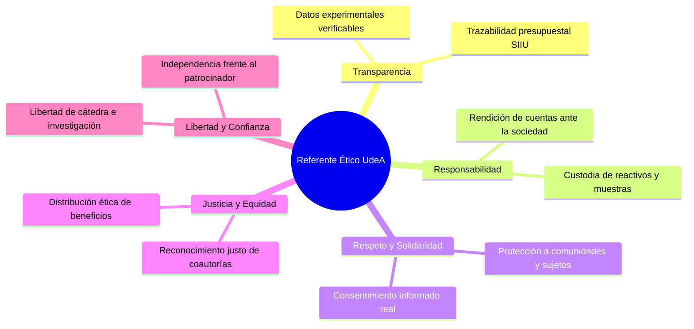
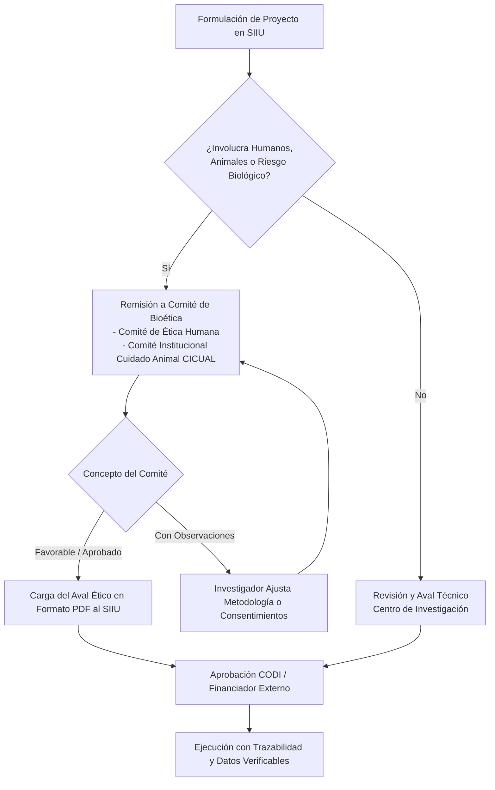

# Resolución Rectoral 39477 de 2014 — Referente Ético Institucional

| Metadato | Detalle Institucional |
| :--- | :--- |
| **Norma Superior** | [Acuerdo Superior 01 de 1994 (Estatuto General)](AS_01_1994_Estatuto_General.md) — Arts. 4, 6 y 14 |
| **Fecha de Expedición** | 13 de noviembre de 2014 |
| **Órgano Emisor** | Rectoría — Universidad de Antioquia |
| **Marco Nacional** | Ley 87 de 1993, Decreto 943 de 2014 (MECI / Protocolos Éticos) |
| **Documento Fidedigno** | [LEG-RR-39477-2014](../archivo_maestro/legalidad/LEG-RR-39477-2014.md) |
| **Estado Jurídico** | **Vigente** |

---

## 1. Propósito y Trascendencia en la Investigación

La **Resolución Rectoral 39477 de 2014** adopta el **Referente Ético de la Universidad de Antioquia**, estableciendo el marco axiológico obligatorio para las conductas de docentes, investigadores, estudiantes y personal administrativo.

En el marco del **Sistema de Información para la Investigación Universitaria (SIIU)**, el Referente Ético fundamenta:
1. La **integridad científica y honestidad académica** en el diseño, experimentación, reporte y publicación de resultados.
2. Los protocolos de **los Comités de Bioética** (investigación con seres humanos, muestras biológicas y experimentación animal).
3. La transparencia en la **declaración de conflictos de interés** y relacionamiento con financiadores públicos o privados.
4. El respeto estricto a la autoría moral e intelectual de estudiantes, jóvenes investigadores y coinvestigadores.

---

## 2. Los Diez Valores Rectores y su Aplicación en Investigación

| Valor Ético | Manifestación en la Vida Cotidiana de la Investigación (SIIU) |
| :--- | :--- |
| **Transparencia** | Coherencia entre datos obtenidos y publicados; prohibición absoluta de manipulación, falsificación o plagio de resultados. |
| **Responsabilidad** | Cumplimiento estricto del cronograma y presupuesto aprobado en el SIIU; cuidado ambiental y bioseguridad en laboratorios. |
| **Justicia** | Reconocimiento de coautorías a coinvestigadores y estudiantes según su aporte sustantivo real; nunca autorías por jerarquía o cortesía. |
| **Equidad** | Inclusión y trato digno en los equipos de investigación; igualdad de oportunidades para jóvenes investigadores y personal en formación. |
| **Libertad** | Búsqueda autónoma de la verdad científica sin censura ni presiones externas de financistas o gremios. |
| **Respeto** | Respeto a los sujetos participantes, comunidades étnicas, bienestar animal y cuidado de los ecosistemas donde se hace trabajo de campo. |
| **Solidaridad** | Retribución social del conocimiento a las comunidades objeto de estudio antes de su difusión comercial. |
| **Confianza** | Manejo transparente de los recursos del proyecto y veracidad en los informes de avance remitidos al CODI. |
| **Tolerancia** | Discusión argumentada de discrepancias científicas sin descalificaciones personales ni persecución académica. |
| **Lealtad** | Fidelidad institucional, confidencialidad en información estratégica y salvaguarda del patrimonio científico universitario. |

---

## 3. Flujo Ético en el Ciclo de Vida de un Proyecto SIIU

---

## 4. Conflictos de Interés y Declaraciones Obligatorias

En consonancia con el **Acuerdo Superior 395 de 2011** y la **RR 39477 de 2014**:
- Todo investigador principal o coinvestigador debe declarar en el SIIU si tiene vínculos económicos, de asesoría personal, familiares o de participación societaria con empresas proveedoras o entidades financiadoras privadas que puedan sesgar la neutralidad del proyecto.
- Los miembros de comités evaluadores del CODI o de los Centros de Investigación deben declararse impedidos cuando evalúen propuestas de colegas de su mismo grupo de investigación o con quienes tengan lazos conyugales o de consanguinidad.

---

## 5. Enlaces y Navegación Cruzada

- **Documento Fidedigno:** [LEG-RR-39477-2014](../archivo_maestro/legalidad/LEG-RR-39477-2014.md)
- **Estatuto Superior:** [Acuerdo Superior 01 de 1994 — Estatuto General](AS_01_1994_Estatuto_General.md)
- **Sistema de Investigación:** [Acuerdo Superior 204 de 2001 — SUI](AS_204_2001_Sistema_Universitario_Investigacion.md)
- **Propiedad Intelectual:** [Resolución Rectoral 21231 de 2005](RR_21231_2005_Estatuto_Propiedad_Intelectual.md)
- **Manual de Interventoría:** [DJ-MA-02](DJ_MA_02_Manual_Interventoria.md)
- **MOC Central:** [MOC_Marco_Normativo](../00_INICIO_Y_MOCS/MOC_Marco_Normativo.md)
