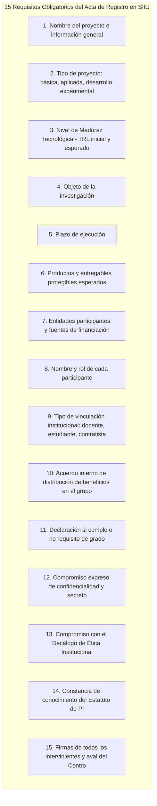
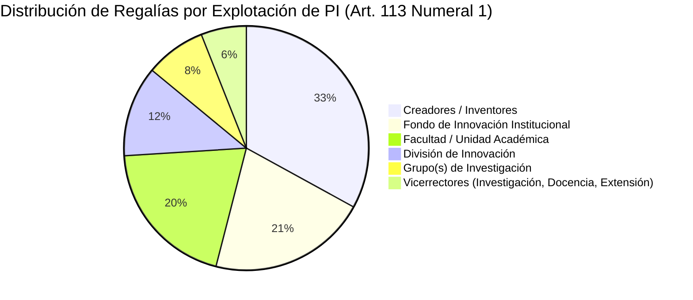
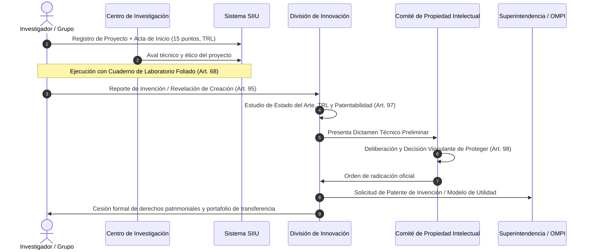

# Resolución Rectoral 49544 de 2022 — Estatuto de Propiedad Intelectual Vigente

| Metadato | Detalle Institucional |
| :--- | :--- |
| **Norma Delegante** | [Acuerdo Superior 01 de 1994 (Estatuto General)](AS_01_1994_Estatuto_General.md) — Art. 33 literal o y AS 073 de 1996 |
| **Fecha de Expedición** | 25 de noviembre de 2022 (Compilado a junio de 2026) |
| **Órgano Emisor** | Rectoría — Universidad de Antioquia |
| **Derogatorias Expresas** | **Deroga íntegramente la [Resolución Rectoral 21231 de 2005](RR_21231_2005_Estatuto_Propiedad_Intelectual.md) y la RR 33944 de 2012** |
| **Documento Fidedigno** | [LEG-RR-49544-2022](../archivo_maestro/legalidad/LEG-RR-49544-2022.md) |
| **Estado Jurídico** | **VIGENTE — Estatuto Rector de Propiedad Intelectual UdeA** |

---

## 1. Importancia y Cambio Estructural

La **Resolución Rectoral 49544 de 2022** representa la modernización más profunda de la normativa sobre derechos de autor, propiedad industrial y transferencia de tecnología de la Universidad de Antioquia. 

Sustituye el régimen histórico de 2005 para adaptarse a la **Ley 1838 de 2017 (Spin-offs)**, la **Ley 1915 de 2018 (Derechos de Autor)**, la **Política Institucional de Acceso Abierto ([AS 451 de 2018](AS_451_2018_Politica_Acceso_Abierto.md))**, y la gestión de proyectos a través del **Sistema de Información para la Investigación Universitaria (SIIU)**.

---

## 2. El Acta de Registro y Propiedad Intelectual en el SIIU (Artículo 64)

> **Mandato Estatutario (Art. 64 Parágrafo 2):**  
> *"El Acta de registro en el Sistema Integrado de Información Universitaria -SIIU-, hará las veces de esta Acta."*

Antes de iniciar la ejecución de cualquier proyecto financiado por el CODI, por fuentes externas o que involucre recursos significativos de la Universidad, el Investigador Principal y todos los participantes deben formalizar el Acta de Registro con los siguientes **15 requisitos obligatorios**:

---

## 3. Matriz Vigente de Distribución de Regalías e Ingresos (Artículo 113)

Cuando una invención, patente, software o desarrollo biotecnológico de la Universidad es transferido, comercializado o licenciado a una empresa o Spin-off, los ingresos netos recibidos se distribuyen obligatoriamente según la siguiente tabla:

| Beneficiario Institucional | Porcentaje Asignado | Destino del Recurso |
| :--- | :---: | :--- |
| **Creadores (Docentes, Estudiantes, Contratistas)** | **33%** | Pago directo en dinero. **No constituye salario** (Art. 109 Par. 2). Vitalicio hasta su fallecimiento. |
| **Fondo de Innovación** | **21%** | Fondo central para cofinanciar nuevos prototipos, patentes y pruebas de concepto. |
| **Unidad Académica de los Creadores** | **20%** | Fortalecimiento de laboratorios e infraestructura de la respectiva Facultad o Instituto. |
| **División de Innovación (Extensión)** | **12%** | Sostenibilidad operativa de la oficina de transferencia y tasas de mantenimiento internacional. |
| **Grupo(s) de Investigación de Origen** | **8%** | Recursos directos para financiar insumos, salidas de campo o reactivos del grupo. |
| **Vicerrectores Misionales** | **6%** | Apoyo a los ejes sustantivos conforme al Art. 47 del AS 124/1997. |

---

## 4. Ruta de Protección y Transferencia Tecnológica

---

## 5. Cuadro Comparativo: Régimen Anterior (RR 21231/2005) vs. Régimen Vigente (RR 49544/2022)

| Aspecto Clave | Régimen Anterior (RR 21231 de 2005) | Régimen Vigente (RR 49544 de 2022) |
| :--- | :--- | :--- |
| **Soporte Digital** | Actas físicas aisladas en papel | **Integración directa en el SIIU** como acta con plena validez jurídica |
| **Madurez Tecnológica** | No contemplaba escalas estandarizadas | Obligatoriedad de medición de **escalas TRL** (Technology Readiness Level) |
| **Spin-offs** | Regulación incipiente sin marco legal | Articulación plena con la **Ley 1838 de 2017** y autorización de marcas UdeA |
| **Entorno Virtual y Software** | Tratamiento genérico analógico | Capítulo integral para software, repositorios institucionales y licencias abiertas (GPL, Creative Commons) |
| **Distribución de Ingresos** | Dispersa en normas complementarias (RR 33944/2012) | **Unificada en el Art. 113** con 33% fijo para creadores y 21% para el Fondo de Innovación |
| **Recursos Genéticos** | Mención básica a permisos ambientales | Procedimiento estricto con **Permiso Marco ANLA y Contratos Marco MinAmbiente** (DA 391/1996) |

---

## 6. Enlaces y Navegación Cruzada

- **Documento Fidedigno:** [LEG-RR-49544-2022](../archivo_maestro/legalidad/LEG-RR-49544-2022.md)
- **Régimen Histórico Derogado:** [Resolución Rectoral 21231 de 2005](RR_21231_2005_Estatuto_Propiedad_Intelectual.md)
- **Ley Habilitante de Spin-offs:** [Ley 1838 de 2017](Ley_1838_2017_Spinoffs.md)
- **Política de Acceso Abierto:** [Acuerdo Superior 451 de 2018](AS_451_2018_Politica_Acceso_Abierto.md)
- **Gestión de Transferencia:** [Programa de Gestión Tecnológica (AS 284 de 2004)](AS_284_2004_Gestion_Tecnologica.md)
- **Mapa Central:** [MOC_Marco_Normativo](../00_INICIO_Y_MOCS/MOC_Marco_Normativo.md)
