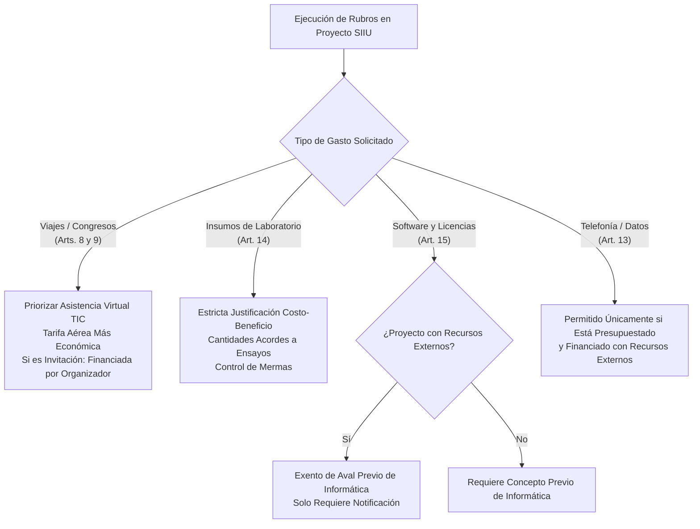

# Resolución Rectoral 51525 de 2024 — Política de Austeridad y Eficiencia en el Gasto Público

| Metadato | Detalle Institucional |
| :--- | :--- |
| **Norma Superior** | [Acuerdo Superior 01 de 1994 (Estatuto General)](AS_01_1994_Estatuto_General.md) y [AS 466 de 2020 (Estatuto Financiero)](AS_466_2020_Estatuto_Financiero_Vigente.md) |
| **Fecha de Expedición** | 25 de julio de 2024 |
| **Órgano Emisor** | Rectoría — Universidad de Antioquia |
| **Deroga Expresamente** | Resolución Rectoral 25750 del 27 de marzo de 2008 |
| **Documento Fidedigno** | [LEG-RR-51525-2024](../archivo_maestro/legalidad/LEG-RR-51525-2024.md) |
| **Estado Jurídico** | **VIGENTE** |

---

## 1. Alcance y Aplicación en Proyectos SIIU

La **Resolución Rectoral 51525 de 2024** actualiza las políticas de contención del gasto, autocontrol y racionalización presupuestal en toda la estructura de la Universidad de Antioquia.

Para los investigadores principales, coordinadores y gestores de centros en el **Sistema de Información para la Investigación Universitaria (SIIU)**, el Artículo 3º establece el principio rector:
> *"Los proyectos de extensión e investigación se sujetarán al cumplimiento del principio de planeación presupuestal; su ejecución y seguimiento debe estar enmarcado en las políticas de eficiencia y austeridad en el gasto, buscando maximizar los excedentes y garantizando el cumplimiento de los objetivos trazados en cada uno de ellos."*

---

## 2. Reglas Específicas para Rubros de Investigación en SIIU

---

## 3. Matriz Operativa de Rubros de Gasto

| Rubro en el SIIU | Restricción / Política de Austeridad | Excepción Habilitante para Investigación |
| :--- | :--- | :--- |
| **Tiquetes Aéreos y Viáticos** | Planificación obligatoria con tarifa económica básica. Priorizar participación remota. | Aprobación justificada del ordenador del gasto para trabajo de campo o misiones científicas insustituibles. |
| **Insumos y Reactivos de Laboratorio** | Prohibición de compras excesivas que generen caducidad o almacenamiento ineficiente. | Adquisiciones respaldadas en el cronograma metodológico del proyecto en SIIU. |
| **Licencias de Software Científico** | Las licencias institucionales requieren concepto favorable de la División de Gestión Informática. | **Proyectos de I+D como contratista o cofinanciados:** No requieren aval previo de informática; solo notificación de control (Art. 15 Parágrafo). |
| **Telefonía Móvil y Planes de Datos** | Desmonte general de planes celulares en la Universidad. | **Líneas para trabajo de campo:** Permitidas si están financiadas con recursos externos y presupuestadas en el proyecto. |
| **Eventos y Logística Científica** | Prohibición absoluta de agasajos, souvenirs, fiestas o propaganda física (agendas, esferos). | Realización en espacios propios universitarios con catering estrictamente funcional. |
| **Consultorías y Estudios Técnicos** | Verificación obligatoria de antecedentes para evitar duplicidades de diagnósticos previos. | Subcontratación justificada en requerimientos de alta especialidad técnica o ensayos certificados. |

---

## 4. Checklist de Validación para el Investigador Principal

Antes de someter una solicitud de desembolso o compra en el SIIU:
- [ ] ¿El insumo o servicio solicitado se encuentra explícitamente programado en el presupuesto aprobado?
- [ ] En caso de tiquetes aéreos, ¿se cotizó la tarifa más económica disponible y con antelación suficiente?
- [ ] En caso de software especializado, ¿se remitió copia informativa a la División de Gestión Informática?
- [ ] ¿Se verificó que no se estén cargando gastos de souvenirs, obsequios o refrigerios suntuarios?
- [ ] ¿Los contratos de prestación de servicios cumplen las directrices del Comité de Transitorios?

---

## 5. Enlaces y Navegación Cruzada

- **Documento Fidedigno:** [LEG-RR-51525-2024](../archivo_maestro/legalidad/LEG-RR-51525-2024.md)
- **Estatuto Financiero Vigente:** [Acuerdo Superior 466 de 2020](AS_466_2020_Estatuto_Financiero_Vigente.md)
- **Reglamento Contractual:** [Resolución Rectoral 39475 de 2014](RR_39475_2014_Reglamento_Contratacion.md)
- **Manual de Interventoría:** [DJ-MA-02](DJ_MA_02_Manual_Interventoria.md)
- **Mapa Normativo Central:** [MOC_Marco_Normativo](../00_INICIO_Y_MOCS/MOC_Marco_Normativo.md)
