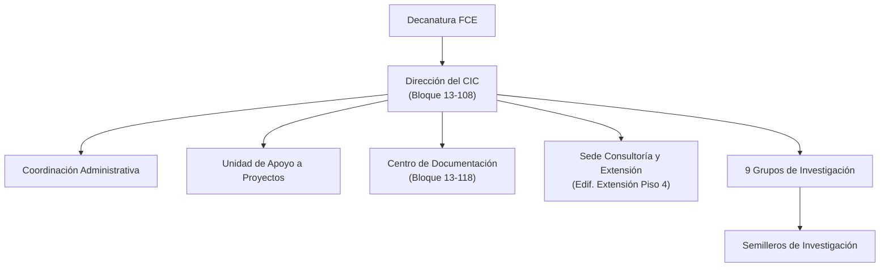

---
search:
  boost: 1.1
---

# Arquitectura Funcional y Auditoría Estratégica: Centro de Investigaciones y Consultorías (CIC)
**Unidad Académica:** Facultad de Ciencias Económicas — Universidad de Antioquia (UdeA)  
**Fecha de Auditoría:** 2026-11-11  
**Estándar de Calidad:** Rigor Técnico y Fidelidad de Datos Absoluta (Linus Archetype)

---

## 1. Misión, Marco Institucional y Génesis Operativa

El **Centro de Investigaciones y Consultorías (CIC)** de la Facultad de Ciencias Económicas (FCE) es la unidad de gestión integral académica y administrativa responsable de articular, ejecutar y fomentar los dos ejes misionales de mayor vinculación social de la Universidad de Antioquia: la **investigación** (básica y aplicada) y la **consultoría especializada**.

### 1.1. Antecedentes y Evolución Orgánica
El CIC se consolidó formalmente a finales del año **2006** mediante el **Acuerdo de Facultad 86 de 2006**, integrando tres centros pioneros que operaban de forma fragmentada en la facultad:
1. **Centro de Investigaciones Económicas (CIE):** Fundado en **1962**, histórico motor del análisis riguroso de la economía regional y nacional y creador de los *Borradores del CIE*.
2. **Consultorio Contable:** Creado en **agosto de 1983**, especializado en servicios de asesoría, auditoría, sistemas contables y estructura de costos.
3. **Centro de Investigaciones y Consultorías Administrativas (CICA):** Surgido en **1983**, enfocado en la institucionalización de la investigación en teoría organizacional y respuesta al entorno empresarial.

### 1.2. Objetivos Estratégicos (Acuerdo de Facultad 86 de 2006)
- **Formación de capital humano avanzado:** Vinculación de estudiantes y docentes en proyectos de investigación científica y consultoría técnica.
- **Divulgación continua:** Transferencia de resultados a la comunidad académica y al sector productivo nacional e internacional.
- **Articulación interdisciplinaria:** Cohesión entre las ciencias contables, las ciencias administrativas y la teoría económica.
- **Resolución de problemas de contexto:** Planteamiento de alternativas viables a problemáticas socioeconómicas de los territorios.

---

## 2. Estructura Organizacional y Directorio Nominal

El equipo directivo y administrativo del CIC opera centralizadamente en la Ciudad Universitaria (Medellín), con sede alterna para extensión en el Edificio de Extensión Universitaria:

### Tabla de Cargos, Personal y Canales de Atención

| Rol / Cargo | Funcionario(a) | Ubicación Física | Correo Electrónico | Teléfono / Extensión |
| --- | --- | --- | --- | --- |
| **Directora del CIC** | Martha Cecilia Álvarez Osorio | Bloque 13, Oficinas 108 y 328A | `jcic.fce@udea.edu.co` / `ciceconomicas@udea.edu.co` | (+57-604) 219 5800 |
| **Coordinadora Administrativa CIC** | Diana Maribel Sánchez Patiño | Bloque 13-108 | `maribel.sanchez@udea.edu.co` | (+57-604) 219 5800 |
| **Asistente Administrativo CIC** | Johnny Andrés Ortíz Armero | Bloque 13-108 | `johnny.ortiz@udea.edu.co` | (+57-604) 219 5800 |
| **Auxiliar Administrativa** | Carolina Ceballos Trejos | Bloque 13-108 | `johana.ceballos@udea.edu.co` | (+57-604) 219 5800 |
| **Auxiliar Administrativa** | Jeniffer Andrea Lopera García | Bloque 13-108 | `jeniffer.lopera@udea.edu.co` | (+57-604) 219 5800 |
| **Coordinadora Centro de Documentación** | Laura María Posada Arboleda | Bloque 13-118 | `laura.posadaa@udea.edu.co` | (+57-604) 219 5819 |
| **Bibliotecóloga Centro de Documentación** | Suly Amparo Monsalve Zapata | Bloque 13-118 | `suly.monsalve@udea.edu.co` | (+57-604) 219 8817 |
| **Coordinadora Centro de Cómputo FCE** | Myriam Lucía Echavarría Chalarca | Bloque 13-224 | `computoeconomicas@udea.edu.co` | (+57-604) 219 5804 |
| **Atención Consultorías y Extensión** | Unidad de Servicios Especializados | Edificio de Extensión, Piso 4, Of. 408 | `ciceconomicas@udea.edu.co` | (+57-604) 219 5840 / 219 5842 |

---

## 3. Líneas de Consultoría y Servicios Especializados

El CIC canaliza la capacidad técnica y científica de la facultad hacia organizaciones públicas, privadas y comunitarias:

### 3.1. Ejes Temáticos de Consultoría
1. **Finanzas y Mercado de Capitales:** Valoración de activos, finanzas corporativas, formulación y evaluación socioeconómica de proyectos de inversión, modelos de cobertura y riesgo.
2. **Gestión Organizacional y Estrategia:** Diseño e implementación de estructuras de gobernanza corporativa, gestión del cambio, optimización de modelos de negocio, clima organizacional.
3. **Auditoría, Control y Contabilidad Aplicada:** Asesoría tributaria, implementación de Normas Internacionales de Información Financiera (NIIF), sistemas de costos avanzados, auditoría forense y control interno.
4. **Economía de la Salud y Políticas Sociales:** Evaluación de impacto en políticas de salud pública, costeo y eficiencia en redes hospitalarias, economía de la seguridad social.
5. **Estudios Regionales y Políticas Públicas:** Análisis de cadenas productivas territoriales, planes de desarrollo municipal/departamental, diagnósticos socioeconómicos y estudios de competitividad.
6. **Marketing Estratégico e Investigación de Mercados:** Comportamiento del consumidor, posicionamiento de marcas, analítica de marketing (Imark).

### 3.2. Gobernanza de Proyectos: Unidad de Apoyo a Proyectos
La formulación y ejecución se rige por dos protocolos técnicos formalizados:
- **Guía de Investigación:** Protocolo normativo interno para radicación de proyectos ante comités de ética, convocatorias CODI y fuentes de financiación externas.
- **Guía de Consultoría:** Flujo administrativo de estructuración presupuestal, liquidación de costos indirectos de la Universidad, formalización contractual y actas de cierre.

---

## 4. Ecosistema de Investigación y Divulgación Científica

### 4.1. Los 9 Grupos de Investigación Vinculados
Todos los grupos se encuentran reconocidos y categorizados ante el Ministerio de Ciencia, Tecnología e Innovación (MinCiencias):

| Grupo | Nombre Oficial | Enfoque Principal / Líneas de Trabajo | Enlace Institucional |
| --- | --- | --- | --- |
| **COMPHOR** | Comportamiento Humano Organizacional | Gestión del talento humano, cultura organizacional, sentido del trabajo, comportamiento individual y grupal. | [Ver grupo](https://www.udea.edu.co/wps/portal/udea/web/inicio/investigacion/grupos-investigacion/ciencias-sociales/comphor) |
| **GES** | Grupo Economía de la Salud | Sistemas de salud, aseguramiento, evaluación económica de tecnologías en salud, políticas farmacéuticas. | [Ver grupo](https://www.udea.edu.co/wps/portal/udea/web/inicio/investigacion/grupos-investigacion/ciencias-sociales/economia-salud) |
| **GER** | Grupo de Estudios Regionales | Economía regional y urbana, geografía económica, desarrollo territorial, mercado laboral regional. | [Ver grupo](https://www.udea.edu.co/wps/portal/udea/web/inicio/investigacion/grupos-investigacion/ciencias-sociales/estudios-regionales) |
| **GESTOR** | Gestión Organizacional | Estrategia empresarial, modelos de gestión, innovación, teoría de la organización, emprendimiento. | [Ver grupo](https://www.udea.edu.co/wps/portal/udea/web/inicio/investigacion/grupos-investigacion/ciencias-sociales/gestion-organizacional) |
| **GICCO** | Investigaciones y Consultorías Contables | Teoría contable, contabilidad ambiental y de gestión, tributación, regulación contable internacional. | [Ver grupo](https://www.udea.edu.co/wps/portal/udea/web/inicio/investigacion/grupos-investigacion/ciencias-sociales/gicco) |
| **Imark** | Investigación en Marketing | Gestión de relaciones, neuromarketing, valor de marca, comportamiento del consumidor, mercadeo social. | [Ver grupo](https://www.udea.edu.co/wps/portal/udea/web/inicio/investigacion/grupos-investigacion/ciencias-sociales/imark) |
| **GIFI** | Grupo de Investigación en Finanzas | Mercados financieros, finanzas corporativas, banca, análisis de riesgo y productos derivados. | [Ver grupo](https://www.udea.edu.co/wps/portal/udea/web/inicio/investigacion/grupos-investigacion/ciencias-sociales/gifi) |
| **Macroeconomía** | Grupo de Macroeconomía Aplicada | Política monetaria, política fiscal, modelos DSGE, crecimiento económico, ciclos macroeconómicos. | [Ver grupo](https://www.udea.edu.co/wps/portal/udea/web/inicio/investigacion/grupos-investigacion/ciencias-sociales/macroeconomia-aplicada) |
| **Microeconomía** | Grupo de Microeconomía Aplicada | Organización industrial, teoría de juegos aplicada, economía de la educación, economía laboral, econometría empírica. | [Ver grupo](https://www.udea.edu.co/wps/portal/udea/web/inicio/investigacion/grupos-investigacion/ciencias-sociales/microeconomia-aplicada) |

### 4.2. Semilleros de Investigación Formativa
El CIC ampara semilleros activos orientados a estudiantes de pregrado:
1. **SIFI:** Semillero de Investigación en Finanzas (adscrito a GIFI).
2. **Semillero Imark:** Investigación cualitativa y cuantitativa de mercados.
3. **Semillero Gestión de lo Propio:** Liderado por COMPHOR en dinámicas humanas.
4. **Semillero Ángelo de Investigación Económica:** Formación macroeconómica rigurosa.
5. **Semillero Financiero GICCO:** Auditoría y modelos contables.
6. **Semillero SILES:** Investigación en lectura y escritura académica contable (GICCO).
7. **Semillero de Innovación FCE:** Proyectos interdisciplinarios en modelos de negocio.
8. **Semillero GESTOR:** Análisis organizacional de pymes y emprendimientos locales.

### 4.3. Portafolio de Revistas y Publicaciones Indexadas
La facultad cuenta con un robusto sistema de divulgación científica montado sobre OJS (Open Journal Systems):
- **Lecturas de Economía:** Revista de referencia internacional en teoría y política económica (A2 Publindex / Scopus / SciELO).
- **Contaduría Universidad de Antioquia:** Publicación insignia de la disciplina contable en Latinoamérica.
- **Perfil de Coyuntura Económica:** Análisis empírico y seguimiento macroeconómico coyuntural de Colombia y la región.
- **Revista Adversia:** Órgano estudiantil de discusión crítica contable y financiera.
- **Revista Oikos:** Difusión en administración, mercadeo y organizaciones.
- **Revista Conexiones:** Divulgación de movilidad académica e internacionalización.
- **Borradores del Departamento de Economía:** Serie de documentos de trabajo en fase preliminar (*working papers*).

---

## 5. Auditoría Crítica de Brechas de Comunicación y Oportunidades de Optimización

Bajo la óptica implacable de la ingeniería de software y la arquitectura de la información, el relevamiento evidenció **cuatro brechas críticas estructurales** que limitan el impacto y la velocidad operativa del CIC:

### Brecha 1: Alta Fragmentación de la Experiencia de Usuario (Silo Platforms)
- **Diagnóstico:** Para consultar información del CIC, un usuario externo o investigador debe interactuar con cuatro plataformas desarticuladas:
  1. Portal institucional WebSphere (`udea.edu.co/wps/portal/...`) para información básica.
  2. Catálogo de consultorías AsOne embebido en un `<iframe>` (`asone.udea.edu.co/portafolio/`).
  3. Sistema OJS (`revistas.udea.edu.co`) para papers y publicaciones.
  4. Directorio telefónico en un servidor Apache PHP independiente (`tsone.udea.edu.co`).
- **Impacto:** Fricción alta, pérdida de contexto de navegación y fallo en la indexación unificada en motores de búsqueda.
- **Solución Recomendada:** Centralización en un portal estático unificado (*Static Knowledge Base*) con API unificada de búsqueda basada en Markdown/Headless CMS.

### Brecha 2: Dependencia de Documentación Pasiva en PDF
- **Diagnóstico:** Los protocolos operativos esenciales (Guía de Investigación y Guía de Consultoría) se presentan únicamente como archivos PDF estáticos para descarga.
- **Impacto:** Imposibilidad de búsqueda semántica de requisitos, falta de trazabilidad en tiempo real sobre versiones vigentes y nula interactividad para los docentes proponentes.
- **Solución Recomendada:** Desglose de las guías en páginas Markdown modulares navegables con checklists interactivos de radicación.

### Brecha 3: Embudo Difuso para la Contratación de Consultoría
- **Diagnóstico:** La página de *Asesorías y consultorías CIC* carece de un formulario de captura de requerimientos o cotizador para el sector productivo; delega todo el contacto a un correo electrónico genérico (`ciceconomicas@udea.edu.co`) y a un teléfono fijo.
- **Impacto:** Fuga de oportunidades de consultoría privada y demoras en el triaje de solicitudes entre los 9 grupos de investigación.
- **Solución Recomendada:** Implementación de un flujo de radicación digital ágil de solicitudes de consultoría con asignación algorítmica según el área temático-disciplinar del grupo.

### Brecha 4: Opacidad de Métricas y Transferencia de Conocimiento
- **Diagnóstico:** El portal no expone dashboards públicos sobre proyectos vigentes, cifras de impacto social, convenios marco activos o patentes/productos técnicos generados por cada grupo.
- **Impacto:** El valor de la investigación de la UdeA queda invisibilizado para los tomadores de decisiones de política pública y el empresariado.
- **Solución Recomendada:** Publicación de un tablero de comando de investigación abierta sincronizado con el Scienti/GrupLAC de MinCiencias.

---

## 6. Conclusión
El Centro de Investigaciones y Consultorías posee una masa crítica de excelencia investigativa (9 grupos categorizados, 6 revistas consolidadas, medio siglo de trayectoria del CIE). No obstante, su infraestructura digital requería esta auditoría profunda y la extracción limpia a Markdown para habilitar una base de conocimiento moderna, desacoplada y lista para integraciones de alta velocidad.
