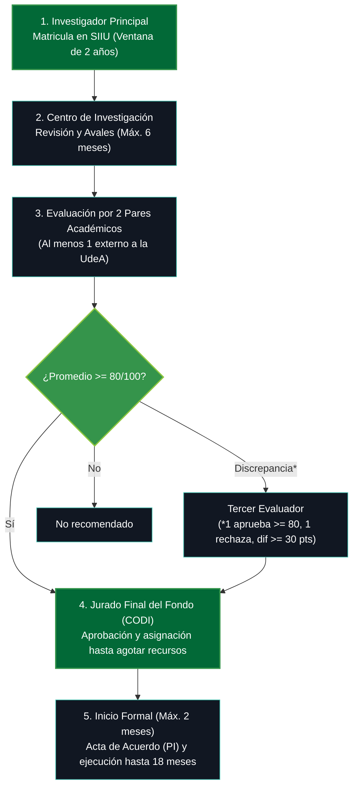

# Fondo de Apoyo al Primer Proyecto de Profesores

Mecanismo permanente del **Comité para el Desarrollo de la Investigación (CODI)** orientado a impulsar el inicio de la carrera investigativa de profesores recién vinculados por concurso de méritos o docentes que culminan sus estudios doctorales, garantizándoles financiación inicial sin competir en las convocatorias tradicionales de menor y mediana cuantía.

!!! info "Base Normativa y Guía Técnica"
    - **Términos de Referencia (TR):** Aprobados en la **Sesión Nro. 833 del CODI** (convocatoria permanente formalizada desde la Sesión 630 de 2012). Consulta el texto normativo estructurado en [TR-CODI-833-Primer-Proyecto](../archivo_maestro/TR-CODI-833-Primer-Proyecto.md).
    - **Instructivo SIIU:** Para el diligenciamiento paso a paso en plataforma, consulta la guía oficial [VI-GU-17: Matrícula de Primer Proyecto en el SIIU](../archivo_maestro/VI-GU-17.md).

---

## 1. Cuantías y Topes de Financiación

Los recursos se asignan con cargo al presupuesto del CODI en **orden de aprobación por el jurado final hasta agotar la disponibilidad presupuestal** de la vigencia:

| Modalidad de Estudiante Vinculado | Tope Máximo Financiable | Condición del Estudiante |
| :--- | :--- | :--- |
| **Estudiante de Pregrado** | **Hasta \$25.000.000** | Bajo la modalidad y requisitos del **Programa de Jóvenes Investigadores CODI UdeA**. |
| **Estudiante de Maestría** | **Hasta \$40.000.000** | No haber cursado más del **50%** del programa al inicio y permanecer al menos **50%** del tiempo del proyecto. |

---

## 2. Requisitos Mínimos y Ventana de Postulación

Para ser elegible, el profesor postulante debe cumplir simultáneamente con las siguientes condiciones:

1. **Ventana de 2 años:** Presentar el proyecto ante el Centro de Investigación dentro de los **dos (2) primeros años** contados desde su vinculación mediante concurso de méritos o desde la culminación de sus estudios de doctorado.
   - *Doctores retornados:* Deben certificar ante el Centro la fecha de terminación de estudios, la comisión correspondiente y la fecha de graduación.
2. **Estado en SIIU:** El proyecto debe encontrarse registrado en el SIIU en estado **`Matriculado`** para que el Centro pueda analizarlo.
3. **Exclusividad como Investigador Principal (IP):** Al momento de presentar la propuesta al Centro, el profesor **no puede estar participando como Investigador Principal** en otros proyectos de investigación registrados en el SUI.
4. **Pertinencia académica:** Declarar antecedentes e intención de iniciar o dar continuidad a un programa, agenda o línea de investigación, preferiblemente con aval de un grupo de investigación UdeA.
5. **Avales institucionales obligatorios:**
   - **Comité Técnico del Centro de Investigación:** Respaldo sobre la importancia del proyecto conforme al concurso de méritos o plan de formación docente.
   - **Consejo de Facultad, Escuela o Instituto:** Aval de **asignación de horas en el plan de trabajo** del profesor.

!!! warning "Plazo máximo de gestión en los Centros (6 meses)"
    Los Centros de Investigación tienen un límite máximo de **seis (6) meses**, contados desde que reciben el proyecto en el SIIU por parte del IP, para emitir sus avales y presentarlo ante la Vicerrectoría de Investigación.

---

## 3. Flujo de Evaluación, Aprobación e Inicio Formal

### Reglas críticas de inicio y duración
- **Plazo para iniciar:** Máximo **dos (2) meses** desde la aprobación. **No hay prórrogas de inicio automáticas.** Si vence el plazo sin iniciar, se pierde el derecho a la financiación.
  - *Excepción:* Antes de cumplirse los 2 meses, se puede tramitar ante el CODI (con aval del Comité Técnico del Centro) una **única prórroga de inicio por máximo 6 meses**.
- **Duración de ejecución:** Hasta **18 meses** contados desde la fecha de inicio consignada en el **Acta de Acuerdo** (Estatuto de Propiedad Intelectual).
- **Prórrogas de ejecución:**
  - *Primera prórroga:* Hasta **6 meses**, aprobada por el **Comité Técnico del Centro**.
  - *Segunda prórroga:* Hasta **6 meses**, aprobada por el **CODI** previo aval del Comité Técnico.

---

## 4. Rubros Financiables y Flexibilidad Presupuestal

### Rubros autorizados
- **Personal:** Incluye el estímulo económico al estudiante en formación.
  - El estudiante **no tiene que estar definido para iniciar** el proyecto, pero debe permanecer vinculado al menos la mitad del tiempo del proyecto (**9 meses**).
  - *Convenios de pasantía en pregrado (Jóvenes Investigadores):* Mínimo **9 meses** si se financia con recursos del proyecto, o **12 meses** si se financia con recursos de la Convocatoria Jóvenes Investigadores CODI UdeA.
- **Otros rubros:** Servicios técnicos, edición y traducción de materiales publicables, material fungible, equipos, seguros de equipos, telecomunicaciones, trabajo de campo, software, publicaciones, bibliografía, servicios de apoyo para laboratorios, viajes y administración.

### Política de cambios de rubro (Autorregulación Vigilada)
El Investigador Principal puede realizar **libremente cambios de rubro en cualquier momento** de la ejecución, siempre que:
1. Sean necesarios, según su criterio, para cumplir los fines de la investigación.
2. Se efectúen dentro del tiempo de ejecución vigente del proyecto.
3. Se informe oportunamente al Centro de Investigación administrador.

!!! tip "Responsabilidad financiera del IP"
    Esta flexibilidad responde a los principios de buena fe y eficiencia del CODI. No obstante, el IP debe rendir cuentas comprobadas de su gestión y **reintegrar a la Universidad** los dineros no utilizados o no aplicados a los compromisos adquiridos.

---

## 5. Compromisos Obligatorios y Opcionales

| Categoría | Requisito Exigible | Criterio de Cumplimiento |
| :--- | :--- | :--- |
| **Obligatorio 1** | **Proyecto a entidad externa** | Presentación de un proyecto de investigación a una entidad externa a la UdeA por un monto **superior** al financiado en esta modalidad. |
| **Obligatorio 2** | **Producto de nuevo conocimiento** | Artículo en revista científica, libro o capítulo de libro resultado de investigación. Se cumple con la **carta de aceptación** de la revista (preferiblemente Acceso Abierto). |
| **Obligatorio 3** | **Estudiante en formación** | Vinculación efectiva de un estudiante de pregrado (Jóvenes Investigadores CODI UdeA) o maestría según el monto financiado. |
| **Opcional (Elegir 1)** | **Producto derivado de investigación** | Una vez seleccionado por el IP, adquiere carácter **obligatorio**: • Artículo en revista de divulgación • Obra artística resultado de investigación • Ponencia en evento académico nacional o internacional • Organización de evento académico con pares nacionales o internacionales • Otro compromiso equivalente propuesto por el IP |

---

## 6. Enlaces Operativos Relacionados
- [Matrícula de Proyectos en el SIIU](../02_PROCESOS_CLAVE/Matricula_Proyectos.md)
- [Guía Técnica VI-GU-17 (Paso a paso en SIIU)](../archivo_maestro/VI-GU-17.md)
- [Convocatorias y Fondos CODI](../02_PROCESOS_CLAVE/Convocatorias_y_Fondos_CODI.md)
- [Programa Jóvenes Investigadores](../02_PROCESOS_CLAVE/Programa_Joven_Investigador.md)
