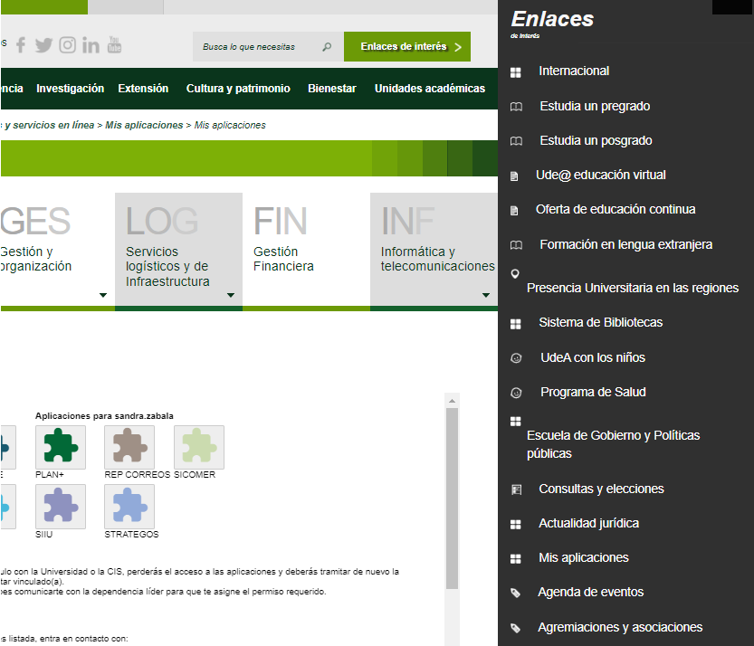
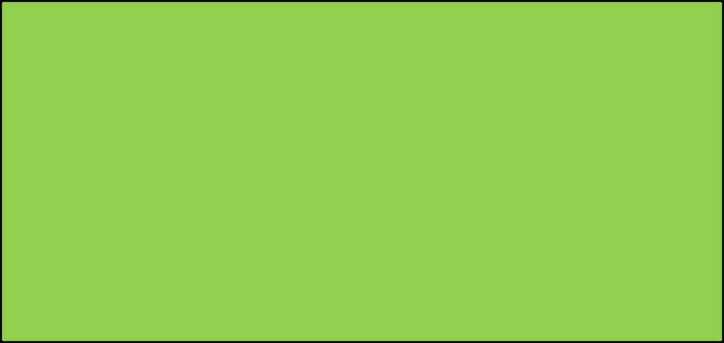
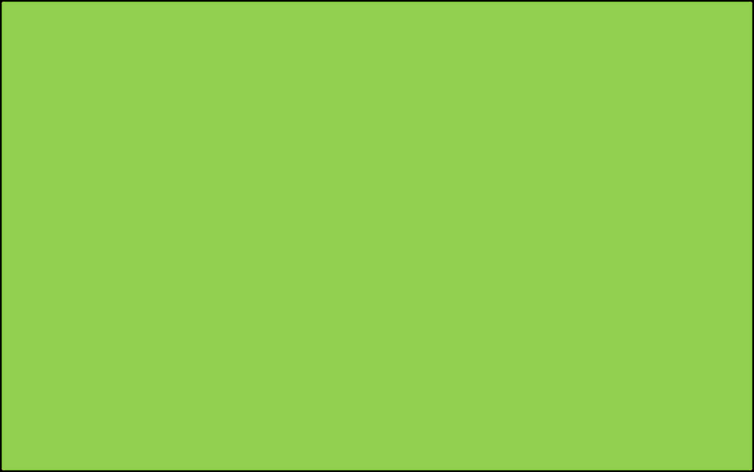
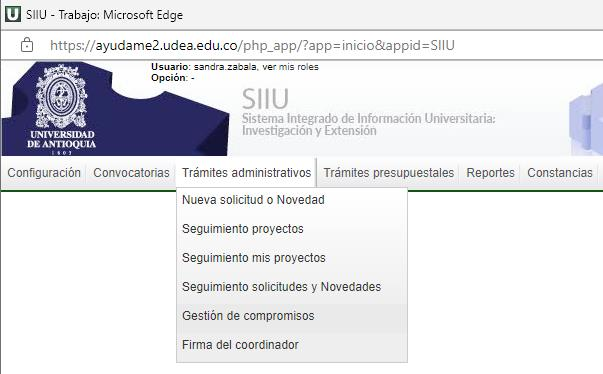
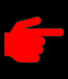
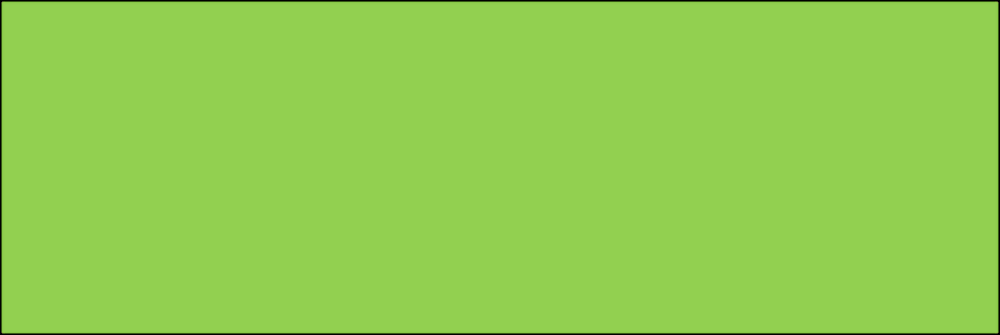
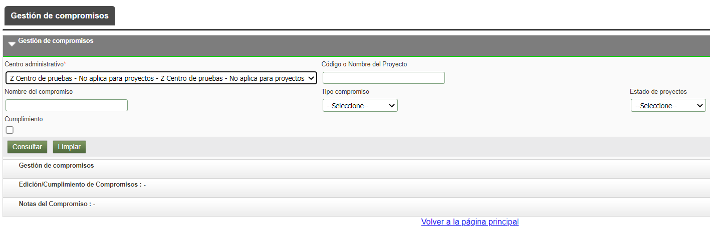
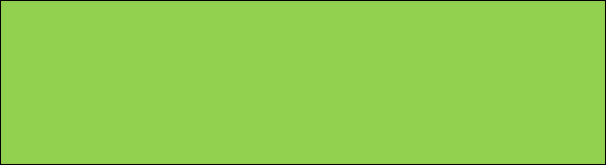
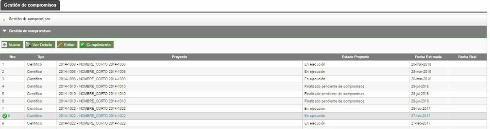
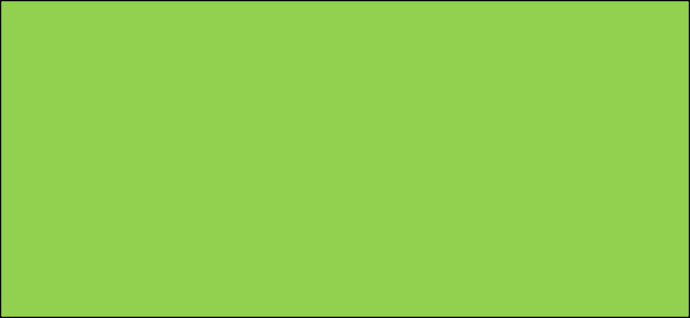

---
codigo: "VI-GU-04"
titulo: "Guía para el cierre de proyectos en SIIU"
version: "01"
fecha_aprobacion: "2024-03-13"
institucion: "Universidad de Antioquia"
dependencia: "Vicerrectoría de Investigación"
sistema: "SIIU (Sistema de Información para la Investigación Universitaria: Investigación y Extensión)"
documento_fuente: "VI-GU-04.pdf"
roles_involucrados:
  - "Usuario administrador centro: jefe centro de investigación"
tags:
  - "archivo_maestro"
  - "guia"
  - "siiu"
  - "proyectos"
  - "cierre"
  - "compromisos"
---

# GUÍA PARA EL CIERRE DE PROYECTOS EN SIIU

!!! note "Información de Control Documental"
> **Código**: VI-GU-04  
> **Versión**: 01 / 13-MAR-2024  
> *Aviso legal institucional*: La impresión o copia digital de este documento se considera "COPIA NO CONTROLADA". Solo se garantiza la actualización de la documentación en el sitio oficial `http://www.udea.edu.co`.

---

## Contenido

1. [Definición](#1-definición)
2. [Contenido](#2-contenido)
   - 2.1. [Requisitos para el cierre](#21-requisitos-para-el-cierre)
   - 2.2. [Usuarios que intervienen en el proceso](#22-usuarios-que-intervienen-en-el-proceso)
   - 2.3. [Ingreso al SIIU](#23-ingreso-al-siiu)
   - 2.4. [Proceso Gestión de compromisos](#24-proceso-gestión-de-compromisos)
   - 2.5. [Cerrar un proyecto](#25-cerrar-un-proyecto)
3. [Nota de cambio](#3-nota-de-cambio)

---

## 1. Definición

Este documento se ha elaborado con el fin de ayudar y capacitar a las personas que desde los centros de investigación **Administran y gestionan los proyectos**, los cuales deben estar registrados en el **Sistema de Información para la Investigación Universitaria – SIIU**. 

Dado lo anterior se aclara que esta guía no hace parte de la normativa universitaria y solamente se debe utilizar como una herramienta que orienta los pasos a seguir para cerrar los proyectos en el SIIU.

---

## 2. Contenido

### 2.1. Requisitos para el cierre

- Para cerrar un proyecto, es necesario que se encuentre en estado **“Finalizado”**, es decir con todos los compromisos cumplidos.
- El único usuario autorizado para el cierre de proyectos es el **jefe de centro**.
- Debe tener disponible el (las) acta(s) de aprobación de cumplimiento de compromisos.

### 2.2. Usuarios que intervienen en el proceso

- **Usuario administrador centro**: jefe centro de investigación.

### 2.3. Ingreso al SIIU

El usuario que se encuentra registrado como jefe de centro debe autenticarse en el portal de la Universidad de Antioquia (`http://www.udea.edu.co`), buscar la opción aplicaciones y entre ellas elegir el SIIU, así:

1. Ingresa al portal de la Universidad: `http://www.udea.edu.co`, en el encabezado seleccione **Ingresar >> Iniciar sesión**.

   
   *Figura 1. Ingreso al portal de la Universidad de Antioquia.*

2. Aparece pantalla para ingresar su usuario y contraseña, seleccione **No soy un Robot** (el sistema le puede pedir realizar validaciones) finalmente presione clic en el botón **CONECTAR**.

   
   *Figura 2. Conectar al portal.*

3. Presione clic en la opción **Enlaces de Interés**, seleccione **Mis aplicaciones**.  
   *Ruta*: `Enlaces de interés → Mis aplicaciones`.

   
   *Figura 3. Enlaces de interés.*

4. Se abrirá una ventana con las aplicaciones de la Universidad, seleccione **SIIU**.

   
   *Figura 4. Seleccione SIIU.*

5. Se abre una nueva ventana con la aplicación SIIU.  
   !!! tip "Configuración del Navegador"
   > Si la ventana no abre inmediatamente, es necesaria la configuración de ventanas emergentes en el navegador y seleccionar la opción que autorice el SIIU.

---

### 2.4. Proceso Gestión de compromisos

Los compromisos del proyecto se dividen en dos conceptos:
- **Compromisos Obligatorios**: Son los compromisos configurados en la convocatoria, de acuerdo con los términos de referencia y que son de obligatorio cumplimiento.
- **Compromisos Opcionales**: Son aquellos compromisos internos para el proyecto que se desean asumir.

1. Ingrese por la opción:  
   `Trámites administrativos > Gestión de compromisos`.

   
   *Figura 5. Menú Gestión de compromisos.*

2. El SIIU abre una ventana con filtros de búsqueda, en la que debe elegir el centro de investigación correspondiente, este campo es obligatorio. Podrá agregar a la búsqueda del proyecto, los diferentes filtros o campos que dispone el sistema. Presione el botón **Consultar**.

   
   *Figura 6. Filtros de consulta compromisos.*

   !!! info "> Si no utiliza otro filtro de consulta para especificar su proyecto, el sistema muestra por defecto, los compromisos pendientes de **TODOS** los proyectos de su centro."

3. Una vez realice la consulta, el sistema presenta listado de los compromisos pendientes por cumplir, además de los campos: tipo, proyecto, estado del proyecto, fecha estimada, la fecha real (campo vacío).  
   Seleccione con el cursor el compromiso que desea cumplir, en la parte superior del listado el sistema mostrará las diferentes opciones que tiene para el compromiso. Seleccione el botón **Cumplimiento**.

   
   *Figura 7. Listado de compromisos, seleccione compromiso.*

   !!! note "> Solo podrá elegir un compromiso a la vez para gestionar su cumplimiento, por lo que deberá repetir el proceso tantas veces como compromisos tenga el proyecto."

4. El sistema abrirá una ventana donde el usuario podrá ver el detalle del compromiso seleccionado y deberá registrar los siguientes valores del acta en que fue aprobado el compromiso en los campos:
   - **Número acta**
   - **Fecha acta**
   - **Fecha real de cumplimiento** (es la fecha en la cual el investigador cumple con el compromiso).

   
   *Figura 8. Fecha real de cumplimiento.*

5. Puede agregar un comentario del compromiso que acaba de colocar la fecha real de finalización; para esto presione el botón **Notas del compromiso** y finalice con el botón **Agregar nota**. Una vez termine de ingresar toda la información del compromiso, presione el botón **Guardar**.

   
   *Figura 9. Nota al compromiso.*

6. El sistema muestra el mensaje *Actualizado exitosamente* y el compromiso desaparecerá de la lista del centro.
   *(Recuerde que solo muestra los compromisos pendientes).*  
   Deberá repetir el procedimiento con todos los compromisos faltantes asociados al proyecto que desea finalizar.

!!! info "> Cuando se cumplan todos los compromisos obligatorios del proyecto, automáticamente este pasa a estado **FINALIZADO**."

---

### 2.5. Cerrar un proyecto

Cuando el proyecto se encuentra en estado **Finalizado**, se puede proceder con el Cierre del proyecto.

1. El usuario que se encuentra registrado como Jefe de Centro debe ingresar al SIIU e ingresar al menú:  
   `Trámites administrativos > Seguimiento proyectos`.

   
   *Figura 10. Seguimiento a proyectos.*

2. El SIIU abre una ventana en la que podrá realizar la búsqueda del proyecto que desea cerrar. Elija el centro de investigación correspondiente; para agilizar la búsqueda del proyecto, seleccione estado: **Finalizado** y presione botón **Consultar**.

   
   *Figura 11. Estado finalizado.*

3. El sistema arroja el listado de los proyectos administrados por el centro que se encuentran en estado Finalizado.

   
   *Figura 12. Proyectos estado finalizado.*

4. Seleccione mediante un clic, el proyecto que desee cerrar. El SIIU mostrará las diferentes opciones que tiene el proyecto en la parte superior de la lista y allí debe elegir el botón **Cerrar proyecto**.

   
   *Figura 13. Botón del Cerrar proyecto.*

5. El sistema abre un formulario para registrar la evaluación de finalización del proyecto, presione el botón **Generar acta**.

   
   *Figura 14. Generar acta de finalización.*

6. El sistema habilitará una ventana donde se debe ingresar la información en los siguientes campos:

| Campo | Detalle |
| :--- | :--- |
| **Acta de comité técnico** | Ingrese el código del acta |
| **Fecha del comité técnico** | Ingrese fecha |
| **Financiador o cofinanciador** | Valores de dineros que han sido ejecutados en fresco o especie |

   Finalice presionando el botón **Generar acta de finalización**.

   
   *Figura 15. Generar acta de finalización.*

7. El sistema genera un documento PDF que deberá descargar e imprimir para agregar las firmas respectivas.

   
   *Figura 16. Acta de finalización PDF.*

   !!! info "> Una vez el acta de finalización se encuentre completamente firmada, debe escanearla en formato PDF y adjuntarla al SIIU para proceder con el cierre del proyecto."

8. Para adjuntar el documento generado, debe volver a ingresar al SIIU, seleccionar el proyecto y buscar la opción **Cerrar proyecto**. El sistema abrirá la ventana de cierre y allí debe presionar la pestaña **Adjuntar documento**, ingresar la información requerida en pantalla, adjuntar el documento y presionar el botón **Guardar**.

   
   *Figura 17. Documento adjunto.*

9. Valide que el documento se cargó exitosamente; observe que aparece en la lista de documentos adjuntos.

   
   *Figura 18. Valida documento adjunto.*

---

## 3. Nota de cambio

- No aplica para la primera versión.

---

## Registro de Control y Firmas

| Rol | Nombre | Cargo / Dependencia | Fecha |
| :--- | :--- | :--- | :--- |
| **Elaboró** | Sandra Patricia Zabala Orrego | Contratista | 16-FEB-2024 |
| **Elaboró** | Lina María Ospina Pérez | Product Owner SIIU, Vicerrectoría de Investigación | 16-FEB-2024 |
| **Revisó** | Kerlin Yohana Bedoya Agudelo | Analista de Procesos, División de Arquitectura de Procesos | 12-MAR-2024 |
| **Revisó** | Julio César García Castrillón | Analista de Procesos, División de Arquitectura de Procesos | 12-MAR-2024 |
| **Aprobó** | Gloria Valencia Bustamante | Asistente, Vicerrectoría de Investigación | 13-MAR-2024 |
