---
codigo: "VI-GU-07"
titulo: "Guía para la configuración de la convocatoria"
version: "01"
fecha_aprobacion: "2024-03-13"
institucion: "Universidad de Antioquia"
dependencia: "Vicerrectoría de Investigación"
sistema: "SIIU (Sistema de Información para la Investigación Universitaria: Investigación y Extensión)"
documento_fuente: "VI-GU-07.pdf"
roles_involucrados:
  - "Administrador del sistema SIIU de las vicerrectorías"
tags:
  - "archivo_maestro"
  - "guia"
  - "siiu"
  - "convocatorias"
  - "configuracion"
  - "presupuesto"
  - "cronograma"
---

# GUÍA PARA LA CONFIGURACIÓN DE LA CONVOCATORIA

!!! note "Información de Control Documental"
> **Código**: VI-GU-07  
> **Versión**: 01 / 13-MAR-2024  
> *Aviso legal institucional*: La impresión o copia digital de este documento se considera "COPIA NO CONTROLADA". Solo se garantiza la actualización de la documentación en el sitio oficial `http://www.udea.edu.co`.

---

## Contenido

1. [Definición](#1-definición)
2. [Políticas](#2-políticas)
3. [Contenido](#3-contenido)
   - 3.1. [Ingresar al sistema SIIU por el portal institucional](#31-ingresar-al-sistema-siiu-por-el-portal-institucional)
   - 3.2. [Inscripción de convocatoria](#32-inscripción-de-convocatoria)
   - 3.3. [Información general](#33-información-general)
     - 3.3.1. [Sección nombre y descripción de la convocatoria](#331-sección-nombre-y-descripción-de-la-convocatoria)
     - 3.3.2. [Sección Financiadores](#332-sección-financiadores)
     - 3.3.3. [Sección proceso de selección, fechas, hora de cierre de la convocatoria](#333-sección-proceso-de-selección-fechas-hora-de-cierre-de-la-convocatoria)
     - 3.3.4. [Sección permisos](#334-sección-permisos)
     - 3.3.5. [Sección Inicio con NN y GUARDAR](#335-sección-inicio-con-nn-y-guardar)
   - 3.4. [Cronograma de la convocatoria](#34-cronograma-de-la-convocatoria)
   - 3.5. [Presupuestal](#35-presupuestal)
     - 3.5.1. [Opción modalidades de financiación](#351-opción-modalidades-de-financiación)
     - 3.5.2. [Opción rubros financiables](#352-opción-rubros-financiables)
     - 3.5.3. [Opción cambio de rubros preautorizados](#353-opción-cambio-de-rubros-preautorizados)
     - 3.5.4. [Porcentaje máximo de rubros](#354-porcentaje-máximo-de-rubros)
   - 3.6. [Compromisos y condiciones formales](#36-compromisos-y-condiciones-formales)
     - 3.6.1. [Compromisos](#361-compromisos)
     - 3.6.2. [Condiciones formales](#362-condiciones-formales)
   - 3.7. [Estructura de proyecto](#37-estructura-de-proyecto)
   - 3.8. [Documento soporte](#38-documento-soporte)
   - 3.9. [Publicar convocatoria](#39-publicar-convocatoria)
4. [Nota de cambio](#4-nota-de-cambio)

---

## 1. Definición

Este documento se ha elaborado con el fin de ayudar y capacitar a usuarios que administran proyectos de las **vicerrectorías de investigación / extensión**, los cuales deben estar registrados en el **Sistema de Información Integrado de información Universitaria: Investigación y Extensión – SIIU**. 

Dado lo anterior se aclara que esta guía no hace parte de la normativa universitaria y solamente se debe utilizar como una herramienta que orienta el paso que se debe seguir en el SIIU para la matrícula de convocatorias en el sistema SIIU.

---

## 2. Políticas

- Para la matrícula de una convocatoria en el Sistema Integrado de Información Universitaria: Investigación y Extensión se debe tener el proceso de selección que fue creado previamente para asociarlo a la convocatoria.
- De otro lado se deben tener el documento de los términos de referencia definidos para la convocatoria.

---

## 3. Contenido

### 3.1 Ingresar al sistema SIIU por el portal institucional

El usuario debe autenticarse en el portal de la Universidad de Antioquia (`http://www.udea.edu.co`), buscar la opción aplicaciones y entre ellas elegir el SIIU, así:

1. Ingresa al portal de la Universidad: `http://www.udea.edu.co`, en el encabezado seleccione **Ingresar >> Iniciar sesión**.

   
   *Figura 1. Ingreso al portal de la UdeA.*

2. Aparecerá la pantalla para iniciar sesión como usuario del portal; ingrese usuario y contraseña luego presione clic en el botón **CONECTAR**.

   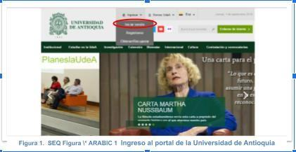
   *Figura 2. Inicio de sesión en portal de la UdeA.*

3. Se abrirá una ventana con su nombre en la parte izquierda de la página, seleccione:  
   `Enlaces de interés → Mis aplicaciones`.

   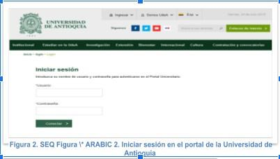
   *Figura 3. Aplicaciones del sistema.*

4. El sistema carga una ventana con las aplicaciones de la Universidad a las cuales el usuario tiene acceso, seleccione la aplicación **SIIU**.

   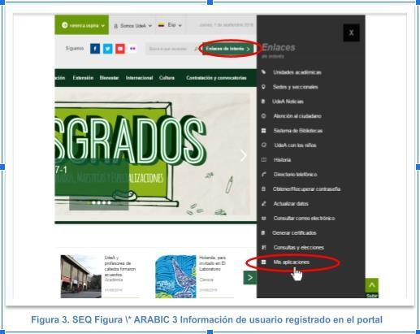
   *Figura 4. Seleccione SIIU.*

5. Se debe abrir una nueva ventana con la aplicación SIIU en la que podrá iniciar el registro del proyecto.  
   !!! tip "Ventanas Emergentes"
   > Si la ventana no abre inmediatamente, es necesaria la configuración de ventanas emergentes en el navegador y seleccionar la opción que autorice el SIIU.

---

### 3.2 Inscripción de convocatoria

Para la matrícula de convocatorias en el sistema SIIU, es indispensable considerar los prerrequisitos del proceso:
- Tener proceso de selección creado para la convocatoria. *(Ver manual de creación de proceso de selección)*.
- Documento de términos de referencia de la convocatoria a inscribir.

!!! info "> El usuario que realiza el proceso es el **Administrador del sistema SIIU de las vicerrectorías**."

**Ruta de acceso**: Ingrese a la opción del menú SIIU: `Convocatorias > Inscripción`.

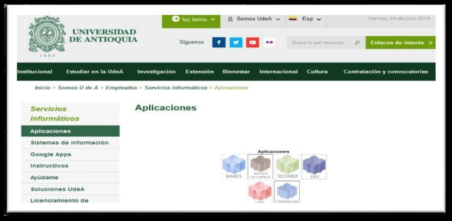
*Figura 5. Menú convocatoria.*

El sistema presenta la pantalla con la información general de la convocatoria con el **tren de opciones** que serán configuradas:
1. Información general
2. Cronograma
3. Presupuestal
4. Compromisos y condiciones
5. Estructura de proyecto
6. Documentos soporte

*Figura 6. Tren de opciones convocatoria.*

---

### 3.3 Información general

#### 3.3.1 Sección nombre y descripción de la convocatoria

Ingrese la información a los siguientes campos de acuerdo a los términos de referencia:
- **Nombre corto**
- **Nombre largo**
- **Descripción**: ingrese la descripción de la convocatoria. *(Tenga presente que tiene hasta 4000 caracteres para ingresar la información)*.

*Figura 7. Información general / Sección nombre y descripción de la convocatoria.*

#### 3.3.2 Sección Financiadores

1. Defina los financiadores de la convocatoria; seleccione el botón **Seleccionar financiadores** y presione el icono **+** para agregar.
2. Realice la búsqueda de los financiadores nacional o internacional. En caso de que no existan en la base de datos, el sistema permite ingresar los financiadores.
3. Ingrese el nombre de la entidad en el campo palabra clave o escriba el NIT en el campo definido, presione el botón **BUSCAR**.

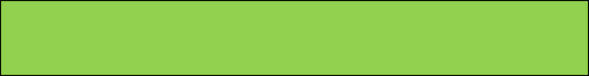
*Figura 8. Información General - Sección financiadores.*

4. Una vez se ha realizado la consulta, el sistema trae la información del financiador y permite seleccionarlo con la opción **AGREGAR FINANCIADOR**.

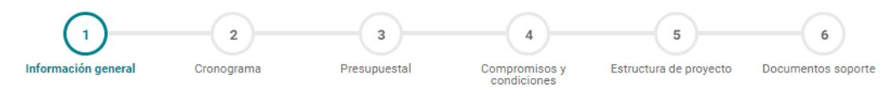
*Figura 9. Selección de financiador.*

5. Cuando el financiador elegido es la **Universidad de Antioquia**, el sistema solicita información adicional, como la **dependencia** y **programa**. Esta opción se realiza para posteriormente definir el centro de costos.

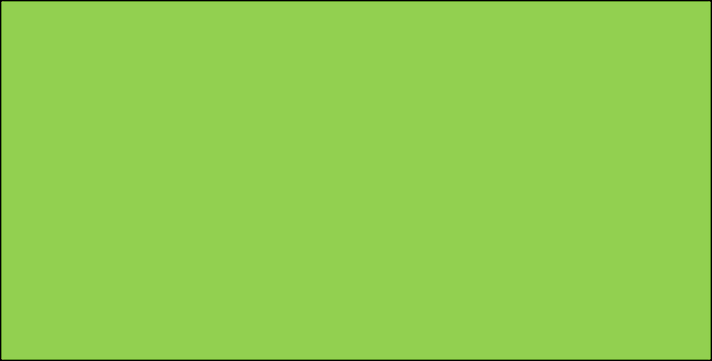
*Figura 10. Selección dependencia.*

6. Presione el botón **Guardar financiadores** para el almacenamiento en la base de datos del financiador elegido.

#### 3.3.3 Sección proceso de selección, fechas, hora de cierre de la convocatoria

En esta sección se debe ingresar información en los siguientes campos:
- **Buscar proceso de selección**: se elige el proceso de selección definido para la convocatoria.
- **Fecha de apertura**: se elige del calendario la fecha de apertura de la convocatoria.
- **Fecha de cierre**: se elige del calendario la fecha de cierre de la convocatoria.
- **Fecha de resultados**: se elige del calendario la fecha de resultados de la convocatoria.
- **Hora de cierre**: se define la hora de cierre de la convocatoria en formato militar 24 horas.

*Figura 11. Definición de fechas para la convocatoria.*

#### 3.3.4 Sección permisos

Defina los siguientes permisos:
- **Tipo**: despliegue los usuarios que tendrán acceso para la matrícula de proyecto de convocatoria.
- **Subtipo**: defina los roles que participan.
- **Instancia**: seleccione la(s) instancia(s) que hacen parte de la gestión o evaluación de los proyectos que se vinculen a la convocatoria.
- **Utilización**: seleccione la opción **TODOS**; estos son roles propios del sistema para el ingreso desde el portal.

*Figura 12. Permisos y roles de acceso.*

#### 3.3.5 Sección Inicio con NN y GUARDAR

- **Permite inicio con NN**: indica si los proyectos permiten iniciar con NN, de acuerdo con los términos de referencia.
- **Tiempo proyecto en lista**: indica el tiempo que los proyectos quedan en lista de espera (por defecto aparece 0).
- **Observaciones**: campo que permite agregar observaciones para la convocatoria que se está configurando (puede ingresar hasta 400 caracteres).
- Presione el botón **GUARDAR** para almacenar el registro de configuración de la convocatoria.

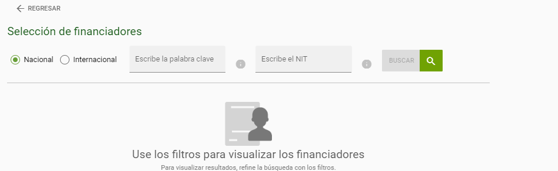
*Figura 13. Inicio con NN y Guardar.*

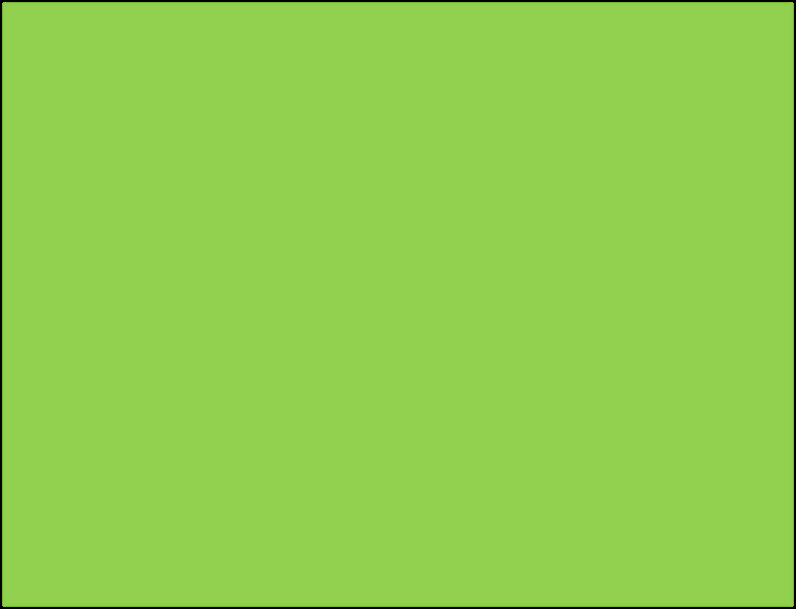
*Figura 14. Ejemplo Información general.*

*Figura 15. Ejemplo Información general (Plazos, prórrogas, suspensiones y cancelaciones).*

---

### 3.4 Cronograma de la convocatoria

Seleccione esta opción para agregar las etapas de la convocatoria y presione **Agregar evento**.

*Figura 16. Agregar evento.*

!!! info "> Este proceso es muy importante porque define las etapas de los proyectos ya sea para **AVALAR** en el centro o **APROBAR** en la vicerrectoría. Se recomienda colocar en el campo *Nombre del evento*: `Avalar proyecto` o `Aprobar proyecto` según sea el caso."

El sistema presenta formulario con las opciones:
- **Nombre del evento**: defina si el proceso a configurar es Avalar o Aprobar.
- **Hito en proceso de selección**: despliegue la lista de valores para el hito y seleccione de acuerdo al nombre del evento definido.

*Figura 17. Configuración Hito.*

- **Fecha de inicio**: ingrese la fecha de inicio del evento.
- **Fecha fin**: ingrese la fecha fin del evento.
- Presione botón **AGREGAR EVENTO**.

*Figura 18. Agregar evento.*

Una vez se agregue el evento, el sistema presenta resumen del evento guardado. Recuerde presionar **GUARDAR** para almacenar el registro.

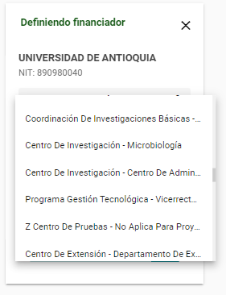
*Figura 19. Guardar evento.*

!!! note "Modificación de eventos"
> Puede modificar el evento **ANTES** de publicar la convocatoria: presione los tres puntos para **Editar** o **Eliminar** el evento.

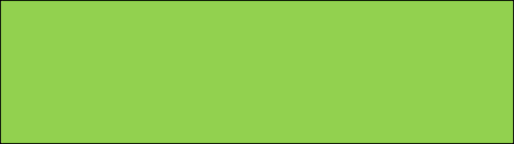
*Figura 20. Editar evento.*

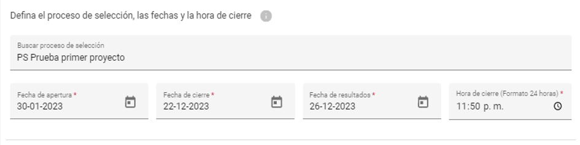
*Figura 21. Resumen de hitos para la convocatoria.*

---

### 3.5 Presupuestal

En el proceso de configuración presupuestal para la convocatoria, aparecen las opciones:
- Modalidades de financiación
- Rubros financiables
- Cambio de rubros preautorizados
- Porcentaje máximo de rubros

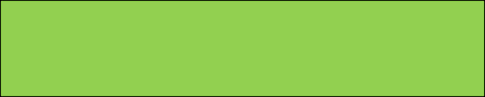
*Figura 22. Configuración presupuestal de la convocatoria.*

#### 3.5.1. Opción modalidades de financiación

Esta opción de la configuración presupuestal permite definir un monto fijo para la convocatoria. Contiene los campos:
- **Nombre modalidad**: ingrese el nombre para la modalidad. *(Pueden ingresarse más de una modalidad de acuerdo con los términos de referencia de la convocatoria)*.
- **Monto máximo**: ingrese el valor máximo de la modalidad.
- **Duración máxima**: ingrese la duración en meses.
- Presione **Agregar Modalidad**.

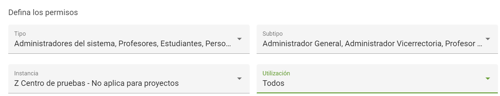
*Figura 23. Modalidad de financiación.*

#### 3.5.2. Opción rubros financiables

Permite definir los rubros que estarán habilitados para la convocatoria según los términos de referencia. Presione el botón **Agregar Rubro +**.

El sistema abre un nuevo formulario con los siguientes campos:
- **Rubro Financiable**: despliegue lista de rubros y seleccione.
- **Nombre del Rubro**: indique el nombre.
- **Permitido para**: seleccione la instancia (S).
- **Justificación solicitada**: ingrese valor en el campo.
- **Descripción**: ingrese valor en el campo.
- **Rubro padre**: despliegue lista de rubros si aplica.
- **Active la opción si el rubro aplica para los cofinanciadores**: se activa esta opción cuando el proyecto cuenta con cofinanciadores con aportes, en fresco o en especie.
- **Calcular administración**: cuando se selecciona el rubro administración, se activa este botón.
- Presione botón **Agregar Rubro**.

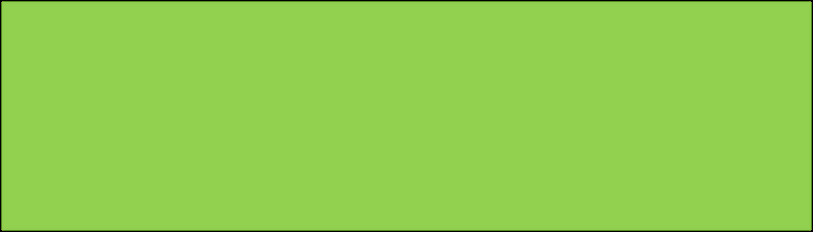
*Figura 24. Agregar rubro.*

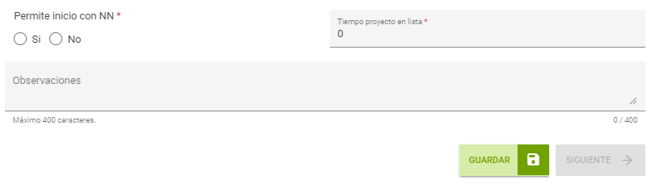
*Figura 25. Lista rubros financiables.*

!!! note "> Debe realizar el mismo proceso por cada rubro que desea vincular a la convocatoria."

*Figura 26. Agregando rubro financiable.*

#### 3.5.3. Opción cambio de rubros preautorizados

Si requiere agregar rubros preautorizados, presione el botón **Agregar Rubro +**.

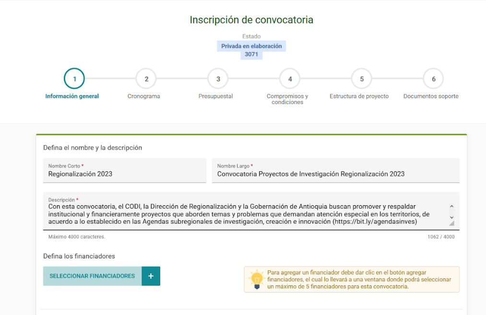
*Figura 27. Rubros preautorizados.*

#### 3.5.4. Porcentaje máximo de rubros

Dependiendo de los términos de la convocatoria, agregue el máximo porcentaje para los rubros. Presione el botón **Agregar Porcentaje**.

*Figura 28. Máximo porcentaje para los rubros.*

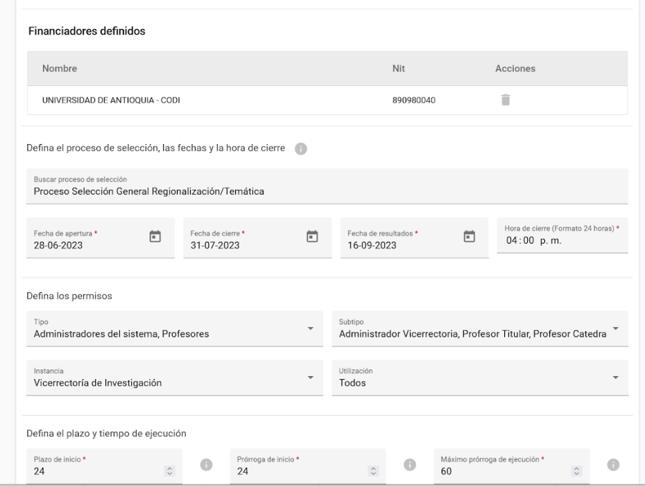
*Figura 29. Porcentaje máximo de rubros.*

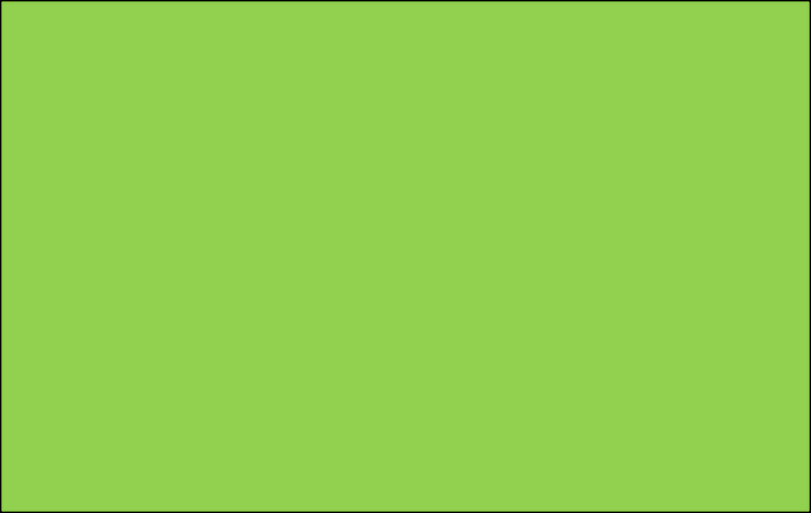
*Figura 30. Resumen porcentaje máximo de rubros.*

---

### 3.6 Compromisos y condiciones formales

Permite la configuración en la convocatoria de los compromisos y las condiciones formales definidos en los términos de referencia.

#### 3.6.1. Compromisos

Por defecto se posiciona en esta pestaña. Presione **Agregar Compromiso**.

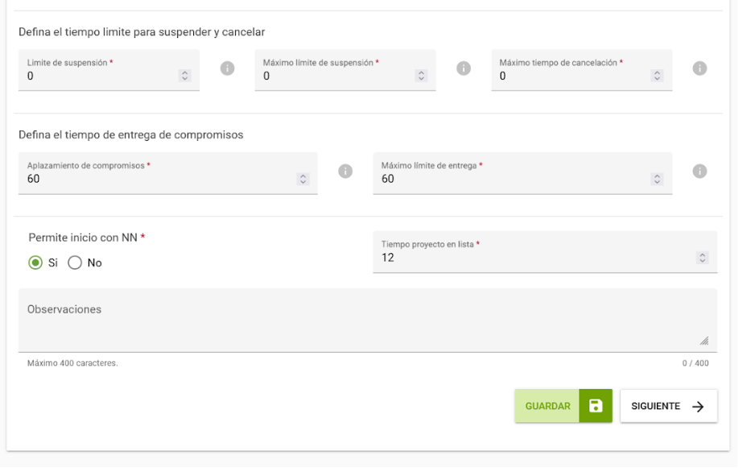
*Figura 31. Compromisos y condiciones formales.*

Una vez se presiona el botón **Agregar compromisos** se ingresa información en los campos:
- **Comentario**: se ingresa el compromiso.
- **Condición para ser obligatorio**: campo opcional.
- **Modalidades que aplica**: el sistema trae por defecto el nombre y el valor de la modalidad o modalidades ingresadas previamente.
- **Tipo**: defina si el compromiso es *opcional* o si es *obligatorio*.
- Presione botón **Agregar Compromiso**.

*Figura 32. Agregar compromiso.*

Una vez se guarde el compromiso aparece un resumen del compromiso guardado.

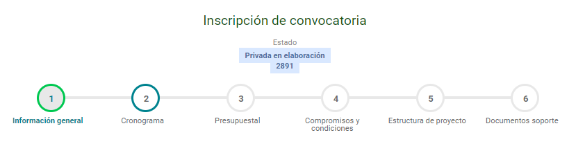
*Figura 33. Resumen de compromisos.*

#### 3.6.2. Condiciones formales

Las condiciones formales son definidas en los términos de referencia de la convocatoria. Se configuran en la convocatoria para que aparezcan en la matrícula de los proyectos y de esta manera se pueda validar su cumplimiento o no.

1. Presione **Agregar condición**.

   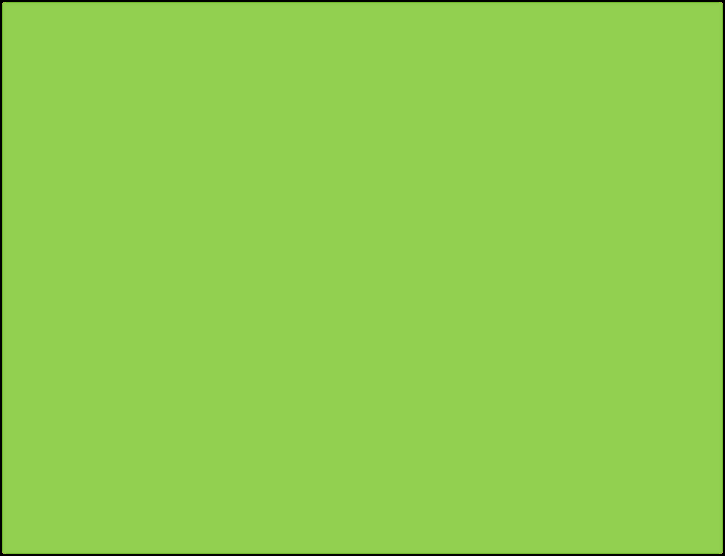
   *Figura 34. Agregar condición formal.*

2. El sistema presenta el formulario con los siguientes campos:

| Campo | Ejemplo / Detalle |
| :--- | :--- |
| **Explicación** | Ingrese la(s) condiciones formales una a una de acuerdo a los términos de referencia. |
| **Modalidades** | Seleccione la(s) modalidad(s) configurada previamente (ej. *Modalidad única*). |
| **Quien Verifica** | Seleccione quien verifica las condiciones formales (ej. *Centro de investigación*, *Vicerrectoría*). |
| **Momento de Verificar** | Seleccione los momentos en que se verificarán las condiciones formales (ej. *Presentación y selección*). |

   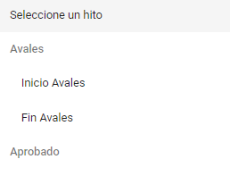
   *Figura 35. Ingresar condiciones formales.*

   Presione el botón para agregar la condición formal ingresada; recuerde que debe realizar el mismo proceso por cada una.

3. Cada vez que se agrega una condición formal y se guarda el sistema presenta un resumen. Esta opción permite editar la condición formal desde la opción de los tres puntos para modificarla **ANTES** de publicar la convocatoria. Recuerde presionar el botón **GUARDAR** para almacenar el registro.

   
   *Figura 36. Resumen condición formal.*

---

### 3.7 Estructura de proyecto

La opción de estructura del proyecto permite definir la información requerida para la matrícula de los proyectos como son, por ejemplo: *Marco teórico, objetivo general, bibliografía*, entre otros que se encuentran definidos en los términos de referencia.

1. Presione **Agregar estructura proyecto** para comenzar.

   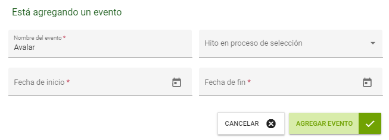
   *Figura 37. Agregar estructura proyecto.*

2. El sistema despliega un formulario para ingresar información con los siguientes campos:
   - **Título**
   - **Explicación**
   - **Máximo número palabras**
   - **Tipo**: Obligatorio / Opcional
   - Finalice con el botón **Agregar estructura proyecto**.

   
   *Figura 38. Ingresar estructura de proyecto.*

3. Cada vez que se agrega un registro de la estructura del proyecto y se guarda, el sistema presenta un resumen de lo guardado. Esta opción permite editar desde la opción de los tres puntos antes de publicar la convocatoria. Presione el botón **GUARDAR** para almacenar el registro.

   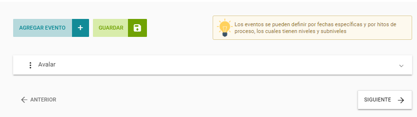
   *Figura 39. Resumen estructura proyecto.*

---

### 3.8 Documento soporte

La opción de documento soporte permite almacenar documentación de la convocatoria, como por ejemplo los términos de referencia. En esta opción encontrará también el botón **PUBLICAR**, el cual permite pasar la convocatoria de estado *En elaboración* a *Publicado*.

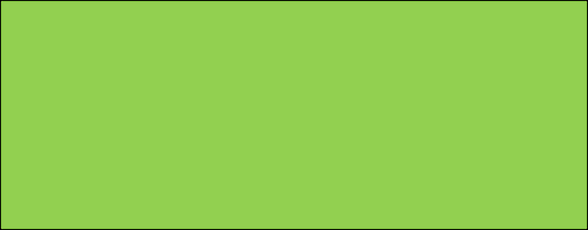
*Figura 40. Publicar convocatoria.*

1. El sistema despliega una ventana donde debe ingresar información en los campos obligatorios:
   - **Nombre del documento**
   - **Número del documento**
   - **Emisor**
   - **Fecha de emisión**
   - **Descripción**
   - **Archivo adjunto**: presione el icono **+** y proceda a seleccionar desde su PC el archivo que desea anexar.
2. Cuando lo haya seleccionado presione el botón **Agregar documento soporte**. Luego presione el botón **GUARDAR**.

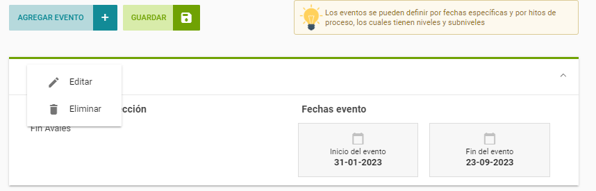
*Figura 41. Documento adjunto.*

---

### 3.9 Publicar convocatoria

Presione el botón **PUBLICAR**:

!!! warning "Acción Irreversible"
> El sistema le presenta mensajes de confirmación ya que luego **no podrá realizar cambios**, por esta causa debe estar muy seguro de que va a publicar.

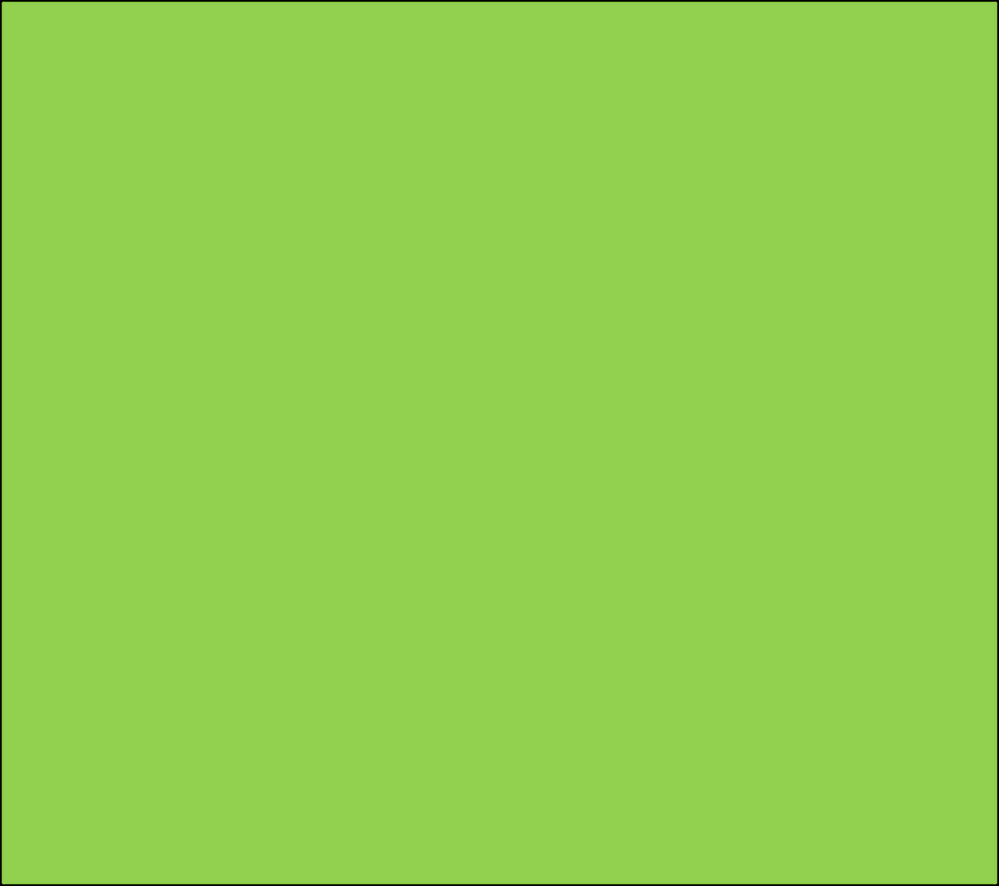
*Figura 42. Mensaje confirmación para publicar convocatoria.*

Una vez se confirma el mensaje con el botón **Aceptar**, el sistema genera un nuevo mensaje con un resumen de la convocatoria. Presione **Aceptar** para continuar.  
La convocatoria pasa a estado **Publicado** y permite vincular los proyectos que se desean matricular.

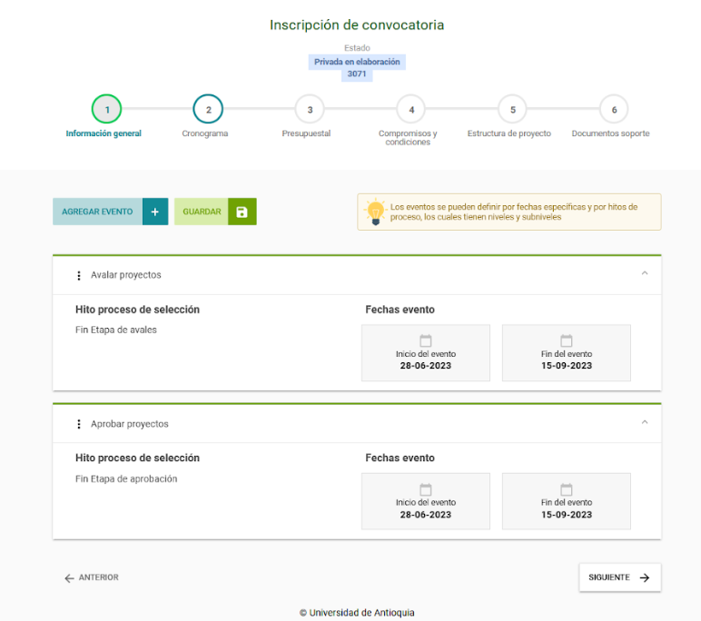
*Figura 43. Resumen de la convocatoria.*

---

## 4. Nota de cambio

- No aplica para la primera versión.

---

## Registro de Control y Firmas

| Rol | Nombre | Cargo / Dependencia | Fecha |
| :--- | :--- | :--- | :--- |
| **Elaboró** | Sandra Patricia Zabala Orrego | Contratista | 16-FEB-2024 |
| **Elaboró** | Lina María Ospina Pérez | Product Owner SIIU, Vicerrectoría de Investigación | 16-FEB-2024 |
| **Revisó** | Kerlin Yohana Bedoya Agudelo | Analista de Procesos, División de Arquitectura de Procesos | 12-MAR-2024 |
| **Revisó** | Julio César García Castrillón | Analista de Procesos, División de Arquitectura de Procesos | 12-MAR-2024 |
| **Aprobó** | Gloria Valencia Bustamante | Asistente, Vicerrectoría de Investigación | 13-MAR-2024 |
