# GUÍA PARA LA EVALUACIÓN TÉCNICA Y AVAL DEL PROYECTO

!!! note "Información de Control Documental"
> **Código**: VI-GU-08  
> **Versión**: 01 / 13-MAR-2024  
> *Aviso legal institucional*: La impresión o copia digital de este documento se considera "COPIA NO CONTROLADA". Solo se garantiza la actualización de la documentación en el sitio oficial `http://www.udea.edu.co`.

---

## Contenido

1. [Definición](#1-definicion)
2. [Políticas](#2-politicas)
3. [Contenido](#3-contenido)
   - 3.1. [Usuarios que intervienen en el proceso](#31-usuarios-que-intervienen-en-el-proceso)
   - 3.2. [Ingreso al SIIU](#32-ingreso-al-siiu)
   - 3.3. [Proceso de evaluación técnica de proyectos](#33-proceso-de-evaluacion-tecnica-de-proyectos)
     - 3.3.1. [Autorización de actualización de proyecto](#331-autorizacion-de-actualizacion-de-proyecto)
       - 3.3.1.1. [Ampliar el plazo de la actualización del proyecto](#3311-ampliar-el-plazo-de-la-actualizacion-del-proyecto)
   - 3.4. [Revisar proyecto actualizado](#34-revisar-proyecto-actualizado)
   - 3.5. [Asignar Evaluación científica](#35-asignar-evaluacion-cientifica)
     - 3.5.1.1. [Asignar Evaluadores](#3511-asignar-evaluadores)
     - 3.5.1.2. [Agregar evaluador existente](#3512-agregar-evaluador-existente)
   - 3.6. [Dar Aval al proyecto por parte del centro](#36-dar-aval-al-proyecto-por-parte-del-centro)
4. [Nota de cambio](#4-nota-de-cambio)

---

## 1. Definición

Este documento se ha elaborado con el fin de ayudar y capacitar a las personas que desde los **centros de investigación / extensión Administran y gestionan los proyectos**, los cuales deben estar registrados en el **Sistema de Información Integrado de información Universitaria: Investigación y Extensión – SIIU**. 

Dado lo anterior se aclara que esta guía no hace parte de la normativa universitaria y solamente se debe utilizar como una herramienta que orienta los pasos que se deben seguir en el SIIU para evaluar y avalar proyectos por parte del centro de investigación.

---

## 2. Políticas

- Para evaluar y avalar un proyecto por el Sistema Integrado de Información Universitaria: Investigación y Extensión - SIIU, se debe tener en cuenta la reglamentación aprobada por el Comité para el Desarrollo de la Investigación CODI o el Comité de Extensión, para el proceso de evaluación de los proyectos en el marco de una convocatoria, documento términos de referencia.
- El usuario con rol de centro de investigación, debe estar registrado en el portal institucional y tener acceso a SIIU.
- El usuario con rol de centro de investigación debe tener acceso a la opción de evaluación técnica y aval para el proyecto.

---

## 3. Contenido

### 3.1 Usuarios que intervienen en el proceso

El centro de investigación es quien se encarga de la evaluación técnica del proyecto y de dar Aval en el Sistema de Información Integrado de información Universitaria: Investigación y Extensión – SIIU, una vez el Investigador envía al centro de investigación o extensión el proyecto por medio de la plataforma, el centro revisa, avala y envía a la Vicerrectoría correspondiente Investigación – Extensión para continuar con el proceso de aprobación del proyecto.

---

### 3.2 Ingreso al SIIU

El usuario con rol de centro debe autenticarse en el portal de la Universidad de Antioquia (`http://www.udea.edu.co`), buscar la opción aplicaciones y entre ellas elegir el SIIU, así:

1. Ingresa al portal de la Universidad: `http://www.udea.edu.co`, en el encabezado seleccione **Ingresar >> Iniciar sesión**.

   
   *Figura 1 - Ingreso al portal de la Universidad de Antioquia*

2. Aparece pantalla para ingresar su usuario y contraseña, seleccione **No soy un Robot** (el sistema le puede pedir realizar validaciones) finalmente presione clic en el botón **CONECTAR**.

   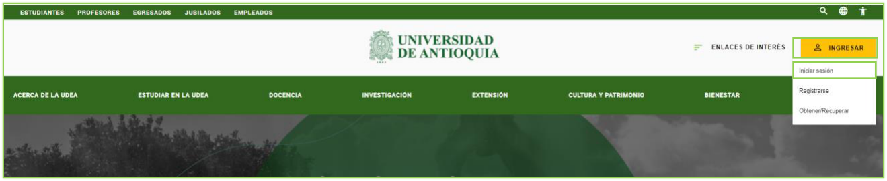
   *Figura 2 - Conectar al portal*

3. Presione clic en la opción **Enlaces de Interés**, seleccione **Mis aplicaciones**.  
   *Ruta*: `Enlaces de interés → Mis aplicaciones`.

   
   *Figura 3 - Enlaces de interés*

4. Se abrirá una ventana con las aplicaciones de la Universidad, seleccione **SIIU**.

   
   *Figura 4 - Seleccione SIIU*

5. Se abre una nueva ventana con la aplicación SIIU.  
   !!! tip "> Si la ventana no abre inmediatamente, es necesaria la configuración de ventanas emergentes en el navegador y seleccionar la opción que autorice el SIIU."

---

### 3.3 Proceso de evaluación técnica de proyectos

1. Estando en la aplicación del SIIU, ingrese por el menú:  
   `Convocatorias > Proyectos en evaluación`.

   
   *Figura 5 - Proyectos en evaluación*

2. En la opción filtros de consulta, desplácese al lado izquierdo de la ventana. Seleccione:
   - **Estado**: Matriculado
   - **Dependencia actual**: Centro al que pertenece el proyecto
   - En *Palabra clave* puede colocar el código del proyecto, o realizar la búsqueda por el campo deseado.  
   Presione la opción **Consultar**.

   
   *Figura 6 - Consulta proyectos en evaluación*

3. Una vez tenga el registro de la búsqueda, en la columna **Acciones** dé clic a los tres puntos que se muestran.

   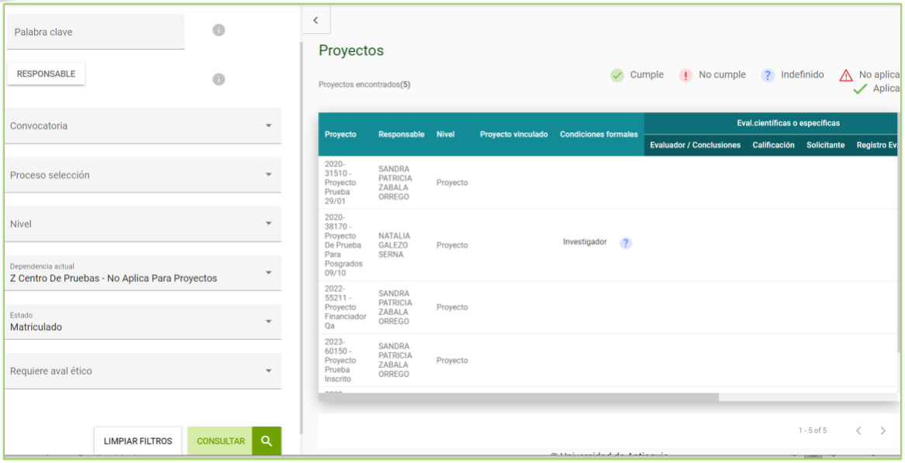
   *Figura 7 - Acciones sobre el proyecto*

4. Una vez presionados los tres puntos, se despliega menú con diferentes opciones; para el proceso de evaluación seleccione la opción **Realizar evaluación técnica**.

   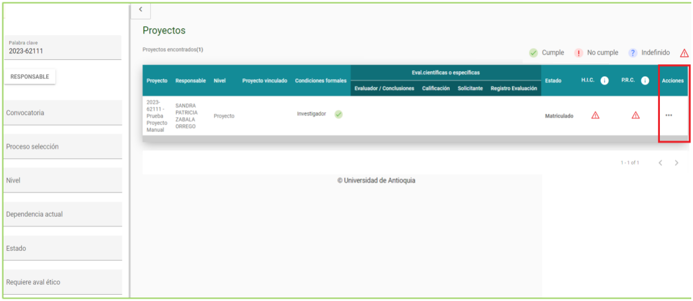
   *Figura 8 – Seleccione Realizar evaluación técnica*

5. El sistema presenta una nueva ventana que contiene en la parte superior la información general del proyecto. *(En caso de que requiera ampliar el detalle del proyecto, seleccione "Ver proyecto")*. En la parte inferior aparecen las condiciones formales definidas en los términos de referencia de la convocatoria y las opciones para seleccionar su cumplimiento.  
   Las opciones disponibles (solo una por registro) son: **Cumple**, **No cumple**, **No aplica**.

   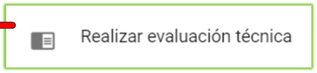
   *Figura 9 - Condiciones formales*

6. Si en la evaluación de las condiciones formales cumple todos los ítems, presione **GUARDAR** y luego **CONFIRMAR**. De esta manera el proyecto queda listo para el proceso de **AVAL**.

   
   *Figura 10 - Evaluación técnica*

---

#### 3.3.1 Autorización de actualización de proyecto

Puede suceder que algunas condiciones formales del proyecto no se cumplan; en este caso deberá marcar **No cumple** y se debe solicitar al Investigador Principal (IP) o responsable la actualización del proyecto.

Cuando se presiona el botón **GUARDAR** y alguna de las condiciones formales está marcada como *No cumple*, se habilitan los botones **Autorizar actualización** y **Confirmar**.

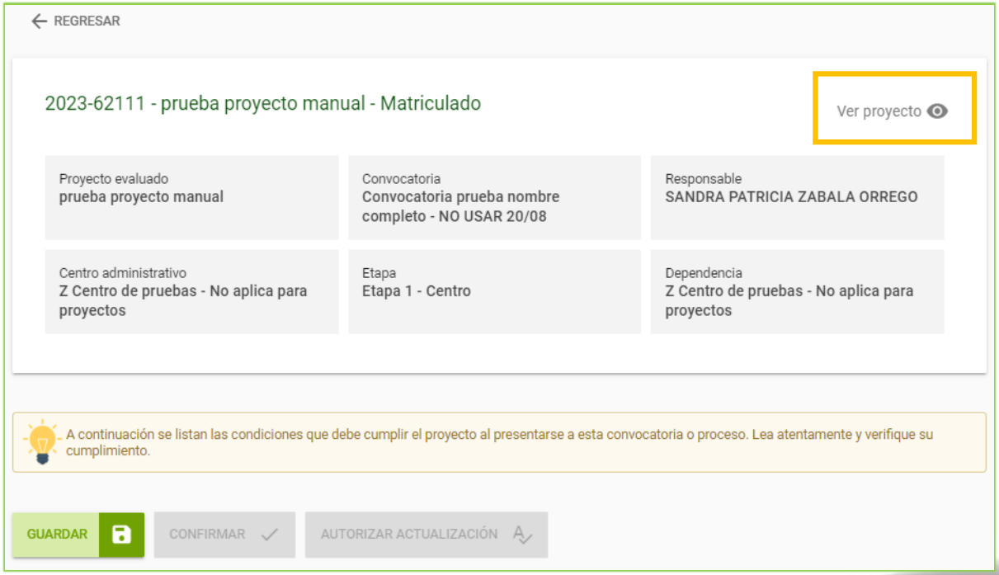
*Figura 11 – Condición formal No cumple*

Presione el botón **Autorizar actualización** para configurar el proceso de ajuste:

| Campo | Configuración requerida |
| :--- | :--- |
| **Evaluación** | Seleccione *Evaluación Técnica*. |
| **Fecha Límite** | Seleccione el plazo límite que dará al IP para el ajuste correspondiente. |
| **Hora Límite** | El sistema por defecto tiene la hora `23:59:59`. |
| **Secciones del Proyecto** | Puede seleccionar múltiples opciones; recuerde que solo se habilitan las pestañas donde el IP deberá realizar el ajuste. |
| **Cambios solicitados** | Redacte con detalle cuáles son los ajustes que deberá realizar el IP. Por favor indique el código del proyecto para que el investigador lo identifique fácilmente (ejemplo: `2022-55370`). |

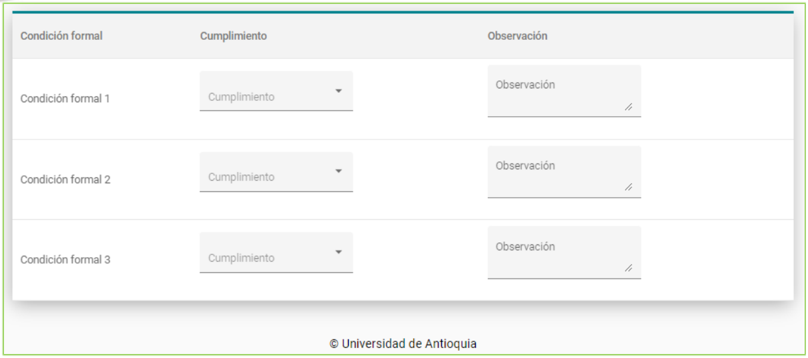
*Figura 12 - Autorizar actualización*

Presione el botón **Autorizar Actualización**. El sistema genera un mensaje de alerta:  
*“¿Confirma que desea autorizar al investigador para que actualice las secciones indicadas para el proyecto? El proyecto quedará en estado Pendiente de actualización y el investigador podrá acceder a él para realizar las modificaciones pertinentes.”*  
Presione el botón **Aceptar** para continuar.

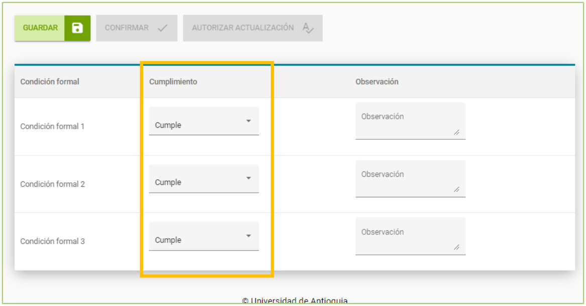
*Figura 13 - Mensaje de alerta para actualizar*

Una vez presionado el botón Aceptar, el sistema genera el mensaje de confirmación:  
*“Las secciones Descripción, Cronograma del proyecto ... han sido habilitadas hasta [fecha/hora] para que el responsable del proyecto las modifique.”*

*Figura 14 - Mensaje de confirmación*

Cuando se acepte la confirmación:
- El proyecto pasa a estado **Pendiente de actualización**.
- Al IP le llega un correo informándole de las secciones habilitadas y el tiempo disponible.
- Cuando el IP realice la actualización, el proyecto pasa a estado **Actualizado** y el usuario centro podrá validar los ajustes.

##### 3.3.1.1 Ampliar el plazo de la actualización del proyecto

!!! info "> Si el IP dejó vencer el tiempo para realizar la actualización del proyecto, el usuario centro puede ampliar el plazo. Tenga en cuenta que solo permite ampliar la fecha del plazo (no permite elegir otra sesión para actualizar)."

1. Ingrese a `Convocatorias > Proyectos en evaluación`.
2. Busque por palabra clave (código del proyecto) y presione **Consultar**.
3. En la columna **Acciones** dé clic a los tres puntos y seleccione **Autorizar actualización**.

   ![[VI-GU-08-figura-12a.png]]
   *Figura 12 a – Autorizar actualización*

4. El sistema solo habilita el campo **Fecha límite** (la hora límite por defecto trae 11:59:59 pm). Presione el icono de calendario para modificar la fecha límite y presione **Autorizar actualización**.

   ![[VI-GU-08-figura-12b.png]]
   *Figura 12 b – Cambiar fecha límite*

---

### 3.4 Revisar proyecto actualizado

Una vez el Investigador haya realizado los ajustes al proyecto:

1. Ingrese a `Convocatorias > Proyectos en Evaluación`.
2. En filtros de búsqueda:
   - **Convocatoria**: Seleccione la convocatoria respectiva.
   - **Estado**: Seleccione **Actualizado**.
   - Presione **Consultar**.

   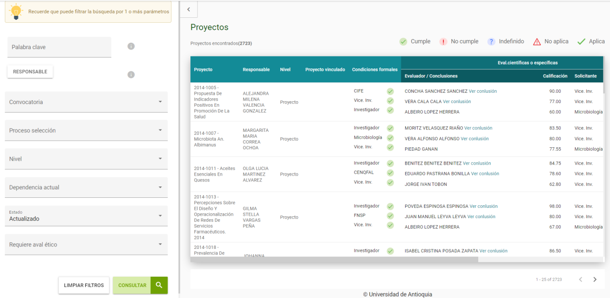
   *Figura 15 - Filtro de búsqueda proyecto actualizado*

3. Seleccione el proyecto haciendo clic en los tres puntos de la columna **Acciones** y presione el botón **Ver proyecto**.

   
   *Figura 16 - Ver proyecto*

4. En una ventana nueva aparecerá toda la información del proyecto; en la pestaña **Actualización** se evidencian las observaciones registradas por el Investigador. Revise de nuevo las secciones del proyecto para corroborar los ajustes.

   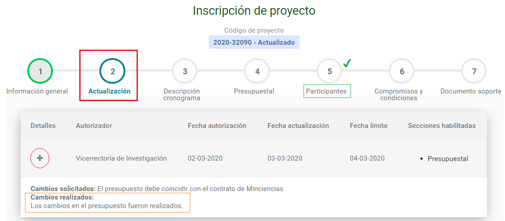
   *Figura 17 - Pestaña Actualización*

5. Decisiones de evaluación sobre el proyecto actualizado:
   - **Si persisten errores o venció el plazo**: Ingrese a la opción *Evaluación Técnica*, marque la condición formal en **No cumple** >> **Autorizar Actualización** para devolverlo nuevamente.
     
     
     *Figura 18 - Validar actualización*

   - **Si los ajustes son correctos**: Seleccione la opción **Cumple** para todas las condiciones formales y finalice presionando los botones **Guardar** y **Confirmar**.

     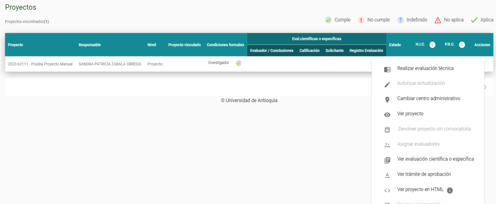
     *Figura 19 - Proyecto cumple*

6. Al presionar **Confirmar**, se abre un cuadro de diálogo: *“¿Desea confirmar la evaluación técnica? Al confirmar la evaluación ya no podrá autorizar al investigador o coordinador la actualización del proyecto, ni realizar más cambios a esta evaluación.”* Presione **Aceptar**.

   
   *Figura 20 - Confirmar envío de proyecto.*

7. El sistema confirma: *“El proyecto ... ha quedado en el estado Aprobada evaluación técnica”*, indicando que queda apto para ser avalado.

   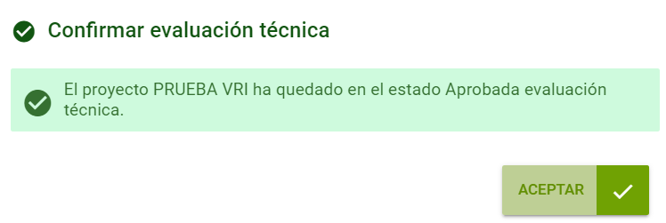
   *Figura 21 - Notificación de proyecto enviado*

---

### 3.5 Asignar Evaluación científica

Para proyectos de la convocatoria de *Primer proyecto*, o donde se haya definido evaluación científica en el centro previo al Aval:

1. Con el proyecto en estado **Aprobada Evaluación técnica**, presione el botón **Acciones** (tres puntos) y seleccione **Asignar Evaluadores**.

   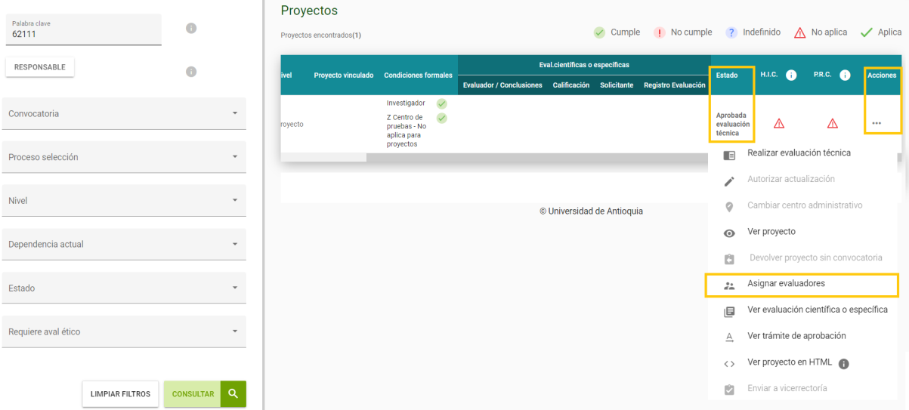
   *Figura 22 - Botón acciones*

#### 3.5.1.1 Asignar Evaluadores

El sistema muestra el o los evaluadores recomendados en la matrícula del proyecto con la etiqueta **Recomendado**.

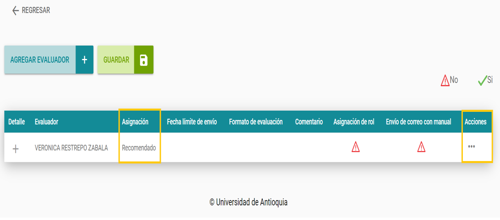
*Figura 23 - Evaluador recomendado*

Presione los tres puntos de la columna acciones para ver las opciones disponibles:

| Acción | Detalle |
| :--- | :--- |
| **Editar** | Cambia la asignación del evaluador de recomendado a seleccionado o descartado. |
| **Eliminar** | Elimina el registro del evaluador. |
| **Actualizar información del evaluador** | Permite actualizar los datos personales y la institución del evaluador. |
| **Asignar rol de evaluador** | Habilita al evaluador la ficha de evaluación. |
| **Enviar correo con manual** | Envía al evaluador un correo con el enlace del proyecto. |

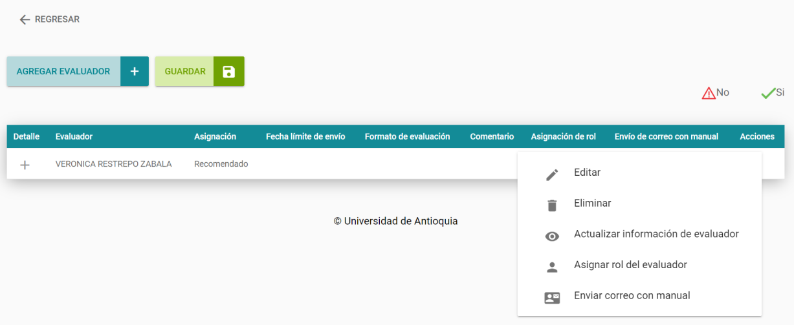
*Figura 24 - Menú botón acciones evaluador*

- **Editar evaluador**: Seleccione *Editar*, cambie asignación a **Seleccionado**, ingrese la fecha límite de envío y el formato de evaluación, agregue comentarios y presione **EDITAR** y luego **GUARDAR**.

  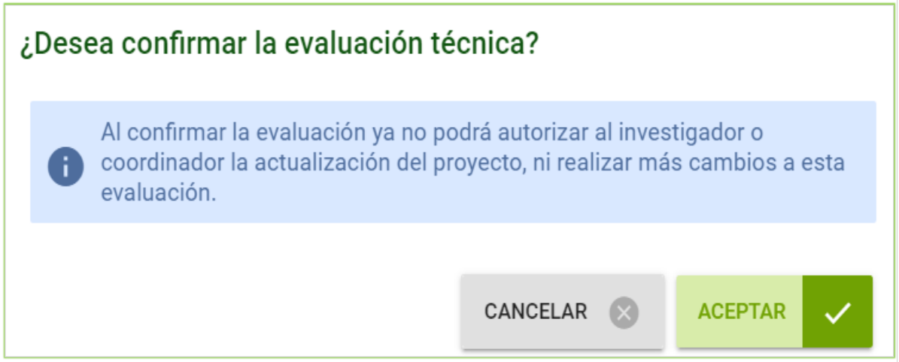
  *Figura 25 - Editar Evaluador*

  
  *Figura 26 - Editar evaluador (formulario fechas y formato)*

  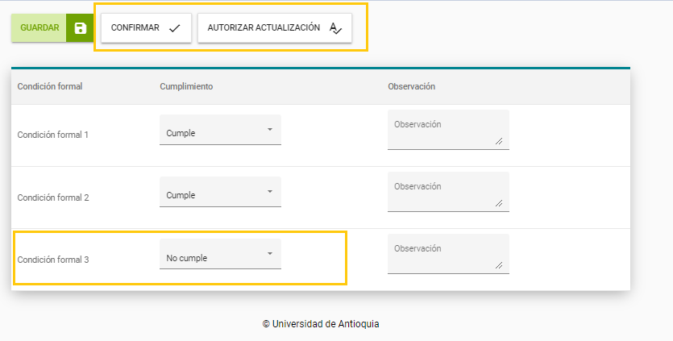
  *Figura 27 - Resumen de evaluador*

- **Eliminar evaluador**: Si se requiere retirar, seleccione *Eliminar* y confirme el mensaje.

  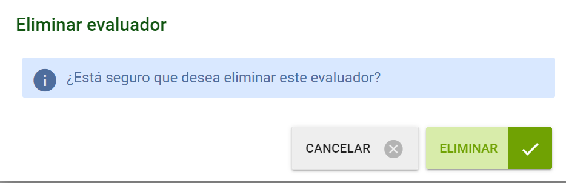
  *Figura 28 - Eliminar evaluador*

- **Actualizar datos del evaluador**: Modifique identificación, nombres, apellidos, contacto y presione *Actualizar evaluador*.

  
  *Figura 29 - Actualizar información del evaluador*

- **Enviar correo con manual**: Genera mensaje de notificación automática al evaluador con el enlace del proyecto.

  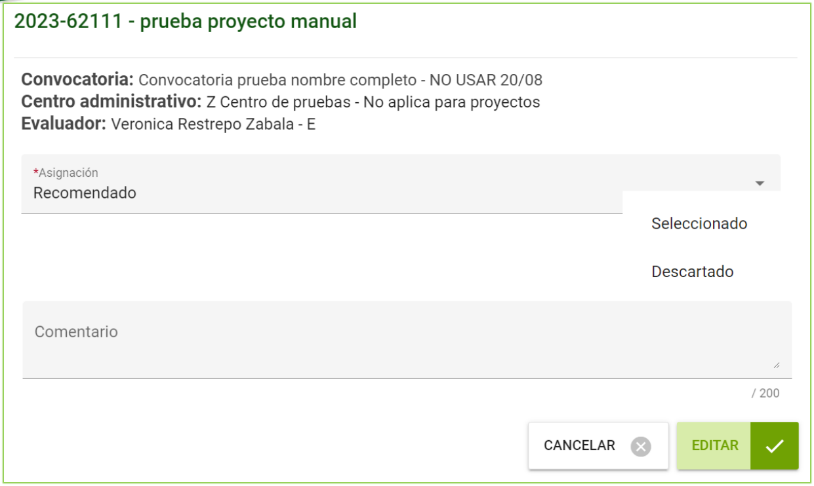
  *Figura 30 - Envío notificación al evaluador*

- **Agregar nuevo evaluador**: Si no hay recomendados, presione **AGREGAR EVALUADOR**. Si no está registrado en el SIIU, use el botón **Registrar evaluador +** completando todos sus datos personales e institucionales.

  
  *Figura 31 - Filtro de búsqueda Agregar evaluador*

  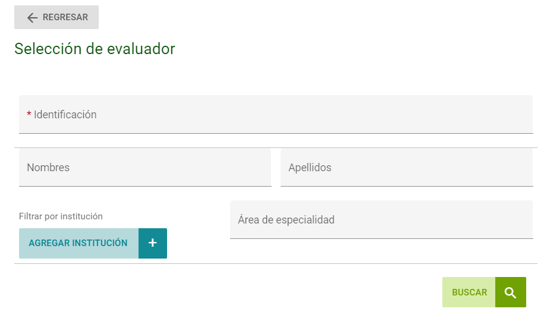
  *Figura 32 - Formulario búsqueda nuevo evaluador*

  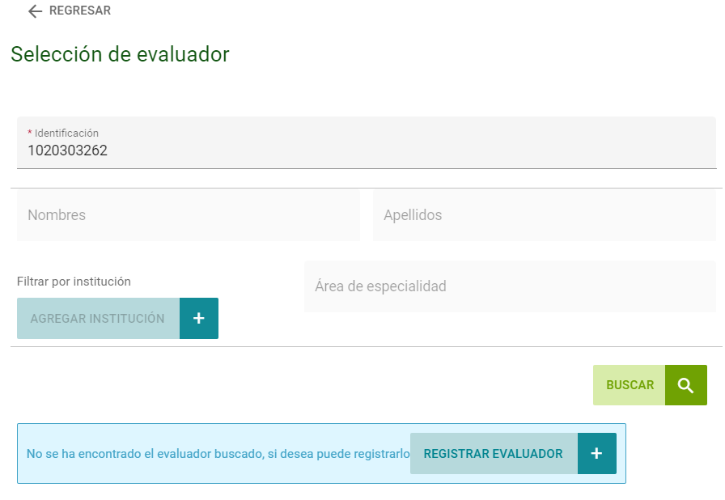
  *Figura 33 - Botón Registrar nuevo evaluador*

  
  *Figura 34 - Datos nuevo evaluador*

#### 3.5.1.2 Agregar evaluador existente

1. Ingrese número de identificación en la consulta y presione **Buscar**.
2. Presione el botón **Seleccionar**.
3. Elija la opción **Seleccionado**, defina fecha límite y formato, y presione **AGREGAR**.

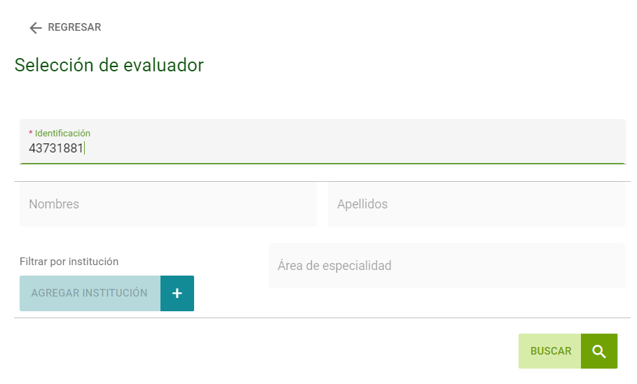
*Figura 35 - Consultar evaluador*

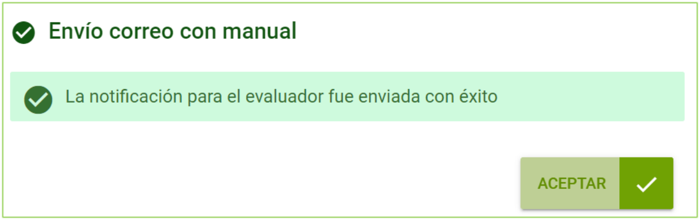
*Figura 36 - Seleccionar evaluador*

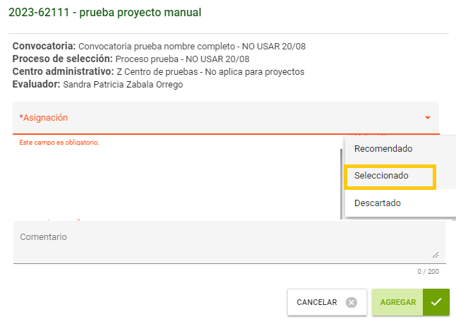
*Figura 37 - Estado seleccionado*

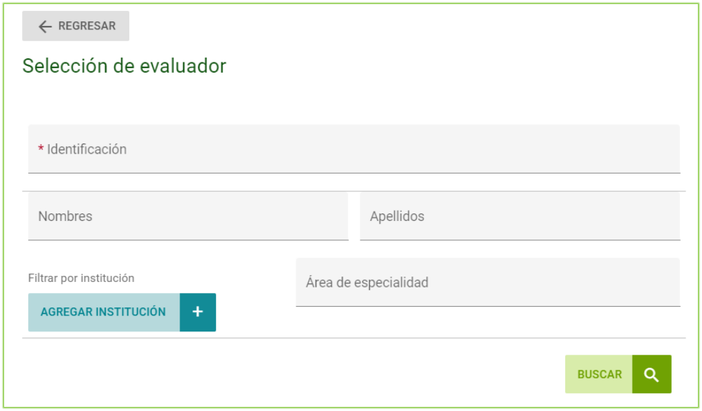
*Figura 38 - Formulario agregar evaluador existente*

#### 3.5.1.3 Asignar rol del evaluador

En la pantalla de resumen presione los tres puntos de acciones, seleccione **Asignar rol de evaluador** y presione **GUARDAR**.

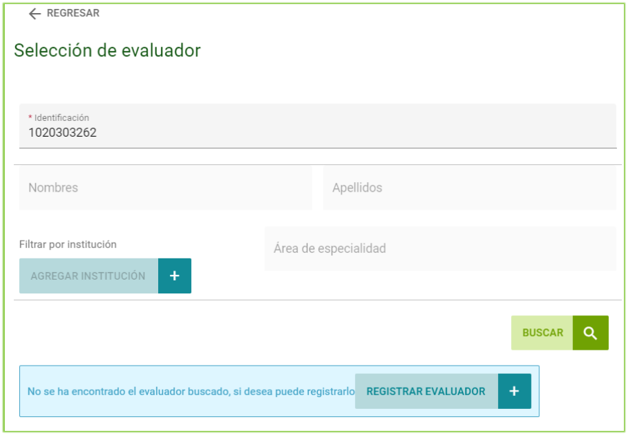
*Figura 39 - Asignar rol evaluador*

!!! note "Procedimiento Transitorio"
> Esta parte del proceso se hace de forma transitoria mientras se ajusta el proceso de evaluación por el sistema:  
> Una vez asignados los evaluadores, el proyecto queda en estado **Pendiente científicamente** y desde el centro se deben enviar en PDF las dos o tres evaluaciones a la Vicerrectoría de Investigación indicando:
> - Código del proyecto.
> - Identificación de los evaluadores registrada en SIIU.
> - Señalando quién es el *evaluador 1* y quién es el *evaluador 2*.

---

### 3.6 Dar Aval al proyecto por parte del centro

Luego de revisar que el proyecto cumple con todos los requisitos y validar la información en el SIIU:

1. Ingrese al menú: `Convocatorias > Aval de proyectos`.

   
   *Figura 40 - Menú Aval de proyectos*

2. Seleccione la convocatoria y en estado elija **Aprobada Evaluación Técnica** >> **Consultar**.

   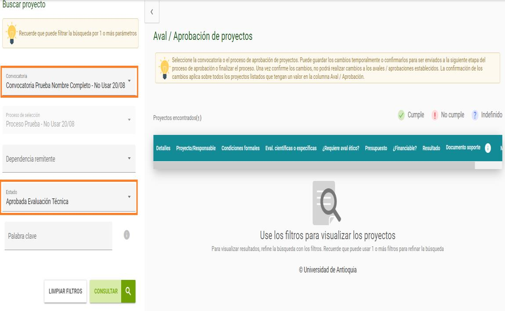
   *Figura 41 - Ingresar a proyecto para Aval del Centro*

3. Para ver el detalle del proyecto ingrese a la columna *Proyecto/Responsable* y dé clic en **Ver proyecto**. Para ver el historial de cambios de estado dé clic en **Ver detalle**.

   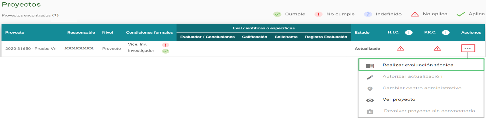
   *Figura 42 - Detalle del proyecto*

4. Para iniciar el proceso de aval:  
   - Seleccione la casilla de verificación en la columna **Documento de soporte**.  
   - Presione el botón superior **Asociar acta**.

   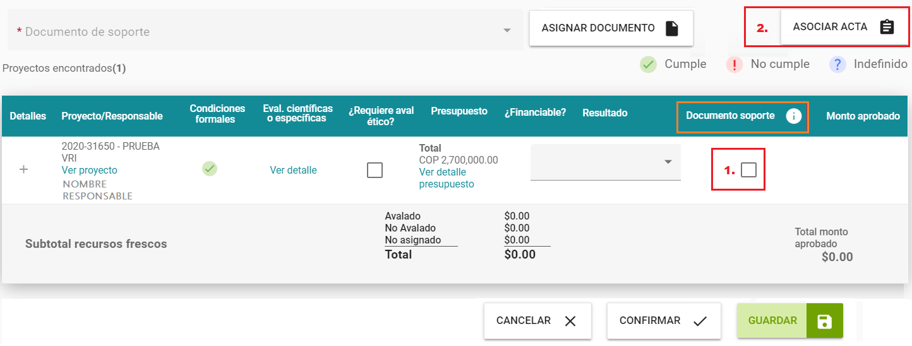
   *Figura 43 - Asociar acta a proyecto para aval*

5. En la ventana para agregar documentos de soporte:  
   - Diligencie: *Nombre del documento (AVAL COMITÉ TÉCNICO)*, *Número del documento*, *Emisor*, *Fecha de emisión*, *Tipo de documento (Acta)*, *Descripción*.  
   - En **Archivo adjunto (+)** seleccione el PDF del acta escaneada.  
   - Presione **AGREGAR DOCUMENTO SOPORTE**.

   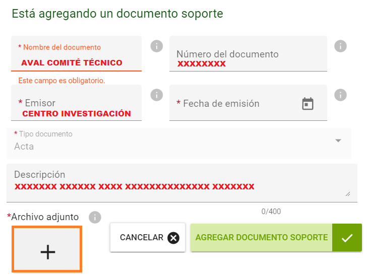
   *Figura 44 - Ventana Documento de soporte*

   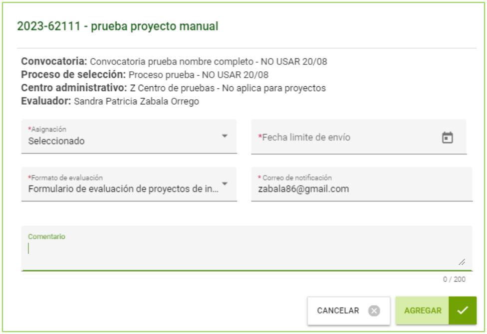
   *Figura 45 - Adjuntar documento*

6. En la columna **Resultado**, escoja la opción **Avalado** y dé clic en el botón **Guardar**.

   
   *Figura 46 - Avalar proyecto*

7. Tras el mensaje de confirmación de guardado exitoso, presione **Confirmar**.

   
   *Figura 47 - Aprobar el proyecto*

8. El sistema muestra la advertencia: *“¿Realmente desea confirmar los Avales / Aprobaciones? Después de confirmar los cambios los proyectos completarán esta etapa... y no podrá realizar modificaciones adicionales...”*. Presione **ACEPTAR**.

   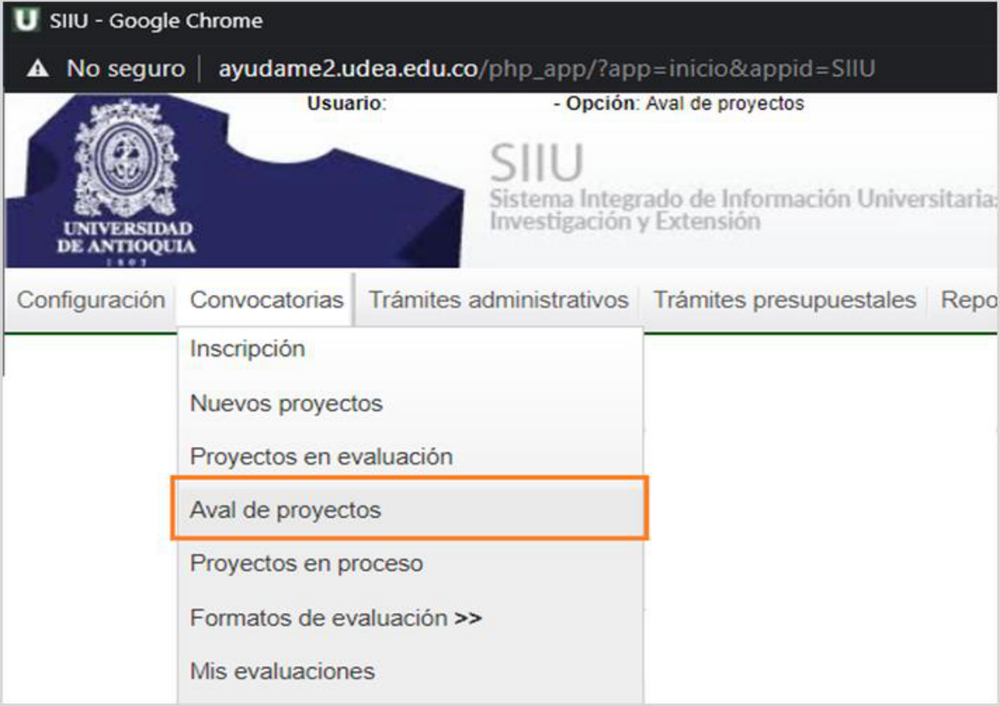
   *Figura 48 - Confirmación de aval*

!!! tip "> Una vez avalado el proyecto por parte del Centro, este será enviado a la Vicerrectoría de Investigación para continuar con la aprobación. Se recomienda notificar a la Vicerrectoría una vez ha sido avalado.  "
> *(Nota: Todos los datos mostrados en las imágenes fueron tomados de proyectos y procesos usados para efectos de pruebas).*

---

## 4. Nota de cambio

- No aplica para la primera versión.

---

## Registro de Control y Firmas

| Rol | Nombre | Cargo / Dependencia | Fecha |
| :--- | :--- | :--- | :--- |
| **Elaboró** | Sandra Patricia Zabala Orrego | Contratista | 16-FEB-2024 |
| **Elaboró** | Lina María Ospina Pérez | Product Owner SIIU, Vicerrectoría de Investigación | 16-FEB-2024 |
| **Revisó** | Kerlin Yohana Bedoya Agudelo | Analista de Procesos, División de Arquitectura de Procesos | 12-MAR-2024 |
| **Revisó** | Julio César García Castrillón | Analista de Procesos, División de Arquitectura de Procesos | 12-MAR-2024 |
| **Aprobó** | Gloria Valencia Bustamante | Asistente, Vicerrectoría de Investigación | 13-MAR-2024 |
