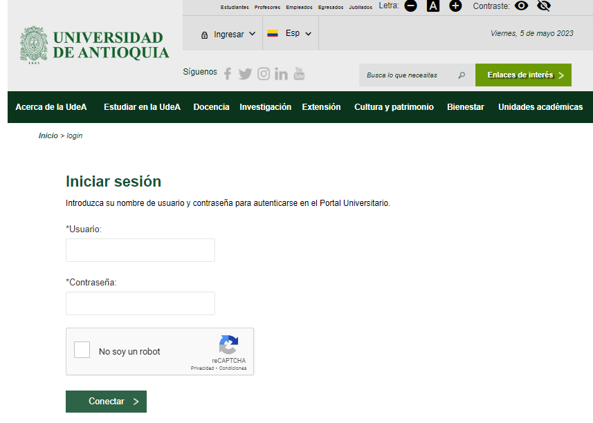
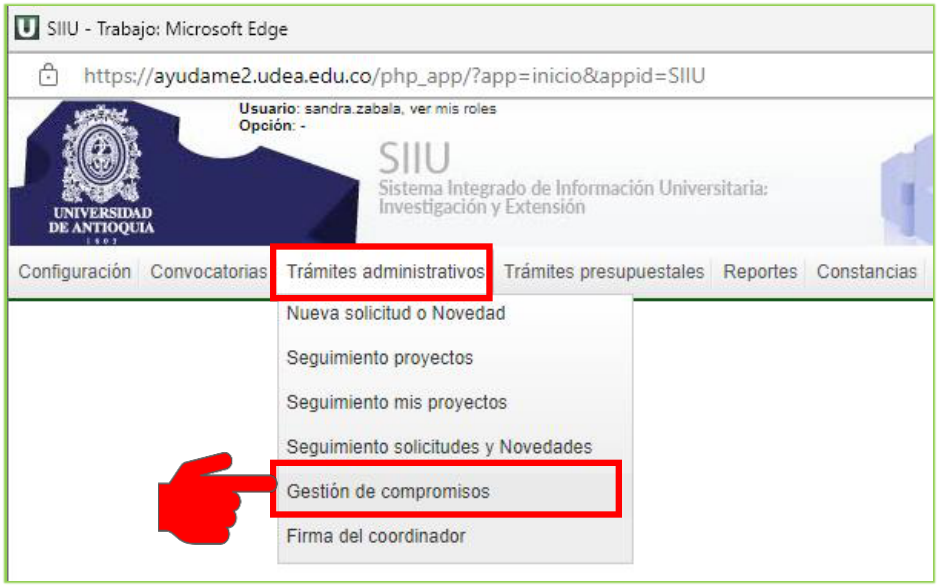
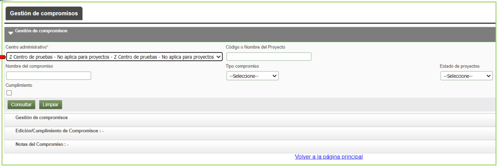
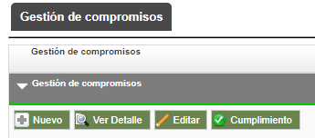
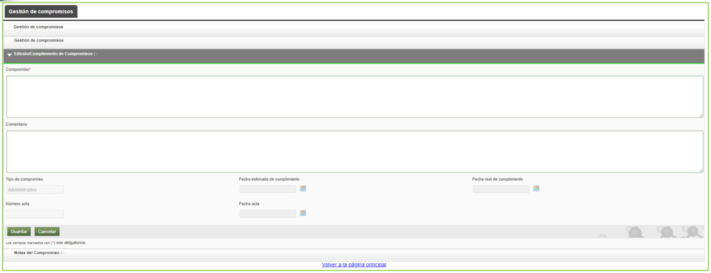
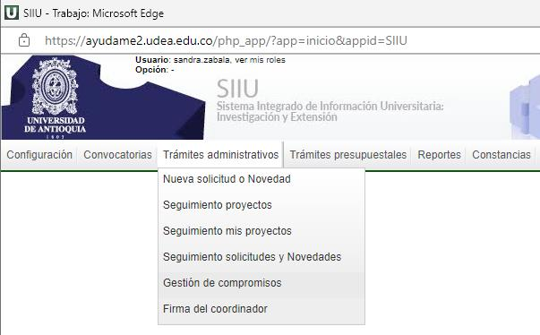
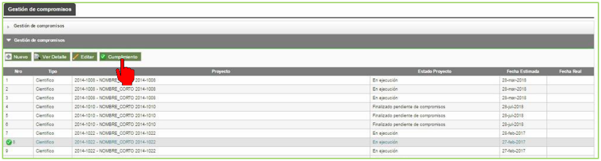

# GUÍA PARA LA GESTIÓN DE COMPROMISOS EN SIIU

!!! note "Información de Control Documental"
> **Código**: VI-GU-09  
> **Versión**: 01 / 13-MAR-2024  
> *Aviso legal institucional*: La impresión o copia digital de este documento se considera "COPIA NO CONTROLADA". Solo se garantiza la actualización de la documentación en el sitio oficial `http://www.udea.edu.co`.

---

## Contenido

1. [Definición](#1-definicion)
2. [Contenido](#2-contenido)
   - 2.1. [Requisitos para la gestión de compromisos](#21-requisitos-para-la-gestion-de-compromisos)
   - 2.2. [Usuarios que intervienen en el proceso](#22-usuarios-que-intervienen-en-el-proceso)
   - 2.3. [Ingreso al SIIU](#23-ingreso-al-siiu)
   - 2.4. [Proceso Gestión de compromisos](#24-proceso-gestion-de-compromisos)
     - 2.4.1. [Nuevo compromiso](#241-nuevo-compromiso)
     - 2.4.2. [Ver detalle de compromiso](#242-ver-detalle-de-compromiso)
     - 2.4.3. [Editar compromiso](#243-editar-compromiso)
     - 2.4.4. [Cumplimiento de compromisos](#244-cumplimiento-de-compromisos)
3. [Nota de cambio](#3-nota-de-cambio)

---

## 1. Definición

Este documento se ha elaborado con el fin de ayudar y capacitar a las personas que desde los centros de investigación **Administran y gestionan los proyectos** de los grupos de investigación, los cuales deben estar registrados en el **Sistema de Información para la Investigación Universitaria – SIIU**. 

Dado lo anterior se aclara que esta guía no hace parte de la normativa universitaria y solamente se debe utilizar como una herramienta que orienta el paso a seguir para la gestión de compromisos en el SIIU.

---

## 2. Contenido

### 2.1. Requisitos para la gestión de compromisos

- El proyecto debe estar en estado **En ejecución**.
- Se deben tener compromisos obligatorios sin finalizar.

### 2.2. Usuarios que intervienen en el proceso

- **Usuario Administrador Centro**: Jefe Centro de Investigación.

### 2.3. Ingreso al SIIU

El usuario con rol Centro debe autenticarse en el portal de la Universidad de Antioquia (`http://www.udea.edu.co`), buscar la opción aplicaciones y entre ellas elegir el SIIU, así:

1. Ingresa al portal de la Universidad: `http://www.udea.edu.co`, en el encabezado seleccione **Ingresar >> Iniciar sesión**.

   
   *Figura 1- Ingreso al portal de la Universidad de Antioquia*

2. Aparece pantalla para ingresar su usuario y contraseña, seleccione **No soy un Robot** (el sistema le puede pedir realizar validaciones) finalmente presione clic en el botón **CONECTAR**.

   
   *Figura 2 - Conectar al portal*

3. Presione clic en la opción **Enlaces de Interés**, seleccione **Mis aplicaciones**.  
   *Ruta*: `Enlaces de interés → Mis aplicaciones`.

   
   *Figura 3 - Enlaces de interés*

4. Se abrirá una ventana con las aplicaciones de la Universidad, seleccione **SIIU**.

   
   *Figura 4 - Seleccione SIIU*

5. Se abre una nueva ventana con la aplicación SIIU.  
   !!! tip "Configuración del Navegador"
   > Si la ventana no abre inmediatamente, es necesaria la configuración de ventanas emergentes en el navegador y seleccionar la opción que autorice el SIIU.

---

### 2.4. Proceso Gestión de compromisos

Los compromisos del proyecto se dividen en dos conceptos:
- **Compromisos Obligatorios**: Son los compromisos configurados en la convocatoria, de acuerdo con los términos de referencia y que son de obligatorio cumplimiento.
- **Compromisos Opcionales**: Son aquellos compromisos internos para el proyecto que se desean asumir.

1. Ingrese por la opción:  
   `Trámites administrativos > Gestión de compromisos` *(referenciado también como Trámites Opcionales > Gestión de compromisos)*.

   
   *Figura 5 - Menú Gestión de compromisos*

2. El SIIU abrirá una ventana con filtros de búsqueda, en la que deberá elegir el centro de investigación correspondiente (este campo es obligatorio). Podrá agregar a la búsqueda del proyecto los diferentes filtros o campos que dispone el sistema. Presione **Consultar**.

   
   *Figura 6 - Filtros de consulta compromisos*

   !!! info "> Debe utilizar el filtro de búsqueda con el **código del proyecto** requerido; si lo elige por el centro únicamente, el sistema le trae como resultado los compromisos pendientes de **TODOS** los proyectos de su centro."

3. Una vez realice la consulta, el sistema presenta el listado de los compromisos pendientes por cumplir, además de los campos: *Tipo, proyecto, estado del proyecto, fecha estimada, la fecha real (campo vacío)*.

   
   *Figura 7 - Consulta de compromisos*

4. Seleccione con el cursor el compromiso que desea gestionar. En la parte superior del listado el sistema mostrará las diferentes opciones que tiene para el compromiso: **Nuevo**, **Ver Detalle**, **Editar**, **Cumplimiento**.

   
   *Figura 8 - Gestión para los compromisos*

---

#### 2.4.1. Nuevo compromiso

Esta opción permite crear un nuevo **compromiso opcional** que el centro considere se debe cumplir en el proyecto, además de los compromisos obligatorios definidos por la convocatoria.  
Para el caso de los proyectos inscritos esta opción permite definir los compromisos opcionales que se desean adquirir.

!!! warning "Compromisos Opcionales Adquiridos"
> Los compromisos opcionales que agregue se convierten en **de obligatorio cumplimiento**.

1. Presione el botón **Nuevo**.
2. El sistema presenta un nuevo formulario donde debe ingresar información en los siguientes campos:

| Campos | Detalle |
| :--- | :--- |
| **Compromiso** | Ingrese el nuevo compromiso que desea registrar – *campo obligatorio*. |
| **Comentario** | Ingrese información adicional para el compromiso. |
| **Tipo Compromiso** | El sistema muestra por defecto de solo lectura: **Administrativo**. |

3. Una vez ingrese la información, presione el botón **GUARDAR**.

*Figura 9 - Nuevo compromiso*

---

#### 2.4.2. Ver detalle de compromiso

Al presionar el botón **Ver detalle**, el sistema presenta una ventana emergente con información propia del compromiso (Tipo de compromiso, Explicación, Comentario, Fecha estimada de cumplimiento, Fecha real de cumplimiento, Notas, Funcionario).  
Presione el botón **Cerrar** para salir.

*Figura 10 - Ver detalle de compromiso*

---

#### 2.4.3. Editar compromiso

El sistema permite editar únicamente los **compromisos opcionales**, ya que los compromisos Obligatorios están definidos por los términos de referencia de la convocatoria.  
Presione el botón **Editar** y modifique la información del compromiso requerido.

---

#### 2.4.4. Cumplimiento de compromisos

En la opción cumplimiento el jefe de centro podrá asignar la fecha real del cumplimiento del compromiso y agregar información en caso de ser necesario.

1. Seleccione el compromiso y presione el botón **Cumplimiento**.

   
   *Figura 11 - Listado de compromisos, seleccione compromiso*

   !!! note "> Solo podrá elegir un compromiso a la vez para gestionar su cumplimiento, por lo que deberá repetir el proceso tantas veces como compromisos tenga el proyecto."

2. El sistema abrirá una ventana donde el usuario podrá ver el detalle del compromiso seleccionado y deberá registrar los siguientes valores del acta en que fue aprobado el compromiso en los campos:
   - **Número acta**
   - **Fecha acta**
   - **Fecha real de cumplimiento** *(es la fecha en la cual el investigador cumple con el compromiso)*.

   
   *Figura 12 – Fecha real de cumplimiento*

3. Puede agregar un comentario del compromiso al que acaba de colocar la fecha real de finalización; presione el botón **NOTAS DEL COMPROMISO** y finalice con **AGREGAR NOTA**. Una vez termine de ingresar toda la información del compromiso, presione el botón **GUARDAR**.

   
   *Figura 13 - Nota al compromiso*

4. El sistema muestra el mensaje *“Actualizado exitosamente”* y el compromiso desaparecerá de la lista del centro.  
   *(Recuerde que solo lista los compromisos pendientes)*.  
   Deberá repetir el procedimiento con todos los compromisos faltantes asociados al proyecto que desea finalizar.

!!! info "> Cuando se cumplan todos los compromisos obligatorios del proyecto, automáticamente este pasa a estado **FINALIZADO**."

---

## 3. Nota de cambio

- No aplica para la primera versión.

---

## Registro de Control y Firmas

| Rol | Nombre | Cargo / Dependencia | Fecha |
| :--- | :--- | :--- | :--- |
| **Elaboró** | Sandra Patricia Zabala Orrego | Contratista | 16-FEB-2024 |
| **Elaboró** | Lina María Ospina Pérez | Product Owner SIIU, Vicerrectoría de Investigación | 16-FEB-2024 |
| **Revisó** | Kerlin Yohana Bedoya Agudelo | Analista de Procesos, División de Arquitectura de Procesos | 12-MAR-2024 |
| **Revisó** | Julio César García Castrillón | Analista de Procesos, División de Arquitectura de Procesos | 12-MAR-2024 |
| **Aprobó** | Gloria Valencia Bustamante | Asistente, Vicerrectoría de Investigación | 13-MAR-2024 |
