# GUÍA PARA LA SOLICITUD DE PRÓRROGA DE CUPOS EN EL PROGRAMA JOVEN INVESTIGADOR

!!! note "Información de Control Documental"
> **Código**: VI-GU-11  
> **Versión**: 01 / 13-MAR-2024  
> *Aviso legal institucional*: La impresión o copia digital de este documento se considera "COPIA NO CONTROLADA". Solo se garantiza la actualización de la documentación en el sitio oficial `http://www.udea.edu.co`.

---

## Contenido

1. [Definición](#1-definición)
2. [Contenido](#2-contenido)
   - 2.1. [Requisitos](#21-requisitos)
   - 2.2. [Usuarios que intervienen](#22-usuarios-que-intervienen)
   - 2.3. [Ingrese a la aplicación SIIU por el portal](#23-ingrese-a-la-aplicación-siiu-por-el-portal)
   - 2.4. [Solicitar prórroga para cupo de Joven Investigador](#24-solicitar-prórroga-para-cupo-de-joven-investigador)
   - 2.5. [Enviar solicitud](#25-enviar-solicitud)
   - 2.6. [Editar Solicitud](#26-editar-solicitud)
3. [Nota de cambio](#3-nota-de-cambio)

---

## 1. Definición

El presente documento tiene como propósito ayudar y capacitar a los **tutores interesados en solicitar prórrogas para cupos de Joven Investigador**, para lo cual deben ingresar al **Sistema de Información para la Investigación Universitaria: Investigación y Extensión – SIIU**, para realizar el respectivo trámite administrativo. 

Dado lo anterior se aclara que esta guía no hace parte de la normativa universitaria y solamente se debe utilizar como una herramienta que orienta los pasos a seguir.

---

## 2. Contenido

### 2.1. Requisitos

- Tener a mano el código del SIIU del cupo que obtuvo el tutor al momento de la matrícula y que se encuentra publicado en los resultados de la convocatoria.
- Utilizar preferiblemente un navegador diferente a Chrome y por modo incógnito o ventana privada.

### 2.2. Usuarios que intervienen

- **Usuario Tutor**: Es quien se encarga de la matrícula del cupo, del registro de la hoja de vida del joven investigador y de la creación de solicitudes administrativas sobre el cupo en el SIIU. El tutor administra el cupo y lo envía por medio de la plataforma a la Vicerrectoría de Investigación para su aprobación correspondiente.
- **Usuario Vicerrectoría**: Es el encargado de **APROBAR** las solicitudes en el SIIU para que sus cambios se vean reflejados en el cupo.

---

### 2.3. Ingrese a la aplicación SIIU por el portal

El tutor debe ingresar al portal de la Universidad de Antioquia (`http://www.udea.edu.co`) donde se autenticará, buscará la opción aplicaciones y entre las disponibles deberá elegir SIIU, así:

1. Ingrese al portal de la Universidad: `http://www.udea.edu.co`, en el encabezado seleccione **Ingresar >> Iniciar sesión**.

   
   *Figura 1. Ingreso al portal de la Universidad de Antioquia*

2. Aparece la pantalla para iniciar sesión como usuario del portal; ingrese su usuario y contraseña y presione clic en el botón **CONECTAR**.

   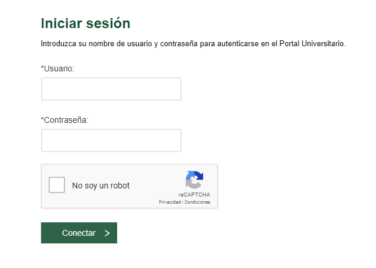
   *Figura 2. Iniciar sesión en el portal de la Universidad de Antioquia*

3. Se abrirá una ventana con su nombre en la parte izquierda de la página, seleccione:  
   `Enlaces de interés >> Mis aplicaciones`.

   
   *Figura 3. Información de usuario registrado en el portal*

4. Se abrirá una ventana con las aplicaciones de la Universidad permitidas para su ingreso; seleccione la aplicación **SIIU**.

   
   *Figura 4. Pantalla de aplicaciones disponibles para usuario*

5. Se debe abrir una nueva ventana con la aplicación SIIU.  
   !!! tip "> Si la ventana no abre inmediatamente, es necesaria la configuración de ventanas emergentes en el navegador y seleccionar la opción que autorice el SIIU."

---

### 2.4. Solicitar prórroga para cupo de Joven Investigador

1. Una vez se encuentre en el aplicativo SIIU, ingrese por el menú:  
   `Trámites administrativos > Nueva solicitud o novedad`.

   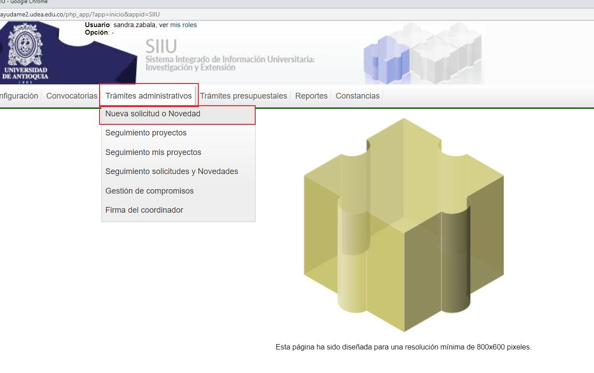
   *Figura 5- Trámites administrativos/Nueva solicitud o novedad*

2. El sistema despliega un formulario con filtros de consulta:
   - En el campo **Centro administrativo** seleccione la opción **“TODOS”**.
   - En el campo **Código proyecto**, ingrese el código del cupo de JI que le fue aprobado en la convocatoria.
   - Presione el botón **CONSULTAR**.

   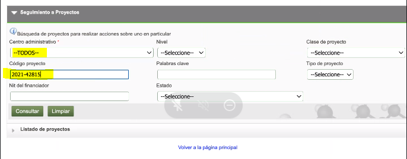
   *Figura 6- Filtro de búsqueda*

3. El sistema realiza la consulta de acuerdo con los parámetros indicados. Presione clic sobre la información del cupo.  
   Nótese que en la parte superior aparecen varios botones (prórroga, cambio en participante, entre otros).

   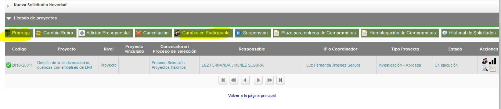
   *Figura 7 - Barra de opciones administrativas*

4. Presione el botón **Prórroga**.

| Solicitud | Detalle |
| :--- | :--- |
| **Prórroga** | Permite realizar prórroga a cupos para la fecha de inicio. |

5. El sistema presenta el formulario de prórroga:
   - Seleccione el campo **“Para Iniciar”** *(esta opción indica que está solicitando un plazo para dar inicio al cupo)*.
   - En el campo **Tiempo solicitado** indique el tiempo de plazo requerido.
   - En el campo **Justificación** ingrese las razones para la solicitud de prórroga.
   - Presione el botón **Guardar**.

   
   *Figura 8 - Formulario Solicitud de prórroga*

   *(Al momento de GUARDAR la solicitud, el sistema mostrará un mensaje de almacenamiento exitoso).*

6. Pase a la siguiente pestaña **Actividades Prórroga**.  
   !!! note "> En esta pestaña se agregan actividades que se desarrollarán durante la prórroga; no obstante, **esto no aplica para los cupos de JI**. Presione directamente **GUARDAR** para continuar."

   
   *Figura 9 - Actividades de prórroga*

7. Pase a la siguiente pestaña **Condiciones formales**.  
   *(En esta pestaña no se incluye ninguna información para este trámite)*. Presione **Guardar**.

   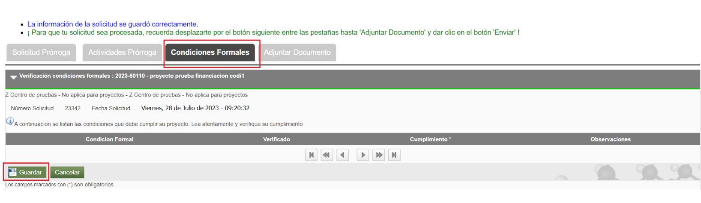
   *Figura 10- Pestaña condiciones formales*

8. El sistema lo llevará a la última pestaña **Documento soporte** (o *Adjuntar Documento*). En esta pestaña puede adjuntar los soportes requeridos:
   - Presione el botón **+ Agregar** que encontrará al lado derecho de la pantalla.

   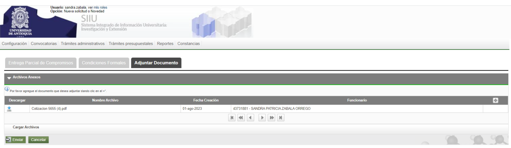
   *Figura 11- Documento soporte botón Agregar*

   !!! info "Regla del Nombre de Archivo"
   > El nombre del archivo a adjuntar debe ser **corto, no exceder 30 caracteres, sin tildes ni caracteres especiales y sin mayúscula sostenida**. No repita el nombre del documento.

   - En el formulario emergente ingrese: *Documento (Soportes)*, *Tipo*, *Emisor (Investigador Principal)*, *Fecha de emisión*, *Número*, *Descripción*.  
   - Clic en **Seleccionar archivo** para abrir el explorador y buscar el PDF; luego clic en **Abrir**.

   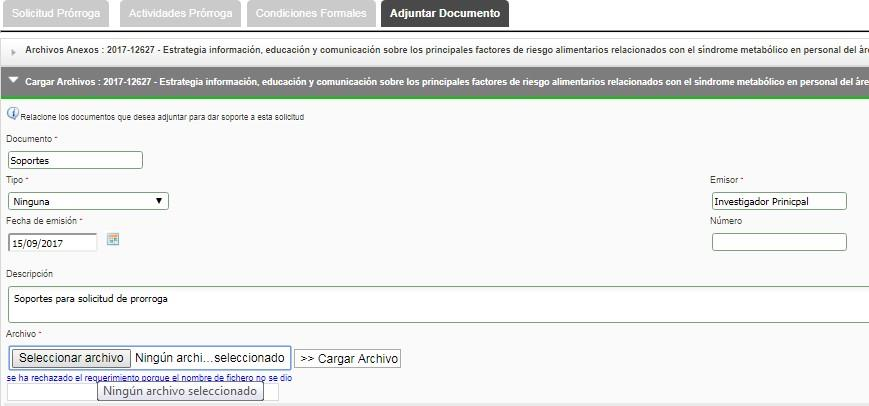
   *Figura 12- Documento soporte _Seleccionar archivo*

   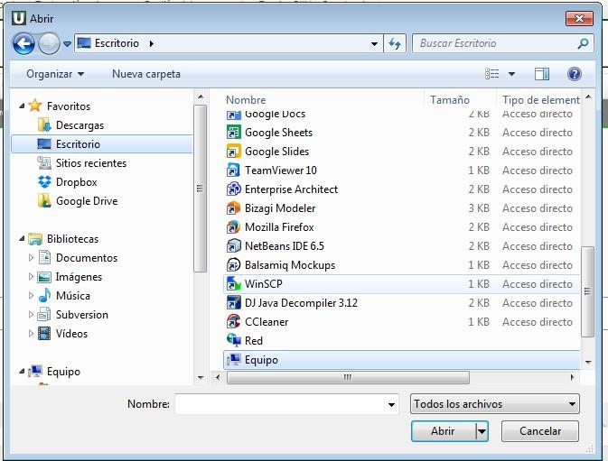
   *Figura 13 (en doc ref. Figura 3)- Búsqueda de archivo para adjuntar*

   - Seleccione el botón **Cargar Archivo** y verifique que la barra de carga esté en azul y con el nombre correcto.  
   - Clic en **Guardar**.

   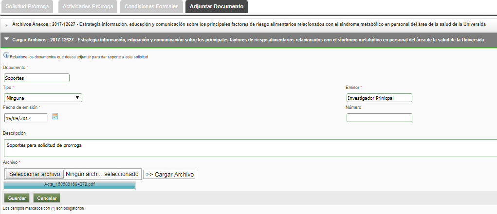
   *Figura 13 / 14 - Cargar archivo*

   - Valide en la lista que el documento de soporte quedó correctamente adjunto.

   
   *Figura 14 - Soporte adjuntado*

---

### 2.5. Enviar solicitud

1. Presione el botón **ENVIAR** para que la Vicerrectoría de Investigación pueda revisar y gestionar la solicitud.

   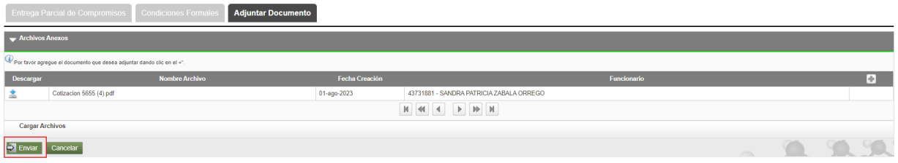
   *Figura 14 (en doc ref. Figura 14b)- Enviar solicitud*

2. El sistema genera un mensaje de confirmación de envío.  
   !!! warning "> Una vez enviada la solicitud ya **no podrá hacerle modificaciones**. La solicitud queda en estado **Pendiente de Aval**."

   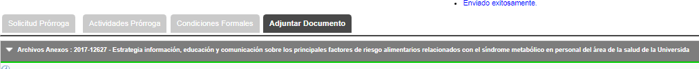
   *Figura 15 - Mensaje Enviado exitosamente*

---

### 2.6. Editar Solicitud

Antes de enviar la solicitud administrativa, se puede editar cuando se cierra el sistema por inactividad o cuando es necesario terminarla en otro momento:

1. Ingrese por: `Trámites administrativos > Seguimiento solicitudes y novedades`.

   
   *Figura 17 - Editar solicitud*

2. El sistema abre el formulario de seguimiento:

| Campo | Detalle |
| :--- | :--- |
| **Centro administrativo** | Seleccione el centro al que pertenece el cupo |
| **Tipo de trámite** | Seleccione la solicitud administrativa a editar |
| **Tipo Solicitud** | Seleccione si es Interna o Novedad |
| **Estado** | Seleccione estado **En edición** *(Antes de Enviar a centro)* |
| **Código o nombre del cupo** | Ingrese el código o nombre del cupo que desea editar (campo código o Nombre del proyecto) |
| **Rango de fecha inicial / final** | Seleccione el rango de fechas de creación |

   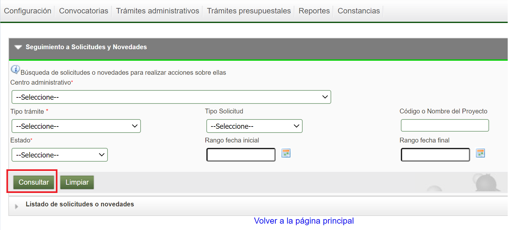
   *Figura 16 - Filtro de búsqueda para editar*

3. Seleccione el cupo a editar y continúe con el registro de la solicitud hasta enviar.

---

## 3. Nota de cambio

- No aplica para la primera versión.

---

## Registro de Control y Firmas

| Rol | Nombre | Cargo / Dependencia | Fecha |
| :--- | :--- | :--- | :--- |
| **Elaboró** | Sandra Patricia Zabala Orrego | Contratista | 16-FEB-2024 |
| **Elaboró** | Lina María Ospina Pérez | Product Owner SIIU, Vicerrectoría de Investigación | 16-FEB-2024 |
| **Revisó** | Kerlin Yohana Bedoya Agudelo | Analista de Procesos, División de Arquitectura de Procesos | 12-MAR-2024 |
| **Revisó** | Julio César García Castrillón | Analista de Procesos, División de Arquitectura de Procesos | 12-MAR-2024 |
| **Aprobó** | Gloria Valencia Bustamante | Asistente, Vicerrectoría de Investigación | 13-MAR-2024 |
