# GUÍA PARA LA MATRÍCULA DE PRIMER PROYECTO EN EL SIIU

!!! note "Información de Control Documental"
> **Código**: VI-GU-17  
> **Versión**: 01 / 29-ABR-2024  
> *Aviso legal institucional*: La impresión o copia digital de este documento se considera "COPIA NO CONTROLADA". Solo se garantiza la actualización de la documentación en el sitio oficial `http://www.udea.edu.co`.

---

## Contenido

1. [Definición](#1-definición)
2. [Contenido](#2-contenido)
   - 2.1. [Requisitos para la matrícula de proyectos](#21-requisitos-para-la-matrícula-de-proyectos)
   - 2.2. [Usuarios que intervienen en el proceso](#22-usuarios-que-intervienen-en-el-proceso)
   - 2.3. [Ingreso al SIIU](#23-ingreso-al-siiu)
   - 2.4. [Matrícula de proyectos vinculados al fondo primer proyecto](#24-matrícula-de-proyectos-vinculados-al-fondo-primer-proyecto)
     - 2.4.1. [Pestaña Información General](#241-pestaña-información-general)
     - 2.4.2. [Pestaña Descripción – Cronograma](#242-pestaña-descripción--cronograma)
     - 2.4.3. [Pestaña Presupuestal](#243-pestaña-presupuestal)
     - 2.4.4. [Pestaña Participantes](#244-pestaña-participantes)
     - 2.4.5. [Pestaña Evaluadores Recomendados](#245-pestaña-evaluadores-recomendados)
     - 2.4.6. [Pestaña Compromisos y Condiciones](#246-pestaña-compromisos-y-condiciones)
     - 2.4.7. [Condiciones Formales](#247-condiciones-formales)
     - 2.4.8. [Pestaña Documento Soporte](#248-pestaña-documento-soporte)
     - 2.4.9. [Pestaña Enviar](#249-pestaña-enviar)
3. [Nota de cambio](#3-nota-de-cambio)
4. [Registro de Control y Firmas](#registro-de-control-y-firmas)

---

## 1. Definición

Este documento se ha elaborado con el fin de ayudar y capacitar los investigadores principales, los cuales registran los proyectos en el Sistema de Información para la Investigación Universitaria – SIIU. Dado lo anterior se aclara que esta guía no hace parte de la normativa universitaria y solamente se debe utilizar como una herramienta que orienta los pasos que se debe seguir para la matrícula de proyectos que participan en fondo de apoyo “Primer proyecto”.

---

## 2. Contenido

### 2.1. Requisitos para la matrícula de proyectos

- El investigador principal o responsable del proyecto debe estar registrado en el portal institucional.
- El usuario debe tener acceso a SIIU.
- Tener a mano el número de documento de los participantes del proyecto.
- Tener a mano el documento de los términos de referencia del fondo.

---

### 2.2. Usuarios que intervienen en el proceso

- **Usuario Investigador Principal**.

---

### 2.3. Ingreso al SIIU

El investigador principal debe autenticarse en el portal de la Universidad de Antioquia, `http://www.udea.edu.co`, buscar la opción aplicaciones y entre ellas elegir el SIIU, así:

1. Ingresa al portal de la Universidad: `http://www.udea.edu.co`, en el encabezado seleccione **Ingresar >> Iniciar sesión** (Ver figura 1).

   
   *Figura 1 - Ingreso al portal de la Universidad de Antioquia*

2. Aparece pantalla para ingresar su usuario y contraseña, seleccione *No soy un Robot* (el sistema le puede pedir realizar validaciones) finalmente presione clic en el botón **CONECTAR**. (Ver figura 2).

   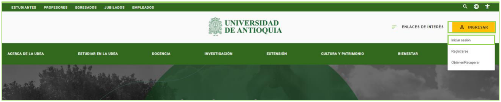
   *Figura 2 - Conectar al portal*

3. Presione clic en la opción **Enlaces de Interés** y seleccione **Mis aplicaciones**, así: `Enlaces de interés → Mis aplicaciones`. (Ver figura 3).

   
   *Figura 3 - Enlaces de interés*

4. Se abrirá una ventana con las aplicaciones de la Universidad; seleccione **SIIU**. (Ver figura 4).

   
   *Figura 4 - Seleccione SIIU*

!!! note "> Se abre una nueva ventana con la aplicación SIIU. Si la ventana no abre inmediatamente, es necesaria la configuración de ventanas emergentes en el navegador y seleccionar la opción que autorice el SIIU."

---

### 2.4. Matrícula de proyectos vinculados al fondo primer proyecto

Estando en el aplicativo SIIU, ingrese al menú **Convocatorias** y seleccione la opción **Nuevos proyectos**. (Ver figura 5).

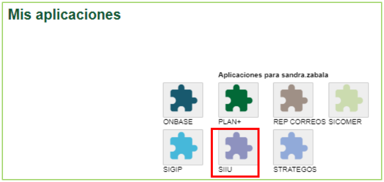
*Figura 5 - Menú para matrícula de proyectos*

---

#### 2.4.1. Pestaña Información General

El sistema abre el formulario denominado **Información general** para ingresar los datos de matrícula con los siguientes campos: (Ver figura 6).

| Campos | Detalle |
| :--- | :--- |
| **Matrícula de** | Proyecto |
| **Clase de proyecto** | Proyecto |
| **Tipo de proyecto** | Investigación |
| **Clasificación** | Básica o aplicada |
| **Opción de matrícula de proyecto** | Convocatoria |
| **Convocatoria** | Fondo apoyo al primer proyecto .... |
| **Modalidad de financiación** | Elija entre: • *Vincula como estudiante en formación a un estudiante de pregrado*: \$25.000.000 • *Vincula como estudiante en formación a un estudiante de posgrado (Maestría, doctorado)*: \$40.000.000 |
| **Centro administrativo** | Centro que administra el proyecto |
| **Nombre corto** | Nombre corto del proyecto |
| **Nombre completo** | Nombre largo o completo del proyecto |
| **Palabras clave** | Indique palabras clave |
| **Seccional** | Elija seccional |
| **Lugar de ejecución** | Indique lugar de ejecución |
| **Duración** | Asigne duración al proyecto (Ver términos de referencia) |
| **Responsable** | El sistema coloca la información automáticamente |

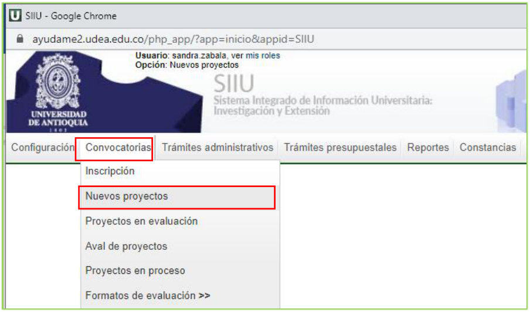
*Figura 6 - Información general*

Presione el botón **GUARDAR** para que el sistema le asigne código al proyecto que está creando.

!!! info "> Es importante tener a mano el número del proyecto asignado por el sistema, ya que lo va a necesitar en otros momentos."

Presione el botón **SIGUIENTE** para continuar con el próximo formulario.

---

#### 2.4.2. Pestaña Descripción – Cronograma

Esta opción del tren de datos se divide en dos pestañas: **Descripción** y **Cronograma**. (Ver figura 7).

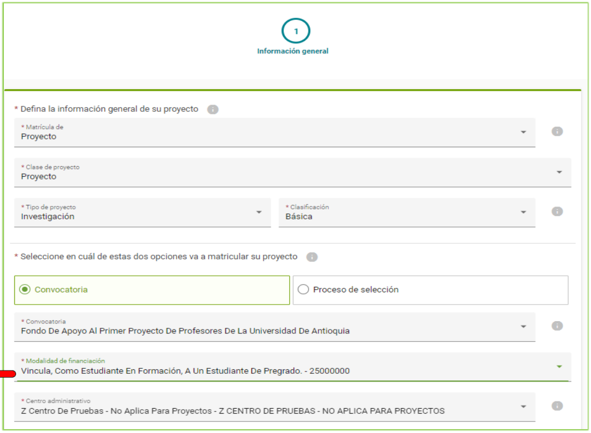
*Figura 7 - Descripción _ cronograma*

##### A. Subpestaña Descripción
En esta opción se ingresa la información académica y técnica requerida para los proyectos matriculados en el fondo. Presione los tres puntos que aparecen en las descripciones para editar cada sección: (Ver figura 8).
- *Planteamiento del Problema*
- *Objetivo General*
- *Metodología Propuesta*
- *Resultados Esperados*
- *Funciones del Estudiante*
- *Consideraciones Éticas*
- *Marco Teórico / Referentes Conceptuales / Estado del Arte*
- *Referencias Bibliográficas*
- *Línea, Programa o Agenda de investigación en la que se inscribe el proyecto*

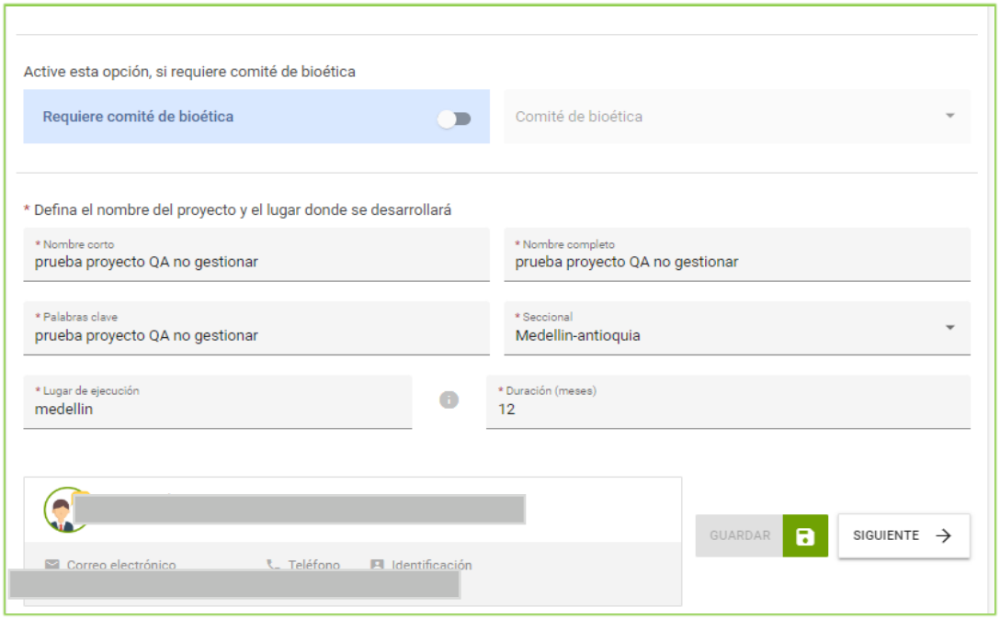
*Figura 8 - Descripciones*

El sistema abre una ventana con un editor de texto enriquecido (HTML) para ingresar la información. Presione el icono de guardar (disco) y luego el botón **CERRAR**. (Ver figura 9).

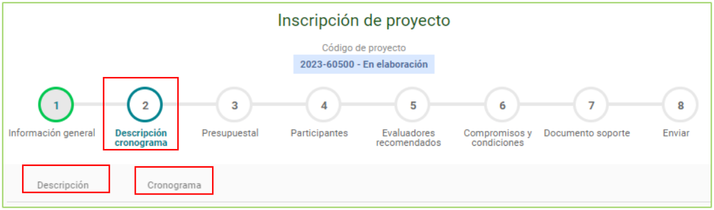
*Figura 9 - Editar descripciones*

- **Agregar nueva descripción**: Si requiere agregar una descripción adicional, presione el botón **Agregar descripción**. El sistema abre una ventana para ingresar el título; presione **Guardar título** y luego edite el contenido. (Ver figura 10).

*Figura 10 - Agregar descripción*

!!! note "Formato HTML de Evaluación"
> Toda la información que se ingrese en la pestaña de descripción se convierte en el HTML que la Vicerrectoría de Investigación descarga para remitir al jurado final del fondo; por tanto, debe quedar actualizada en caso de ajustes requeridos por los pares académicos y antes de que el Centro avale el proyecto.

##### B. Subpestaña Cronograma
Esta opción permite configurar la planeación de las actividades del proyecto y visualizar el cronograma de Gantt. Presione la opción **Agregar actividad**. (Ver figura 11).

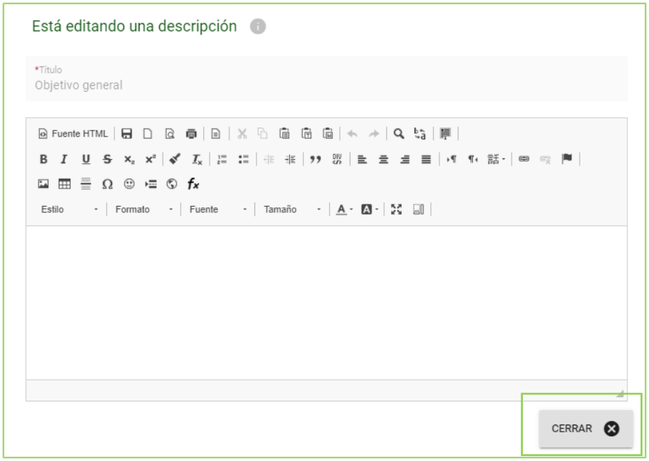
*Figura 11 - Agregar actividad _ cronograma*

El sistema despliega una ventana emergente con los siguientes campos:

| Campo | Detalle |
| :--- | :--- |
| **Actividad** | Ingrese la actividad del proyecto. |
| **Detalle** | Campo opcional. |
| **Inicio** | Ingrese el mes de inicio de la actividad (número de mes a partir del inicio del proyecto). |
| **Fin** | Ingrese el mes de final de la actividad. |

Presione **Agregar actividad** para almacenar el registro. Realice la misma acción por todas las actividades que desee configurar. (Ver figura 12).

!!! warning "> Recuerde: la duración de las actividades no debe sobrepasar el tiempo total de duración del proyecto."

*Figura 12 - Agregar actividad*

!!! tip "Retomar un proyecto en proceso"
> Si sale del SIIU o la sesión se cierra por inactividad, podrá retomar el registro fácilmente:
> 1. Ingrese al menú `Convocatorias / Proyectos en proceso`. (Ver figura 13).
> 2. En el campo *Palabra clave*, indique el código del proyecto y presione **Consultar**. (Ver figura 14).
> 3. En la columna *Acciones*, presione los tres puntos y seleccione la opción **Editar**. (Ver figura 15).

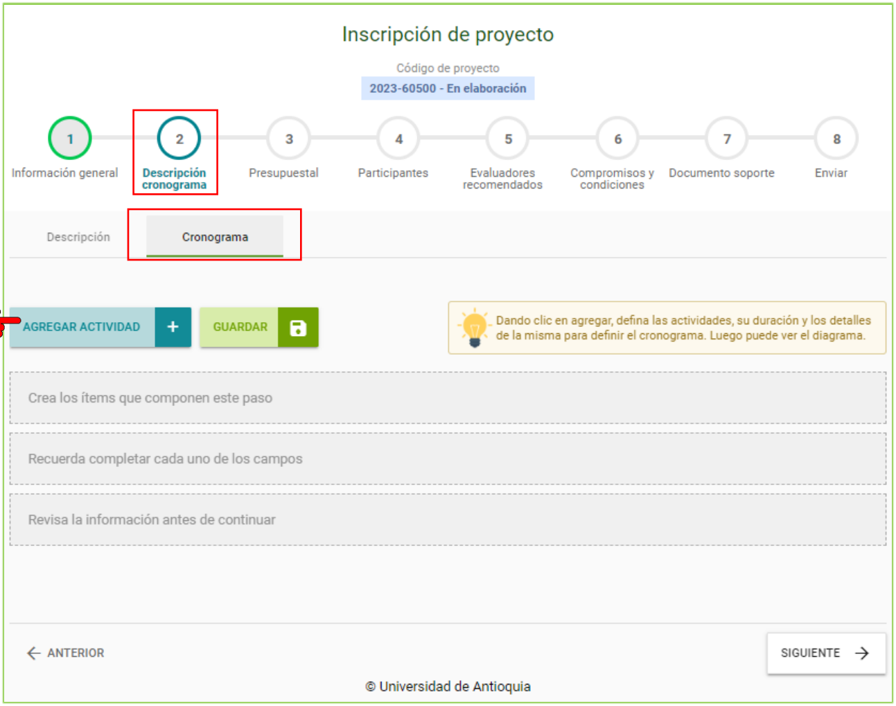
*Figura 13 - Editar proyecto*

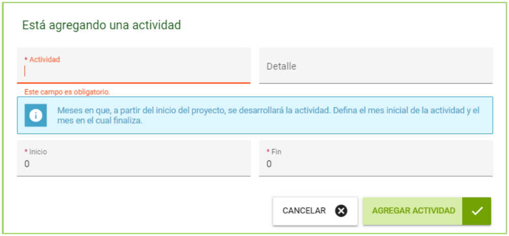
*Figura 14 - Consulta proyecto a editar*

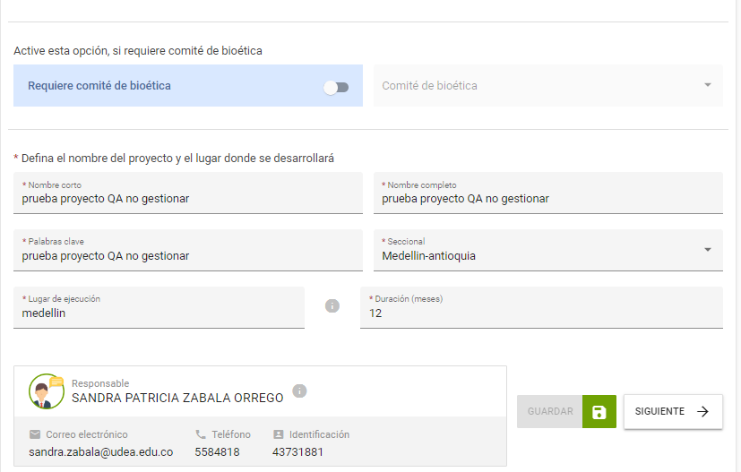
*Figura 15 - Menú contextual Editar proyecto*

---

#### 2.4.3. Pestaña Presupuestal

En esta pestaña encontrará las entidades que financian el proyecto (en recursos frescos o en especie) y podrá configurar el presupuesto por rubro. Consta de dos subpestañas: **Cofinanciadores** y **Presupuesto**. (Ver figura 16).

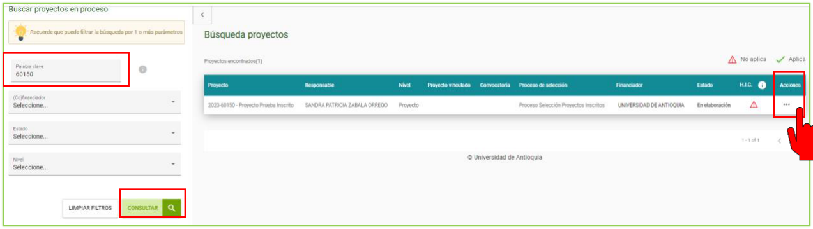
*Figura 16 - Pestaña presupuestal*

##### A. Subpestaña Cofinanciadores
Presione **Agregar cofinanciador**; el sistema despliega las opciones de *Financiador* o *Grupo*. (Ver figura 17).

*Figura 17 - Agregar financiador*

1. Digite el NIT del aportante y presione **Buscar**.
2. Elija la dependencia que aportará los recursos (ejemplo: `CODI - Comité para el Desarrollo de la Investigación`).
3. Presione **Agregar** y finalice con el botón **Guardar**. (Ver figura 18).

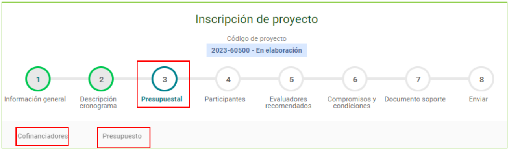
*Figura 18 - Agregar financiador UdeA CODI*

!!! info "> Si va a ingresar recursos de una entidad diferente a las registradas, presione **Agregar cofinanciador** y registre los datos (recuerde adjuntar el documento soporte de respaldo)."
> Al momento de **GUARDAR**, el sistema valida que exista **al menos un financiador** para el proyecto. (Ver figura 19).

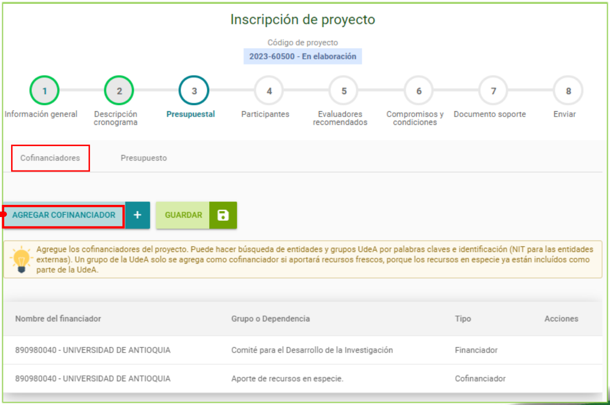
*Figura 19 - Valida financiador*

Para cambiar el tipo de aportante (de Cofinanciador a Financiador), seleccione el registro en la lista desplegable *Tipo* y presione **Guardar**. (Ver figura 20).

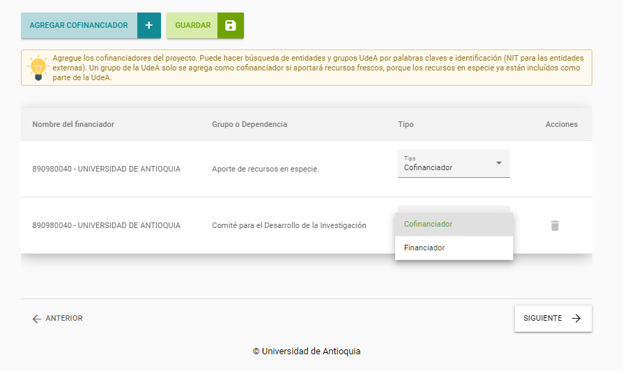
*Figura 20 - Cambiar tipo de financiador*

**Matrícula de financiador que NO existe en el SIIU**:
Si al buscar el NIT este no existe, presione el botón **Registrar financiador**. (Ver figura 21).

*Figura 21 - Financiador no existe*

El sistema abre un formulario de persona jurídica para ingresar:
- NIT y Dígito de verificación
- Razón social y Tipo
- Información de contacto: Correo electrónico, Teléfono, Celular
- Ubicación: Continente, País, Departamento, Municipio, Dirección
- Presione **REGISTRAR FINANCIADOR**. (Ver figura 22).

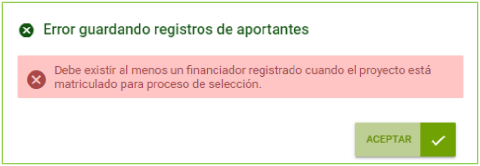
*Figura 22 - Nueva persona jurídica*

Seleccione el nuevo financiador registrado y finalice con el botón **GUARDAR**. (Ver figura 23).

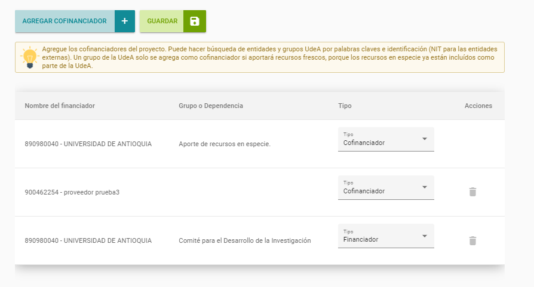
*Figura 23 - Agregar nuevo financiador*

##### B. Subpestaña Presupuesto
Permite ingresar los montos por cada rubro presupuestal teniendo en cuenta los términos de referencia. (Ver figura 24).

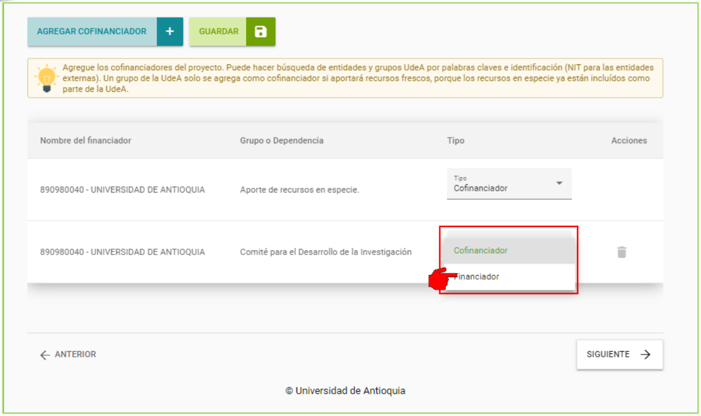
*Figura 24 - Subpestaña presupuesto*

1. Presione el botón **Agregar rubro**; el sistema abre una ventana emergente con la lista desplegable de rubros predefinidos (Administración, Apoyo a estudiantes, Publicaciones, etc.). Seleccione el rubro y presione **Aceptar**. (Ver figura 25).

   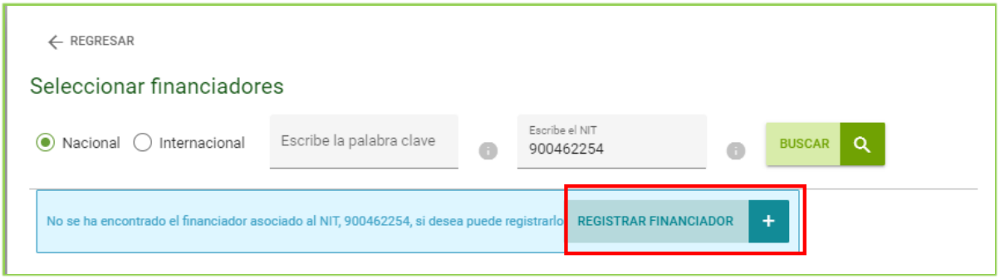
   *Figura 25 - Lista de rubros*

2. Ingrese una justificación si lo considera necesario y presione **AGREGAR RUBRO**. (Ver figura 26).

   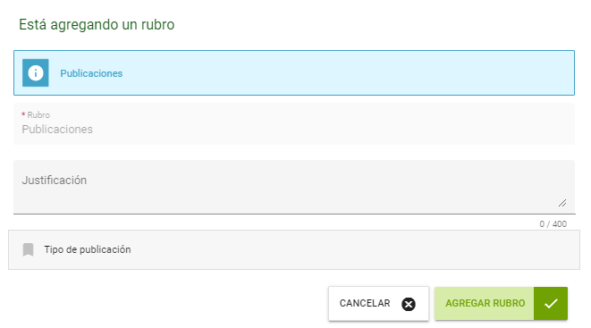
   *Figura 26 - Agregar rubros*

!!! note "Criterios Presupuestales Especiales"
> - **Rubro Personal**: Para el caso del rubro *Personal* que corresponda al valor de las horas salariales que la Universidad le autoriza a cada investigador para trabajar en el proyecto, estos recursos se registran como dinero en **especie** (consultar fórmula con el Centro).
> - **Rubro Administración**: El porcentaje debe consultarlo con el Centro de Investigación; este se calcula sobre el valor total del presupuesto del proyecto.

3. Digite los valores en la columna del financiador o cofinanciador correspondiente. Identifique o seleccione la moneda Colombiana (**COP**) y presione el botón **GUARDAR**. (Ver figura 27).

   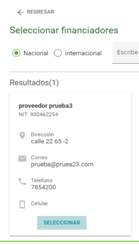
   *Figura 27 - Insertar rubro*

4. **Creación de Subrubros**: Los subrubros son hijos o extensiones de un rubro padre, utilizados para discriminar ordenadamente el gasto.
   - Posiciónese en el rubro padre y presione los tres puntos antes del rubro.
   - Elija **+ Agregar subrubro**. (Ver figura 28).
   - Ingrese los valores discriminados y presione **Guardar** (mensaje: *Guardado exitosamente*). (Ver figura 29).

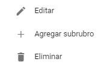
*Figura 28 - Agregar subrubro*

*Figura 29 - Definir valores subrubro*

---

#### 2.4.4. Pestaña Participantes

Permite registrar el talento humano que hará parte del proyecto (personal interno y externo). (Ver figura 30).

!!! note "Participantes Indeterminados (NN)"
> Son aquellos que se matriculan en el proyecto para separar el cupo de la vacante cuando aún no se conoce la identidad de la persona (de acuerdo con los términos de referencia).

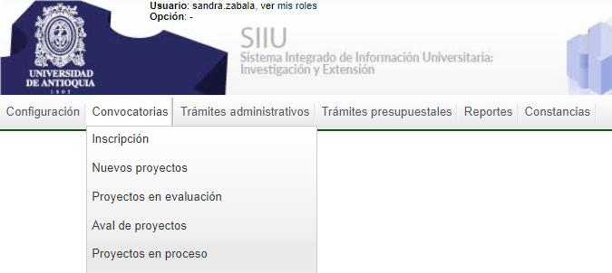
*Figura 30 - Opción participantes*

##### Registro de participantes:
1. Presione **AGREGAR PARTICIPANTE**.
2. Presione el botón **Seleccionar participante**, ingrese el documento en el campo *Identificación* y presione **Buscar**. (Ver figura 31).

   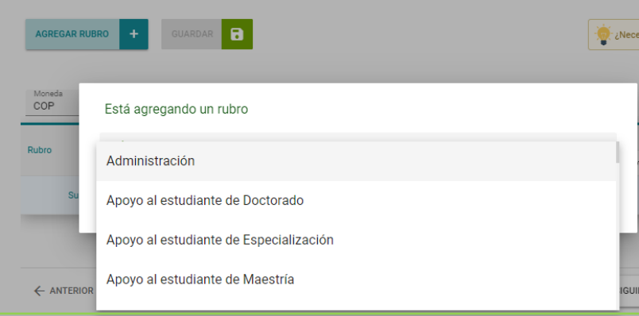
   *Figura 31 - Seleccionar participante*

   !!! info "> Tenga a mano el número de documento de cada participante (salvo si es indeterminado). Verifique el grupo de investigación al que pertenece y evite ingresar datos erróneos."

3. En el resultado de la búsqueda, presione la opción **Seleccionar**. (Ver figura 32). El sistema cargará los datos de la persona. (Ver figura 33).

   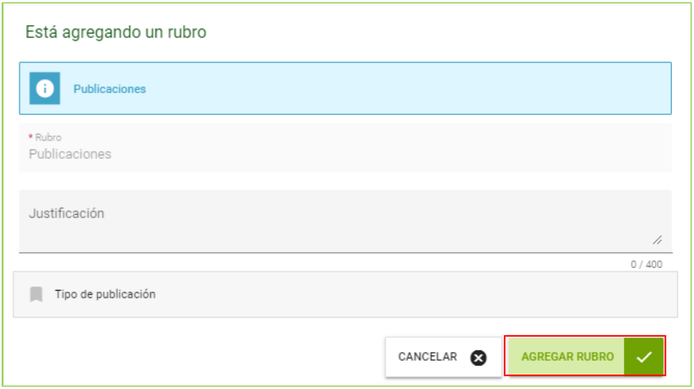
   *Figura 32 - Participante a seleccionar*

   
   *Figura 33 - Agregar participante seleccionado*

4. **Institución del participante**:
   - Presione clic en **SELECCIONAR INSTITUCIÓN**.
   - Digite el NIT y presione **Buscar**.
   - Seleccione la institución y presione **Agregar**. (Ver figuras 34 y 35).

   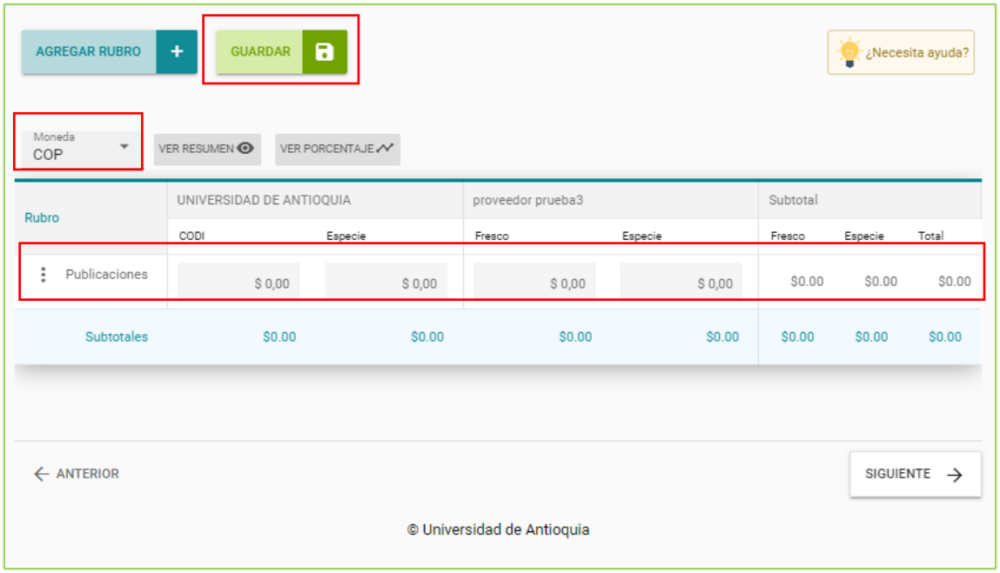
   *Figura 34 - Agregar institución*

   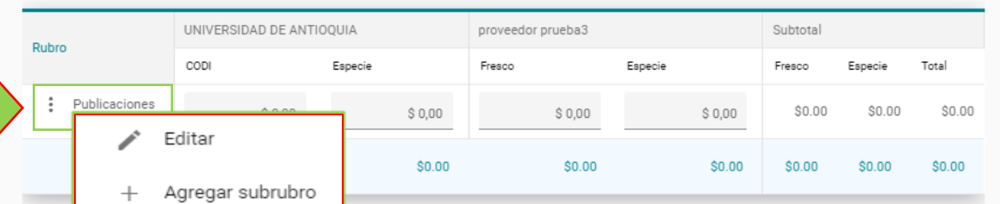
   *Figura 35 - Institución adjunta*

5. **Selección del grupo**:
   - Presione el botón **BUSCAR GRUPO**.
   - El sistema permite elegir el grupo del participante cuando este pertenece a alguno. Si no pertenece a ninguno, no muestra lista (previamente puede solicitar la filiación a la Vicerrectoría enviando el soporte del GrupLAC). (Ver figura 36).

   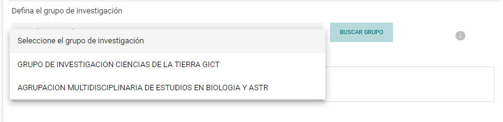
   *Figura 36 - Seleccionar grupo*

6. **Parámetros del participante**:
   - Vínculo UdeA
   - Rol en el proyecto (Tutor, Joven Investigador Minciencias, Auxiliar, etc.)
   - Dedicación horaria: horas por semana y meses (por dentro o por fuera del plan de trabajo)
   - Funciones en el proyecto
   - Observaciones
   - Presione **AGREGAR PARTICIPANTE**. (Ver figura 37).

*Figura 37 - Vínculo, rol, dedicación horaria y funciones del participante*

---

#### 2.4.5. Pestaña Evaluadores Recomendados

En esta pestaña podrá ingresar los evaluadores sugeridos para el proceso de evaluación externa. Presione el botón **Agregar evaluador**. (Ver figura 38).

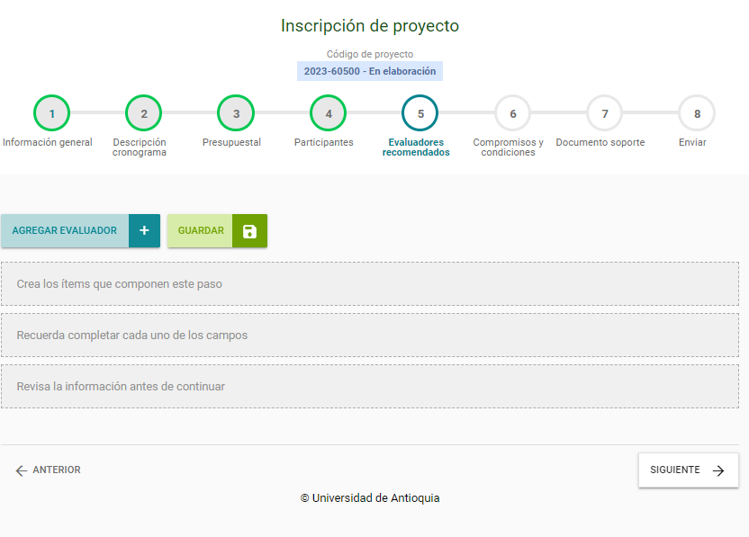
*Figura 38 - Pestaña Evaluadores recomendados*

1. Digite el documento de identidad en el campo *Identificación* y presione **Buscar**. (Ver figura 39).
2. Si el evaluador ya existe en la base de datos de SIIU, el sistema trae sus datos personales, área de especialidad e institución. Presione **Seleccionar** y luego **Guardar**. (Ver figuras 40 y 41).

*Figura 39 - Agregar evaluador recomendado*

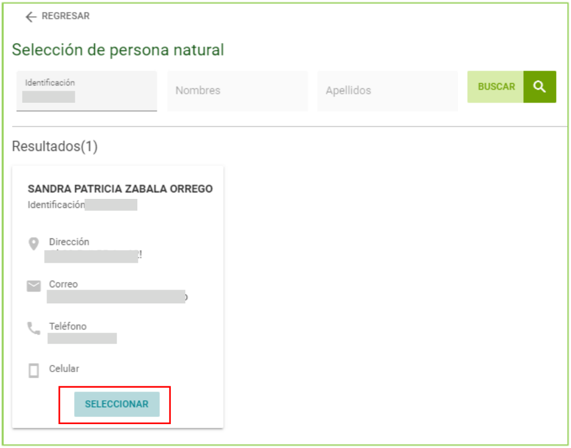
*Figura 40 - Registrar evaluador*

*Figura 41 - Evaluador agregado*

3. **Registrar evaluador inexistente**: Si el evaluador no existe en SIIU, presione el botón **REGISTRAR EVALUADOR**. (Ver figura 42).
4. El sistema abre un formulario completo: Nombres, Apellidos, Tipo y número de documento, Sexo, Correo, Teléfono, Celular, Ubicación (País, Depto, Municipio, Dirección), Institución, Área de especialidad, Dirección CvLAC y Observaciones. Presione **REGISTRAR EVALUADOR**. (Ver figura 43).

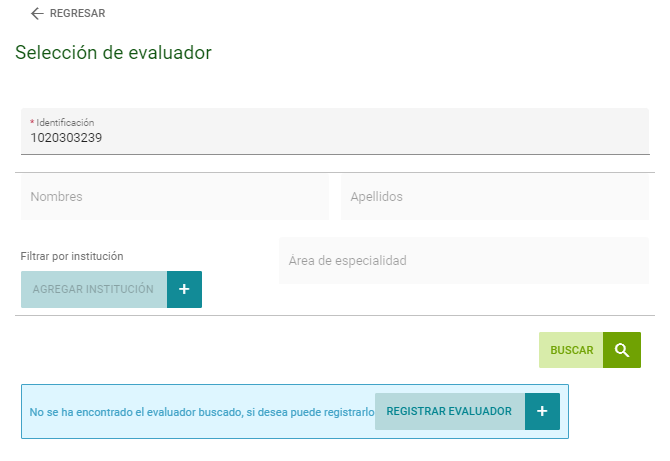
*Figura 42 - Registrar evaluador que no existe*

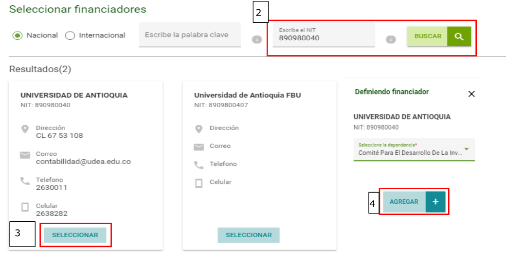
*Figura 43 - Registro evaluador inexistente*

---

#### 2.4.6. Pestaña Compromisos y Condiciones

Continúa el proceso en la pestaña **Compromisos y condiciones**. (Ver figura 44).

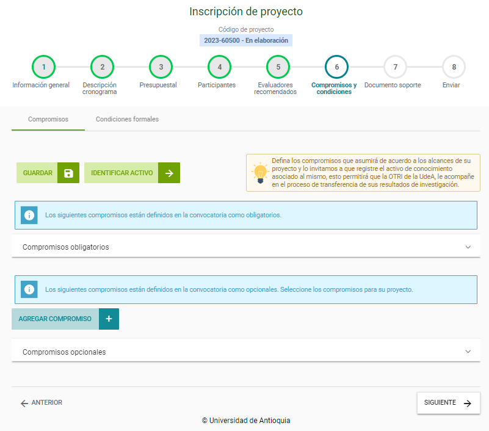
*Figura 44 - Pestaña de compromisos*

- El sistema lista los compromisos obligatorios configurados para la convocatoria de acuerdo con los términos de referencia. (Ver figura 45).

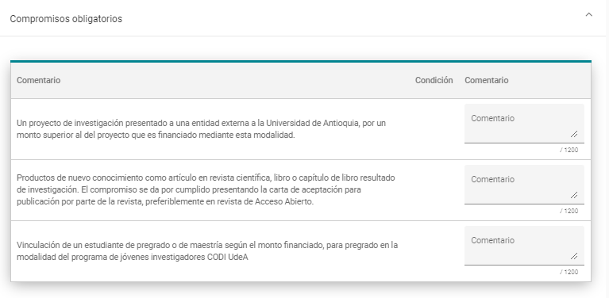
*Figura 45 - Compromisos obligatorios*

- **Agregar compromisos adicionales**: Presione el botón **AGREGAR COMPROMISO**, diligencie el nombre del compromiso y comentarios, y presione **AGREGAR COMPROMISO**. (Ver figura 46).
- Una vez agregado, en la columna acciones se presentan las opciones de **Editar** y **Eliminar**. (Ver figura 47).
- Seleccione los compromisos opcionales que asumirá y presione **Guardar**. (Ver figura 48).

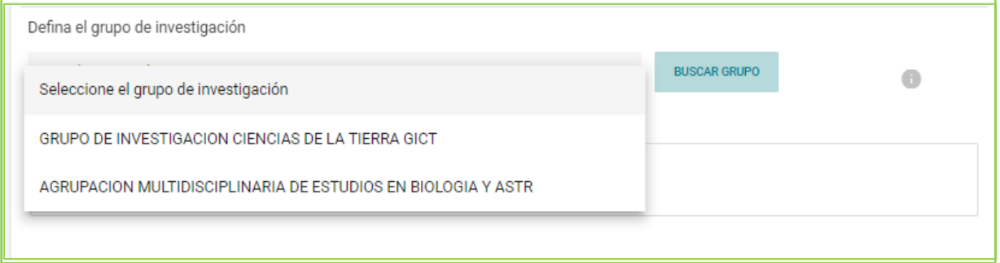
*Figura 46 - Agregar compromiso*

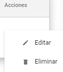
*Figura 47 - Acciones compromisos opcionales*

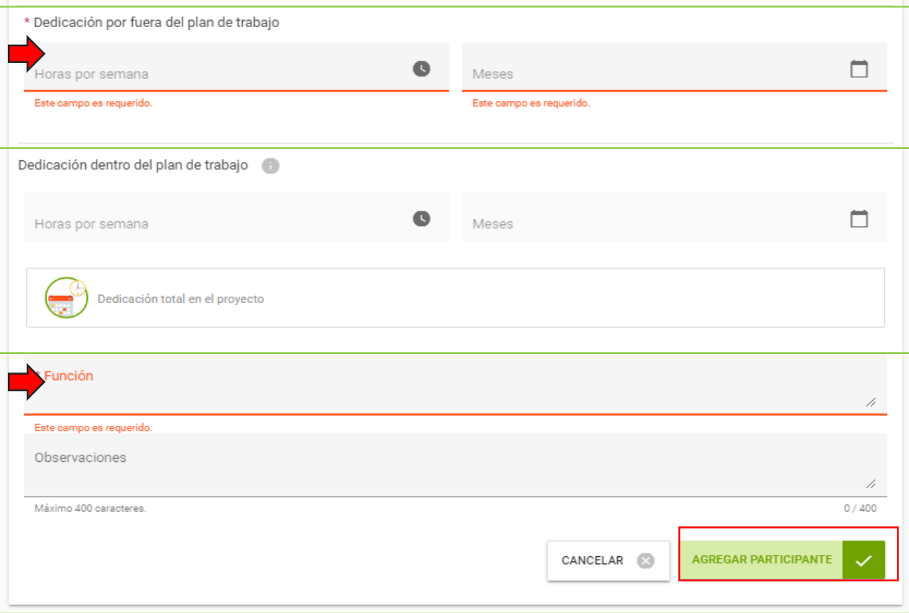
*Figura 48 - Seleccionar compromisos opcionales*

!!! warning "Compromisos Opcionales"
> Recuerde: Los compromisos opcionales que seleccione se convertirán en compromisos obligatorios para el proyecto; es decir, serán de obligatorio cumplimiento una vez aprobado.

---

#### 2.4.7. Condiciones Formales

Las condiciones formales fueron definidas de acuerdo con los términos de referencia para todos los proyectos que se inscriban al fondo. (Ver figura 49).

Valide una a una las condiciones formales y seleccione su estado en la columna **Cumplimiento**:
- `Cumple`
- `No cumple`
- `No aplica`

Seleccione la opción `Cumple` (o `No aplica`) según corresponda y presione el botón **Guardar**. (Ver figuras 50 y 51).

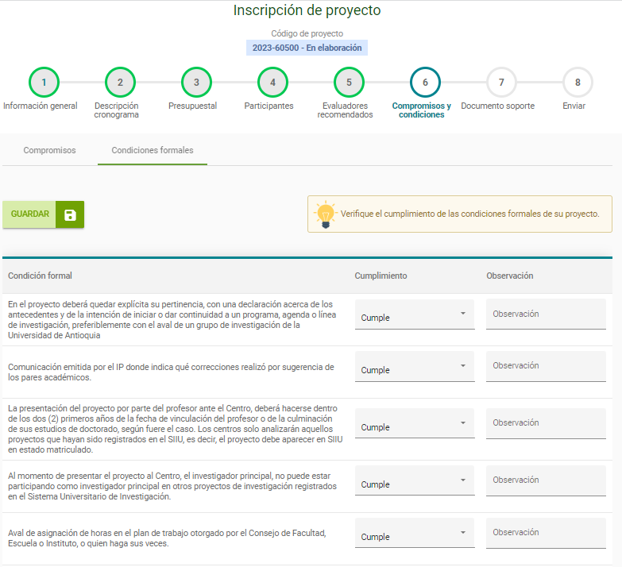
*Figura 49 - Condiciones formales*

*Figura 50 - Gestión condiciones formales*

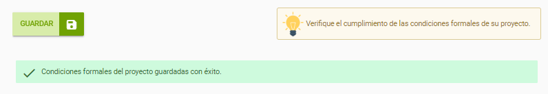
*Figura 51 - Guardar condiciones formales*

!!! caution "Regla de Envío para Condiciones Formales"
> **Todas las condiciones formales deben estar marcadas con las opciones *Cumple* o *No aplica*.** Si alguna de las condiciones está marcada con *No cumple*, el sistema **NO** permitirá realizar el envío del proyecto al Centro.

---

#### 2.4.8. Pestaña Documento Soporte

En esta pestaña se adjuntan los documentos de respaldo pertinentes para la matrícula del proyecto (propuesta detallada, avales éticos, cartas de intención de cofinanciadores o carta explicativa de ajustes tras evaluación de pares si aplica).

1. Presione el botón **Agregar documento soporte**. (Ver figura 52).

   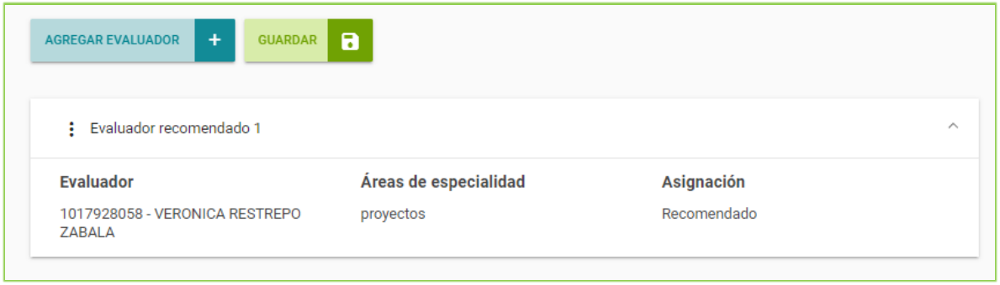
   *Figura 52 - Pestaña Documento soporte*

2. El sistema despliega el formulario: ingrese Nombre del documento, Número, Emisor, Fecha de emisión, Tipo de documento y Descripción. (Ver figura 53).

   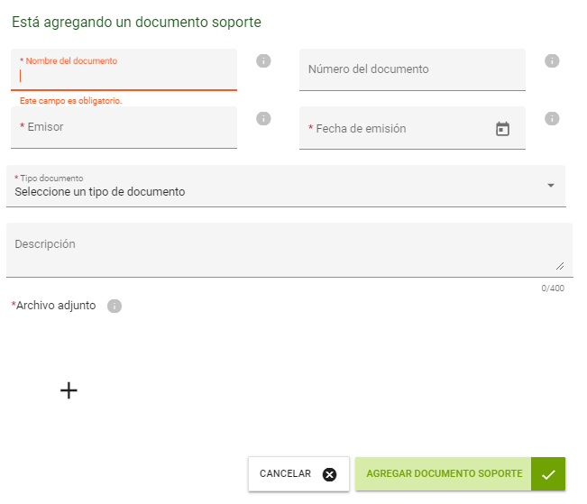
   *Figura 53 - Adjuntar documento*

3. Presione el icono **+** en *Archivo adjunto*, seleccione el archivo desde su PC, presione **Agregar documento soporte** y luego haga clic en el botón **GUARDAR**. (Ver figura 54).

   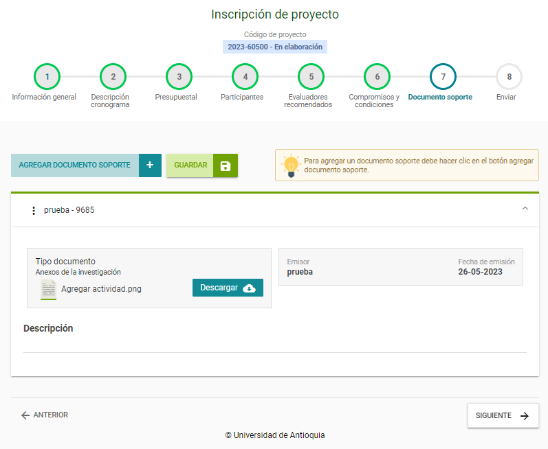
   *Figura 54 - Guardar documento soporte*

---

#### 2.4.9. Pestaña Enviar

Esta última pestaña del tren de datos permite enviar el proyecto formalmente al Centro de Investigación para su revisión y aval.

1. Presione el botón **Enviar a centro**. (Ver figura 55).

   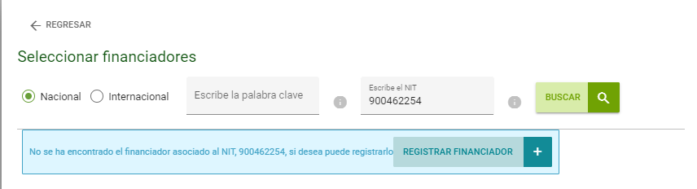
   *Figura 55 - Enviar a centro*

2. El sistema genera un mensaje de alerta: *"Recuerde que al enviar el proyecto el centro ya no podrá realizar cambios a menos de que se lo permitan en el momento de la revisión. ¿Realmente desea enviar el proyecto?"*. Si todo es correcto, presione el botón **ACEPTAR**. (Ver figura 56).

   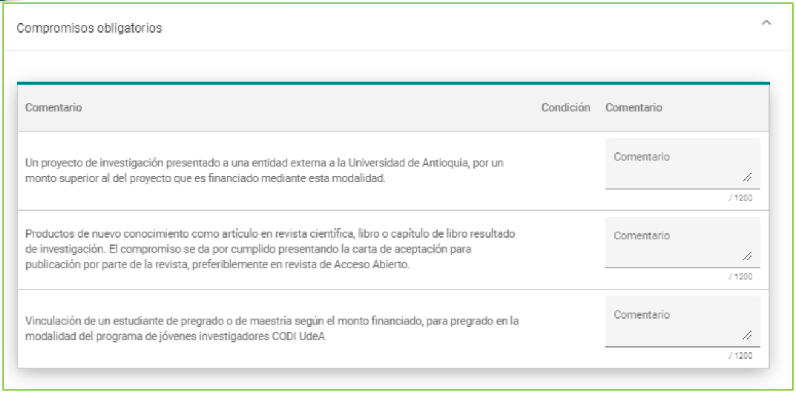
   *Figura 56 - Mensaje de alerta*

3. El sistema emite el mensaje de confirmación oficial indicando el código asignado, la fecha oficial de envío y confirmando que el proyecto queda en estado **Matriculado**. (Ver figura 57).

   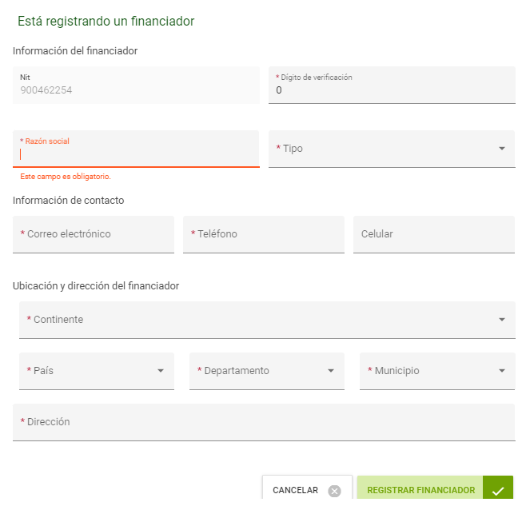
   *Figura 57 - Mensaje de confirmación*

!!! warning "Validación previa al envío"
> Cuando va a enviar el proyecto, el sistema valida que todas las secciones del tren de datos estén 100% completas. Si falta información en alguna pestaña (por ejemplo, en *Compromisos y condiciones*), el sistema no permitirá el envío y resaltará en rojo la pestaña incompleta. (Ver figura 58). Proceda a completar la información faltante y vuelva a intentar el envío.

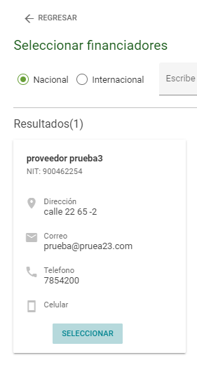
*Figura 58 - Completar información del proyecto*

---

## 3. Nota de cambio

- No aplica para la primera versión.

---

## Registro de Control y Firmas

| Rol | Nombre | Cargo / Dependencia | Fecha |
| :--- | :--- | :--- | :--- |
| **Elaboró** | Sandra Patricia Zabala Orrego | Contratista, Vicerrectoría Investigación | 16-FEB-2024 |
| **Revisó** | Kerlin Yohana Bedoya Agudelo | Analista de Procesos, División de Arquitectura de Procesos | 29-ABR-2024 |
| **Aprobó** | Gloria Valencia Bustamante | Asistente, Vicerrectoría de Investigación | 29-ABR-2024 |
