# GUÍA PARA LA MATRÍCULA DE PROYECTOS INSCRITOS AL SIIU

!!! note "Información de Control Documental"
> **Código**: VI-GU-18  
> **Versión**: 01 / 29-ABR-2024  
> *Aviso legal institucional*: La impresión o copia digital de este documento se considera "COPIA NO CONTROLADA". Solo se garantiza la actualización de la documentación en el sitio oficial `http://www.udea.edu.co`.

---

## Contenido

1. [Definición](#1-definición)
2. [Contenido](#2-contenido)
   - 2.1. [Requisitos para la matrícula de proyectos inscritos](#21-requisitos-para-la-matrícula-de-proyectos-inscritos)
   - 2.2. [Usuarios que intervienen en el proceso](#22-usuarios-que-intervienen-en-el-proceso)
   - 2.3. [Ingreso al SIIU](#23-ingreso-al-siiu)
   - 2.4. [Matrícula de proyectos inscritos](#24-matrícula-de-proyectos-inscritos)
     - 2.4.1. [Pestaña Información General](#241-pestaña-información-general)
     - 2.4.2. [Pestaña Descripción – Cronograma](#242-pestaña-descripción--cronograma)
     - 2.4.3. [Pestaña Presupuestal](#243-pestaña-presupuestal)
     - 2.4.4. [Pestaña Participantes](#244-pestaña-participantes)
     - 2.4.5. [Pestaña Compromisos y Condiciones](#245-pestaña-compromisos-y-condiciones)
     - 2.4.6. [Pestaña Documento Soporte](#246-pestaña-documento-soporte)
     - 2.4.7. [Pestaña Enviar](#247-pestaña-enviar)
3. [Nota de cambio](#3-nota-de-cambio)
4. [Registro de Control y Firmas](#registro-de-control-y-firmas)

---

## 1. Definición

Este documento se ha elaborado con el fin de ayudar y capacitar los investigadores principales, los cuales registran en el Sistema de Información para la Investigación Universitaria – SIIU los proyectos inscritos para la oportuna gestión del proyecto. Dado lo anterior se aclara que esta guía no hace parte de la normativa universitaria y solamente se debe utilizar como una herramienta que orienta los pasos que se debe seguir para la matrícula de proyectos inscritos al SIIU.

---

## 2. Contenido

### 2.1. Requisitos para la matrícula de proyectos inscritos

- El investigador principal o responsable del proyecto debe estar registrado en el portal institucional.
- El usuario debe tener acceso a SIIU.

---

### 2.2. Usuarios que intervienen en el proceso

- **Usuario Investigador Principal o Responsable del Proyecto**.

---

### 2.3. Ingreso al SIIU

El investigador principal o responsable del proyecto debe autenticarse en el portal de la Universidad de Antioquia, `http://www.udea.edu.co`, buscar la opción aplicaciones y entre ellas elegir el SIIU, así:

1. Ingresa al portal de la Universidad: `http://www.udea.edu.co`, en el encabezado seleccione **Ingresar >> Iniciar sesión** (ver Figura 1).

   
   *Figura 1 - Ingreso al portal de la Universidad de Antioquia*

2. Aparece pantalla para ingresar su usuario y contraseña, seleccione *No soy un Robot* (el sistema le puede pedir realizar validaciones) finalmente presione clic en el botón **CONECTAR**. (Ver figura 2).

   
   *Figura 2 - Conectar al portal*

3. Presione clic en la opción **Enlaces de Interés** seleccione **Mis aplicaciones**, así: `Enlaces de interés → Mis aplicaciones` (Ver Figura 3).

   
   *Figura 3 - Enlaces de interés*

4. Se abrirá una ventana con las aplicaciones de la Universidad; seleccione **SIIU**. (Ver figura 4).

   
   *Figura 4 - Seleccione SIIU*

!!! note "> Se abre una nueva ventana con la aplicación SIIU. Si la ventana no abre inmediatamente, es necesaria la configuración de ventanas emergentes en el navegador y seleccionar la opción que autorice el SIIU."

---

### 2.4. Matrícula de proyectos inscritos

Estando en el aplicativo SIIU, ingrese al menú **Convocatorias** y seleccione la opción **Nuevos proyectos**. (Ver figura 5).

*Figura 5 - Menú para matrícula de proyectos*

El tren de datos de la inscripción para proyectos inscritos consta de 7 secciones:
1. *Información general*
2. *Descripción cronograma*
3. *Presupuestal*
4. *Participantes*
5. *Compromisos y condiciones*
6. *Documento soporte*
7. *Enviar*

---

#### 2.4.1. Pestaña Información General

El sistema abre el nuevo formulario llamado **Información general**. Ingrese la información para cada campo solicitado, teniendo en cuenta elegir la opción **Proceso de selección**, y luego indicar **Proceso selección proyectos inscritos**. (Ver figura 6).

| Campos | Detalle |
| :--- | :--- |
| **Matrícula de** | Proyecto |
| **Clase de proyecto** | Proyecto |
| **Tipo de proyecto** | Investigación |
| **Clasificación** | Básica o aplicada |
| **Opción de matrícula** | Proceso de selección |
| **Proceso de selección** | Proceso selección proyectos inscritos |
| **Centro administrativo** | Centro que administra el proyecto |
| **Nombre corto** | Nombre corto del proyecto |
| **Nombre completo** | Nombre largo o completo del proyecto |
| **Palabras clave** | Indique palabras clave |
| **Seccional** | Elija seccional |
| **Lugar de ejecución** | Indique lugar de ejecución |
| **Duración** | Asigne duración al proyecto (meses) |
| **Responsable** | El sistema coloca la información automáticamente |

*Figura 6 - Información general*

Presione el botón **Guardar** para que el sistema le asigne código al proyecto inscrito que está creando.

!!! info "> Es importante que tenga a mano el número del proyecto asignado por el sistema, ya que lo va a necesitar en otros momentos.  "
> **Una vez se guarde la información, esta no podrá ser modificada en la primera pestaña.**

Presione el botón **Siguiente** y llene la información del próximo formulario.

---

#### 2.4.2. Pestaña Descripción – Cronograma

Esta opción se divide en dos pestañas: **Descripción** y **Cronograma**. (Ver figura 7).

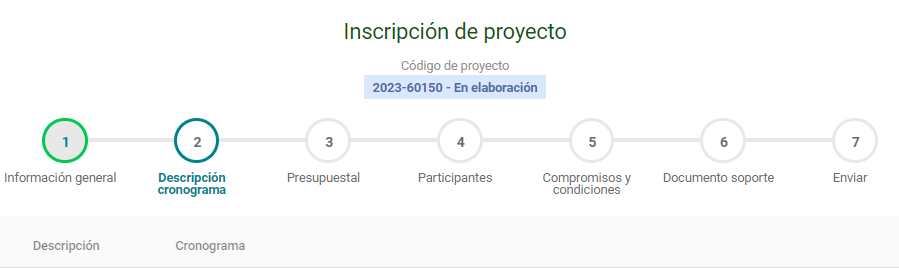
*Figura 7 - Descripción _ cronograma*

##### A. Subpestaña Descripción
En esta opción se ingresa la información requerida para los proyectos inscritos. Presione los tres puntos que aparecen en las descripciones para editar. (Ver figura 8).

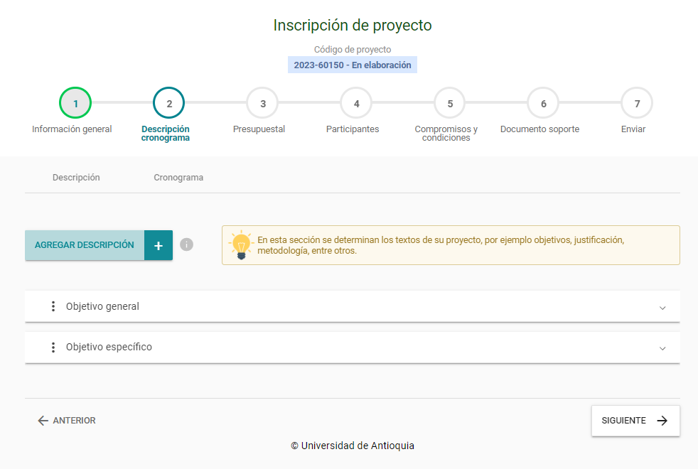
*Figura 8 - Descripciones*

El sistema abre una ventana con un editor de texto enriquecido (HTML) para ingresar la información solicitada. Para guardar presione el icono de guardado (disco) y luego la opción **Cerrar**. (Ver figura 9).

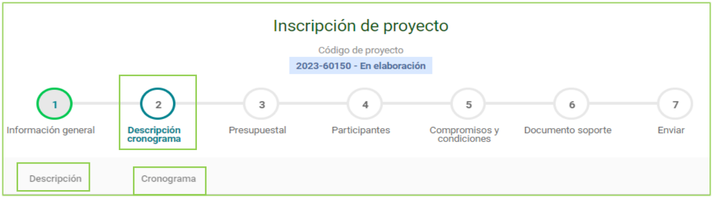
*Figura 9 - Editar descripciones*

- **Agregar nueva descripción**: Si requiere agregar una nueva descripción, presione la opción **Agregar descripción**. El sistema abre una ventana; agregue el nuevo título y presione **Guardar título**. (Ver figura 10). Una vez almacenado, el sistema le permite editar la descripción.

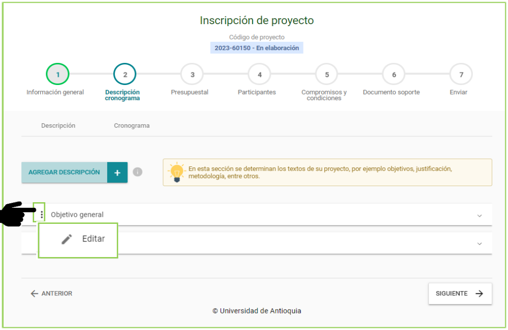
*Figura 10 - Agregar descripción*

##### B. Subpestaña Cronograma
Esta opción le permite configurar la planeación de las actividades del proyecto; adicionalmente podrá visualizar las actividades en un cronograma de Gantt. Presione el botón **Agregar actividad**. (Ver figura 11).

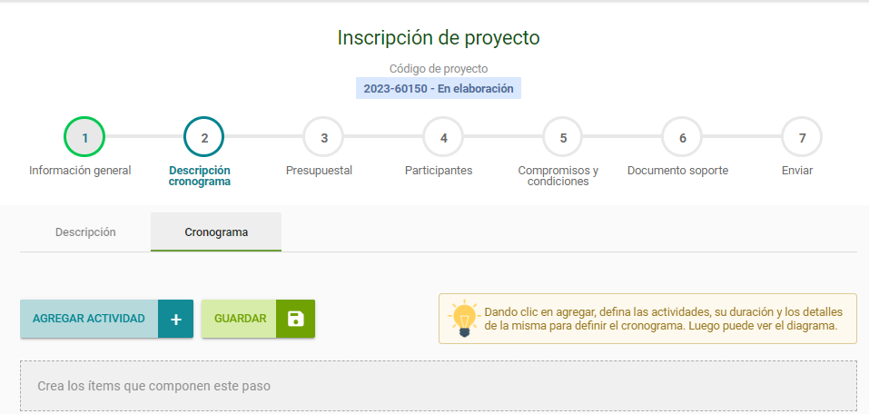
*Figura 11 - Agregar actividad _ cronograma*

El sistema despliega una ventana emergente con los siguientes campos:

| Campo | Detalle |
| :--- | :--- |
| **Actividad** | Ingrese la actividad del proyecto (obligatorio). |
| **Detalle** | Campo opcional. |
| **Inicio** | Ingrese el mes de inicio de la actividad. |
| **Fin** | Ingrese el mes de final de la actividad. |

!!! warning "> Importante: La suma o duración de las actividades **No debe pasar el tiempo de duración total del proyecto**."

Presione **Agregar actividad** para terminar el registro. Realice la misma acción por todas las actividades que desee configurar. (Ver figura 12).

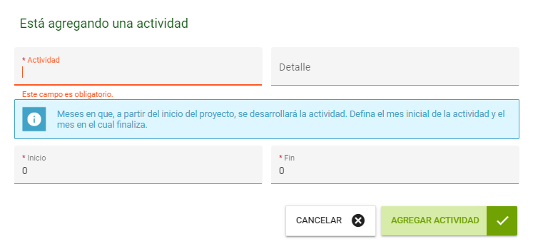
*Figura 12 - Agregar actividad*

!!! tip "Retomar el registro de un proyecto en proceso"
> Si sale del SIIU o se cierra la sesión por inactividad, podrá volver a ingresar y retomar el registro fácilmente:
> 1. Presione clic en el menú `Convocatorias / Proyectos en proceso`. (Ver figura 13).
> 2. En el campo *Palabra clave*, indique el código del proyecto y presione **Consultar**. (Ver figura 14).
> 3. En la columna *Acciones*, presione los tres puntos y elija la opción **Editar** para continuar. (Ver figura 15).

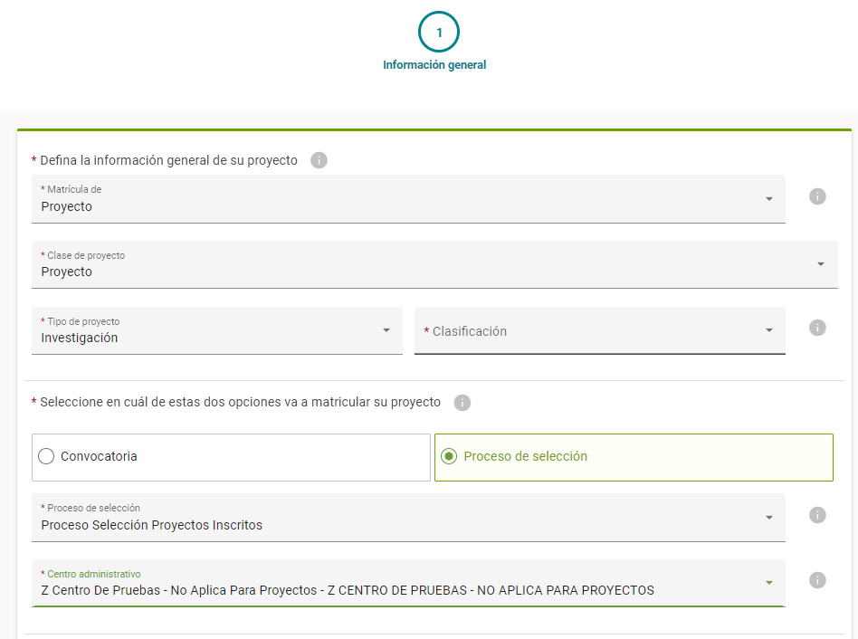
*Figura 13 - Editar proyecto*

*Figura 14 - Consulta proyecto a editar*

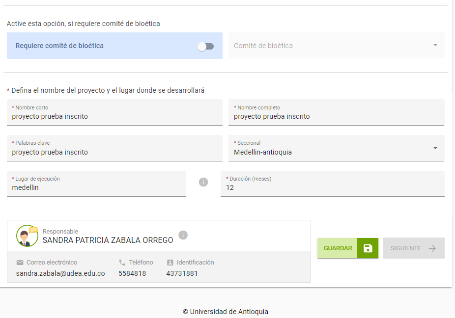
*Figura 15 - Editar proyecto*

---

#### 2.4.3. Pestaña Presupuestal

En esta pestaña encontrará las entidades que financian el proyecto, bien sea en recursos frescos o en especie. Adicionalmente podrá agregar nuevos financiadores en la subpestaña **Cofinanciadores**, y configurar el presupuesto detallado en la subpestaña **Presupuesto**. (Ver figura 16).

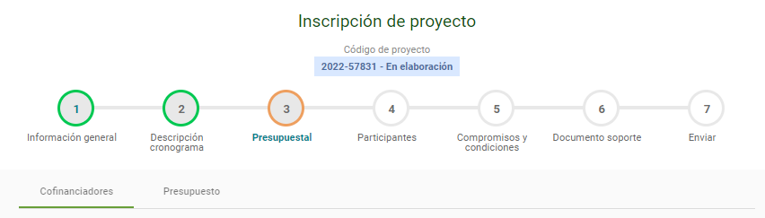
*Figura 16 - Pestaña presupuestal*

##### A. Subpestaña Cofinanciadores
Si una dependencia de la Universidad va a aportar recursos frescos al proyecto, presione **Agregar cofinanciador**; el sistema despliega las opciones de *Financiador* o *Grupo* para elegir según la necesidad. (Ver figura 17).

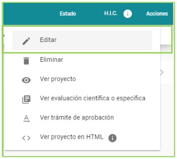
*Figura 17 - Agregar cofinanciador*

1. Ingrese el NIT de la entidad y presione el botón **Buscar**. (Ver figura 18).

   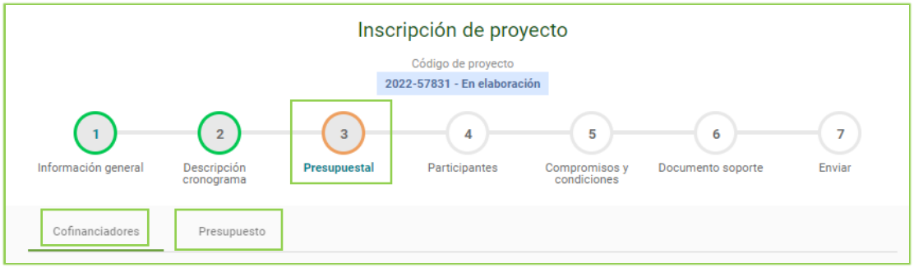
   *Figura 18 - Agregar financiador*

2. Si desea agregar al CODI como financiador, digite el NIT de la Universidad (`890980040`) y presione **Buscar**. Seleccione la dependencia (`Comité Para El Desarrollo De La Investigación`), haga clic en **Agregar** y luego en **Guardar**. (Ver figura 19).

   
   *Figura 19 - Agregar financiador UdeA CODI*

!!! info "> Si va a ingresar recursos de una entidad diferente a la(s) registrada(s), presione **Agregar cofinanciador** y registre los datos (recuerde adjuntar el documento soporte de respaldo)."
> Tenga en cuenta que, al momento de **GUARDAR**, el sistema valida que exista **al menos un financiador** por el proyecto. (Ver figura 20).

*Figura 20 - Valida financiador*

Para cambiar el campo tipo (por defecto aparecen como Cofinanciador), seleccione el aportante, elija la opción **Financiador** y presione el botón **Guardar** para almacenar el cambio. (Ver figuras 21 y 22).

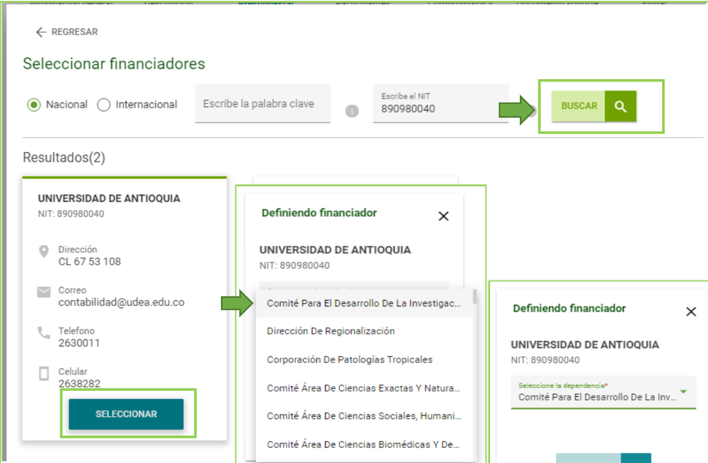
*Figura 21 - Seleccionar aportante*

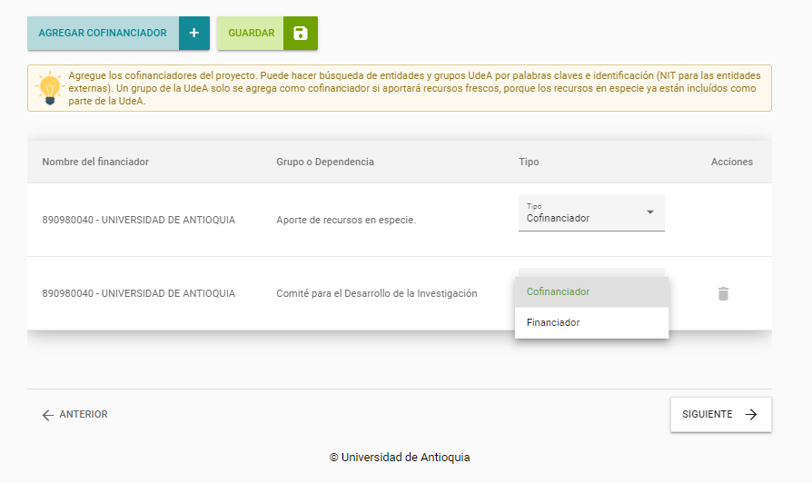
*Figura 22 - Cambiar tipo de financiador*

**Matricular financiador que NO existe**:
El sistema SIIU permite matricular un nuevo financiador cuando al buscar su NIT este no existe. Presione la opción **Registrar financiador**. (Ver figura 23).

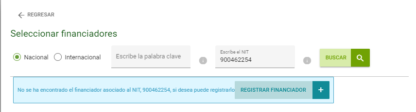
*Figura 23 - Financiador no existe*

El sistema abre un formulario para ingresar:
- NIT y Dígito de verificación
- Razón social y Tipo
- Correo electrónico, Teléfono y Celular
- Ubicación: Continente, País, Departamento, Municipio, Dirección
- Presione **REGISTRAR FINANCIADOR**. (Ver figura 24).

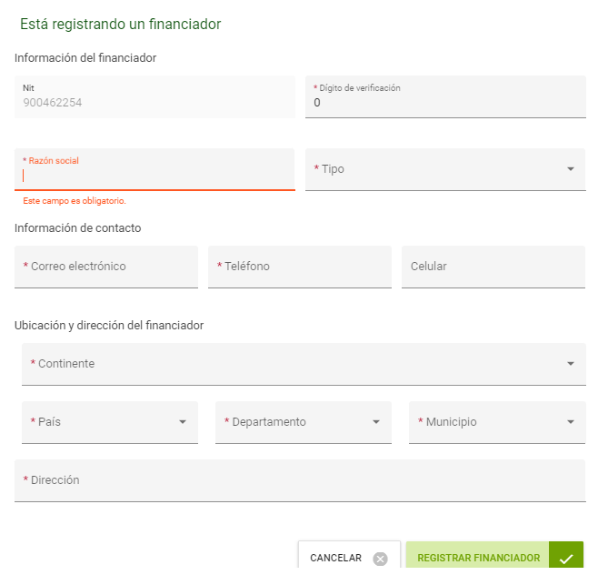
*Figura 24 - Nueva persona jurídica*

Seleccione el nuevo financiador; el sistema lo agrega a la tabla. Finalice con el botón **GUARDAR**. (Ver figura 25).

*Figura 25 - Agregar nuevo financiador*

##### B. Subpestaña Presupuesto
Permite ingresar los valores por cada rubro para el presupuesto a configurar. (Ver figura 26).

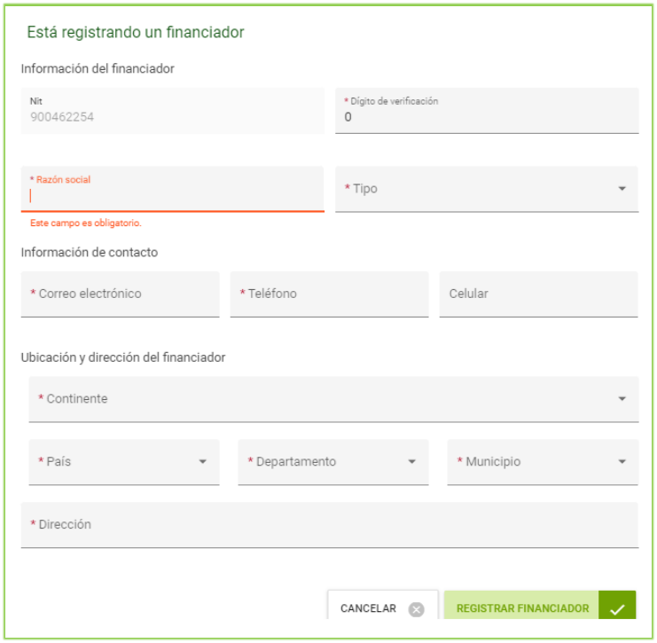
*Figura 26 - Subpestaña presupuesto*

1. Presione el botón **Agregar rubro**; el sistema abre una ventana emergente con la lista desplegable de rubros predefinidos. Seleccione el rubro y presione **Aceptar**. (Ver figuras 27 y 28).

   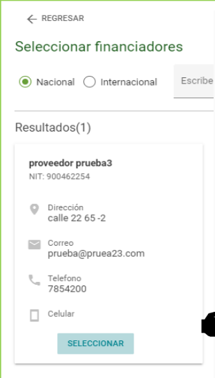
   *Figura 27 - Lista de rubros*

   
   *Figura 28 - Lista de rubros desplegada*

2. Ingrese una justificación si lo considera necesario y presione **AGREGAR RUBRO**. (Ver figura 29).

   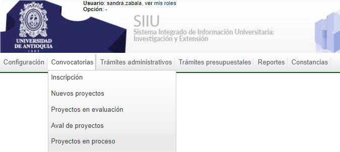
   *Figura 29 - Agregar rubros*

!!! note "Rubro Personal"
> Importante: Para el caso del rubro *Personal* que corresponda al valor de las horas salariales que la Universidad le autoriza a cada investigador para trabajar en el proyecto, estos recursos se registran como **dinero en especie**.

3. Ingrese los valores monetarios correspondientes al financiador o cofinanciador seleccionado. Verifique la moneda (COP) y presione el botón **GUARDAR**. (Ver figura 30). Realice este procedimiento por cada rubro requerido.

   
   *Figura 30 - Insertar rubro*

4. **Creación de Subrubros**: Los subrubros son extensiones de un rubro padre para discriminar de forma ordenada el presupuesto.
   - Posiciónese en el rubro padre y presione los tres puntos antes del nombre del rubro.
   - Elija **+ Agregar subrubro**. (Ver figura 31).
   - Ingrese los valores y presione **Guardar** (mensaje: *Guardado exitosamente*). (Ver figura 32).

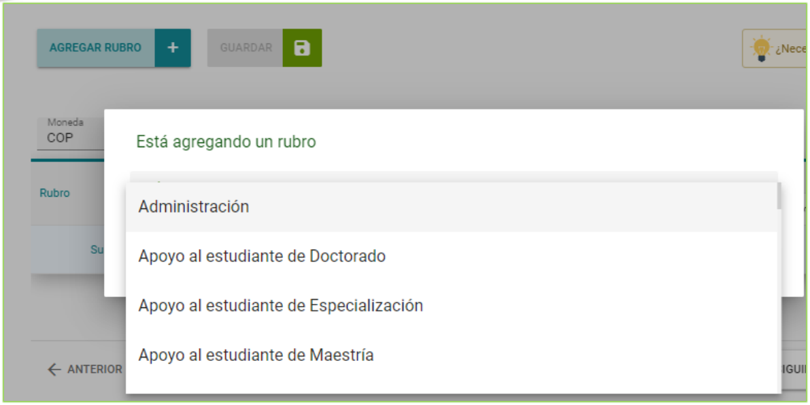
*Figura 31 - Agregar subrubro*

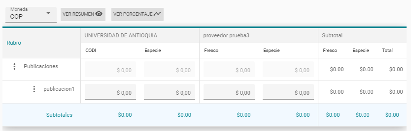
*Figura 32 - Definir valores subrubro*

---

#### 2.4.4. Pestaña Participantes

En esta pestaña podrá agregar los participantes que harán parte del proyecto (personal interno y externo). (Ver figura 33).

!!! note "Participantes Indeterminados"
> Los participantes indeterminados son aquellos que se matriculan en el proyecto para separar el cupo de una vacante, aunque aún no se tenga el dato exacto de quién la ocupará.

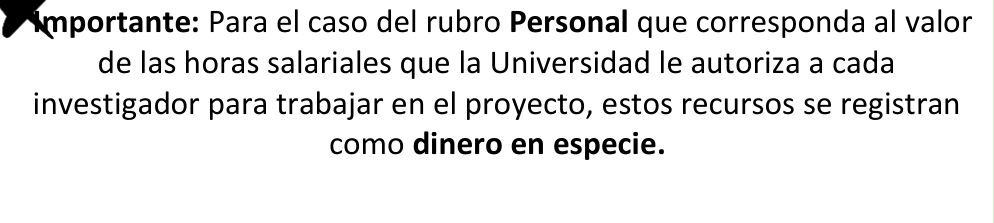
*Figura 33 - Opción participantes*

##### Pasos para registrar participante:
1. Presione **AGREGAR PARTICIPANTE**. El sistema presenta el formulario de usuario. (Ver figura 34).

   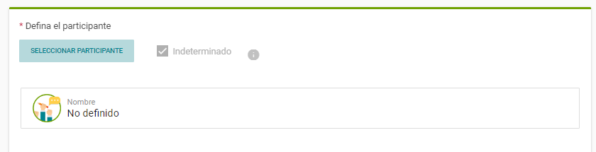
   *Figura 34 - Agregar participante*

2. Presione **Seleccionar participante**, digite el número de documento en el campo *Identificación* y presione **Buscar**. (Ver figura 35).

   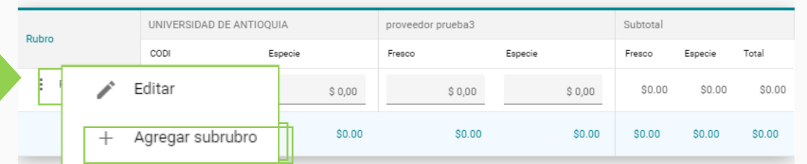
   *Figura 35 - Seleccionar participante*

   !!! info "> Tenga a mano el número del documento del participante que va a ingresar (salvo si es indeterminado). Verifique el grupo de investigación al que pertenece y evite ingresar datos erróneos."

3. En el resultado de búsqueda, presione **Seleccionar**. (Ver figura 36). El sistema agregará al participante. (Ver figura 37).

   
   *Figura 36 - Participante a seleccionar*

   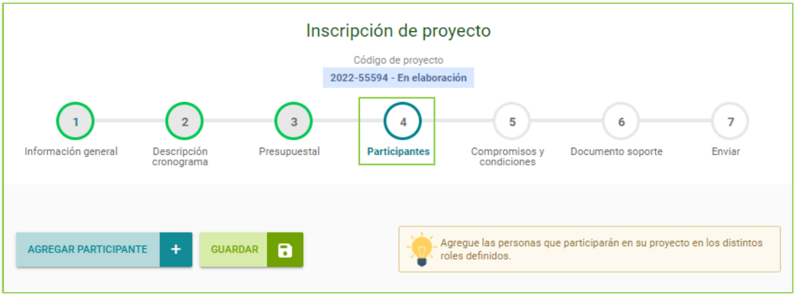
   *Figura 37 - Agregar participante seleccionado*

4. **Vincular institución**:
   - Presione clic en **SELECCIONAR INSTITUCIÓN**.
   - Digite el NIT y presione **Buscar**.
   - Seleccione la institución y presione **Agregar**. (Ver figuras 38 y 39).

   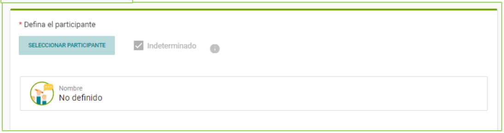
   *Figura 38 - Agregar institución*

   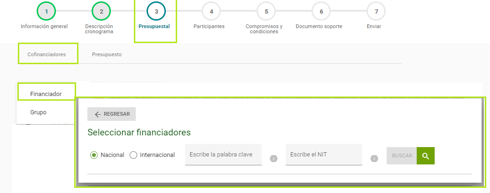
   *Figura 39 - Institución adjunta*

5. **Seleccionar grupo de investigación**:
   - Presione el botón **BUSCAR GRUPO**.
   - El sistema permite elegir el grupo al que pertenece el participante. Si no pertenece a ninguno, no muestra lista (solicitar previamente a la Vicerrectoría con soporte GrupLAC). (Ver figura 40).

   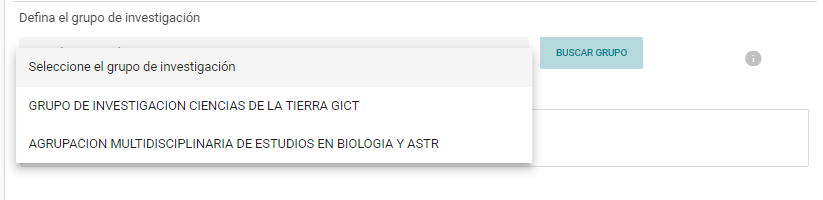
   *Figura 40 - Seleccionar grupo*

6. **Definir rol, dedicación y funciones**:
   - Vínculo con la universidad (Vínculo UdeA).
   - Rol en el proyecto (Tutor, Joven Investigador, etc.).
   - Dedicación horaria: horas por semana y meses (por dentro o por fuera del plan de trabajo).
   - Función en el proyecto y observaciones.
   - Presione **AGREGAR PARTICIPANTE**. (Ver figura 41).

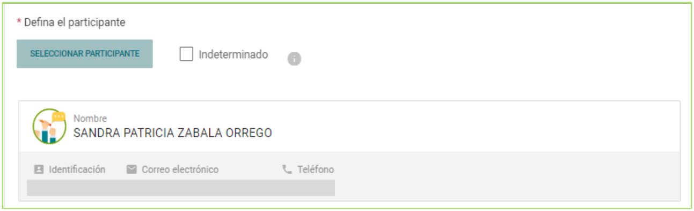
*Figura 41 - Vínculo, rol, dedicación horaria y funciones del participante*

---

#### 2.4.5. Pestaña Compromisos y Condiciones

Una vez completada la pestaña participante, continúe en la pestaña **Compromisos y condiciones**. (Ver figura 42).

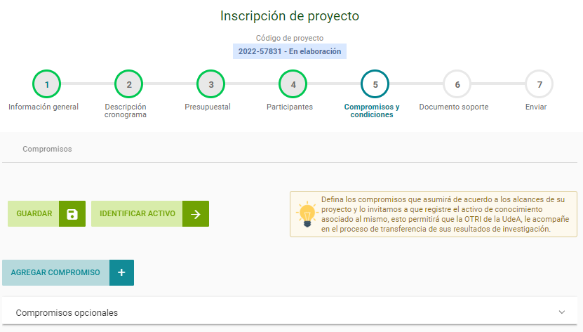
*Figura 42 - Pestaña de compromisos*

1. Presione el botón **AGREGAR COMPROMISO**; el sistema despliega una ventana emergente para registrar el compromiso requerido. (Ver figura 43).

   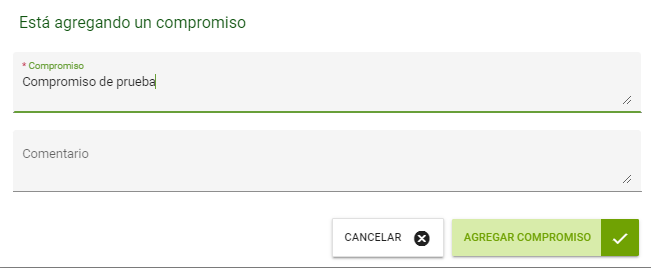
   *Figura 43 - Agregar compromiso*

2. Una vez agregado el compromiso en la sección de compromisos opcionales, la columna acción presenta las opciones de **Editar** y **Eliminar**. (Ver figura 44).

!!! note "Compromisos institucionales para proyectos inscritos"
> Recuerde registrar los compromisos establecidos en el proceso de proyectos inscritos, conforme al documento ubicado en el portal:  
> `Inicio > Investigación > Gestión de la investigación > Procedimientos y formatos`.

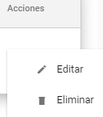
*Figura 44 - Compromisos opcionales*

---

#### 2.4.6. Pestaña Documento Soporte

En esta pestaña se adjuntan los documentos requeridos en la matrícula del proyecto. (Ver figura 45).

1. Presione **Agregar documento soporte**.

   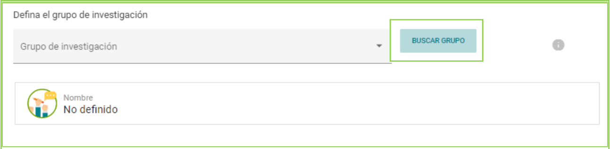
   *Figura 45 - Pestaña Documento soporte*

2. El sistema despliega la ventana para ingresar los campos obligatorios: Nombre del documento, Número, Emisor, Fecha de emisión, Tipo de documento y Descripción. (Ver figura 46).
3. Presione el icono **+**, seleccione el archivo en su PC, presione el botón **Agregar documento soporte** y luego haga clic en **GUARDAR**. (Ver figura 46).

   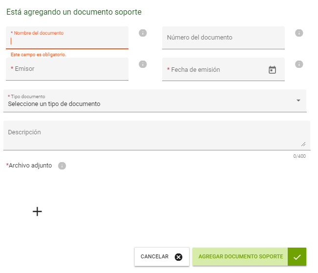
   *Figura 46 - Adjuntar documento*

4. Una vez almacenado, el sistema permite visualizar y gestionar el documento adjunto. (Ver figura 47).

   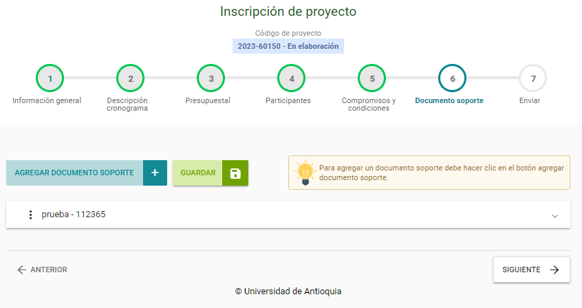
   *Figura 47 - Guardar documento soporte*

---

#### 2.4.7. Pestaña Enviar

Esta pestaña le permitirá enviar el proyecto al Centro de Investigación para su revisión formal.

1. Presione el botón **Enviar a centro**. (Ver figura 48).

   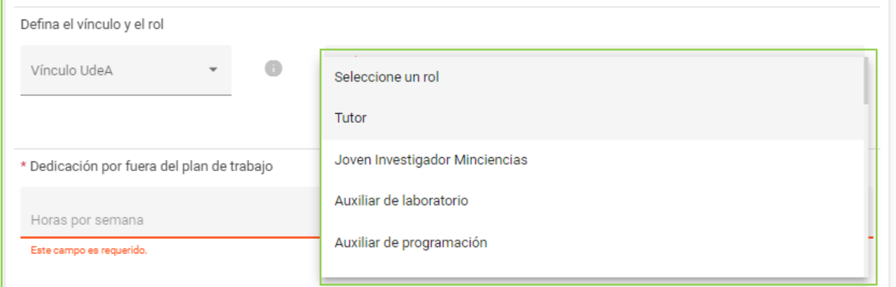
   *Figura 48 - Enviar a centro*

2. El sistema genera un mensaje de alerta: *"Recuerde que al enviar el proyecto el centro ya no podrá realizar cambios a menos de que se lo permitan en el momento de la revisión. ¿Realmente desea enviar el proyecto?"*. Si todo está correcto, presione el botón **ACEPTAR**. (Ver figura 49).

   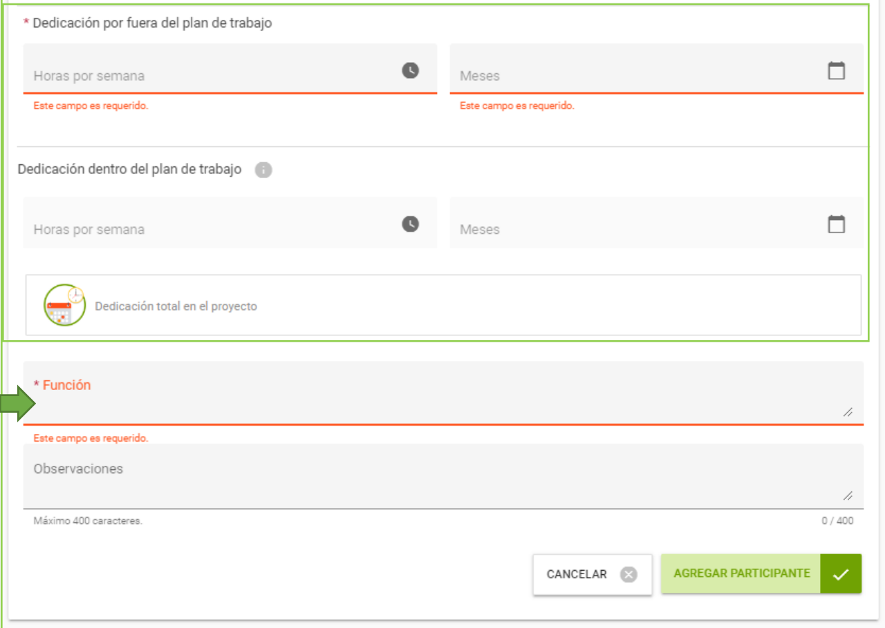
   *Figura 49 - Mensaje de alerta*

3. El sistema emite el mensaje de confirmación oficial con el código de proyecto asignado y fecha/hora exacta de radicación, quedando el proyecto en estado **Matriculado**. Con este paso concluye la matrícula del proyecto. (Ver figura 50).

   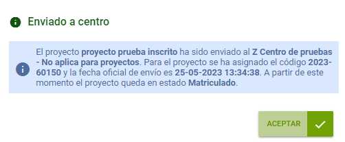
   *Figura 50 - Mensaje de confirmación*

---

## 3. Nota de cambio

- No aplica para la primera versión.

---

## Registro de Control y Firmas

| Rol | Nombre | Cargo / Dependencia | Fecha |
| :--- | :--- | :--- | :--- |
| **Elaboró** | Sandra Patricia Zabala Orrego | Contratista, Vicerrectoría Investigación | 16-FEB-2024 |
| **Elaboró** | Mauricio Toro Torres | Profesional 1, Vicerrectoría Investigación | 16-FEB-2024 |
| **Revisó** | Kerlin Yohana Bedoya Agudelo | Analista de Procesos, División de Arquitectura de Procesos | 29-ABR-2024 |
| **Aprobó** | Gloria Valencia Bustamante | Asistente, Vicerrectoría de Investigación | 29-ABR-2024 |
