# GUÍA PARA LA SOLICITUD DE CAMBIO DE PARTICIPANTE EN EL SIIU

!!! note "Información de Control Documental"
> **Código**: VI-GU-19  
> **Versión**: 01 / 29-ABR-2024  
> *Aviso legal institucional*: La impresión o copia digital de este documento se considera "COPIA NO CONTROLADA". Solo se garantiza la actualización de la documentación en el sitio oficial `http://www.udea.edu.co`.

---

## Contenido

1. [Definición](#1-definición)
2. [Contenido](#2-contenido)
   - 2.1. [Requisitos para crear solicitud cambio de participante](#21-requisitos-para-crear-solicitud-cambio-de-participante)
   - 2.2. [Usuarios que intervienen en el proceso](#22-usuarios-que-intervienen-en-el-proceso)
   - 2.3. [Trámites administrativos](#23-trámites-administrativos)
     - 2.3.1. [Ingreso al SIIU](#231-ingreso-al-siiu)
     - 2.3.2. [Conceptos de Solicitud vs. Novedad](#232-conceptos-de-solicitud-vs-novedad)
     - 2.3.3. [Filtros de búsqueda y opciones de trámite](#233-filtros-de-búsqueda-y-opciones-de-trámite)
   - 2.4. [Solicitud Cambio de Participante](#24-solicitud-cambio-de-participante)
     - 2.4.1. [Retirar participante](#241-retirar-participante)
     - 2.4.2. [Ingresar participante](#242-ingresar-participante)
     - 2.4.3. [Cambio de %P&B (porcentaje participación y beneficio)](#243-cambio-de-pb-porcentaje-participación-y-beneficio)
     - 2.4.4. [Cambio de funciones del participante](#244-cambio-de-funciones-del-participante)
     - 2.4.5. [Pestaña Condiciones formales y generación de respaldo](#245-pestaña-condiciones-formales-y-generación-de-respaldo)
3. [Nota de cambio](#3-nota-de-cambio)
4. [Registro de Control y Firmas](#registro-de-control-y-firmas)

---

## 1. Definición

Este documento se ha elaborado con el fin de ayudar y capacitar a los usuarios con rol de investigador principal para el Sistema de Información para la Investigación Universitaria – SIIU en la creación de solicitudes administrativas. Dado lo anterior se aclara que esta guía no hace parte de la normativa universitaria y solamente se debe utilizar como una herramienta que orienta el paso a paso que se debe seguir.

---

## 2. Contenido

### 2.1 Requisitos para crear solicitud cambio de participante

- Para realizar la solicitud de cambio de participante, el proyecto debe encontrarse en estado **Aprobado** o **En ejecución**.
- El usuario con rol de investigador debe tener acceso a la opción para crear solicitudes administrativas.
- Antes de solicitar un ingreso o retiro de participantes, se debe verificar si existe alguna norma o requisito contemplado en los términos de referencia que rijan para el proyecto.

---

### 2.2 Usuarios que intervienen en el proceso

- **Usuario Investigador**: Investigador Principal o responsable del Proyecto, quien realiza la solicitud.
- **Usuario Administrador de Centro de Investigación**: Jefe del Centro de investigación del proyecto, quien **REVISA, AVALA, APLICA y genera las adendas** de la solicitud, según las recomendaciones del Comité Técnico del Centro.
- **Usuario Vicerrectoría**: Es el encargado de **APROBAR** las solicitudes en el SIIU para que sus cambios se vean reflejados en los proyectos.

---

### 2.3 Trámites administrativos

#### 2.3.1. Ingreso al SIIU
Investigador principal o responsable del proyecto debe autenticarse en el portal de la Universidad de Antioquia, `http://www.udea.edu.co`, buscar la opción aplicaciones y entre ellas elegir el SIIU, así:

1. Ingresa al portal de la Universidad: `http://www.udea.edu.co`, en el encabezado seleccione **Ingresar >> Iniciar sesión** (Ver figura 1).

   
   *Figura 1 - Ingreso al portal de la Universidad de Antioquia*

2. Aparece pantalla para ingresar su usuario y contraseña, seleccione *No soy un Robot* (el sistema le puede pedir realizar validaciones) finalmente presione clic en el botón **CONECTAR**. (Ver figura 2).

   
   *Figura 2 - Conectar al portal*

3. Presione clic en la opción **Enlaces de Interés** seleccione **Mis aplicaciones**, así: `Enlaces de interés → Mis aplicaciones`. (Ver figura 3).

   
   *Figura 3 - Enlaces de interés*

4. Se abrirá una ventana con las aplicaciones de la Universidad; seleccione **SIIU**. (Ver figura 4).

   
   *Figura 4 - Seleccione SIIU*

!!! note "> Se abre una nueva ventana con la aplicación SIIU. Si la ventana no abre inmediatamente, es necesaria la configuración de ventanas emergentes en el navegador y seleccionar la opción que autorice el SIIU."

---

#### 2.3.2. Conceptos de Solicitud vs. Novedad

Una vez se encuentre en SIIU ingrese por la opción: `Trámites administrativos / Nueva solicitud o novedad`. (Ver figura 5).

!!! note "Distinción Institucional en SIIU"
> - **Solicitud**: Son los cambios que se pueden realizar a un proyecto en: *Tiempo, presupuesto, participante o compromisos*, el cual ha sido aprobado por su **(co)financiador responsable interno**, es decir, pertenece a la Universidad de Antioquia.
> - **Novedad**: Son los cambios que se pueden realizar a un proyecto en: *Tiempo, presupuesto, participante o compromisos*, el cual ha sido aprobado por su **(co)financiador responsable externo** a la Universidad de Antioquia.

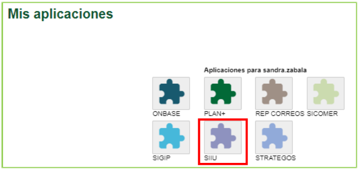
*Figura 5 - Nueva solicitud o novedad*

---

#### 2.3.3. Filtros de búsqueda y opciones de trámite

El sistema presenta un formulario para realizar el filtro de búsqueda con los siguientes campos:

| Campo | Detalle |
| :--- | :--- |
| **Centro administrativo** | Campo obligatorio; seleccione de la lista desplegable el centro al que pertenece el proyecto. |
| **Nivel** | Lista desplegable con las opciones: *Macroproyecto*, *Subproyecto*, *Proyecto*. |
| **Clase de proyecto** | Lista desplegable con las opciones: *Proyecto*, *Proyecto asociado a macroproyecto*. |
| **Código de proyecto** | Ingrese el código del proyecto. |
| **Palabras Clave** | Ingrese palabras clave del proyecto. |
| **Tipo de Proyecto** | Lista desplegable con las opciones: *Investigación*, *Extensión*, *Posgrados*. |
| **NIT del financiador** | Ingrese el NIT del financiador del proyecto. |
| **Estado** | Lista desplegable con los estados del proyecto (ej: *En ejecución*). |
| **Botón Consultar** | Presione una vez defina el criterio de búsqueda. |
| **Botón Limpiar** | Presione si desea borrar el criterio de búsqueda. |

En el filtro de búsqueda seleccione el centro de investigación, en el campo código del proyecto indique el código (o filtre por estado *En ejecución*), y presione **Consultar**. (Ver figuras 6 y 7).

*Figura 6 - Consulta por código del proyecto*

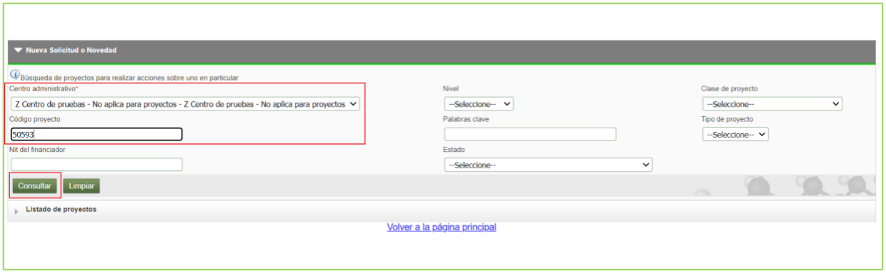
*Figura 7 - Filtro de búsqueda*

El sistema trae como resultado una tabla con las columnas:
- *Código Proyecto*
- *Nivel*
- *Proyecto vinculado*
- *Convocatoria / Proceso de Selección*
- *Responsable*
- *IP o Coordinador*
- *Tipo Proyecto*
- *Estado*
- *Acciones*

La columna acciones presenta los siguientes iconos de acceso directo a la información del proyecto:

| Icono | Detalle |
| :---: | :--- |
| | **Ver participante** |
| | **Ver etapas** |
| | **Ver Detalle** |
| | **Ver compromisos** |

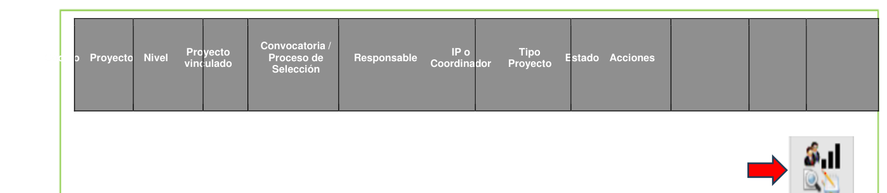
*Figura 8 - Resultado de búsqueda*

Seleccione el proyecto al cual desea realizarle la solicitud. El sistema muestra la barra superior de solicitudes administrativas: (Ver figura 9).

| Solicitud | Detalle |
| :--- | :--- |
| **Prórroga** | Permite realizar prórroga a proyectos para iniciar o para postergar la fecha de finalización. |
| **Cambio Rubro** | Permite hacer cambios al valor de los rubros, crear subrubro. |
| **Adición Presupuestal** | Permite adicionar presupuesto al proyecto por parte del aportante. |
| **Cancelación** | Permite cancelar el proyecto *(opción inhabilitada actualmente)*. |
| **Cambio en Participante** | Permite realizar cambio en los participantes del proyecto. |
| **Suspensión** | *(Esta opción se encuentra inhabilitada)*. |
| **Plazo para entrega de Compromisos** | Permite solicitar plazo para entregar los compromisos. |
| **Homologación de Compromisos** | Permite cambiar los compromisos. |
| **Historial de Solicitudes** | Permite ver el histórico de las solicitudes de un proyecto. |

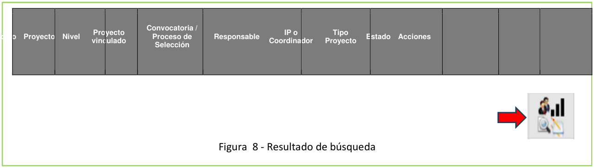
*Figura 9 - Resultado de búsqueda por filtros definidos y barra de solicitudes*

---

### 2.4 Solicitud Cambio de Participante

La solicitud de cambio de participante puede realizarse en dos momentos institucionales:
1. **Cuando el proyecto está en estado Aprobado**: Permite cambiar los participantes del proyecto **ANTES** de que se realice el inicio formal.
2. **Cuando el proyecto se encuentra en estado En Ejecución**: Permite cambiar los participantes del proyecto después del inicio formal.  
   !!! info "> Cada vez que se solicite un cambio de participante en ejecución, el sistema genera una **adenda**, la cual es un documento que contiene los cambios en los participantes solicitados previamente. Este documento debe contener las **firmas del Coordinador de grupo, Jefe de centro y el Investigador Principal o responsable del proyecto**."

En la solicitud de cambio de participante se puede realizar:
- Solo ingresar participante(s).
- Solo retirar participante(s).
- Retirar e ingresar participante(s).
- Cambiar el %P&B (porcentaje participación y beneficio) de los participantes.
- Cambiar las funciones del participante.

Seleccione el botón **Cambio en Participante**; el sistema despliega el nuevo formulario. (Ver figura 10).

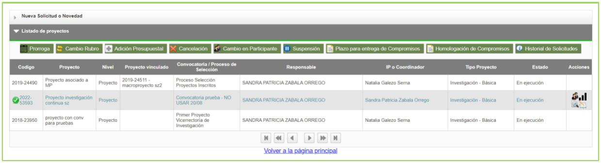
*Figura 10 - Solicitud cambio de participante*

---

#### 2.4.1 Retirar participante

1. Si desea retirar un participante, selecciónelo marcando la casilla de verificación (cuadro) ubicada a la izquierda de su nombre.
2. El sistema lo traslada a la tabla inferior **Participantes a Retirar**.
3. **Asigne el valor de `0` al campo % PyB nuevo.** (Ver figura 11).

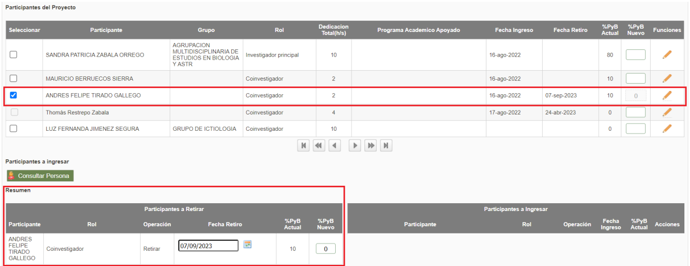
*Figura 11 - Participante a retirar*

- **Caso de solo retiro**: El sistema permite realizar la solicitud de solo retiro del participante (sin reemplazo). En este caso no se selecciona *Consultar persona*. Ingrese la **Justificación** del retiro, presione **Guardar** y continúe con la solicitud hasta finalizar. (Ver figura 12).
- **Caso de reemplazo**: El sistema permite reemplazar al usuario saliente ingresando un nuevo participante desde el botón **Consultar persona**.

*Figura 12 - Retiro de participante*

---

#### 2.4.2 Ingresar participante

Para ingresar un nuevo participante, presione el botón **Consultar Persona**.

!!! info "> Se debe tener a mano la información real del o los participantes a ingresar ya que, una vez almacenado el registro, algunos campos no se podrán modificar."

1. El sistema abre la ventana **Consulta de personas**:
   - Ingrese el número en el campo **Cédula**, o
   - Ingrese el nombre y apellido en el campo **Nombre**.
   - Presione el botón **Consultar**. (Ver figuras 13 y 14).

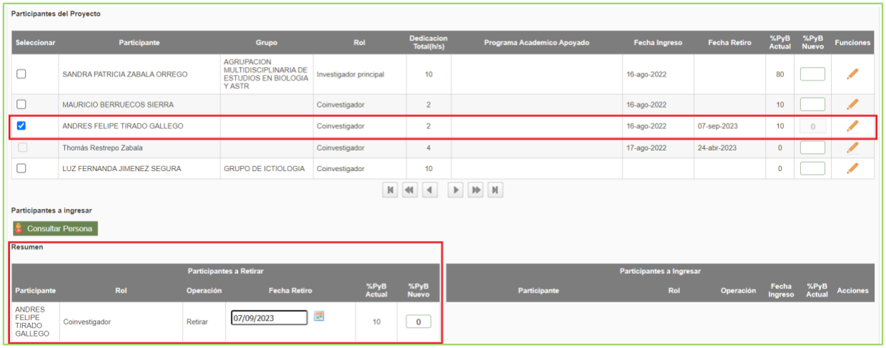
*Figura 13 - Consulta x cédula*

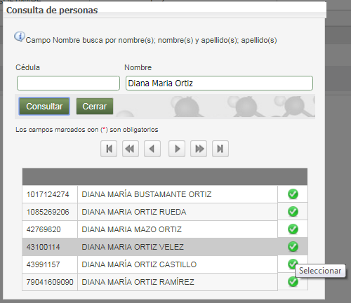
*Figura 14 - Consulta x Nombre*

2. Seleccione el participante presionando el ícono verde de visto bueno que aparece al lado derecho del nombre.
3. El sistema abre el formulario de vinculación con los siguientes campos:

| Campos | Detalle |
| :--- | :--- |
| **Participante** | Este campo no es editable. |
| **Teléfono** | Este campo no es editable. |
| **Correo** | Este campo no es editable. |
| **Grupo por el que participa** | Este campo se puede editar y modificar. |
| **Institución que representa** | Seleccione la institución o elija *Sin institución*. |
| **Rol en el proyecto** | Seleccione de la lista desplegable el rol a desempeñar. |
| **Dedicación por fuera del plan de trabajo (Personal externo)** | |
| **Horas por semana** | Asigne número de horas, teniendo en cuenta los topes definidos desde talento humano. |
| **Meses** | Asigne número de meses; no debe superar la duración total del proyecto. |
| **Dedicación dentro del plan de trabajo (Empleados, personal interno)** | |
| **Horas por semana** | Asigne número de horas según topes de talento humano. |
| **Meses** | Asigne número de meses; no debe superar la duración total del proyecto. |
| **Nota aclaratoria para el %PyB** | Ingrese nota aclaratoria del % de participación y beneficios si lo requiere (aparecerá en documentos de respaldo; no obligatorio). |
| **Función** | Ingrese las funciones a desarrollar en el proyecto por parte del participante. |
| **Observaciones** | Ingrese observaciones si son requeridas. |

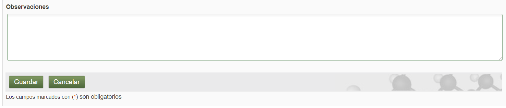
*Figura 15 - Ingreso de participante*

4. Una vez ingresada la información, el sistema muestra en la pantalla principal la tabla **Participantes a Ingresar** con la operación `Ingresar`. (Ver figura 16).
   - Se puede eliminar el participante ingresado presionando el icono `X` rojo.
   - Se puede editar la información presionando el icono lápiz.

!!! warning "Participante no registrado en el portal"
> Si el participante no se encuentra registrado, el sistema genera el mensaje *"La consulta no trajo resultados"*. En este caso, el investigador principal o responsable debe radicar un **ticket asignado a la Vicerrectoría de Investigación** indicando: Tipo de documento, número de documento, Nombre completo, correo electrónico y teléfono.

*Figura 16 - Participantes a ingresar*

---

#### 2.4.3 Cambio de %P&B (porcentaje participación y beneficio)

Para cambiar el %P&B de los participantes del proyecto:
1. Seleccione la columna **%P&B Nuevo**.
2. Diligencie los nuevos valores de %PyB para los participantes requeridos (si en la solicitud no cambia el %PyB, no es necesario diligenciar esta casilla).
3. Escriba la justificación detallada de las variaciones realizadas en el campo **Justificación**.

!!! caution "Regla del 100%"
> Valide que la sumatoria total de los porcentajes de PyB entre todos los participantes dé **exactamente el 100%**.

4. Finalice presionando el botón **Guardar**. (Ver figura 17).

*Figura 17 - Cambio de% PyB*

---

#### 2.4.4 Cambio de funciones del participante

Para cambiar las funciones de los participantes del proyecto:
1. Ubique al participante requerido en la lista.
2. En la columna **Funciones**, presione el icono del **lápiz**.
3. El sistema presenta una ventana emergente que muestra las *Funciones Anteriores* y un campo para ingresar las *Funciones Nuevas*.
4. Ingrese los ajustes correspondientes y presione **Confirmar** para terminar. (Ver figura 18).

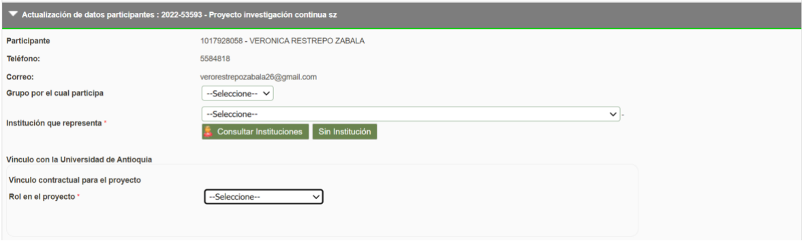
*Figura 18 - Cambiar funciones del participante*

---

#### 2.4.5 Pestaña Condiciones formales y generación de respaldo

En la pestaña **Condiciones Formales** se validan las condiciones previas del trámite y se genera el documento de respaldo de firmas:

1. Presione el botón **Generar Respaldo** (este paso es **obligatorio** para poder enviar la solicitud al centro).
2. El sistema genera una ventana para aceptar los términos y condiciones:
   - Marque con un check la casilla: *"He leído y aceptado los términos y condiciones de este documento"*.
   - Presione el botón **Confirmar**. (Ver figura 19).

!!! note "Firma electrónica del Investigador Principal"
> En el momento en que el Investigador Principal o responsable del proyecto acepta los términos y condiciones en la plataforma, **no se requiere su firma física manual** en el documento de respaldo generado, puesto que el sistema estampa automáticamente su firma electrónica institucional.

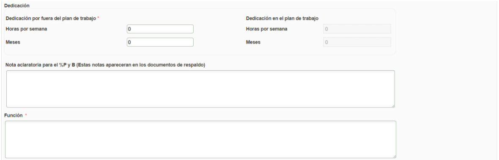
*Figura 19 - Términos y condiciones*

3. El sistema genera y descarga un archivo PDF con la información completa del cambio de participante (operaciones de retiro, ingreso, cambio de dedicación, P&B y funciones). Este archivo constituye el **Documento de Respaldo de Solicitud de Cambio de Participante**. (Ver figuras 20 y 21).

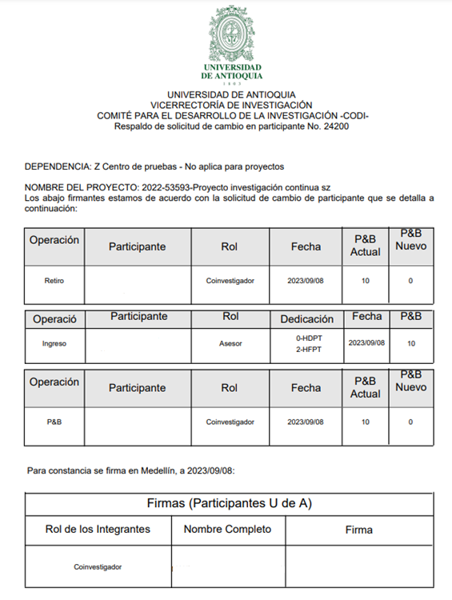
*Figura 20 - Documento respaldo*

*Figura 21 - Firmas documento de respaldo*

!!! info "Recolección de firmas y radicación"
> - Si no es posible conseguir las firmas físicas de los demás participantes de forma inmediata, guarde la solicitud.
> - Una vez tenga el documento de respaldo completamente firmado por los participantes de la Universidad de Antioquia, ingrese nuevamente al SIIU en `Trámites Administrativos / Seguimiento solicitudes y Novedades`.
> - Adjunte el PDF escaneado en la pestaña **Adjuntar Documento** como documento soporte.
> - Finalmente, proceda a enviar la solicitud al Centro de Investigación para su respectivo aval.

---

## 3. Nota de cambio

- No aplica para la primera versión.

---

## Registro de Control y Firmas

| Rol | Nombre | Cargo / Dependencia | Fecha |
| :--- | :--- | :--- | :--- |
| **Elaboró** | Sandra Patricia Zabala Orrego | Contratista, Vicerrectoría Investigación | 16-FEB-2024 |
| **Revisó** | Kerlin Yohana Bedoya Agudelo | Analista de Procesos, División de Arquitectura de Procesos | 29-ABR-2024 |
| **Aprobó** | Gloria Valencia Bustamante | Asistente, Vicerrectoría de Investigación | 29-ABR-2024 |
