# GUÍA PARA LA SOLICITUD DE CAMBIO DE RUBRO EN EL SIIU

!!! note "Información de Control Documental"
> **Código**: VI-GU-20  
> **Versión**: 01 / 29-ABR-2024  
> *Aviso legal institucional*: La impresión o copia digital de este documento se considera "COPIA NO CONTROLADA". Solo se garantiza la actualización de la documentación en el sitio oficial `http://www.udea.edu.co`.

---

## Contenido

1. [Definición](#1-definición)
2. [Contenido](#2-contenido)
   - 2.1. [Requisitos para crear solicitud cambio de rubro](#21-requisitos-para-crear-solicitud-cambio-de-rubro)
   - 2.2. [Usuarios que intervienen en el proceso](#22-usuarios-que-intervienen-en-el-proceso)
   - 2.3. [Ingreso al SIIU](#23-ingreso-al-siiu)
   - 2.4. [Trámites administrativos](#24-trámites-administrativos)
   - 2.5. [Solicitud Cambio de Rubro](#25-solicitud-cambio-de-rubro)
     - 2.5.1. [Opción Ver disponibilidad por período](#251-opción-ver-disponibilidad-por-período)
     - 2.5.2. [Opción Rubro origen](#252-opción-rubro-origen)
     - 2.5.3. [Opción Rubro destino](#253-opción-rubro-destino)
     - 2.5.4. [Opción Agregar rubro ++](#254-opción-agregar-rubro-)
     - 2.5.5. [Opción Agregar subrubro ++](#255-opción-agregar-subrubro-)
     - 2.5.6. [Pestaña Condiciones Formales](#256-pestaña-condiciones-formales)
     - 2.5.7. [Pestaña Adjuntar Documento](#257-pestaña-adjuntar-documento)
   - 2.6. [Enviar solicitud](#26-enviar-solicitud)
   - 2.7. [Editar Solicitud](#27-editar-solicitud)
3. [Nota de cambio](#3-nota-de-cambio)
4. [Registro de Control y Firmas](#registro-de-control-y-firmas)

---

## 1. Definición

Este documento se ha elaborado con el fin de ayudar y capacitar a los usuarios con rol de investigador principal para el Sistema de Información para la Investigación Universitaria – SIIU en la creación de solicitudes administrativas. Dado lo anterior se aclara que esta guía no hace parte de la normativa universitaria y solamente se debe utilizar como una herramienta que indica paso a paso que se debe seguir.

---

## 2. Contenido

### 2.1 Requisitos para crear solicitud cambio de rubro

- Antes de solicitar un cambio de rubro, se debe verificar que la convocatoria en la que resultó financiado el proyecto tenga contemplada esta alternativa, así como la opción de ejecutar recursos en el rubro que se desee crear.
- Para realizar la solicitud de cambio de rubro, el proyecto debe encontrarse en estado **"En ejecución"**, ya que solo en este estado es permitido afectar los recursos presupuestales.
- El usuario con rol de investigador debe tener acceso a la opción para crear solicitudes administrativas.

---

### 2.2 Usuarios que intervienen en el proceso

- **Usuario Investigador**: Investigador Principal o responsable del Proyecto, quien realiza la solicitud.
- **Usuario Administrador de Centro de Investigación**: Jefe del Centro de investigación del proyecto, quien **revisa y avala** la solicitud, según las recomendaciones del Comité Técnico del Centro.
- **Usuario Vicerrectoría**: Es el encargado de **aplicar** las solicitudes de cambio de rubro en el SIIU para que sus cambios se vean reflejados en los proyectos, además de **generar las adendas** a la solicitud.

---

### 2.3 Ingreso al SIIU

El investigador principal o responsable del proyecto debe autenticarse en el portal de la Universidad de Antioquia, `http://www.udea.edu.co`, buscar la opción aplicaciones y entre ellas elegir el SIIU, así:

1. Ingresa al portal de la Universidad: `http://www.udea.edu.co`, en el encabezado seleccione **Ingresar >> Iniciar sesión** (Ver figura 1).

   
   *Figura 1 - Ingreso al portal de la Universidad de Antioquia*

2. Aparece pantalla para ingresar su usuario y contraseña, seleccione *No soy un Robot* (el sistema le puede pedir realizar validaciones) finalmente presione clic en el botón **CONECTAR**. (Ver figura 2).

   
   *Figura 2 - Conectar al portal*

3. Presione clic en la opción **Enlaces de Interés** y seleccione **Mis aplicaciones**, así: `Enlaces de interés → Mis aplicaciones`. (Ver figura 3).

   
   *Figura 3 - Enlaces de interés*

4. Se abrirá una ventana con las aplicaciones de la Universidad; seleccione **SIIU**. (Ver figura 4).

   
   *Figura 4 - Seleccione SIIU*

!!! note "> Se abre una nueva ventana con la aplicación SIIU. Si la ventana no abre inmediatamente, es necesaria la configuración de ventanas emergentes en el navegador y seleccionar la opción que autorice el SIIU."

---

### 2.4 Trámites administrativos

Una vez se encuentre en SIIU ingrese por la opción: `Trámites administrativos / Nueva solicitud o novedad`. (Ver figura 5).

!!! note "Diferenciación entre Solicitud y Novedad"
> - **Solicitud**: Son los cambios que se pueden realizar a un proyecto en: *Tiempo, presupuesto, participante o compromisos*, el cual ha sido aprobado por su **(co)financiador responsable interno**, es decir, pertenece a la Universidad de Antioquia.
> - **Novedad**: Son los cambios que se pueden realizar a un proyecto en: *Tiempo, presupuesto, participante o compromisos*, el cual ha sido aprobado por su **(co)financiador responsable externo** a la Universidad de Antioquia.

*Figura 5 - Nueva solicitud o novedad*

El sistema presenta un formulario para realizar el filtro de búsqueda con los siguientes campos:

| Campo | Detalle |
| :--- | :--- |
| **Centro administrativo** | Campo obligatorio; seleccione de la lista desplegable el centro al que pertenece el proyecto. |
| **Nivel** | Lista desplegable con las opciones: *Macroproyecto*, *Subproyecto*, *Proyecto*. |
| **Clase de proyecto** | Lista desplegable con las opciones: *Proyecto*, *Proyecto asociado a macroproyecto*. |
| **Código de proyecto** | Ingrese el código del proyecto. |
| **Palabras Clave** | Ingrese palabras clave del proyecto. |
| **Tipo de Proyecto** | Lista desplegable con las opciones: *Investigación*, *Extensión*, *Posgrados*. |
| **NIT del financiador** | Ingrese el NIT del financiador del proyecto. |
| **Estado** | Lista desplegable con los estados del proyecto. |
| **Botón Consultar** | Presione una vez defina el criterio de búsqueda. |
| **Botón Limpiar** | Presione si desea borrar el criterio de búsqueda. |

En el filtro de búsqueda seleccione el centro de investigación y en el campo código del proyecto indique el código correspondiente (o filtre por estado *En ejecución*), y presione **Consultar**. (Ver figuras 6 y 7).

*Figura 6 - Consulta por código del proyecto*

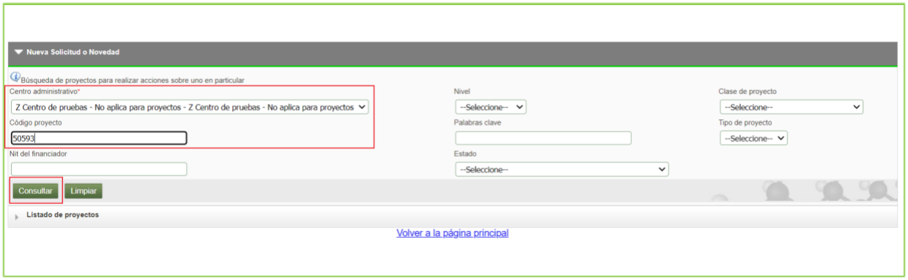
*Figura 7 - Filtro de búsqueda*

El sistema trae como resultado la información en las siguientes columnas:
- *Código Proyecto*
- *Nivel*
- *Proyecto vinculado*
- *Convocatoria / Proceso de Selección*
- *Responsable*
- *IP o Coordinador*
- *Tipo Proyecto*
- *Estado*
- *Acciones*

La columna acciones presenta iconos de acceso directo a la información del proyecto:
- **Ver participante**
- **Ver etapas**
- **Ver Detalle**
- **Ver compromisos** (Ver figura 8).

*Figura 8 - Resultado de búsqueda*

El sistema trae la consulta de todos los proyectos en estado *En ejecución* para el centro indicado. Seleccione el proyecto al cual desea realizarle la solicitud. (Ver figura 9).

El sistema muestra la barra de iconos que corresponde a las solicitudes administrativas disponibles:

| Solicitud | Detalle |
| :--- | :--- |
| **Prórroga** | Permite realizar prórroga a proyectos para iniciar o para postergar la fecha de finalización. |
| **Cambio Rubro** | Permite hacer cambios al valor de los rubros, crear subrubro. |
| **Adición Presupuestal** | Permite adicionar presupuesto al proyecto por parte del aportante. |
| **Cancelación** | Permite cancelar el proyecto (*esta opción está inhabilitada*). |
| **Cambio en Participante** | Permite realizar cambio en los participantes del proyecto. |
| **Suspensión** | (*Esta opción se encuentra inhabilitada*). |
| **Plazo para entrega de Compromisos** | Permite solicitar plazo para entregar los compromisos. |
| **Homologación de Compromisos** | Permite cambiar los compromisos. |
| **Historial de Solicitudes** | Permite ver el histórico de las solicitudes de un proyecto. |

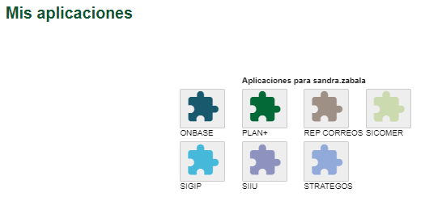
*Figura 9 - Resultado de búsqueda y barra de solicitudes administrativas*

---

### 2.5 Solicitud Cambio de Rubro

Seleccione la opción **Cambio Rubro**. El sistema despliega un nuevo formulario: en el campo **Entidad**, despliegue la lista de valores (aparecen los aportantes del proyecto: financiadores y cofinanciadores). Seleccione el aportante al cual va a realizar el cambio de rubro. (Ver figura 10).

*Figura 10 - Seleccione aportante*

Una vez seleccionado el aportante, el sistema presenta el formulario estructurado en 12 secciones: (Ver figura 11).

| Sección | Detalle |
| :---: | :--- |
| **1** | Tipo de trámite o solicitud. |
| **2** | Código, nombre del proyecto y estado. |
| **3** | • Centro al que pertenece. • Número de solicitud. • Fecha de la solicitud. • NIT y nombre del aportante. |
| **4** | Lista de Rubros definidos para el proyecto. |
| **5** | Opciones para el trámite: *Rubro origen*, *Agregar subrubro*, *Agregar rubro*, *Ver disponibilidad por período*. |
| **6** | • Rubro origen. • Rubro destino. |
| **7** | Justificación de la solicitud de cambio de rubro. |
| **8** | Botones Guardar o cancelar. |
| **9** | Rubro origen. |
| **10** | Valor para trasladar. |
| **11** | Rubro destino. |
| **12** | Botón Cancelar. |

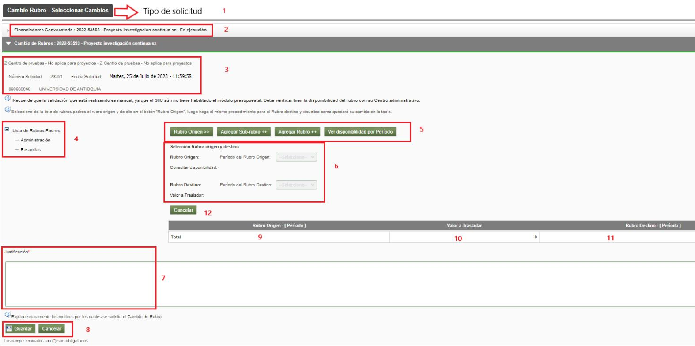
*Figura 11 - Formulario cambio de rubro*

---

#### 2.5.1 Opción Ver disponibilidad por período

Antes de iniciar la solicitud de cambio de rubro, se recomienda consultar el estado actual de los recursos aportados por la entidad seleccionada. Para hacerlo, presione el botón **Ver disponibilidad por período** ubicado al lado derecho de las opciones en pantalla. (Ver figura 12).

*Figura 12 - Ver disponibilidad por período*

El sistema muestra los valores disponibles en cada rubro, contemplando los valores trasladados en la misma solicitud o en solicitudes de cambio de rubro que estén en trámite (en estado *Pendiente de Aval*, *Avalada*, *Aprobada*).

Para consultar los recursos disponibles, seleccione el **período** que desea consultar y el sistema mostrará el árbol de rubros con su respectiva disponibilidad en dinero fresco. (Ver figura 13).

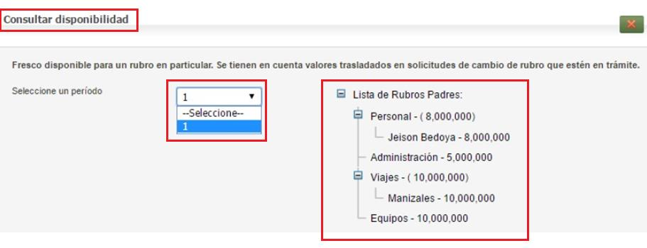
*Figura 13 - Consultar disponibilidad*

---

#### 2.5.2 Opción Rubro origen

El rubro de origen es el rubro del cual se van a trasladar los recursos (el que cede dinero):

1. Ubique en el lado izquierdo de la pantalla el listado de rubros y seleccione el rubro o subrubro que desea utilizar como origen. (Ver figura 14).
2. Presione el botón **Rubro Origen>>**. (Ver figura 15).

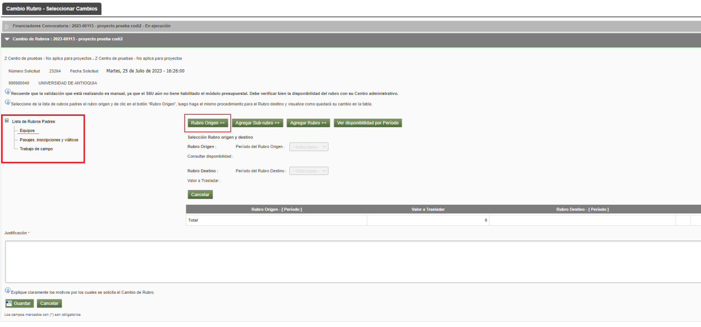
*Figura 14 - Seleccionar rubros*

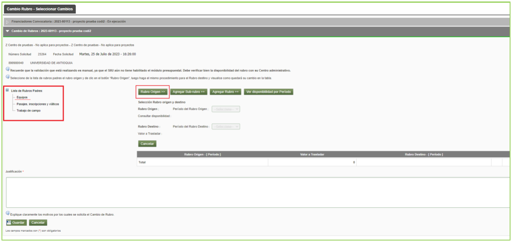
*Figura 15 - Rubro Origen*

3. Seleccione el **Período del Rubro de Origen** del que desea trasladar recursos (por ejemplo: período `1`). (Ver figura 16).

*Figura 16 - Seleccionar período del Rubro de origen*

4. El sistema mostrará en **color rojo** la cantidad de dinero que el rubro seleccionado tiene disponible en el campo *Consultar disponibilidad*. A su vez, el sistema habilita el botón **Rubro Destino>>**. (Ver figura 17).

*Figura 17 - Recurso disponible del rubro*

---

#### 2.5.3 Opción Rubro destino

El rubro de destino es el que recibirá el dinero trasladado:

1. Seleccione el rubro que desea que reciba el dinero en la lista que aparece al lado izquierdo de la pantalla. A continuación, presione clic en el botón **Rubro Destino>>**. (Ver figura 18).
   *(En caso de no encontrarlo en la lista, deberá crearlo previamente usando las opciones Agregar rubro ++ o Agregar subrubro ++).*

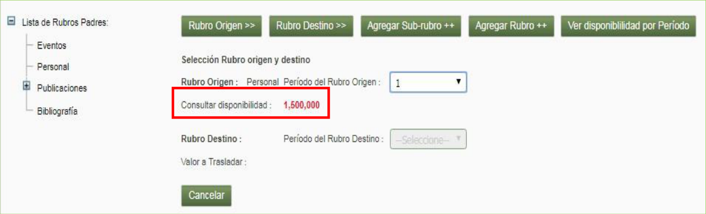
*Figura 18 - Rubro destino*

2. Seleccione el número de período para el campo **Período del Rubro Destino** (ejemplo: período `1`). (Ver figura 19).

*Figura 19 - Seleccionar periodo del Rubro Destino*

3. El sistema habilita el campo **Valor a trasladar**. Ingrese el monto exacto del recurso que desea mover desde el rubro origen hacia el rubro destino, y presione la opción **Guardar**. (Ver figura 20).

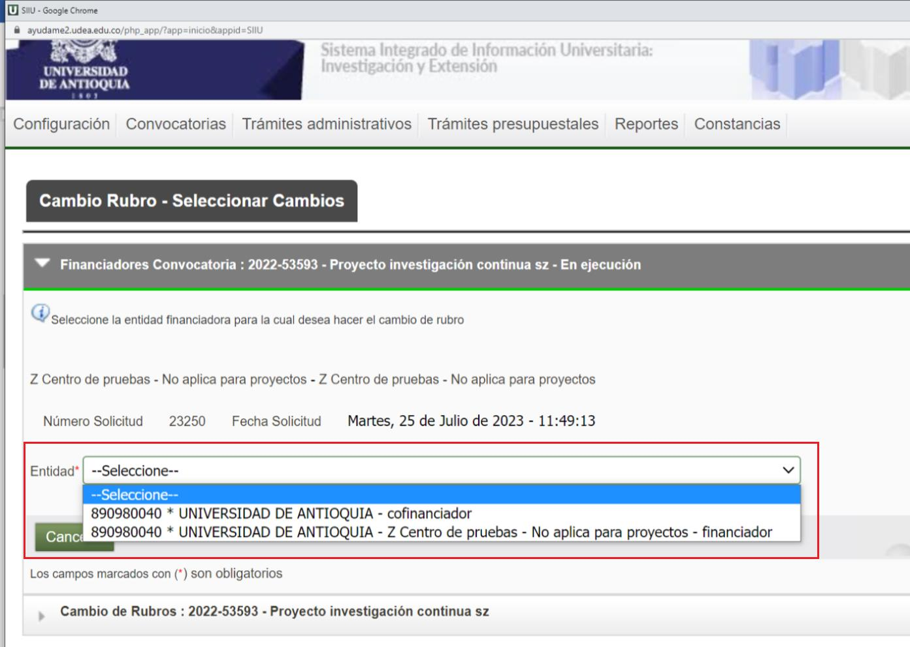
*Figura 20 - Confirmar valor a trasladar*

4. El sistema muestra el resumen del traslado en una tabla que se actualiza automáticamente con la información ingresada (Rubro Origen, Valor a Trasladar, Rubro Destino).
5. Agregue la **Justificación** detallada del cambio requerido en el campo de texto y presione el botón **Guardar**. (Ver figura 21).

*Figura 21 - Tabla resumen del cambio de rubro*

Una vez presionado el botón *Guardar*, el sistema muestra el mensaje *"Creado exitosamente"* en la parte superior. Observe que se habilitan las pestañas **Condiciones formales** y **Adjuntar documento** en la parte superior, y en la parte inferior se activa el botón **Siguiente**. (Ver figura 22).

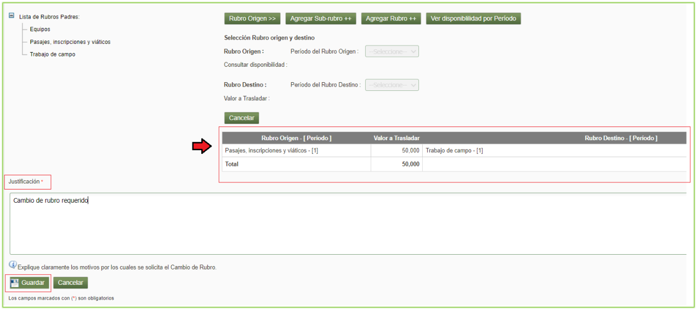
*Figura 22 - Nuevas pestañas*

---

#### 2.5.4 Opción Agregar rubro ++

Esta opción permite agregar un **nuevo rubro padre** al proyecto.
- Tenga en cuenta que el nuevo rubro debe estar contemplado en el marco de la convocatoria a la cual pertenece el proyecto, o ser un rubro financiable para el caso de proyectos inscritos.
- Estos rubros padres se crean inicialmente con **disponibilidad de cero pesos (\$0)**, para luego recibir el traslado de valor desde un rubro existente.

!!! info "Regla para creación de Subrubros"
> Para crear rubros hijo (subrubro), es **estrictamente necesario** que primero se transfieran recursos de otro rubro con disponibilidad hacia el rubro padre en el cual se quieren generar esos rubros hijos.

1. Presione el botón **Agregar rubro ++**.
2. El sistema despliega el listado de rubros disponibles para agregar (Personal, Servicios técnicos, Materiales e insumos, Equipos, Software, Publicaciones, etc.).
3. Seleccione el rubro requerido, ingrese la **Justificación del investigador** y presione el botón **Crear Rubro**. (Ver figura 23).

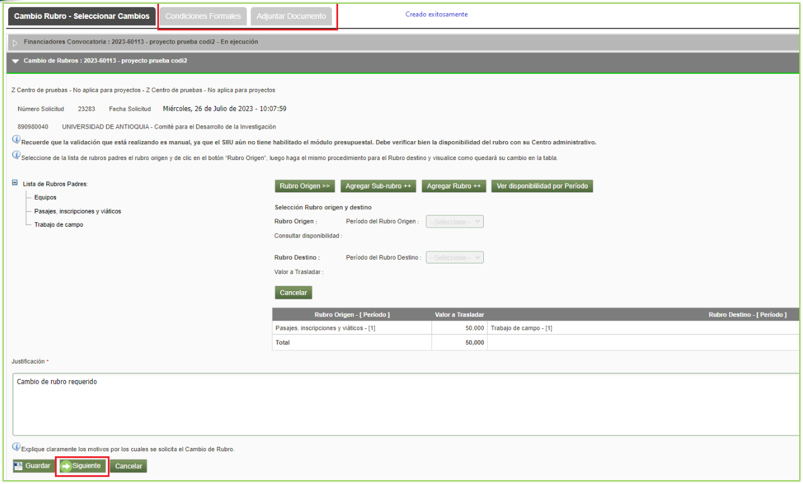
*Figura 23 - Listado de rubros disponibles para agregar*

4. El sistema genera el mensaje *"Rubro creado exitosamente"* y actualiza la lista del árbol presupuestal con el nuevo rubro creado. (Ver figura 24).

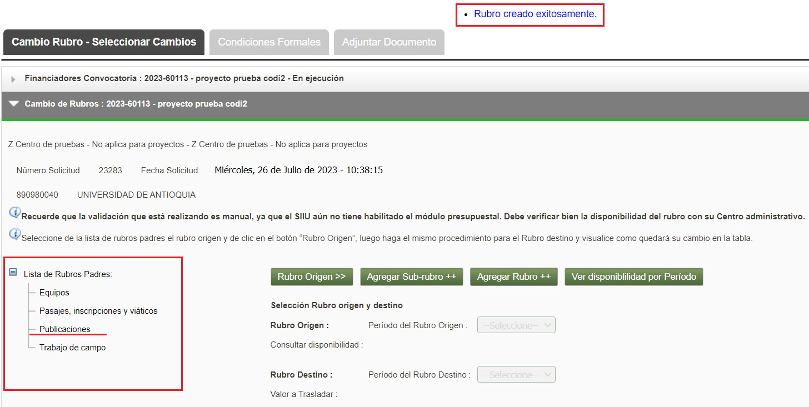
*Figura 24 - Lista con nuevo rubro*

---

#### 2.5.5 Opción Agregar subrubro ++

Esta opción permite crear **rubros hijos (subrubros)** para discriminar gastos detallados:
- **Condición**: El rubro padre debe existir y tener disponibilidad presupuestal mayor a \$0.
- Posiciónese y seleccione primero el rubro padre.
- Presione el botón **Agregar sub-rubro ++**. (Ver figura 25).

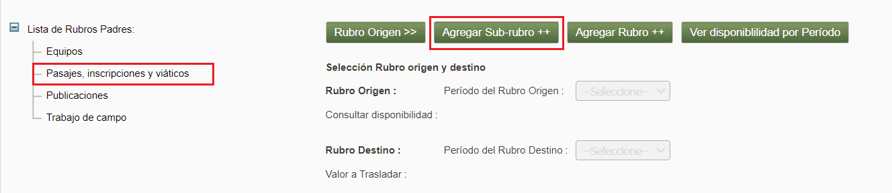
*Figura 25 - Agregar subrubro*

1. El sistema abre una nueva ventana donde debe asignar los campos obligatorios:
   - **Nombre**: Ingrese el nombre específico del subrubro (por ejemplo: `Inscripción a seminario científico`).
   - **Justificación**: Detalle la necesidad presupuestal.
   - Presione el botón **Crear Rubro**. (Ver figura 26).

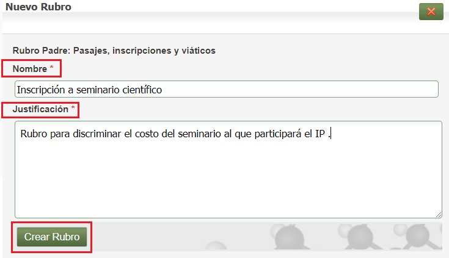
*Figura 26 - Crear subrubro*

2. Puede consultar el subrubro creado presionando el botón **Ver disponibilidad por período** para verificar su inclusión bajo el rubro padre. (Ver figura 27).

*Figura 27 - Ver subrubro creado*

---

#### 2.5.6 Pestaña Condiciones Formales

Si la convocatoria del proyecto exige condiciones formales para el cambio de rubro, el sistema las mostrará en esta pestaña:
- Diligencie la columna *Cumplimiento* si corresponde.
- De lo contrario, presione el botón **Guardar** y luego haga clic en **Siguiente** para continuar. (Ver figura 28).

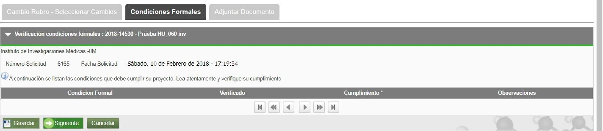
*Figura 28 - Condiciones formales*

---

#### 2.5.7 Pestaña Adjuntar Documento

Seleccione la pestaña **Adjuntar Documento** para cargar el soporte técnico o la justificación formal del cambio de rubro.

1. Presione el botón **+** para agregar un nuevo archivo. (Ver figura 29).

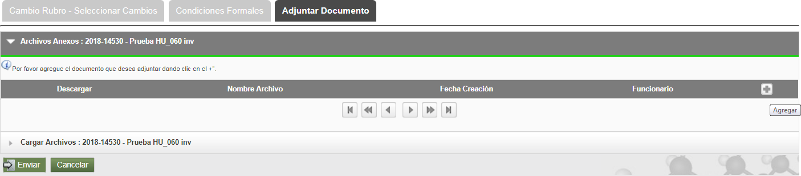
*Figura 29 - Adjuntar documento*

!!! caution "Restricciones institucionales para el nombre de archivos"
> El nombre del archivo a adjuntar debe ser **corto, no exceder 30 caracteres, sin tildes ni caracteres especiales, y sin mayúscula sostenida**. No repita el nombre de documentos ya cargados.

2. Ingrese los datos del documento:
   - **Documento**: Nombre del documento (ej: `de aprobacion`).
   - **Tipo**: Seleccione el tipo correspondiente.
   - **Fecha de emisión**: Indique la fecha.
   - **Descripción**: Breve reseña.
   - Presione **Seleccionar archivo** y elija el documento en su equipo.
   - Presione **Cargar Archivo** y verifique que la barra de carga esté azul con el nombre del archivo.
   - Presione **Guardar**. (Ver figura 30).

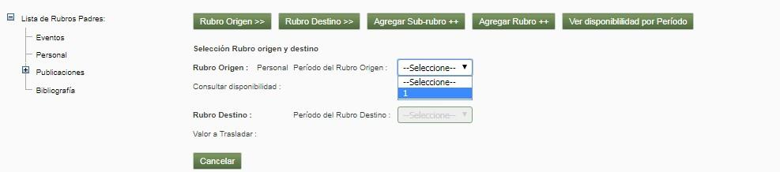
*Figura 30 - Adjuntar documento*

3. Valide que el archivo cargado aparezca listado en la tabla de la pestaña *Adjuntar Documento*.

---

### 2.6 Enviar solicitud

Presione el botón **ENVIAR** para radicar la solicitud formalmente ante el Centro de Investigación.

!!! info "Flujo de estados al enviar"
> - **Caso General**: La solicitud llega directamente al Centro de Investigación en estado **Pendiente de Aval** para que el Jefe de Centro la revise y tramite el aval del Comité Técnico.
> - **Caso Firma de Coordinador**: Si el acta de inicio original fue firmada por el Coordinador del grupo, al enviar la solicitud el sistema la dejará primero en estado **Pendiente de firma**, para que el coordinador ingrese al SIIU y estampe su firma electrónica. Una vez firmada por este, pasará a *Pendiente de Aval*.

Al presionar el botón **ENVIAR**, el sistema mostrará el mensaje de confirmación: *"Enviado exitosamente"* en la parte superior de la ventana. (Ver figura 31).

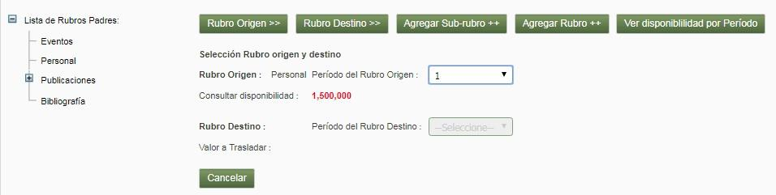
*Figura 31 - Enviar solicitud*

---

### 2.7 Editar Solicitud

Antes de enviar la solicitud administrativa, esta puede ser editada en caso de que se haya cerrado la sesión por inactividad o se requiera completar en otro momento:

1. Ingrese por la opción: `Trámites administrativos / Seguimiento Solicitudes y novedades`. (Ver figura 32).

*Figura 32 - Editar solicitud*

2. El sistema abre el formulario de búsqueda con los siguientes campos: (Ver figura 33).

| Campo | Detalle |
| :--- | :--- |
| **Centro administrativo** | Seleccione el centro al que pertenece el proyecto. |
| **Tipo de trámite** | Seleccione la solicitud administrativa a editar (*Cambio Rubro*). |
| **Tipo Solicitud** | Seleccione si es *Interna* o *Novedad*. |
| **Estado** | Seleccione el estado **En edición** (solicitudes guardadas antes de enviar al centro). |
| **Código o nombre del proyecto** | Ingrese el código o nombre del proyecto. |
| **Rango de fecha inicial** | Seleccione la fecha inicial de creación. |
| **Rango de fecha final** | Seleccione la fecha final de creación. |

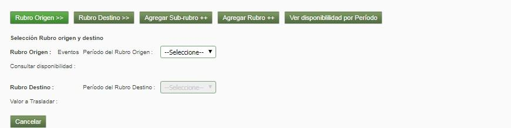
*Figura 33 - Filtro de búsqueda para editar*

3. Presione **Consultar**, seleccione el proyecto en la lista de resultados y continúe con el registro hasta terminar y enviar la solicitud.

---

## 3. Nota de cambio

- No aplica para la primera versión.

---

## Registro de Control y Firmas

| Rol | Nombre | Cargo / Dependencia | Fecha |
| :--- | :--- | :--- | :--- |
| **Elaboró** | Sandra Patricia Zabala Orrego | Contratista, Vicerrectoría Investigación | 16-FEB-2024 |
| **Elaboró** | Mauricio Toro Torres | Profesional 1, Vicerrectoría Investigación | 16-FEB-2024 |
| **Revisó** | Kerlin Yohana Bedoya Agudelo | Analista de Procesos, División de Arquitectura de Procesos | 29-ABR-2024 |
| **Aprobó** | Gloria Valencia Bustamante | Asistente, Vicerrectoría de Investigación | 29-ABR-2024 |
