# GUÍA PARA LA MATRÍCULA DE PROYECTOS EN CONVOCATORIA EN EL SIIU

!!! note "Información de Control Documental"
> **Código**: VI-GU-24  
> **Versión**: 01 / 29-ABR-2024  
> *Aviso legal institucional*: La impresión o copia digital de este documento se considera "COPIA NO CONTROLADA". Solo se garantiza la actualización de la documentación en el sitio oficial `http://www.udea.edu.co`.

---

## Contenido

1. [Definición](#1-definición)
2. [Contenido](#2-contenido)
   - 2.1. [Requisitos para la matrícula de proyectos de convocatoria](#21-requisitos-para-la-matrícula-de-proyectos-de-convocatoria)
   - 2.2. [Usuarios que intervienen en el proceso](#22-usuarios-que-intervienen-en-el-proceso)
   - 2.3. [Ingreso al SIIU](#23-ingreso-al-siiu)
   - 2.4. [Matrícula proyectos en convocatorias](#24-matrícula-proyectos-en-convocatorias)
     - 2.4.1. [Pestaña Información General](#241-pestaña-información-general)
     - 2.4.2. [Pestaña Descripción – Cronograma](#242-pestaña-descripción--cronograma)
     - 2.4.3. [Pestaña Presupuestal](#243-pestaña-presupuestal)
     - 2.4.4. [Pestaña Participantes](#244-pestaña-participantes)
     - 2.4.5. [Pestaña Compromisos y Condiciones](#245-pestaña-compromisos-y-condiciones)
     - 2.4.6. [Pestaña Documento Soporte](#246-pestaña-documento-soporte)
     - 2.4.7. [Retomar el registro del proyecto](#247-retomar-el-registro-del-proyecto)
     - 2.4.8. [Pestaña Enviar](#248-pestaña-enviar)
   - 2.5. [Verificación](#25-verificación)
3. [Nota de cambio](#3-nota-de-cambio)
4. [Registro de Control y Firmas](#registro-de-control-y-firmas)

---

## 1. Definición

Este documento se ha elaborado con el fin de ayudar y capacitar los investigadores principales, los cuales registran en el Sistema de Información para la Investigación Universitaria – SIIU los proyectos en convocatoria para la oportuna gestión del proyecto. Dado lo anterior se aclara que esta guía no hace parte de la normativa universitaria y solamente se debe utilizar como una herramienta que orienta los pasos que se debe seguir para la matrícula de proyectos al SIIU.

---

## 2. Contenido

### 2.1. Requisitos para la matrícula de proyectos de convocatoria

- El investigador principal o coordinador de proyecto debe estar registrado en el portal institucional.
- El usuario debe tener acceso a SIIU.

---

### 2.2. Usuarios que intervienen en el proceso

- **Usuario con rol Investigador Principal o Coordinador de Proyecto**.

---

### 2.3. Ingreso al SIIU

El investigador principal o coordinador de proyecto debe autenticarse en el portal de la Universidad de Antioquia, `http://www.udea.edu.co`, buscar la opción aplicaciones y entre ellas elegir el SIIU, así:

1. Ingresa al portal de la Universidad: `http://www.udea.edu.co`, en el encabezado seleccione **Ingresar >> Iniciar sesión** (Ver figura 1).

   
   *Figura 1 - Ingreso al portal de la Universidad de Antioquia*

2. Aparece pantalla para ingresar su usuario y contraseña, seleccione *No soy un Robot* (el sistema le puede pedir realizar validaciones) finalmente presione clic en el botón **CONECTAR**. (Ver figura 2).

   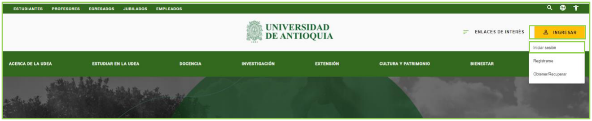
   *Figura 2 - Conectar al portal*

3. Presione clic en la opción **Enlaces de Interés** y seleccione **Mis aplicaciones**, así: `Enlaces de interés → Mis aplicaciones` (Ver figura 3).

   
   *Figura 3 - Enlaces de interés*

4. Se abrirá una ventana con las aplicaciones de la Universidad; seleccione **SIIU**. (Ver figura 4).

   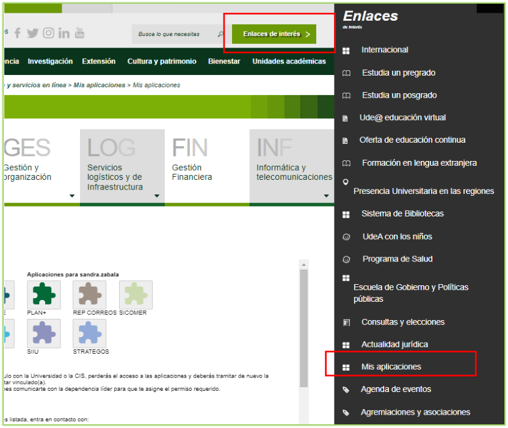
   *Figura 4 - Seleccione SIIU*

!!! note "> Se abre una nueva ventana con la aplicación SIIU. Si la ventana no abre inmediatamente, es necesaria la configuración de ventanas emergentes en el navegador y seleccionar la opción que autorice el SIIU."

---

### 2.4. Matrícula proyectos en convocatorias

Estando en el aplicativo SIIU, ingrese al menú **Convocatorias** y seleccione la opción **Nuevos proyectos**. (Ver figura 5).

*Figura 5 - Menú para matrícula de proyectos*

El tren de datos de la inscripción para proyectos en convocatorias consta de 7 secciones:
1. *Información general*
2. *Descripción cronograma*
3. *Presupuestal*
4. *Participantes*
5. *Compromisos y condiciones*
6. *Documento soporte*
7. *Enviar*

---

#### 2.4.1. Pestaña Información General

El sistema abre el nuevo formulario llamado **Información general**. Ingrese la información para cada campo solicitado, teniendo en cuenta elegir la opción **Convocatoria**, y luego indicar la convocatoria a la que desea matricular el proyecto. (Ver figura 6).

| Campos | Detalle |
| :--- | :--- |
| **Matrícula de** | Proyecto |
| **Clase de proyecto** | Proyecto |
| **Tipo de proyecto** | Investigación |
| **Clasificación** | Básica o aplicada |
| **Opción de matrícula** | Convocatoria |
| **Convocatoria** | Elija la convocatoria en que desea matricular el proyecto |
| **Modalidad** | Seleccione la modalidad de la convocatoria |
| **Centro administrativo** | Centro que administra el proyecto |
| **Nombre corto** | Nombre corto del proyecto |
| **Nombre completo** | Nombre largo o completo del proyecto |
| **Palabras clave** | Indique palabras clave |
| **Seccional** | Elija seccional |
| **Lugar de ejecución** | Indique lugar de ejecución |
| **Duración** | Asigne duración al proyecto (meses) |
| **Responsable** | El sistema coloca la información automáticamente |

*Figura 6 - Información general*

Presione el botón **Guardar** para que el sistema le asigne código al proyecto que está creando.

!!! info "> Es importante que tenga a mano el número del proyecto asignado por el sistema, ya que lo va a necesitar en otros momentos.  "
> **Una vez se guarde la información, esta no podrá ser modificada en la primera pestaña.**

Presione el botón **Siguiente** y continúe con el próximo formulario.

---

#### 2.4.2. Pestaña Descripción – Cronograma

Esta opción se divide en dos pestañas: **Descripción** y **Cronograma**. (Ver figura 7).

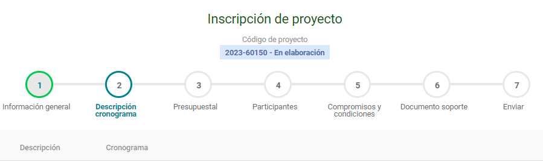
*Figura 7 - Descripción _ cronograma*

##### A. Subpestaña Descripción
En esta opción se ingresa la información académica y metodológica requerida para los proyectos de convocatorias, de acuerdo con los términos de referencia que fueron configurados previamente. Presione los tres puntos que aparecen en las descripciones para editar. (Ver figura 8).

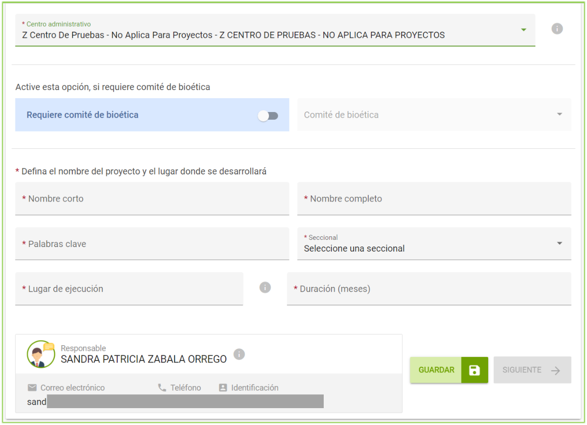
*Figura 8 - Descripciones*

El sistema abre una ventana con un editor de texto enriquecido (HTML) para ingresar la información. Para guardar presione el icono de guardado (disco) y luego presione el botón **Cerrar**. (Ver figura 9).

*Figura 9 - Editar descripciones*

- **Agregar nueva descripción**: Si requiere agregar una nueva descripción, presione la opción **Agregar descripción**. El sistema abre una ventana; agregue el nuevo título y presione el botón **Guardar título**. (Ver figura 10). Una vez almacenado, el sistema le permite editar el contenido.

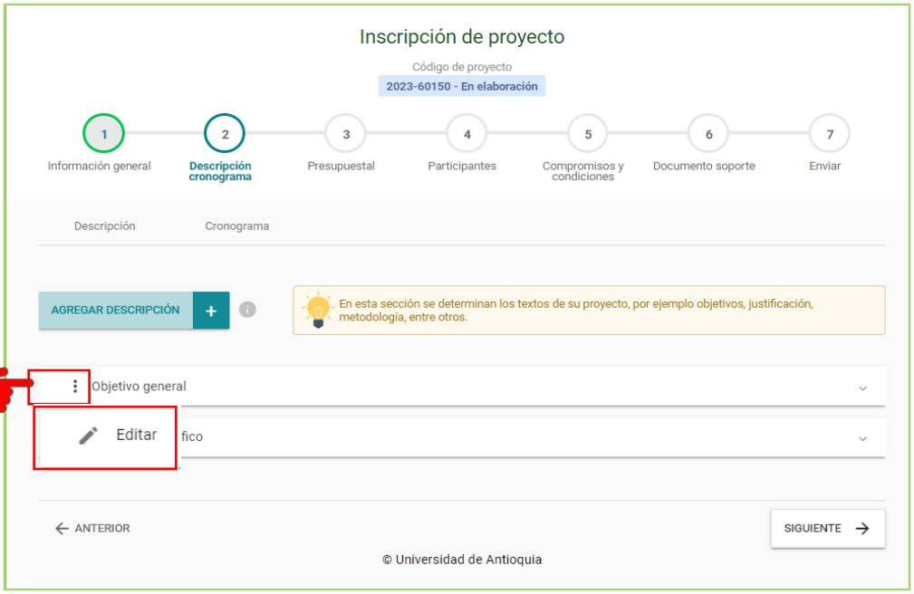
*Figura 10 - Agregar descripción*

!!! tip "Uso de imágenes y cuadros en las descripciones"
> Si requiere insertar alguna imagen o cuadro en los campos descriptivos, puede consultar el *Manual uso CK Editor* disponible en el portal institucional:  
> `https://www.udea.edu.co/.../manual-ckeditor.pdf`

##### B. Subpestaña Cronograma
Esta opción permite configurar la planeación temporal de las actividades del proyecto y visualizar el cronograma de Gantt. Presione **Agregar actividad**. (Ver figura 11).

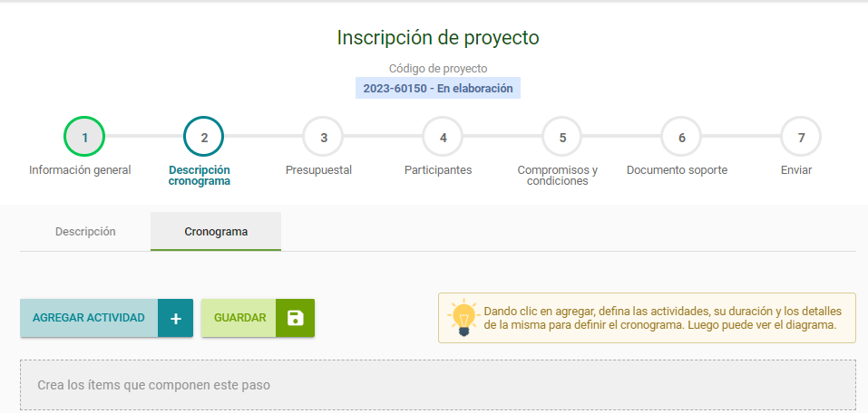
*Figura 11 - Agregar actividad _ cronograma*

El sistema despliega una ventana emergente con los siguientes campos:

| Campo | Detalle |
| :--- | :--- |
| **Actividad** | Ingrese la actividad del proyecto (obligatorio). |
| **Detalle** | Campo opcional. |
| **Inicio** | Ingrese el mes de inicio de la actividad (número de mes desde el inicio). |
| **Fin** | Ingrese el mes de final de la actividad. |

!!! warning "> Importante: La duración de las actividades **No debe pasar el tiempo total de duración del proyecto**."

Presione **Agregar actividad** para terminar el registro. Realice la misma acción por todas las actividades que desee configurar. (Ver figura 12).

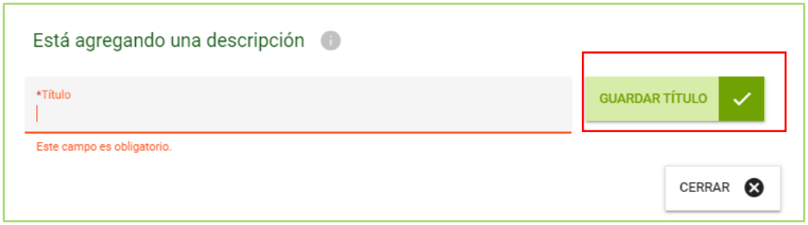
*Figura 12 - Agregar actividad*

---

#### 2.4.3. Pestaña Presupuestal

En esta pestaña encontrará las entidades que financian el proyecto (en recursos frescos o en especie), podrá agregar nuevos aportantes como cofinanciadores en la subpestaña **Cofinanciadores**, y configurar los montos por rubro en la subpestaña **Presupuesto**. (Ver figura 13).

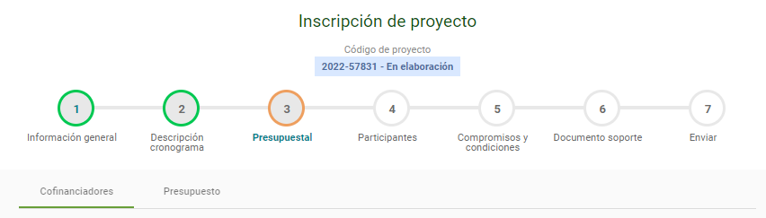
*Figura 13 - Pestaña presupuestal*

##### A. Subpestaña Cofinanciadores
Si una dependencia de la Universidad o un tercero va a aportar recursos frescos al proyecto, presione **Agregar cofinanciador**; el sistema despliega las opciones de *Financiador* o *Grupo*. (Ver figura 14).

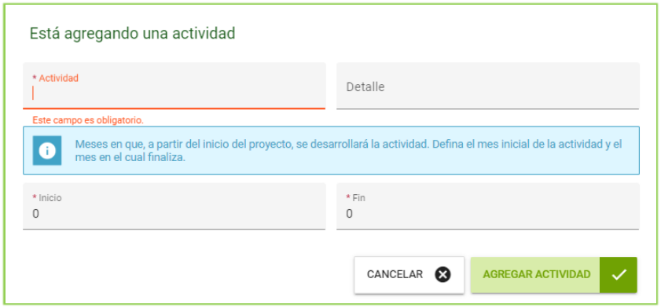
*Figura 14 - Agregar financiador o grupo*

- **Agregar financiador Nacional o Internacional**:
  - Si el financiador es interno, digite el NIT del financiador.
  - Si el financiador es externo, busque por NIT o palabra clave, seleccionando si es Nacional o Internacional. (Ver figura 15).

  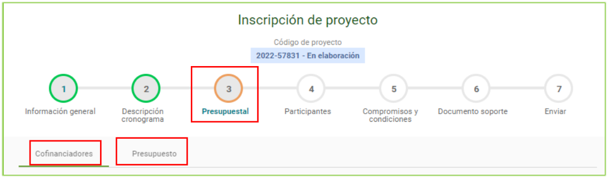
  *Figura 15 - Aportante Financiador*

- **Aportante tipo Grupo**: Ingrese la palabra clave del grupo y presione buscar. (Ver figura 16).

  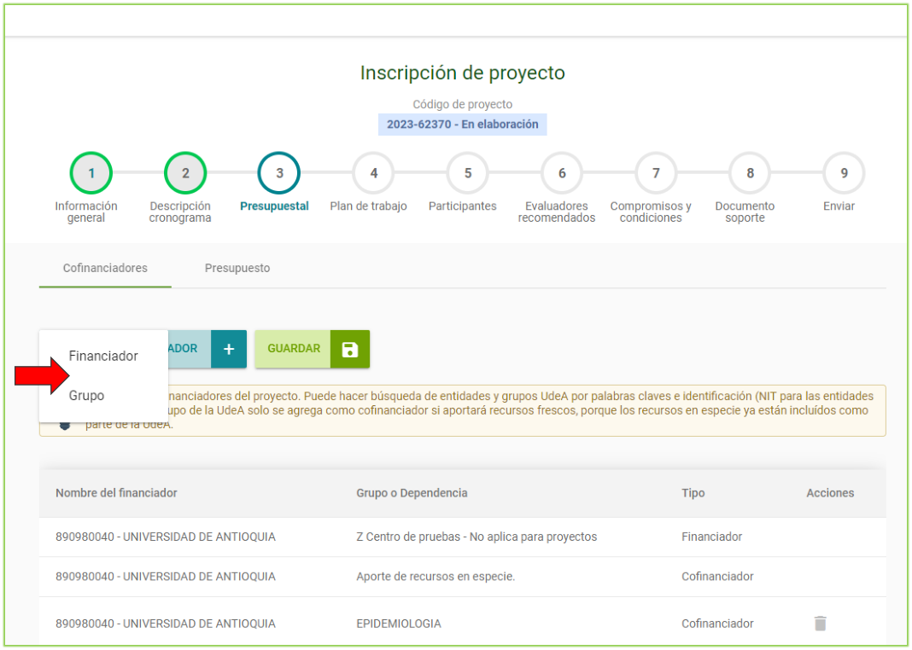
  *Figura 16 - Aportante grupo*

Verifique en la lista consolidada que los aportantes queden categorizados correctamente (Financiador principal y Cofinanciadores). (Ver figura 17).

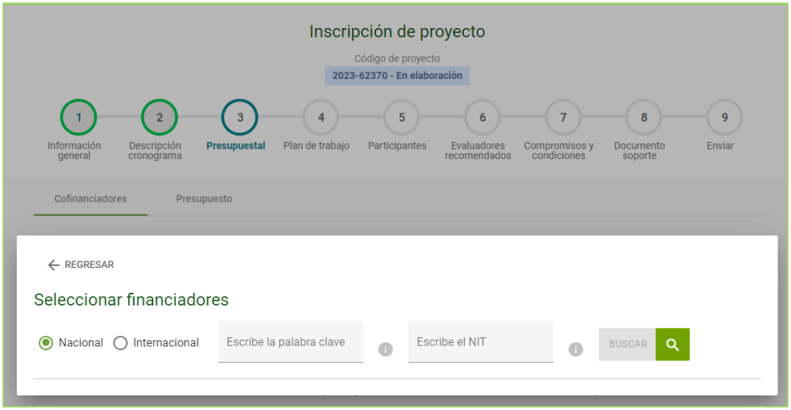
*Figura 17 - Aportante grupo y financiador*

!!! caution "Cuidado con los datos tributarios (NIT)"
> Por favor abstenerse de colocar valores errados en el campo NIT:
> - Para aportantes nacionales, todos tienen NIT; debe buscarlo y garantizar que ingrese los valores correctos.
> - Para aportantes internacionales que no cuenten con NIT o identificación tributaria, **solicite a la Vicerrectoría el registro** para que sea creado adecuadamente en el sistema.

**Matricular un financiador que NO existe en el SIIU**:
Si al buscar el NIT este no existe, presione el botón **Registrar financiador**. (Ver figura 18).

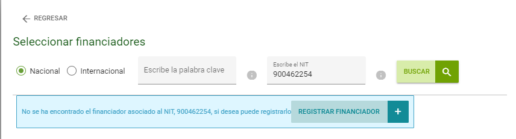
*Figura 18 - Financiador no existe*

El sistema abre el formulario de registro: complete NIT, Razón social, Contacto y Dirección, y presione **REGISTRAR FINANCIADOR**. (Ver figuras 19 y 20).

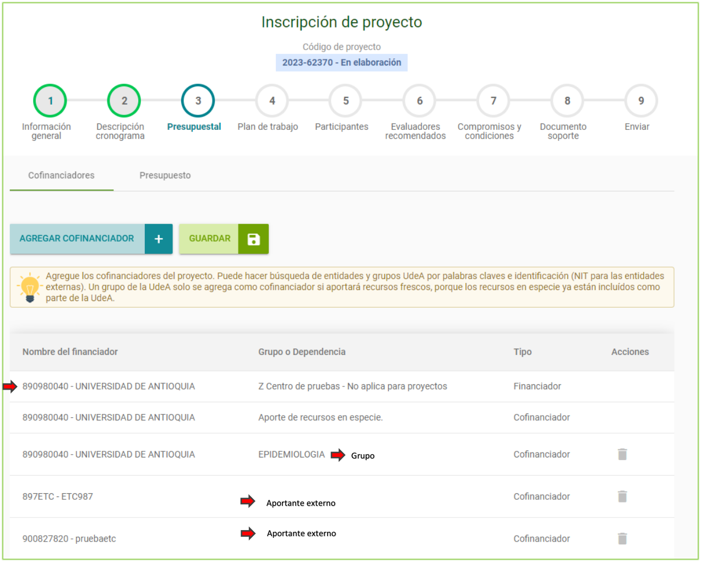
*Figura 19 - Nueva persona jurídica*

*Figura 20 - Agregar nuevo financiador*

##### B. Subpestaña Presupuesto
Permite ingresar los valores por cada rubro presupuestal tanto en recurso fresco como en especie. (Ver figura 21).

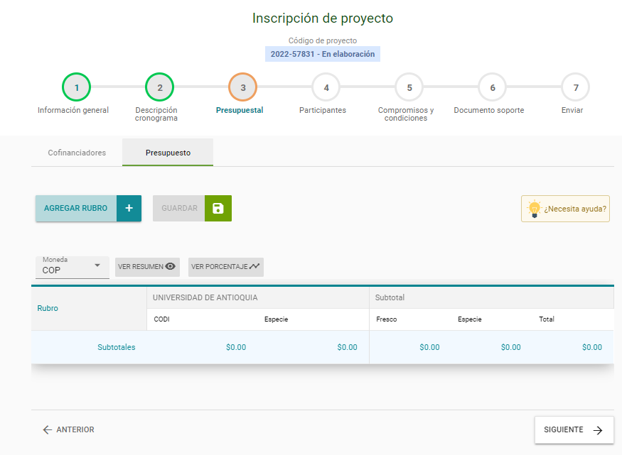
*Figura 21 - Subpestaña presupuesto*

1. Presione el botón **Agregar rubro**; el sistema abre la ventana con la lista desplegable de rubros definidos en la convocatoria. Seleccione el rubro y presione **Aceptar**. (Ver figuras 22 y 23).

   
   *Figura 22 - Lista de rubros*

   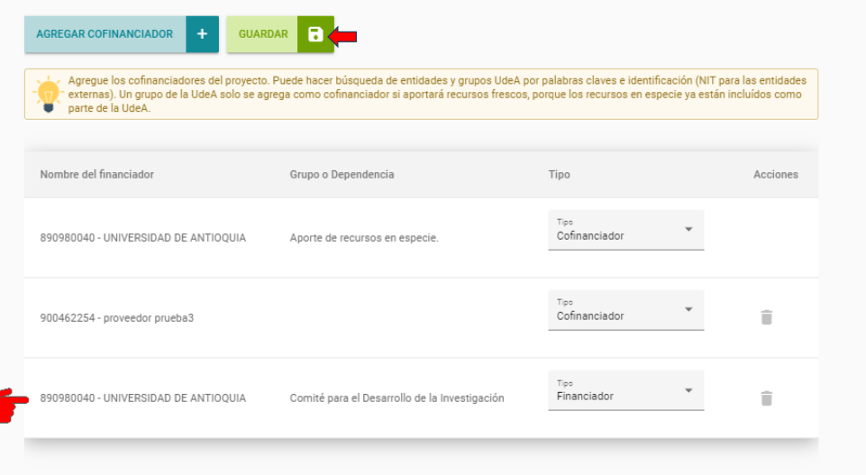
   *Figura 23 - Lista de rubros desplegada*

2. Ingrese justificación si lo considera necesario y presione **AGREGAR RUBRO**. (Ver figura 24).

   
   *Figura 24 - Agregar rubros*

!!! note "Criterios Presupuestales Clave"
> - **Rubro Personal**: Corresponde al valor de las horas salariales que la Universidad le autoriza a cada investigador para trabajar en el proyecto; estos recursos se registran como **dinero en especie**.
> - **Rubro Administración**: El porcentaje sale de la totalidad de los rubros ejecutables en el proyecto y debe estar incluido en el valor total solicitado al CODI.

3. Al presionar *Agregar Rubro*, el sistema permite ingresar los valores monetarios por cada aportante. Seleccione la moneda en **pesos colombianos - COP** y finalice con el botón **GUARDAR**. (Ver figura 25).

   
   *Figura 25 - Insertar rubro*

4. **Creación de Subrubros**:
   - Posiciónese en el rubro padre y presione los tres puntos a la izquierda.
   - Elija **+ Agregar subrubro**. (Ver figura 26).
   - Ingrese los valores discriminados y presione **Guardar**. (Ver figura 27).

   !!! info "Reglas de los Subrubros:"
   > 1. El valor del rubro padre es la sumatoria de sus subrubros.
   > 2. Cuando un rubro tenga subrubro, los valores monetarios se ingresan exclusivamente en los subrubros, no en el rubro padre.
   > 3. El rubro Administración debe estar contemplado en el monto total solicitado al CODI.
   > 4. Recordar seleccionar la denominación COP.

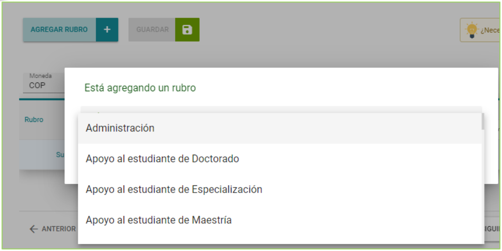
*Figura 26 - Agregar subrubro*

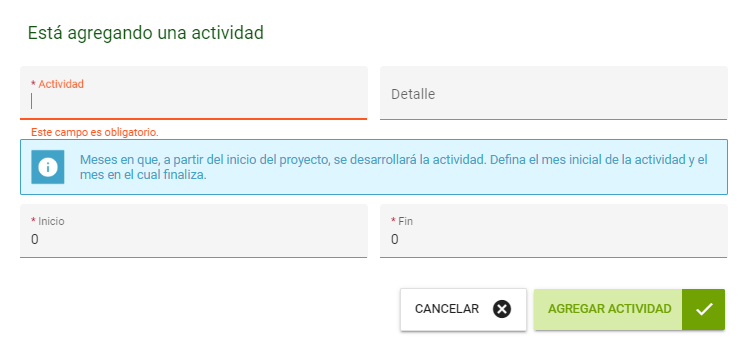
*Figura 27 - Definir valores subrubro*

---

#### 2.4.4. Pestaña Participantes

En esta pestaña podrá agregar los participantes que harán parte del proyecto (personal interno y externo). (Ver figura 28).

!!! note "Participantes Indeterminados"
> Son aquellos que se matriculan en el proyecto para identificar un rol o cupo que está pendiente por asignar a una persona en particular.

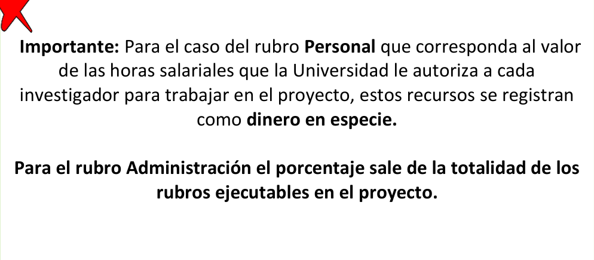
*Figura 28 - Opción participantes*

##### Registro del participante:
1. Presione **Agregar participante**. Por defecto aparece como indeterminado (sin nombre definido). (Ver figura 29).

   
   *Figura 29 - Agregar participante*

2. Presione **Seleccionar participante**, digite el documento en el campo *Identificación* y presione **Buscar**. (Ver figura 30).
3. Seleccione a la persona en la lista de resultados. (Ver figuras 31 y 32).

   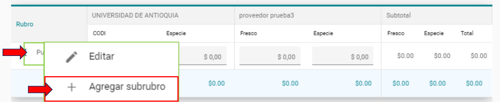
   *Figura 30 - Seleccionar participante*

   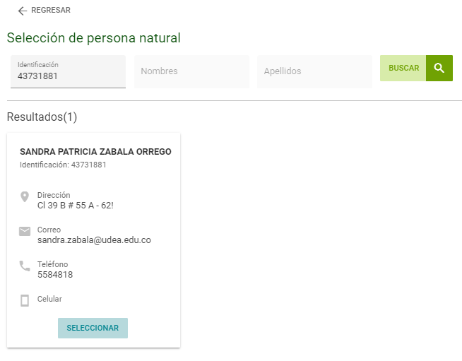
   *Figura 31 - Participante a seleccionar*

   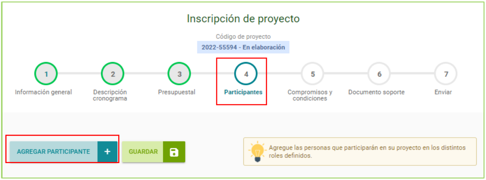
   *Figura 32 - Agregar participante seleccionado*

4. **Institución del participante**:
   - Presione **SELECCIONAR INSTITUCIÓN**, busque por NIT y presione **Agregar**. (Ver figuras 33 y 34).

   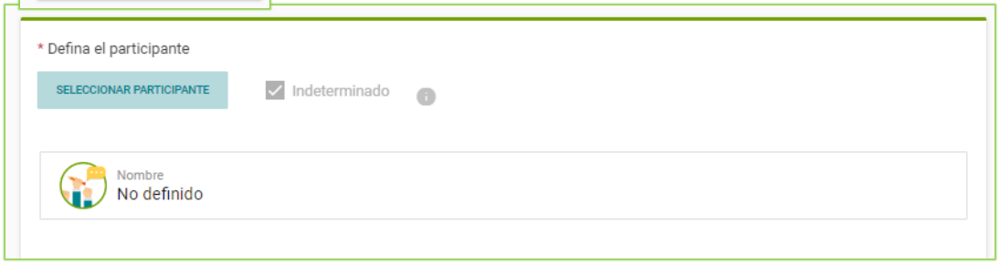
   *Figura 33 - Agregar institución*

   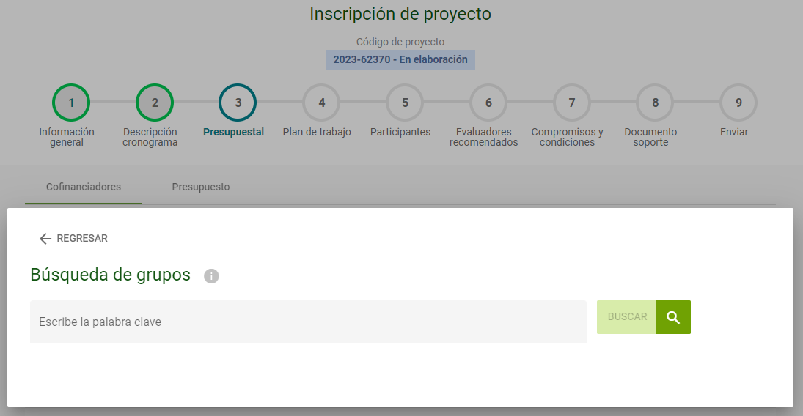
   *Figura 34 - Institución adjunta*

5. **Seleccionar grupo de investigación**:
   - Presione el botón **BUSCAR GRUPO**. Seleccione el grupo correspondiente al proyecto. (Ver figura 35).

   
   *Figura 35 - Seleccionar grupo*

6. **Definir rol, dedicación y funciones**: (Ver figura 36).

| Rol del participante | Detalle del diligenciamiento |
| :--- | :--- |
| **Indeterminado** | Verifique que tenga la opción *Indeterminado* activa y continúe el registro. |
| **Estudiante** | El sistema solicitará Facultad y programa académico. |
| **Docente vinculado** | El sistema habilitará las horas tanto *por dentro* como *por fuera* del plan de trabajo. |
| **Docente cátedra, externo y estudiante** | El sistema habilitará únicamente las horas *por fuera* del plan de trabajo. |
| **Participantes extranjeros** | Debe tener el número de identificación real que corresponde; evite colocar datos ficticios. |

!!! info "Recomendaciones de Talento Humano"
> - Valide que al ingresar el documento no queden espacios en blanco al inicio o al final.
> - Si un participante vinculado a la Universidad no aparece en la búsqueda, valide primero con Talento Humano que tenga contrato vigente; si el contrato está en trámite, puede matricularse transitoriamente como indeterminado.

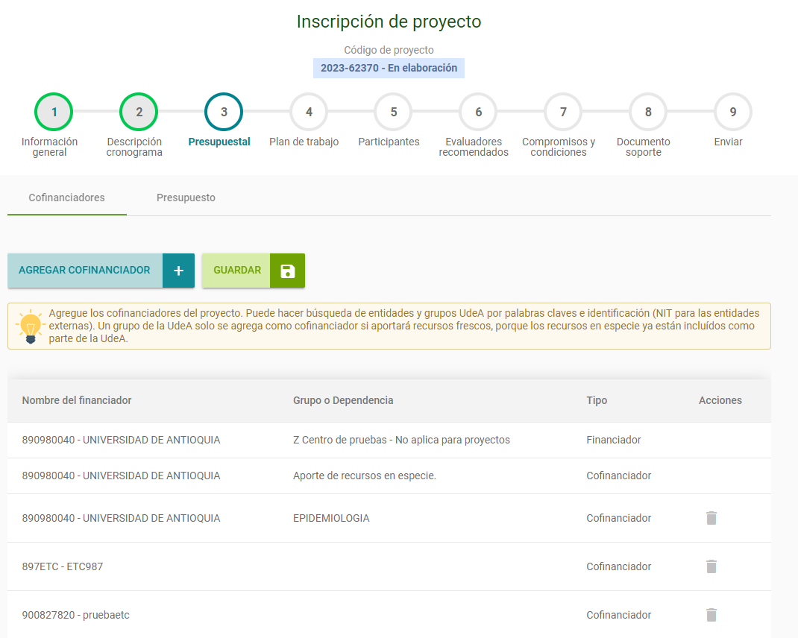
*Figura 36 - Vínculo, rol, dedicación horaria y funciones del participante*

---

#### 2.4.5. Pestaña Compromisos y Condiciones

Continúa el proceso en la pestaña **Compromisos y condiciones**. (Ver figura 37).

*Figura 37 - Compromisos y condiciones formales*

##### A. Subpestaña Compromisos
El sistema muestra los compromisos configurados en la convocatoria:
- **Compromisos obligatorios**: Definidos en los términos de referencia, son de obligatorio cumplimiento.
- **Compromisos opcionales**: Aquellos adicionales que se deseen asumir.  
  !!! warning "> Los compromisos opcionales que se registren se convierten formalmente en compromisos de obligatorio cumplimiento para el proyecto."

Si desea adicionar un compromiso opcional, presione **AGREGAR COMPROMISO**, ingrese el nombre y comentarios, y presione **AGREGAR COMPROMISO**. (Ver figuras 38, 39 y 40). En la columna acciones podrá editarlos o eliminarlos. Finalice con el botón **GUARDAR**.

*Figura 38 - Compromisos*

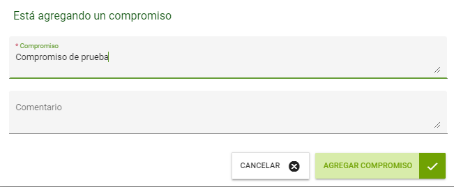
*Figura 39 - Agregar compromiso*

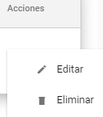
*Figura 40 - Compromisos opcionales*

##### B. Subpestaña Condiciones Formales
Las condiciones formales fueron definidas en los términos de referencia.
- Valide una a una las condiciones formales.
- En la columna *Cumplimiento*, elija entre: `Cumple`, `No cumple`, `No aplica`. (Ver figura 41).
- Seleccione la opción **Cumple** (o No aplica) para **TODAS** las condiciones y presione **GUARDAR**. (Ver figuras 42 y 43).

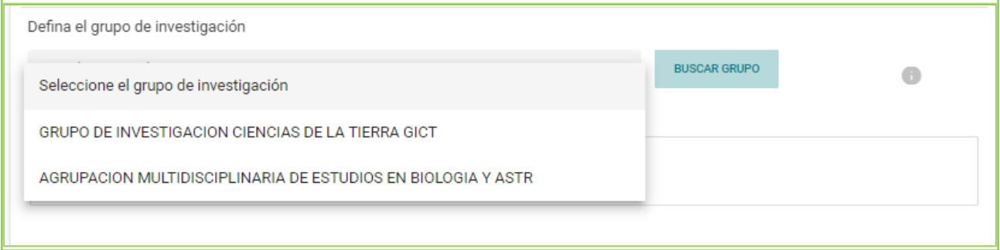
*Figura 41 - Condiciones formales*

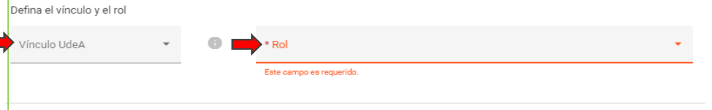
*Figura 42 - Cumple todas las condiciones*

*Figura 43 - Almacenamiento exitoso*

!!! caution "Bloqueo por No Cumplimiento"
> Todas las condiciones formales deben estar marcadas con *Cumple* o *No aplica*. Si alguna de las condiciones está marcada con **No cumple**, el sistema **NO** permitirá realizar el envío del proyecto.

---

#### 2.4.6. Pestaña Documento Soporte

En esta pestaña se adjuntan los documentos requeridos en la convocatoria (propuesta técnica detallada, avales éticos, cartas de cofinanciadores, aval de descarga horaria, etc.).

1. Ingrese a la pestaña *Documento Soporte* y presione el botón **Agregar documento soporte (+)**. (Ver figura 44).

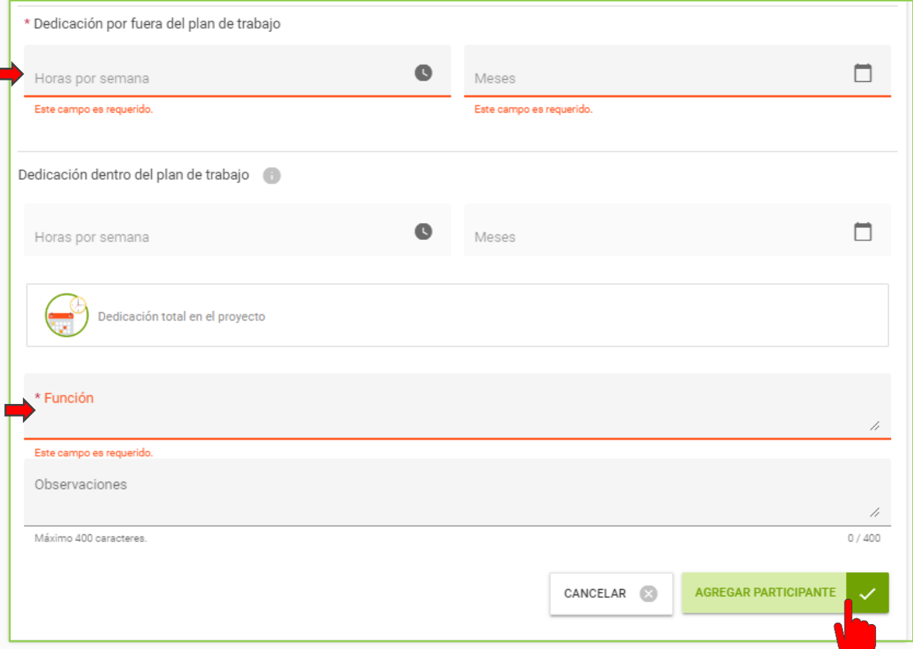
*Figura 44 - Pestaña Documento soporte*

!!! caution "Reglas para nombres de archivos"
> El nombre del archivo a adjuntar debe ser **corto, no exceder 30 caracteres, sin tildes ni caracteres especiales, y sin mayúscula sostenida**. Preferiblemente en formato **PDF**.

2. Diligencie los campos del formulario:

| Campo | Detalle |
| :--- | :--- |
| **Nombre documento** | Título del documento (ej: `Aval de descarga horaria`). |
| **Número** | Número asignado al documento por la dependencia (ej: `Oficio 2016_20085`). |
| **Emisor** | Entidad o dependencia emisora. |
| **Fecha de Emisión** | Fecha de expedición del documento. |
| **Tipo de documento** | Anexos de investigación, TDR o proceso de selección. |
| **Descripción** | Aclaraciones adicionales. |
| **Archivo** | Presione *Seleccionar archivo*, elija el documento y haga clic en *Adjuntar*. |

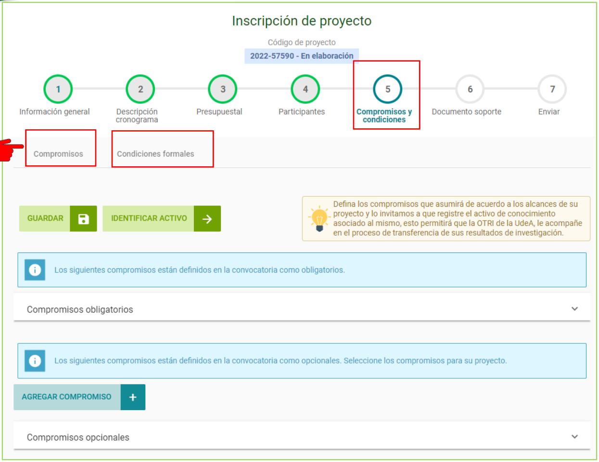
*Figura 45 - Documento Soporte*

3. Presione el botón **GUARDAR** para confirmar el archivo adjunto. (Ver figuras 46 y 47).
4. Para eliminar un documento soporte, haga clic sobre los tres puntos a la izquierda del documento y seleccione **Eliminar**. (Ver figura 48).

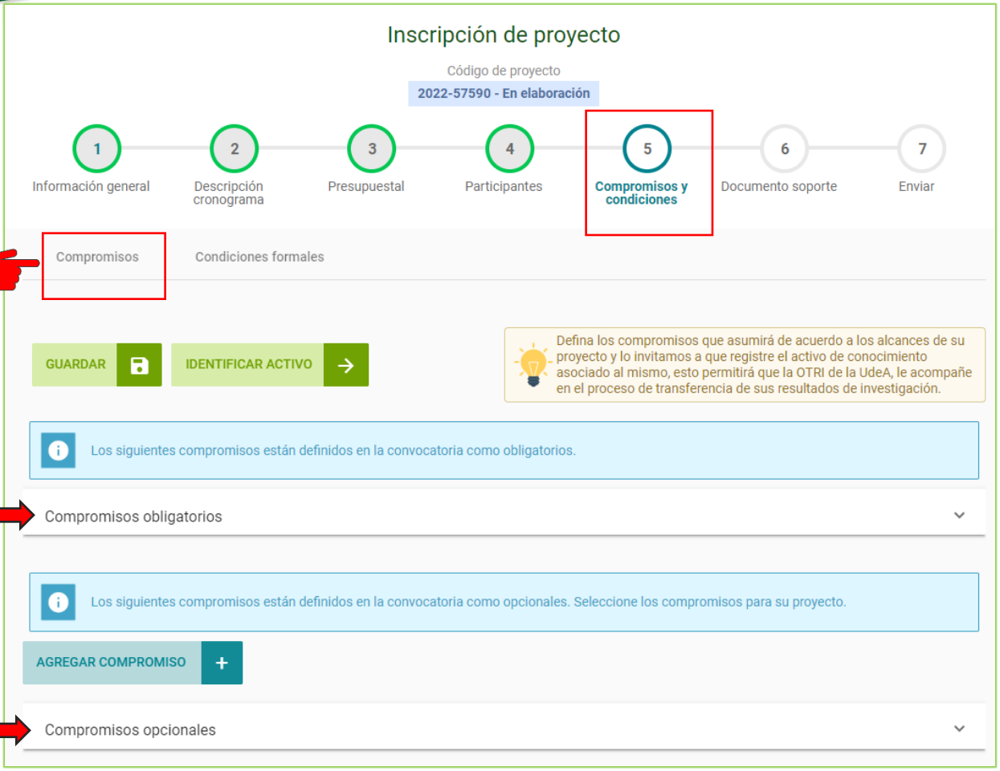
*Figura 46 - Resumen documento adjunto*

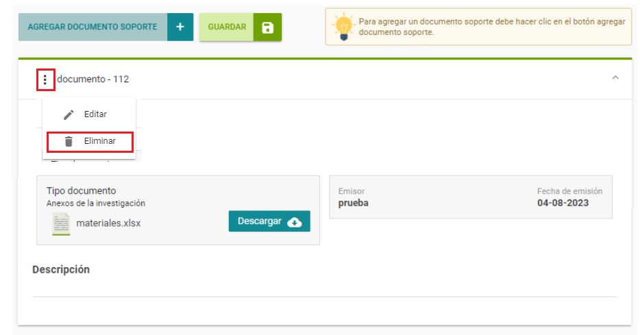
*Figura 47 - Eliminar documento*

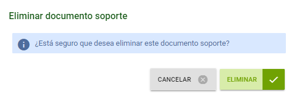
*Figura 48 - Mensaje de confirmación eliminar documento*

!!! tip "Problemas de carga por conectividad"
> Si experimenta problemas al subir un documento, guárdelo localmente con un nombre diferente e inténtelo de nuevo. Si persiste la dificultad, comuníquese con su Centro de Investigación o con la Vicerrectoría de Investigación.

---

#### 2.4.7. Retomar el registro del proyecto

Si sale del SIIU o se cierra la sesión por inactividad, podrá retomar el registro (siempre que la convocatoria permanezca abierta):
1. Ingrese a: `Convocatorias / Proyectos en proceso`. (Ver figura 49).
2. Ubique el proyecto en la lista o busque por código en el filtro. (Ver figura 50).
3. En la columna *Acciones*, presione los tres puntos y elija **Editar** para continuar. (Ver figura 51).

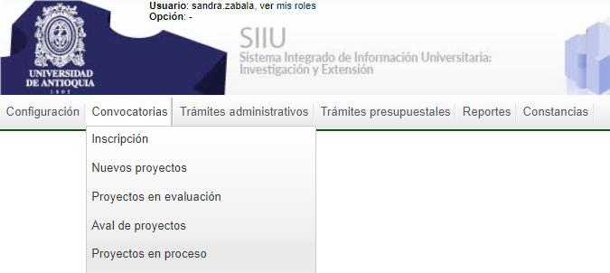
*Figura 49 - Proyectos en proceso*

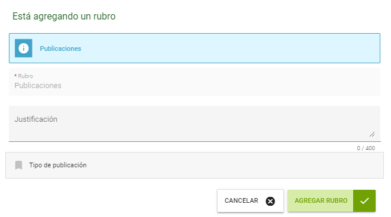
*Figura 50 - Consulta proyecto a editar*

*Figura 51 - Editar*

---

#### 2.4.8. Pestaña Enviar

Valide que el proyecto esté debidamente diligenciado y cumpla con todos los requisitos de los términos de referencia.

1. Diríjase a la pestaña **Enviar** y presione el botón **Enviar a centro**. (Ver figura 52).

   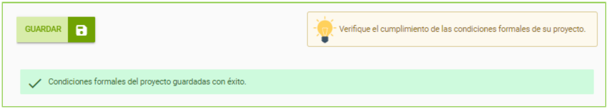
   *Figura 52 - Enviar a centro*

2. El sistema genera el mensaje de confirmación: *"Recuerde que al enviar el proyecto el centro ya no podrá realizar cambios a menos de que se lo permitan en el momento de la revisión. ¿Realmente desea enviar el proyecto?"*. Presione **ACEPTAR**. (Ver figura 53).

   
   *Figura 53 - Mensaje de alerta*

3. El sistema emite el mensaje oficial de radicación con el código asignado y la fecha/hora de envío, quedando el proyecto en estado **Matriculado**. (Ver figura 54).

   
   *Figura 54 - Mensaje de confirmación*

!!! warning "Validación de campos incompletos"
> Si alguna sección del tren de datos está incompleta o pendiente, el sistema **no permitirá el envío** y resaltará en color rojo la pestaña afectada (por ejemplo, cronograma o presupuesto incompleto). Corrija las secciones observadas y proceda a enviar nuevamente. (Ver figura 55).

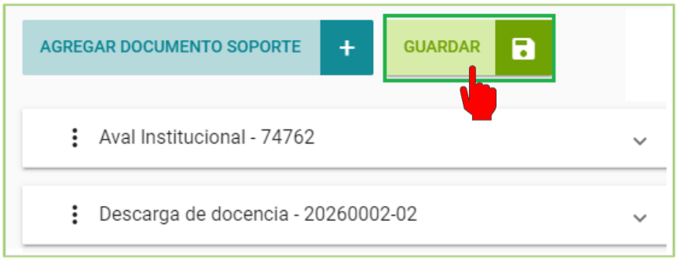
*Figura 55 - Ejemplo de proyecto incompleto*

---

### 2.5. Verificación

Para verificar formalmente que el proyecto fue presentado con éxito:
1. Ingrese al menú `Convocatorias >> Proyectos en proceso`.
2. En la lista de proyectos en curso, verifique que en la columna **Estado** el proyecto aparezca como **Matriculado**. (Ver figura 56).

!!! caution "Estado del Proyecto"
> Si el proyecto registrado aparece con un estado **DIFERENTE a Matriculado** (por ejemplo, *En elaboración*), su proyecto **NO ha sido enviado y por lo tanto NO ha sido presentado formalmente**.

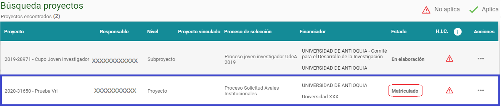
*Figura 56 - Confirmación Proyecto matriculado*

El Centro de Investigación asume la función de evaluar el proyecto. Si el Comité Técnico o los evaluadores solicitan ajustes, el proyecto podrá ser devuelto al Investigador Principal. En tal caso, puede consultarse el manual:  
`Manual Proyecto devuelto al IP para ajustes`

!!! note "> Todos los datos mostrados en las imágenes fueron tomados de proyectos y procesos usados para efectos de pruebas."

---

## 3. Nota de cambio

- No aplica para la primera versión.

---

## Registro de Control y Firmas

| Rol | Nombre | Cargo / Dependencia | Fecha |
| :--- | :--- | :--- | :--- |
| **Elaboró** | Sandra Patricia Zabala Orrego | Contratista, Vicerrectoría Investigación | 16-FEB-2024 |
| **Elaboró** | Lina María Ospina Pérez | Profesional 2, Vicerrectoría Investigación | 16-FEB-2024 |
| **Revisó** | Kerlin Yohana Bedoya Agudelo | Analista de Procesos, División de Arquitectura de Procesos | 29-ABR-2024 |
| **Aprobó** | Gloria Valencia Bustamante | Asistente, Vicerrectoría de Investigación | 29-ABR-2024 |
