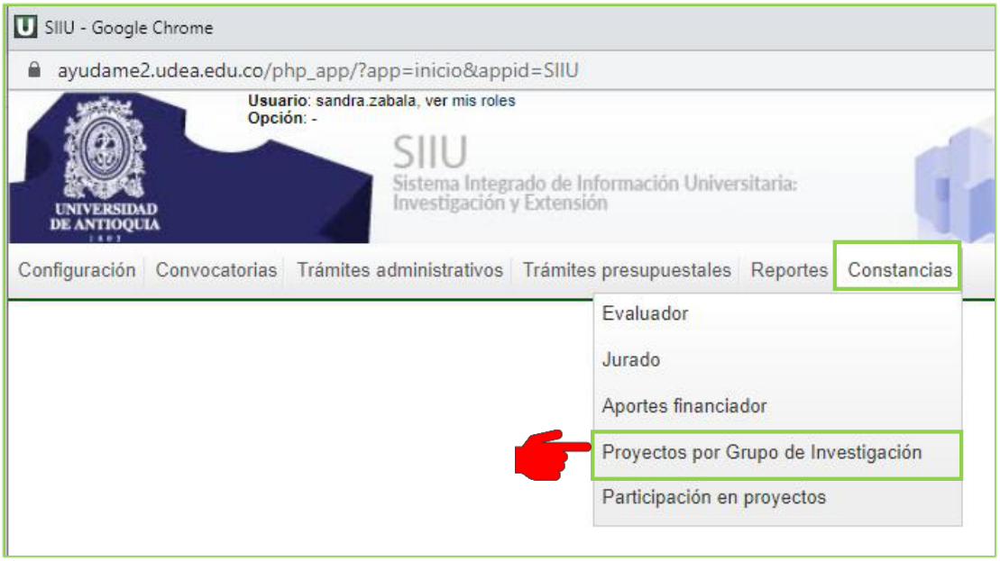
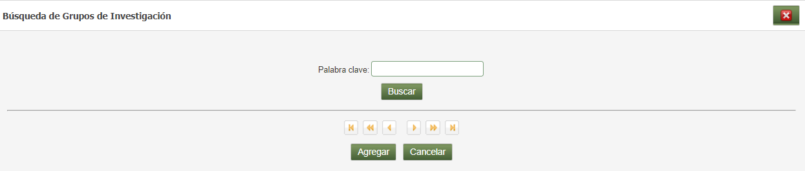
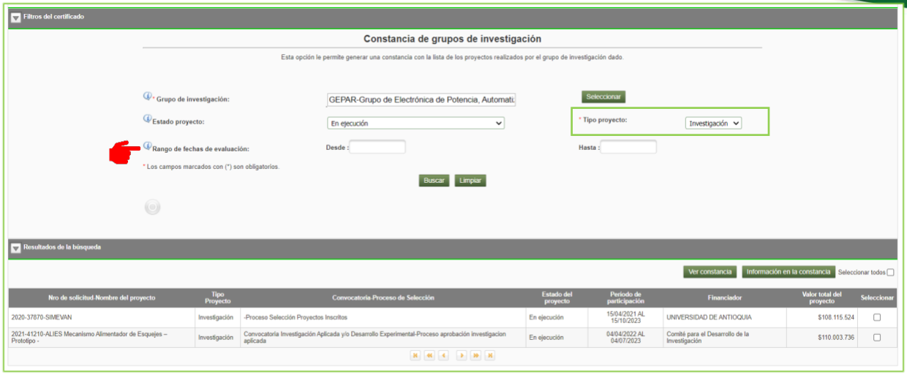
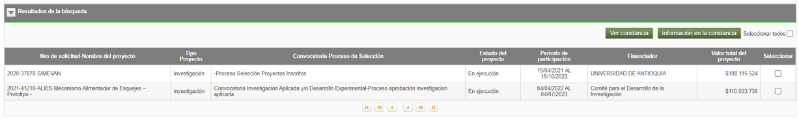

# INSTRUCTIVO PARA GENERAR CONSTANCIAS DE PROYECTOS POR GRUPOS DE INVESTIGACIÓN

!!! note "Información de Control Documental"
> **Código**: VI-IN-01  
> **Versión**: 01 / 13-MAR-2024  
> *Aviso legal institucional*: La impresión o copia magnética de este documento se considera "COPIA NO CONTROLADA". Solo se garantiza la actualización de la documentación en el sitio oficial `http://www.udea.edu.co`.

---

## Contenido

1. [Definición](#1-definicion)
2. [Contenido](#2-contenido)
   - 2.1. [Ingresar al SIIU](#21-ingresar-al-siiu)
   - 2.2. [Constancias de proyectos por grupos de investigación](#22-constancias-de-proyectos-por-grupos-de-investigacion)
3. [Nota de cambio](#3-nota-de-cambio)
4. [Registro de Control y Firmas](#registro-de-control-y-firmas)

---

## 1. Definición

El presente documento tiene como propósito ayudar y capacitar a los investigadores principales, los cuales generan el reporte de participación en los proyectos desde el Sistema de Información para la Investigación Universitaria – SIIU. Dado lo anterior se aclara que este instructivo no hace parte de la normativa universitaria y solamente se debe utilizar como una herramienta que indica el paso a paso que se debe seguir para generar constancias de proyectos por grupos de investigación.

---

## 2. Contenido

### Requisitos para la generación de constancia por grupo de investigación
- El investigador principal, responsable del proyecto o usuario centro de investigación, debe estar registrado en el portal institucional.
- El usuario debe tener acceso a SIIU.

### Usuarios que intervienen en el proceso
- Usuario que pertenece a un grupo de investigación (Investigador Principal, coinvestigador o usuario de centro).

---

### 2.1. Ingresar al SIIU

El usuario con rol de IP o de centro de investigación debe autenticarse en el portal de la Universidad de Antioquia, `http://www.udea.edu.co`, buscar la opción aplicaciones y entre ellas elegir el SIIU, así:

1. Ingresa al portal de la Universidad: `http://www.udea.edu.co`, en el encabezado seleccione **Ingresar >> Iniciar sesión** (ver Figura 1).

   
   *Figura 1- Ingreso al portal de la Universidad de Antioquia*

2. Aparece pantalla para ingresar su usuario y contraseña, seleccione *No soy un Robot* (el sistema le puede pedir realizar validaciones) finalmente presione clic en el botón **CONECTAR**. (Ver figura 2).

   
   *Figura 2 - Conectar al portal*

3. Presione clic en la opción **Enlaces de Interés** y seleccione **Mis aplicaciones**, así: `Enlaces de interés → Mis aplicaciones`. (Ver figura 3).

   
   *Figura 3 - Enlaces de interés*

4. Se abrirá una ventana con las aplicaciones de la Universidad; seleccione **SIIU**. (Ver figura 4).

   
   *Figura 4 - Seleccione SIIU*

!!! note "> Se abre una nueva ventana con la aplicación SIIU (Ver figura 5). Si la ventana no abre inmediatamente, es necesaria la configuración de ventanas emergentes en el navegador y seleccionar la opción que autorice el SIIU."

---

### 2.2. Constancias de proyectos por grupos de investigación

Una vez se encuentre en el SIIU:
1. Ingrese al menú **Constancias / Proyectos por Grupo de Investigación**. (Ver figura 5).

*Figura 5 - Menú constancia participación en proyectos*

2. El sistema abre el formulario denominado *Constancia de grupos de investigación* (permite generar una constancia con la lista de los proyectos realizados por el grupo de investigación dado).
3. Presione el botón **Seleccionar**. (Ver figura 6).

*Figura 6 - Botón seleccionar*

4. El sistema abre una ventana emergente para buscar el grupo:
   - Ingrese el nombre o la sigla del grupo de investigación en el campo **Palabra clave** (por ejemplo: `gepar`).
   - Presione el botón **Buscar**. (Ver figura 7).

*Figura 7 - Consultar grupo de investigación*

5. El sistema trae la información del grupo consultado:
   - Seleccione con un check el grupo deseado en la columna *Selección*.
   - Presione el botón **Agregar**. (Ver figura 8).

*Figura 8 - Grupo consultado*

6. Configure los parámetros de filtrado:
   - **Estado proyecto**: Seleccione el estado (por ejemplo: *En ejecución*, *Terminado*, etc.).
   - **Tipo proyecto**: Seleccione el tipo de proyecto (*Investigación*, *Extensión*, etc.).
   - **Rango de fechas de evaluación** (*Desde / Hasta*): Campo opcional. (Ver figura 9).

   !!! tip "Histórico completo"
   > Si no selecciona un rango de fechas, el sistema generará automáticamente un **histórico completo** de la participación del grupo en proyectos.

*Figura 9 - Estado y tipo de proyecto*

7. Presione el botón **Buscar**.
8. El sistema muestra la tabla con la lista de proyectos que cumplen con los criterios de búsqueda (Número de solicitud/Nombre del proyecto, Tipo de Proyecto, Convocatoria/Proceso de Selección, Estado del proyecto, Período de participación, Financiador, Valor total del proyecto). (Ver figura 10).

*Figura 10 - Consulta constancia*

9. Para visualizar y descargar el reporte, marque los proyectos y presione el botón **Ver constancia**. (Ver figura 11).

*Figura 11 - Ver constancia*

10. El sistema genera la constancia institucional como reporte oficial en **formato PDF**, el cual puede descargarse o imprimirse.

---

## 3. Nota de cambio

- No aplica para la primera versión.

---

## Registro de Control y Firmas

| Rol | Nombre | Cargo / Dependencia | Fecha |
| :--- | :--- | :--- | :--- |
| **Elaboró** | Sandra Patricia Zabala Orrego | Contratista, Vicerrectoría de Investigación | 16-FEB-2024 |
| **Elaboró** | Lina María Ospina Pérez | Product Owner SIIU, Vicerrectoría de Investigación | 16-FEB-2024 |
| **Revisó** | Kerlin Yohana Bedoya Agudelo | Analista de Procesos, División de Arquitectura de Procesos | 12-MAR-2024 |
| **Revisó** | Julio César García Castrillón | Analista de Procesos, División de Arquitectura de Procesos | 12-MAR-2024 |
| **Aprobó** | Gloria Valencia Bustamante | Asistente, Vicerrectoría de Investigación | 13-MAR-2024 |
