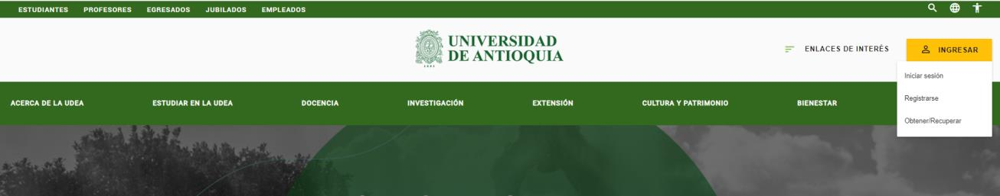
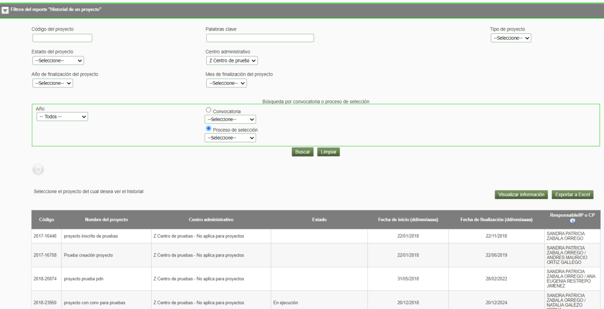

# INSTRUCTIVO PARA GENERAR REPORTE HISTORIAL DE PROYECTOS

!!! note "Información de Control Documental"
> **Código**: VI-IN-02  
> **Versión**: 01 / 13-MAR-2024  
> *Aviso legal institucional*: La impresión o copia magnética de este documento se considera "COPIA NO CONTROLADA". Solo se garantiza la actualización de la documentación en el sitio oficial `http://www.udea.edu.co`.

---

## Contenido

1. [Definición](#1-definición)
2. [Contenido](#2-contenido)
   - 2.1. [Ingresar al SIIU](#21-ingresar-al-siiu)
   - 2.2. [Reporte historial de proyectos](#22-reporte-historial-de-proyectos)
3. [Nota de cambio](#3-nota-de-cambio)
4. [Registro de Control y Firmas](#registro-de-control-y-firmas)

---

## 1. Definición

Este documento se ha elaborado con el fin de ayudar y capacitar los investigadores principales, usuarios de centro y vicerrectoría, los cuales generan el reporte historial de proyectos desde el Sistema de Información para la Investigación Universitaria – SIIU. Dado lo anterior se aclara que este instructivo no hace parte de la normativa universitaria y solamente se debe utilizar como una herramienta que indica el paso a paso que se debe seguir para generar el reporte.

---

## 2. Contenido

### Requisitos para la generación de reporte historial de proyectos
- El investigador principal o responsable del proyecto, usuario de centro de investigación, usuario de vicerrectoría, debe estar registrado en el portal institucional.
- El usuario debe tener acceso a SIIU.
- Tener a mano el código del proyecto o los demás datos que pueda solicitar el sistema para el reporte.

### Usuarios que intervienen en el proceso
- Usuario Investigador principal o responsable del proyecto.
- Usuario de centro de investigación.
- Usuario de vicerrectoría.

---

### 2.1. Ingresar al SIIU

El usuario con rol de IP, centro de investigación o vicerrectoría debe autenticarse en el portal de la Universidad de Antioquia, `http://www.udea.edu.co`, buscar la opción aplicaciones y entre ellas elegir el SIIU, así:

1. Ingresa al portal de la Universidad: `http://www.udea.edu.co`, en el encabezado seleccione **Ingresar >> Iniciar sesión** (Ver Figura 1).

   
   *Figura 1- Ingreso al portal de la Universidad de Antioquia*

2. Aparece pantalla para ingresar su usuario y contraseña, seleccione *No soy un Robot* (el sistema le puede pedir realizar validaciones) finalmente presione clic en el botón **CONECTAR**. (Ver figura 2).

   
   *Figura 2 - Conectar al portal*

3. Presione clic en la opción **Enlaces de Interés** y seleccione **Mis aplicaciones**, así: `Enlaces de interés → Mis aplicaciones`. (Ver Figura 3).

   
   *Figura 3 - Enlaces de interés*

4. Se abrirá una ventana con las aplicaciones de la Universidad; seleccione **SIIU**. (Ver Figura 4).

   
   *Figura 4 - Seleccione SIIU*

!!! note "> Se abre una nueva ventana con la aplicación SIIU (Ver Figura 5). Si la ventana no abre inmediatamente, es necesaria la configuración de ventanas emergentes en el navegador y seleccionar la opción que autorice el SIIU."

---

### 2.2. Reporte historial de proyectos

Una vez se encuentre en el SIIU:
1. Ingrese al menú: `Convocatorias / Reportes / Historial de Proyecto` (o Información básica de proyectos). (Ver figura 5).

*Figura 5 - Menú de acceso al reporte*

2. El sistema despliega un formulario con los criterios de búsqueda para el reporte:

| Campo | Detalle |
| :--- | :--- |
| **Código del proyecto** | Ingrese el código del proyecto. |
| **Palabra clave** | Se utiliza para traer una consulta específica; en este campo se puede indicar el código o nombre del proyecto. |
| **Tipo de proyecto** | Muestra lista con los diferentes tipos de proyectos (*Investigación*, etc.). |
| **Estado** | Despliega lista con los estados del proyecto (*En ejecución*, *Terminado*, etc.). |
| **Centro administrativo** | Despliega lista con el nombre corto del centro. |
| **Año finalización** | Año de finalización del proyecto. |
| **Mes finalización** | Mes de finalización del proyecto. |
| **Año** | Seleccione el año de la convocatoria. |
| **Convocatoria** | Seleccione la convocatoria específica. |
| **Proceso de selección** | Seleccione el nombre del proceso de selección. |

*Figura 6 - Criterios de búsqueda historial de proyectos*

!!! tip "Optimización de consultas"
> **Evite seleccionar la opción "TODOS" en los campos**, ya que el sistema realiza la consulta de forma masiva sobre la base de datos institucional y ocasiona demoras en el tiempo de respuesta. Le recomendamos que especifique más su consulta utilizando filtros precisos (Centro, Código o Año).

3. Presione el botón **Buscar**.
4. Una vez realizada la consulta, el sistema presenta en pantalla los resultados coincidentes con información en columnas: *Código*, *Nombre del proyecto*, *Centro administrativo*, *Estado*, *Fecha de inicio*, *Fecha de finalización*, *Responsable / IP*. (Ver figura 7).

*Figura 7 - Resultado de la consulta*

5. En la parte superior de la tabla de resultados se habilitan los siguientes botones de acción: (Ver figura 8).
   - **Visualizar información**: Permite consultar en pantalla el detalle ampliado del proyecto seleccionado.
   - **Exportar a Excel**: Descarga la matriz de datos de proyectos consultados en una hoja de cálculo formato Microsoft Excel.

*Figura 8 - Resultado de búsqueda nuevos botones*

---

## 3. Nota de cambio

- No aplica para la primera versión.

---

## Registro de Control y Firmas

| Rol | Nombre | Cargo / Dependencia | Fecha |
| :--- | :--- | :--- | :--- |
| **Elaboró** | Sandra Patricia Zabala Orrego | Contratista, Vicerrectoría de Investigación | 16-FEB-2024 |
| **Elaboró** | Lina María Ospina Pérez | Product Owner SIIU, Vicerrectoría de Investigación | 16-FEB-2024 |
| **Revisó** | Kerlin Yohana Bedoya Agudelo | Analista de Procesos, División de Arquitectura de Procesos | 12-MAR-2024 |
| **Revisó** | Julio César García Castrillón | Analista de Procesos, División de Arquitectura de Procesos | 12-MAR-2024 |
| **Aprobó** | Gloria Valencia Bustamante | Asistente, Vicerrectoría de Investigación | 13-MAR-2024 |
