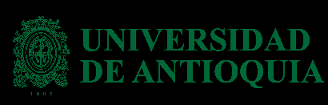
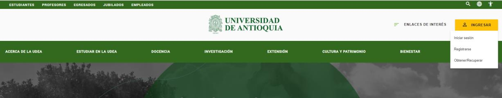
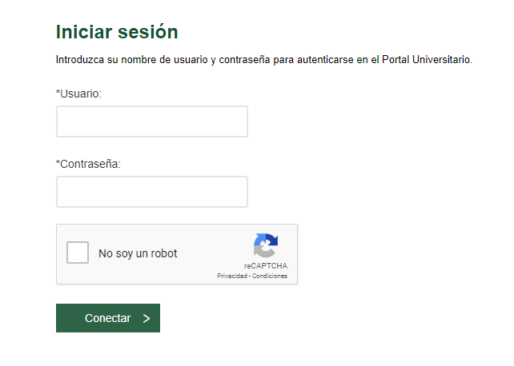
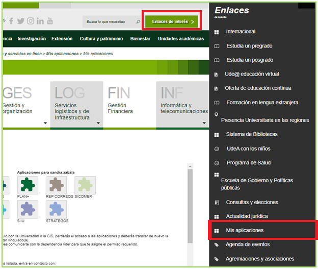
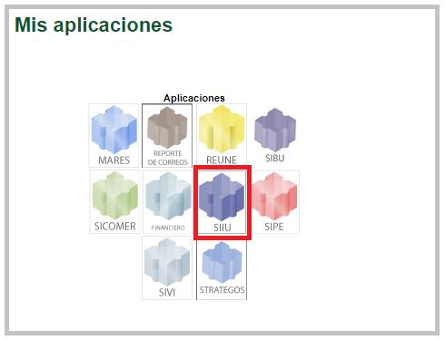
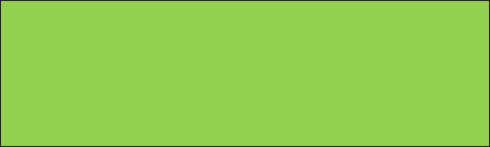
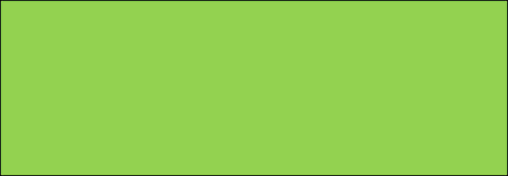
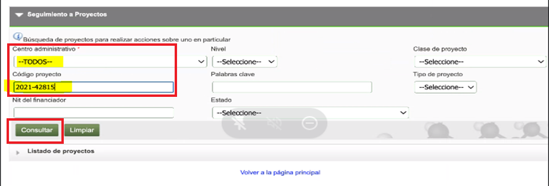
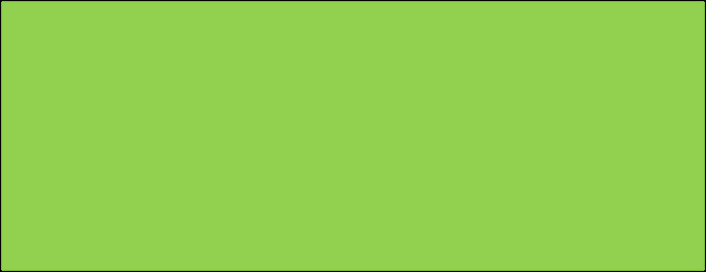
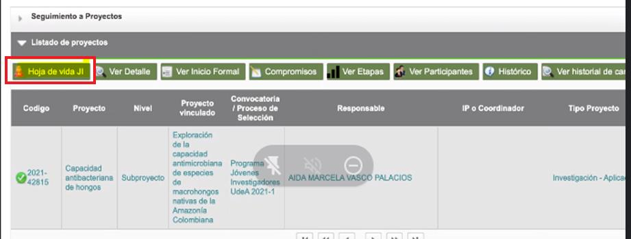

---
codigo: VI-IN-06
titulo: Instructivo para el registro de estudiante como joven investigador
version: 01
fecha_aprobacion: 12-ABR-2024
elaboro: Sandra Patricia Zabala Orrego (Contratista, Vicerrectoría de Investigación)
reviso: Kerlin Yohana Bedoya Agudelo (Analista de Procesos, División de Arquitectura de Procesos)
aprobo: Gloria Valencia Bustamante (Asistente, Vicerrectoría de Investigación)
estado: Vigente
tipo_documento: Instructivo
sistema: SIIU
entidad: Universidad de Antioquia - Vicerrectoría de Investigación
---

# INSTRUCTIVO PARA EL REGISTRO DE ESTUDIANTE COMO JOVEN INVESTIGADOR

**Vicerrectoría de Investigación**  
**Código:** VI-IN-06  
**Versión:** 01  

> *La impresión o copia magnética de este documento se considera "COPIA NO CONTROLADA". Solo se garantiza la actualización de la documentación en el sitio http://www.udea.edu.co*

---

## 1. Definición

Este documento se ha elaborado con el fin de ayudar y capacitar a los tutores que requieren matricular Joven Investigador para el cupo, en el Sistema de Información para la Investigación Universitaria: Investigación y Extensión – SIIU. Dado lo anterior se aclara que este instructivo no hace parte de la normativa universitaria y solamente se utiliza como un paso a paso para utilizar el aplicativo.

---

## 2. Contenido

### 2.1 Requisitos

- Tener a mano el código del SIIU del cupo que obtuvo el tutor al momento de la matrícula y que se encuentra publicado en los resultados de la convocatoria.
- Registrar la información de la hoja de vida del Joven Investigador preferiblemente con el estudiante, ya que se requieren datos personales y de número de cuenta bancaria.
- **Recuerde:** No se permiten cuentas de Bancolombia Nequi, Ahorro a la mano, Daviplata, Agroseguro, solo cuenta de ahorros normal. Tenga en cuenta que la Universidad no le dará carta para apertura de cuenta ya que no es un contrato laboral, es un estímulo económico.
- Utilizar preferiblemente un navegador diferente a Chrome y por incógnito o ventana privada.

### 2.2 Usuarios Que Intervienen

- **Usuario Tutor:** Se encarga de la matrícula del cupo y del registro de la hoja de vida del Joven Investigador en el Sistema de Información para la Investigación Universitaria: Investigación y Extensión – SIIU, el tutor es quien administra el cupo y por medio de la plataforma lo envía a la Vicerrectoría de Investigación, quien se encargará de realizar la aprobación correspondiente.

---

### 2.3 Ingrese a la aplicación SIIU por el portal

El tutor debe ingresar al portal de la Universidad de Antioquia, [http://www.udea.edu.co](http://www.udea.edu.co) donde se autenticará, buscará la opción aplicaciones y entre las disponibles deberá elegir SIIU, así:

Ingrese al portal de la Universidad: [http://www.udea.edu.co](http://www.udea.edu.co), en el encabezado seleccione **Ingresar >> Iniciar sesión** (Ver figura 1).

*Figura 1 - Ingreso al portal de la Universidad de Antioquia*

Aparece la pantalla para iniciar sesión como usuario del portal (Ver figura 2), ingrese su usuario y contraseña y presione clic en el botón **CONECTAR**.

*Figura 2 - Iniciar sesión en el portal de la Universidad de Antioquia*

Se abrirá una ventana con su nombre en la parte izquierda de la página, seleccione **Enlaces de interés >> Mis aplicaciones** (Ver figura 3).

*Figura 3 - Información de usuario registrado en el portal*

Se abrirá una ventana con las aplicaciones de la Universidad permitidas para su ingreso, seleccione la aplicación **SIIU** (Ver figura 4).

*Figura 4 - Pantalla de aplicaciones disponibles para usuario*

Se debe abrir una nueva ventana con la aplicación SIIU en la que podrá iniciar el registro del estudiante. Si la ventana no abre inmediatamente, es necesaria la configuración de ventanas emergentes en el navegador y seleccionar la opción que autorice el SIIU.

---

### 2.4 Registrar estudiante en el cupo obtenido

Una vez se encuentre en el aplicativo SIIU, ingrese por el menú **<<Trámites administrativos opción Seguimiento mis proyectos >>** (Ver figura 5).

*Figura 5 - Trámites administrativos/Seguimiento mis proyectos*

El sistema despliega formulario con filtros de consulta, el cual debe proceder según indicaciones. (Ver figura 6).

En el campo **Centro administrativo** seleccione la opción **“TODOS”** y en el campo **Código proyecto**, ingrese el código del cupo de JI que le fue aprobado en la convocatoria. Presione botón **CONSULTAR**.

*Figura 6 - Filtro de búsqueda*

El sistema le realiza la consulta de acuerdo con los parámetros indicados presione clic sobre la información del cupo. Nótese que en la parte superior aparece un botón con la descripción (Ver figura 7).

Presione el botón **Hoja de vida JI** para ingresar allí de la información del estudiante con rol Joven Investigador.

*Figura 7 - Botón Hoja de vida JI*

Una vez presionado el botón **Hoja de vida JI**, el sistema abre un nuevo formulario para ingresar la información personal del estudiante, cuando se ingresa el tipo y número de documento el sistema realiza una consulta automática de la información del estudiante consultado, con rol de Joven Investigador.

!!! info "Importante"
> Gran parte de la información del Joven Investigador se carga automáticamente, desde el sistema **MARES**, si los datos se encuentran desactualizados debe actualizarlos en el origen para garantizar calidad del dato.

*Figura 8 - Hoja de vida información personal*

Para los campos: **Lugar de expedición (Cédula)**, **Lugar de residencia** y **dirección** el sistema presenta a un lado la opción **Asignar**, esta opción le permite seleccionar la ubicación eligiendo las opciones: continente, país, departamento, municipio.  
Si no permite que se realice dicha selección puede ingresar la información directamente en el campo. (Ver figura 9).

*Figura 9 - Opciones de ubicación*

En el formulario de registro aparecen otras sesiones de la Hoja de vida que se ingresan para el Joven Investigador como son:

- **Información académica:** El sistema carga el programa académico, semestre, fecha de inicio del semestre y fecha de posible terminación del semestre. (Ver figura 10).

*Figura 10 - Información académica*

- **Datos de cuenta Bancaria:** Ingrese la información en los campos: Banco, número de cuenta y tipo de cuenta. (Ver figura 11).

*Figura 11 - Información académica*

!!! warning "Recuerde"
> No se pueden cuentas de Bancolombia Nequi, Ahorro a la mano, Daviplata, Agroseguro.  
> Solo cuenta de ahorros normal.  
> Tenga en cuenta que la Universidad no le dará carta para apertura de cuenta ya que no es un contrato laboral, es un estímulo económico.

- **Información del tutor:** El sistema carga de forma automática la información del tutor con los campos Nombres y apellidos y No. De documento. Los campos correo electrónico y número de contacto principal deben ser ingresados previamente. (Ver figura 12).

*Figura 12 - Información del tutor*

#### Opciones Guardar, confirmar, volver

Presione **Guardar** para almacenar la información.

Presione **Confirmar Actualización**, el sistema presenta un mensaje emergente, que indica una vez se presione Confirmar ya no se podrán realizar actualizaciones en la hoja de vida. (Ver figura 13).

*Figura 13 - Mensaje de confirmación actualización hoja de vida*

El sistema genera un mensaje de confirmación de la hoja de vida. (Ver figura 14).

*Figura 14 - Confirmación de Hoja de vida*

---

## 3. Nota de cambio

- No aplica para la primera versión.

---

## Control del Documento

| Rol | Nombre | Cargo / Dependencia | Fecha |
| :--- | :--- | :--- | :--- |
| **Elaboró** | Sandra Patricia Zabala Orrego | Contratista, Vicerrectoría Investigación | 16-FEB-2024 |
| **Revisó** | Kerlin Yohana Bedoya Agudelo | Analista de Procesos, División de Arquitectura de Procesos | 04-ABR-2024 |
| **Aprobó** | Gloria Valencia Bustamante | Asistente, Vicerrectoría de Investigación | 12-ABR-2024 |
