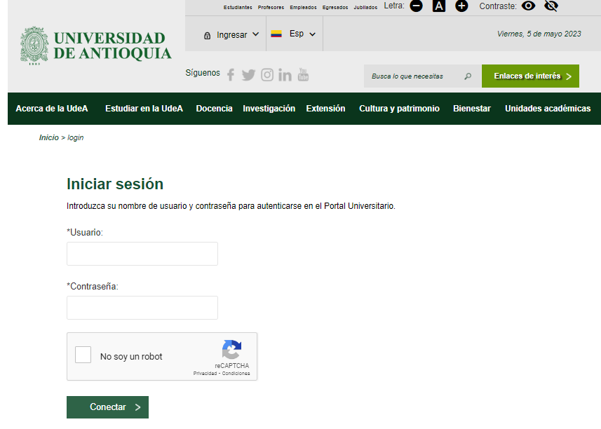
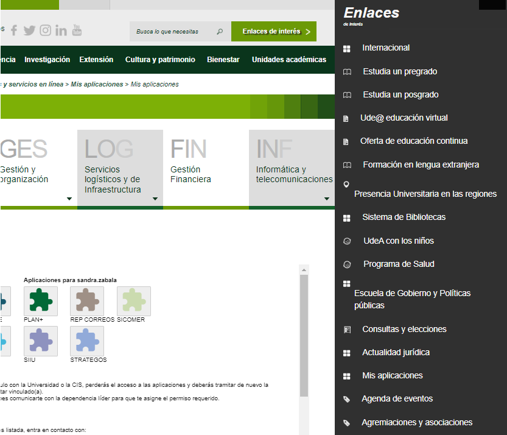
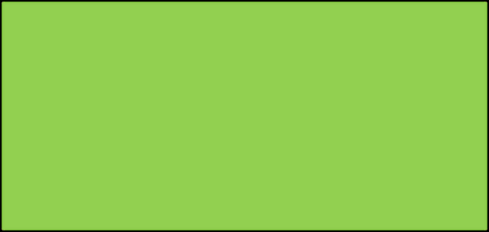
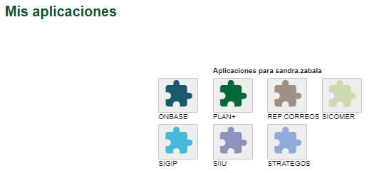
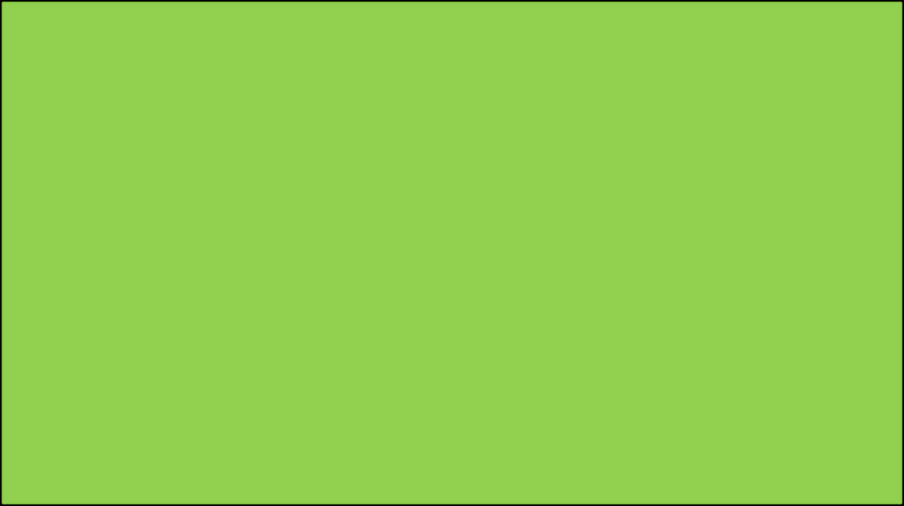
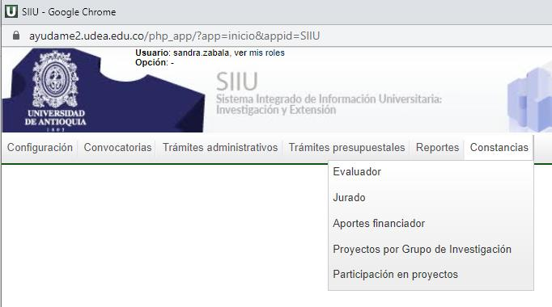

---
codigo: VI-IN-08
titulo: Instructivo para generar constancias evaluador de proyectos
version: 01
fecha_aprobacion: 12-ABR-2024
elaboro: Sandra Patricia Zabala Orrego (Contratista, Vicerrectoría Investigación)
reviso: Kerlin Yohana Bedoya Agudelo (Analista de Procesos, División de Arquitectura de Procesos)
aprobo: Gloria Valencia Bustamante (Asistente, Vicerrectoría de Investigación)
estado: Vigente
tipo_documento: Instructivo
sistema: SIIU
entidad: Universidad de Antioquia - Vicerrectoría de Investigación
---

# INSTRUCTIVO PARA GENERAR CONSTANCIAS EVALUADOR DE PROYECTOS

**Vicerrectoría de Investigación**  
**Código:** VI-IN-08  
**Versión:** 01  

> *La impresión o copia magnética de este documento se considera "COPIA NO CONTROLADA". Solo se garantiza la actualización de la documentación en el sitio http://www.udea.edu.co*

---

## 1. Definición

Este documento se ha elaborado con el fin de ayudar y capacitar los investigadores principales, los cuales generan el reporte de participación en los proyectos desde el Sistema de Información para la Investigación Universitaria – SIIU. Dado lo anterior se aclara que este instructivo no hace parte de la normativa universitaria y solamente se debe utilizar como una herramienta que indica el paso a paso que se debe seguir para generar constancias evaluador de proyectos.

---

## 2. Contenido

### 2.1 Requisitos para la generación de constancia evaluador de proyectos

- El investigador principal o responsable del proyecto, debe estar registrado en el portal institucional.
- El usuario debe tener acceso a SIIU
- Tener a mano el número de documento de los participantes del proyecto.

### 2.2 Usuarios que intervienen en el proceso

Usuario Investigador principal o responsable del proyecto.

### 2.3 Ingreso al SIIU

Investigador principal o responsable del proyecto debe autenticarse en el portal de la Universidad de Antioquia, [http://www.udea.edu.co](http://www.udea.edu.co), buscar la opción aplicaciones y entre ellas elegir el SIIU, así:

Ingresa al portal de la Universidad: [http://www.udea.edu.co](http://www.udea.edu.co), en el encabezado seleccione **Ingresar >> Iniciar sesión** (ver Figura 1).

*Figura 1- Ingreso al portal de la Universidad de Antioquia*

Aparece pantalla para ingresar su usuario y contraseña, seleccione **No soy un Robot** (el sistema le puede pedir realizar validaciones) finalmente presione clic en la opción **CONECTAR** ver figura 2

*Figura 2 - Conectar al portal*

Presione clic en la opción **Enlaces de Interés** seleccione **Mis aplicaciones**. así: **Enlaces de interés → Mis aplicaciones** (ver Figura 3).

*Figura 3 - Enlaces de interés*

Se abrirá una ventana con las aplicaciones de la Universidad seleccione **SIIU** (ver Figura 4).

*Figura 4 Seleccione SIIU*

Se abre una nueva ventana con la aplicación SIIU (ver Figura 5). Si la ventana no abre inmediatamente, es necesaria la configuración de ventanas emergentes en el navegador y seleccionar la opción que autorice el SIIU. (Ver instrucciones)

---

### 2.4 Constancias por participación en proyectos

Una vez se encuentre en el SIIU, ingrese al menú **constancias / participación en proyectos** ver figura 5

*Figura 5 - Menú constancia participación en proyectos*

Ingrese a la opción de menú y observe que el sistema le abre formulario para ingresar los datos requeridos, presione botón **seleccionar** ver figura 6

*Figura 6 - Botón seleccionar*

Una vez se presiona el botón seleccionar, el sistema abre ventana para ingresar el número de documento, presione **Buscar**. Ver figura 7

*Figura 7 - Consultar participante*

El sistema trae la información del participante consultado Seleccione con check el participante y presione la opción **Agregar** ver figura 8.

*Figura 8 - Seleccionar con check participante*

Si desea puede definir un rango de fechas de participación, si no selecciona rango de fechas el sistema le genera un histórico de participación en proyectos, presione botón **Buscar**. Ver figura 9

*Figura 9 - Generación de constancia*

EL sistema trae la información solicitada para ver el reporte presione **Ver constancia**, ver figura 10

*Figura 10 - Ver constancia*

El sistema genera constancia como reporte en formato PDF, el cual puede descargar o imprimir. Ver figura 11

*Figura 11 - Reporte constancia de participación en proyectos*

---

## 3. Nota de cambio.

- No aplica para la primera versión

---

## Control del Documento

| Rol | Nombre | Cargo / Dependencia | Fecha |
| :--- | :--- | :--- | :--- |
| **Elaboró** | Sandra Patricia Zabala Orrego | Contratista, Vicerrectoría Investigación | 16-FEB-2024 |
| **Revisó** | Kerlin Yohana Bedoya Agudelo | Analista de Procesos, División de Arquitectura de Procesos | 04-ABR-2024 |
| **Aprobó** | Gloria Valencia Bustamante | Asistente, Vicerrectoría de Investigación | 12-ABR-2024 |
