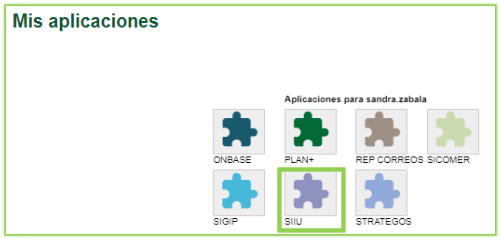
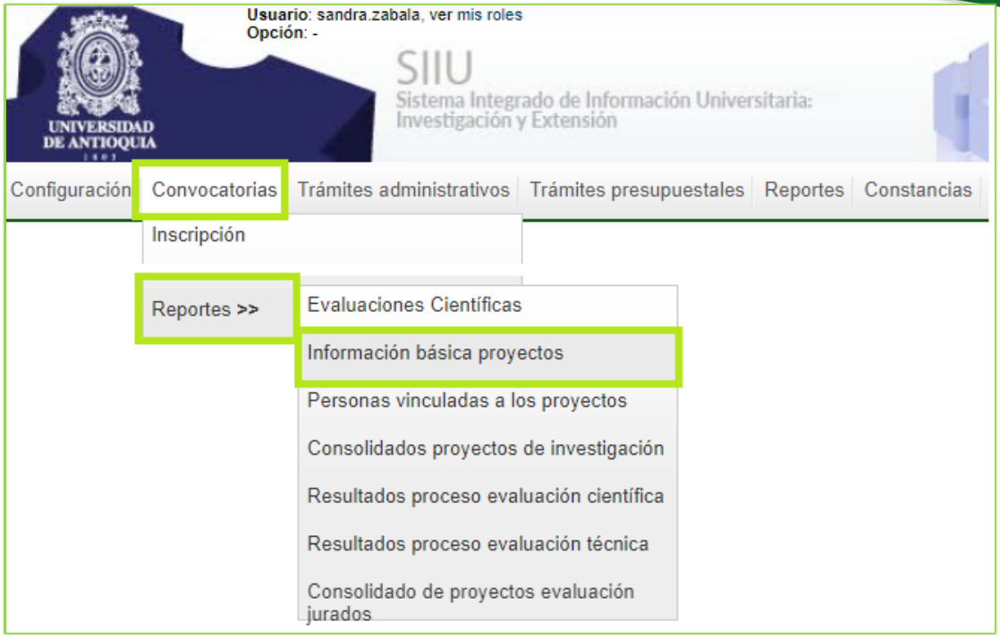
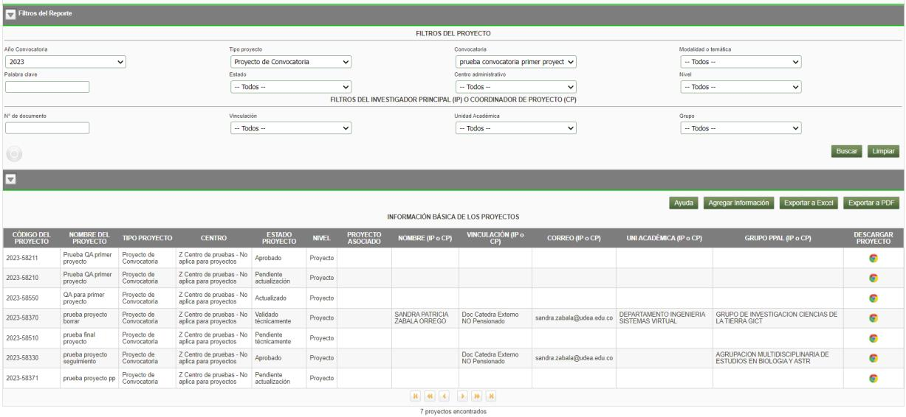
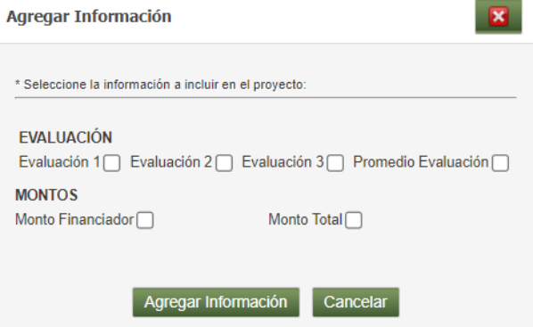

# INSTRUCTIVO PARA GENERAR EL REPORTE DE INFORMACIÓN BÁSICA DE PROYECTOS

**Vicerrectoría de Investigación**  
**Código:** VI-IN-09  
**Versión:** 01  

> *La impresión o copia magnética de este documento se considera "COPIA NO CONTROLADA". Solo se garantiza la actualización de la documentación en el sitio http://www.udea.edu.co*

---

## 1. Definición

Este documento se ha elaborado con el fin de ayudar y capacitar los investigadores principales, usuarios de centro y vicerrectoría, los cuales generan el reporte de información básica de proyectos desde el Sistema de Información para la Investigación Universitaria– SIIU. Dado lo anterior se aclara que este instructivo no hace parte de la normativa universitaria y solamente se debe utilizar como una herramienta que indica el paso a paso que se debe seguir para generar el reporte.

---

## 2. Contenido

### 2.1. Requisitos para la generación de reporte información básica de proyectos

- El investigador principal o responsable del proyecto, usuario de centro de investigación, usuario de vicerrectoría, debe estar registrado en el portal institucional.
- El usuario debe tener acceso a SIIU
- Tener a mano el código del proyecto o los demás datos que pueda solicitar el sistema para el reporte.

### 2.2. Usuarios que intervienen en el proceso

Usuario Investigador principal o responsable del proyecto, usuario de centro de investigación, usuario de vicerrectoría.

---

### 2.3. Ingreso al SIIU

El Usuario Investigador principal o responsable del proyecto, de centro de investigación o de vicerrectoría debe autenticarse en el portal de la Universidad de Antioquia, [http://www.udea.edu.co](http://www.udea.edu.co), buscar la opción aplicaciones y entre ellas elegir el SIIU, así:

Ingresa al portal de la Universidad: [http://www.udea.edu.co](http://www.udea.edu.co), en el encabezado seleccione **Ingresar >> Iniciar sesión** (ver Figura 1).

*Figura 1- Ingreso al portal de la Universidad de Antioquia*

Aparece pantalla para ingresar su usuario y contraseña, seleccione **No soy un Robot** (el sistema le puede pedir realizar validaciones) finalmente presione clic en el botón **CONECTAR** ver figura 2

*Figura 2 - Conectar al portal*

Presione clic en la opción **Enlaces de Interés** seleccione **Mis aplicaciones**. así: **Enlaces de interés → Mis aplicaciones** (ver Figura 3).

*Figura 3 - Enlaces de interés*

Se abrirá una ventana con las aplicaciones de la Universidad seleccione **SIIU** (ver Figura 4).

*Figura 4 Seleccione SIIU*

Se abre una nueva ventana con la aplicación SIIU (ver Figura 5). Si la ventana no abre inmediatamente, es necesaria la configuración de ventanas emergentes en el navegador y seleccionar la opción que autorice el SIIU. (Ver instrucciones)

---

### 2.4. Reporte información básica de proyectos

Una vez se encuentre en el SIIU, ingrese al menú **Convocatorias / Reportes / Información básica de proyectos** ver figura 5

*Figura 5 - Menú de acceso al reporte*

El sistema despliega un nuevo formulario con criterios de búsqueda para el reporte, los campos son:

| Campo | Detalle |
| :--- | :--- |
| **Año convocatoria** | Muestra lista desplegable con el año a seleccionar |
| **Tipo de proyecto** | Muestra lista con los diferentes tipos de proyectos |
| **Convocatoria** | Por defecto aparece la opción Todo este campo está ligado al año |
| **Modalidad o temática** | |
| **Palabra clave** | Se utiliza para traer una consulta específica, en el este campo se puede indicar el código del proyecto |
| **Estado** | Despliega lista con los estados del proyecto |
| **Centro administrativo** | Despliega lista con el nombre corto del centro |
| **Nivel** | Despliega lista para seleccionar macroproyecto, proyecto o subproyecto |
| **No. Documento** | Ingrese No. documento del IP o responsable del proyecto |
| **Vinculación** | Lista desplegable para seleccionar vinculación del IP |
| **Unidad Académica** | Lista desplegable con la unidad a la que pertenece el IP |
| **Grupo** | Lista desplegable con el grupo al que pertenece el IP |

En la figura 6 se muestran los criterios de búsqueda para el reporte

*Figura 6 - Criterios de búsqueda del reporte*

Una vez se ha realizado la consulta el sistema presenta en la figura 7 una muestra del resultado de la consulta, observe que aparece nuevos botones los cuales se detallan a continuación.

*Figura 7 - Resultado de la consulta*

En el resultado de búsqueda se habilitan unas opciones los cuales se explican a continuación:

#### Ayuda
Presenta ventana desplegable con la explicación de los campos

*Figura 8 - Ayuda*

A continuación, encontrará varias definiciones acerca de los datos incluidos en este reporte, que le ayudarán a interpretar de forma apropiada la información visualizada:

| Campo | Definición |
| :--- | :--- |
| **Año de la convocatoria** | Es el año de apertura de la convocatoria |
| **Convocatoria** | Es la convocatoria donde se matricula el proyecto |
| **Modalidad o temática** | **Modalidad:** Es la forma de financiación de los recursos frescos para una convocatoria. **Temática:** Se refiere a las líneas de enfoque de la convocatoria. |
| **Centro administrativo** | Los Centros de Investigación o extensión son las unidades para el fomento de esta actividad, particularmente por medio del apoyo a Grupos de Investigación y estudiantes en general adscritos a las Facultades. |
| **Estado** | Este es el estado de los proyectos en cada uno de los sub-procesos que son parte de los procesos administrativos y se definen de la siguiente manera: - **Atrasados:** Cuando un proyecto excede el tiempo para culminar los compromisos y existen todavía algunos pendientes. - **Aprobado:** Cuando un proyecto se presenta a una convocatoria, pasa todos los procesos y es aprobado por la instancia respectiva. - **Aplazado:** Cuando en un proyecto es aplazado el inicio formal. - **No iniciado:** Cuando se vence el plazo de inicio formal y no inician el proyecto. - **En Ejecución:** Un proyecto está en ejecución cuando se inicia formalmente y aún no se cumple el plazo máximo de finalización, además no están pendientes algún tipo de solicitud. - **Pendiente de Prórroga:** Cuando sobre este se realiza una solicitud de prórroga. - **Cancelado:** Cuando se emite una solicitud de cancelación del proyecto. - **Suspendido:** Cuando se emite una solicitud de suspensión del proyecto. - **Finalizado pendiente de compromisos:** Cuando termina el tiempo de ejecución del proyecto pero quedan faltando compromisos por cumplir. - **Liquidado:** Cuando un proyecto ya tiene acta de finalización y se legalizo la totalidad del presupuesto. - **Evaluado finalización:** Cuando en un proyecto ya se hizo acta de finalización y se elige la opción para evaluar algún ítem general del proyecto. - **Finalizado:** El proyecto ha terminado pero no se ha legalizado todo el presupuesto. |
| **Nombre del Proyecto** | Nombre corto del proyecto |
| **Nombre IP o CP** | Corresponde al nombre completo del investigador principal o coordinador del proyecto que en algunos casos puede ser diferente al responsable del proyecto, pero en otros es el mismo. |
| **Vinculación** | Corresponde a la vinculación que tiene el IP o el CP con la Universidad a la fecha de presentación del proyecto, está puede ser: -Profesor regular: tiempo completo, medio tiempo, tiempo parcial. -Profesor ocasional: tiempo completo, medio tiempo-Cátedra |
| **Unidad Académica** | Unidad Académica |
| **Grupo** | Es el grupo de investigación principal que avala la presentación del proyecto. Aunque el proyecto se puede presentar en conjunto con varios grupos, pero siempre se define uno principal (el del Investigador Principal) Nombre corto |
| **Código del proyecto** | Es el código único que asigna el SIIU a todos los proyectos matriculados |
| **Monto financiador** | Valor solicitado al financiador por el proyecto, este valor incluye recursos frescos y en especie (Acorde a lo definido en los términos de referencia de la convocatoria) |
| **Monto Total** | Valor total del proyecto incluyendo cofinanciación y contrapartidas en especie |
| **Evaluación 1** | Es el puntaje asignado al proyecto por evaluador 1 |
| **Evaluación 2** | Es el puntaje asignado al proyecto por evaluador 2 |
| **Evaluación 3** | Es el puntaje asignado al proyecto por evaluador 3 |
| **Promedio** | Es el promedio de la evaluación del proyecto. |

#### Agregar Información
Permite agregar columnas al resultado de la consulta.

*Figura 9 - Botón agregar información*

#### Botones de Acción

- **Exportar a Excel:** El sistema permite exportar a Excel el resultado de la consulta.
- **Exportar a PDF:** El sistema permite exportar a PDF el resultado de la consulta.
- **DESCARGAR PROYECTO:** El sistema permite visualizar en HTML el proyecto original que fue matriculado.

#### Tips

Si requiere los proyectos de una convocatoria específica y conoce el año de la convocatoria realice la consulta así:
- Seleccione el año de la convocatoria
- Tipo de proyecto: proyecto de convocatoria
- Convocatoria: Seleccione la convocatoria requerida presione buscar

!!! note "RECOMENDACIÓN"
> Evite seleccionar la opción **TODOS** en los campos, ya que el sistema realiza la consulta de forma general y ocasiona demora en el tiempo de respuesta.  
> Te recomendamos que especifiques más tu consulta.

---

## 3. Nota de cambio

- No aplica para la primera versión.

---

## Control del Documento

| Rol | Nombre | Cargo / Dependencia | Fecha |
| :--- | :--- | :--- | :--- |
| **Elaboró** | Sandra Patricia Zabala Orrego | Contratista, Vicerrectoría Investigación | 16-FEB-2024 |
| **Revisó** | Kerlin Yohana Bedoya Agudelo | Analista de Procesos, División de Arquitectura de Procesos | 04-ABR-2024 |
| **Aprobó** | Gloria Valencia Bustamante | Asistente, Vicerrectoría de Investigación | 12-ABR-2024 |
