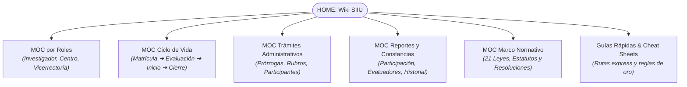

# Base de Conocimiento y Wiki Operativa del SIIU
### Sistema de Información para la Investigación Universitaria — Universidad de Antioquia

Bienvenido al centro de navegación y documentación del **Sistema de Información para la Investigación Universitaria (SIIU)**, administrado por la **Vicerrectoría de Investigación** y la **Vicerrectoría de Extensión** de la Universidad de Antioquia.

Esta Wiki sintetiza de forma didáctica, estructurada y modular los **31 procedimientos oficiales** (21 Guías operativas y 10 Instructivos técnicos) contenidos íntegramente en el [Catálogo Normativo Oficial](04_GLOSARIO_Y_CONCEPTOS/Catalogo_Normativo_31_Docs.md).

!!! tip "¿Primera vez aquí? Empieza en 5 minutos"
    Ve a **[Empieza aquí en 5 minutos](inicio-rapido.md)**: elige tu perfil, sigue la ruta en 6 pasos y resuelve tu duda en 60 segundos. Los diagramas traen botón **⛶ Ampliar** arriba a la derecha.

---

## Mapas de Contenido

---

## Vías de Acceso Rápido

### 1. Navegación por Perfil Operativo
- **[Investigador Principal / Tutor](01_ROLES/Rol_Investigador.md):** Matrícula de propuestas, cupos de Joven Investigador, solicitudes de prórroga, cambios de rubro y reporte de compromisos.
- **[Centro de Investigación / Extensión](01_ROLES/Rol_Centro_Investigacion.md):** Evaluación técnica formal, devolución para ajustes, aval institucional, aprobación de trámites y asignación de evaluadores.
- **[Vicerrectoría de Investigación](01_ROLES/Rol_Vicerrectoria.md):** Configuración de convocatorias, flujos de trámites, aval de instancias superiores (CODI) y aplicación definitiva de novedades.

### 2. Procesos Clave
- **Inscribir un proyecto:** [Matrícula de Proyectos](02_PROCESOS_CLAVE/Matricula_Proyectos.md) *(Convocatoria interna, Inscrito con financiación externa o Primer Proyecto)*.
- **Atender observaciones del Centro:** [Subsanación de proyectos devueltos](02_PROCESOS_CLAVE/Evaluacion_y_Aval.md).
- **Iniciar formalmente un proyecto:** [Inicio Formal](02_PROCESOS_CLAVE/Inicio_Formal.md) *(Pólizas, contratos, compromisos y centro de costos)*.
- **Solicitar más tiempo o recursos:** [Modificaciones y Trámites](02_PROCESOS_CLAVE/Modificaciones_y_Tramites.md) *(Prórroga de inicio, prórroga de ejecución y cambio de rubro)*.
- **Gestionar Jóvenes Investigadores:** [Programa Joven Investigador](02_PROCESOS_CLAVE/Programa_Joven_Investigador.md) *(Matrícula de cupos, vinculación de hoja de vida y prórroga)*.
- **Finalizar y liquidar proyecto:** [Cierre y Liquidación](02_PROCESOS_CLAVE/Cierre_y_Liquidacion.md) *(Compromisos, acta de cierre y paz y salvo presupuestal)*.
- **Obtener certificados o constancias:** [Reportes y Certificaciones](02_PROCESOS_CLAVE/Reportes_y_Certificaciones.md) *(Participación en proyectos, constancia de evaluador, historial)*.

### 3. Herramientas y Apoyo Operativo
- **[Preguntas Frecuentes (FAQ)](faq.md):** Respuestas en 2 minutos por tema: acceso, errores y legal.
- **[Módulo Legal Simple](legal/index.md):** Términos, privacidad, cookies y licencias sin jerga, con enlace al texto fiel.
- **[Ficha Rápida del Investigador](03_GUIAS_RAPIDAS_CHEAT_SHEETS/CheatSheet_Investigador.md):** Pasos clave y rutas directas.
- **[Ficha Rápida para Centros](03_GUIAS_RAPIDAS_CHEAT_SHEETS/CheatSheet_Centro.md):** Criterios de validación y control.
- **[Reglas de Oro del SIIU](03_GUIAS_RAPIDAS_CHEAT_SHEETS/Reglas_Oro_SIIU.md):** Requisitos de adjuntos, ventanas emergentes, navegadores y limitaciones de cuentas bancarias.
- **[Glosario de Términos del SIIU](04_GLOSARIO_Y_CONCEPTOS/Glosario_Terminos_SIIU.md):** Conceptos clave (*Solicitud vs Novedad*, estados de proyectos, rubros).
- **[Catálogo Normativo (31 Documentos)](04_GLOSARIO_Y_CONCEPTOS/Catalogo_Normativo_31_Docs.md):** Índice oficial con vínculos a guías e instructivos.
- **[Marco Normativo e Institucional (21 Documentos)](00_INICIO_Y_MOCS/MOC_Marco_Normativo.md):** Matriz integral y fichas operativas de las 21 leyes, acuerdos superiores y resoluciones rectorales que rigen la investigación universitaria.
