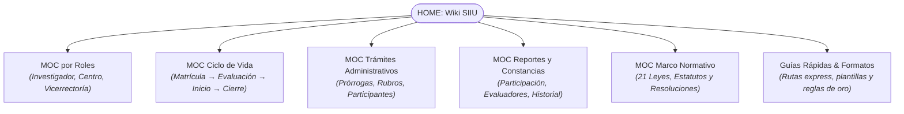

---
search:
  boost: 3.0
---

# Wiki Operativa del SIIU — Universidad de Antioquia

Guía Comunitaria No Oficial · Apoyo SIIU UdeA

## Todo el ciclo de tus proyectos de investigación, en un solo lugar

Consulta paso a paso cómo formular, avalar, ejecutar, modificar y liquidar proyectos en el **Sistema de Información para la Investigación Universitaria (SIIU)**, con acceso directo a **formatos oficiales, cronogramas CODI, comités de ética y normativa vigente**.

  <a class="wiki-btn wiki-btn--primary" href="inicio-rapido/">Empieza aquí en 5 minutos</a>
  <a class="wiki-btn wiki-btn--secondary" href="03_GUIAS_RAPIDAS_CHEAT_SHEETS/Catalogo_Formatos_Oficiales/">Formatos Descargables</a>
  <a class="wiki-btn wiki-btn--secondary" href="legal/politicas-y-aclaraciones/">Políticas y Aclaraciones</a>
  <a class="wiki-btn wiki-btn--secondary" href="faq/">Preguntas Frecuentes</a>

---

## ¿Qué necesitas hacer hoy?

  <a class="wiki-card" href="02_PROCESOS_CLAVE/Matricula_Proyectos/">
    
1. Inscribir un proyecto

    
Cómo formular y radicar propuestas en convocatorias internas, financiación externa o Primer Proyecto.

  </a>
  <a class="wiki-card" href="02_PROCESOS_CLAVE/Evaluacion_y_Aval/">
    
2. Evaluación y subsanación

    
Qué hacer cuando el Centro devuelve tu proyecto ("Pendiente Actualización") y cómo obtener el aval.

  </a>
  <a class="wiki-card" href="02_PROCESOS_CLAVE/Convocatorias_y_Fondos_CODI/">
    
3. Fondos y convocatorias CODI

    
Estrategia de Sostenibilidad 2026, Primer Proyecto, fondos CPC/ASC y circulares vigentes de la VRI.

  </a>
  <a class="wiki-card" href="02_PROCESOS_CLAVE/Inicio_Formal/">
    
4. Iniciar formalmente

    
Pólizas, actas de inicio, centro de costos y requisitos antes de ejecutar el primer peso.

  </a>
  <a class="wiki-card" href="02_PROCESOS_CLAVE/Modificaciones_y_Tramites/">
    
5. Prórrogas y cambios de rubro

    
Cómo solicitar más tiempo, trasladar presupuesto entre rubros o cambiar participantes.

  </a>
  <a class="wiki-card" href="02_PROCESOS_CLAVE/Gestion_Compromisos/">
    
6. Entregar compromisos

    
Cargue de productos académicos, informes y solicitud de plazo adicional para compromisos.

  </a>
  <a class="wiki-card" href="02_PROCESOS_CLAVE/Programa_Joven_Investigador/">
    
7. Jóvenes Investigadores

    
Matrícula de cupos, vinculación de hoja de vida, cuentas bancarias válidas y prórrogas.

  </a>
  <a class="wiki-card" href="02_PROCESOS_CLAVE/Cierre_y_Liquidacion/">
    
8. Cerrar y liquidar

    
Paz y salvo presupuestal, acta de cierre y liquidación financiera definitiva del proyecto.

  </a>
  <a class="wiki-card" href="02_PROCESOS_CLAVE/Reportes_y_Certificaciones/">
    
9. Descargar certificados

    
Constancias de participación, evaluador, grupo e historial (recuerda habilitar pop-ups).

  </a>

---

## Elige tu perfil en el SIIU

  <a class="wiki-card" href="01_ROLES/Rol_Investigador/">
    
Investigador Principal / Tutor

    
Formula propuestas, radica novedades, vincula jóvenes investigadores y reporta compromisos.

  </a>
  <a class="wiki-card" href="01_ROLES/Rol_Centro_Investigacion/">
    
Centro de Investigación / Extensión

    
Revisa requisitos, asigna evaluadores pares, emite aval técnico y aprueba trámites.

  </a>
  <a class="wiki-card" href="01_ROLES/Rol_Vicerrectoria/">
    
Vicerrectoría de Investigación

    
Configura convocatorias, avala instancias CODI y aplica novedades mayores o liquidaciones.

  </a>
  <a class="wiki-card" href="01_ROLES/Ecosistema_Comites_Gobernanza/">
    
Comités, Ética y Permisos

    
CODI, Consejos de Facultad, Comité Central de Ética, CICUA, colecta biológica y FCOI.

  </a>

---

## Herramientas y Atajos de Consulta

  <a class="wiki-card" href="faq/">
    
Preguntas Frecuentes (FAQ)

    
Respuestas directas en 2 minutos para los errores y dudas más comunes del sistema.

  </a>
  <a class="wiki-card" href="03_GUIAS_RAPIDAS_CHEAT_SHEETS/Catalogo_Formatos_Oficiales/">
    
Formatos Descargables

    
Enlaces directos a minutas, actas, listas de chequeo y plantillas oficiales de la UdeA.

  </a>
  <a class="wiki-card" href="03_GUIAS_RAPIDAS_CHEAT_SHEETS/Reglas_Oro_SIIU/">
    
Reglas de Oro del SIIU

    
PDFs válidos, uso de CKEditor (Ctrl+Shift+V), pop-ups y cuentas bancarias aceptadas.

  </a>
  <a class="wiki-card" href="04_GLOSARIO_Y_CONCEPTOS/Glosario_Terminos_SIIU/">
    
Glosario y Estados

    
Qué significa cada estado del proyecto y la diferencia entre Solicitud y Novedad.

  </a>
  <a class="wiki-card" href="00_INICIO_Y_MOCS/MOC_Marco_Normativo/">
    
Marco Normativo (21 Normas)

    
Síntesis didáctica de estatutos financieros, contratación, propiedad intelectual y ética.

  </a>
  <a class="wiki-card" href="legal/">
    
Módulo Legal Simple

    
Términos de uso, privacidad, cookies y licencias explicados sin jerga jurídica.

  </a>

---

## Mapa General de Navegación

