# Empieza aquí en 5 minutos

> Esta página es el atajo. Léela una vez y sabrás por dónde seguir según tu caso.
> Tiempo estimado: 5 minutos.

---

## 1. ¿Quién eres? Elige tu puerta

| Si tú eres... | Tu manual es... | Tu primer trámite suele ser... |
|---|---|---|
| Investigador o tutor | [Rol Investigador](01_ROLES/Rol_Investigador.md) | Inscribir proyecto: [Matrícula](02_PROCESOS_CLAVE/Matricula_Proyectos.md) |
| Centro de investigación / extensión | [Rol Centro](01_ROLES/Rol_Centro_Investigacion.md) | Evaluar y avalar: [Evaluación y Aval](02_PROCESOS_CLAVE/Evaluacion_y_Aval.md) |
| Vicerrectoría o gestión | [Rol Vicerrectoría](01_ROLES/Rol_Vicerrectoria.md) | Configurar y liquidar: [Cierre y Liquidación](02_PROCESOS_CLAVE/Cierre_y_Liquidacion.md) |

!!! tip "¿Tienes 60 segundos? Respuestas directas"
    | Tu duda | Haz esto |
    |---|---|
    | No guarda el presupuesto | Verifica estado **En ejecución** y saldo > $0 ([detalle](faq.md)) |
    | No abre la constancia | Permite **pop-ups** en el navegador ([cómo](legal/cookies.md)) |
    | El Centro me devolvió el proyecto | Corrige solo lo indicado y reenvía ([pasos](02_PROCESOS_CLAVE/Evaluacion_y_Aval.md)) |
    | Necesito más tiempo | Pide **prórroga** antes del vencimiento ([trámites](02_PROCESOS_CLAVE/Modificaciones_y_Tramites.md)) |
    | Cuenta de Joven Investigador | Solo **ahorros tradicional**, nada de Nequi/Daviplata ([checklist](03_GUIAS_RAPIDAS_CHEAT_SHEETS/CheatSheet_Investigador.md)) |
    | ¿Qué norma me aplica? | Finanzas: **AS 466/2020** ([resumen simple](05_MARCO_NORMATIVO/AS_466_2020_Estatuto_Financiero_Vigente.md)) |

---

## 2. Tu ruta en 6 pasos (el mapa completo)

```mermaid
flowchart LR
    classDef paso fill:#0D2115,stroke:#35944B,stroke-width:1.5px,color:#FFFFFF,rx:6px,ry:6px;
    classDef fin fill:#026937,stroke:#8DC63F,stroke-width:2px,color:#FFFFFF,rx:8px,ry:8px;

    P1["1. Formula y radica<br><small>8 pestañas + Enviar a Centro</small>"]:::paso --> P2["2. Subsanación<br><small>Corrige si te devuelven</small>"]:::paso
    P2 --> P3["3. Inicio formal<br><small>Contratos, pólizas, centro de costos</small>"]:::paso
    P3 --> P4["4. Ejecución<br><small>Prórrogas y cambios de rubro</small>"]:::paso
    P4 --> P5["5. Compromisos<br><small>Informes y productos en PDF</small>"]:::paso
    P5 --> P6["6. Cierre y liquidación<br><small>Paz y salvo + acta</small>"]:::fin
```

!!! note "Amplía cualquier diagrama"
    Cada diagrama trae un botón **⛶ Ampliar** arriba a la derecha para verlo en grande (con botones A+ / A−).

---

## 3. Tus primeros 5 clics (checklist)

1. [ ] Abre tu [manual por rol](#1-quien-eres-elige-tu-puerta) y ubica tu ruta en el menú SIIU.
2. [ ] Guarda la [Ficha Rápida](03_GUIAS_RAPIDAS_CHEAT_SHEETS/CheatSheet_Investigador.md) que corresponda a tu perfil.
3. [ ] Aprende las [Reglas de Oro](03_GUIAS_RAPIDAS_CHEAT_SHEETS/Reglas_Oro_SIIU.md): PDF, nombres cortos, pop-ups, CKEditor.
4. [ ] Marca esta [FAQ](faq.md) en favoritos: es el buscador de dudas frecuentes.
5. [ ] Lee el [resumen legal](legal/index.md) (5 bullets) antes de firmar o radicar.

---

## 4. Si algo falla (3 culpables habituales)

1. **Pop-ups bloqueados** → las constancias no abren. [Cómo permitirlos](legal/cookies.md).
2. **Texto pegado de Word** → el formulario no guarda. Pega con **Ctrl+Shift+V**. [Detalle](02_PROCESOS_CLAVE/Matricula_Proyectos.md#3-editor-de-texto-ckeditor-en-siiu).
3. **Sesión vencida** → guarda a menudo y vuelve a ingresar por el portal UdeA.

## 5. Lo legal en 3 líneas

- Tus finanzas se rigen por el **AS 466/2020**: nada de gastar sin CDP/CRP previo.
- Tus creaciones, por el estatuto de PI (**RR 49544/2022**) y la **Ley 1838/2017** si hay spin-off.
- El texto fiel manda sobre los resúmenes: [Módulo Legal](legal/index.md).

---

!!! tip "¿Siguiente paso?"
    Ya sabes el mapa. Profundiza en tu [proceso clave](02_PROCESOS_CLAVE/Matricula_Proyectos.md) o pregunta en la [FAQ](faq.md).
